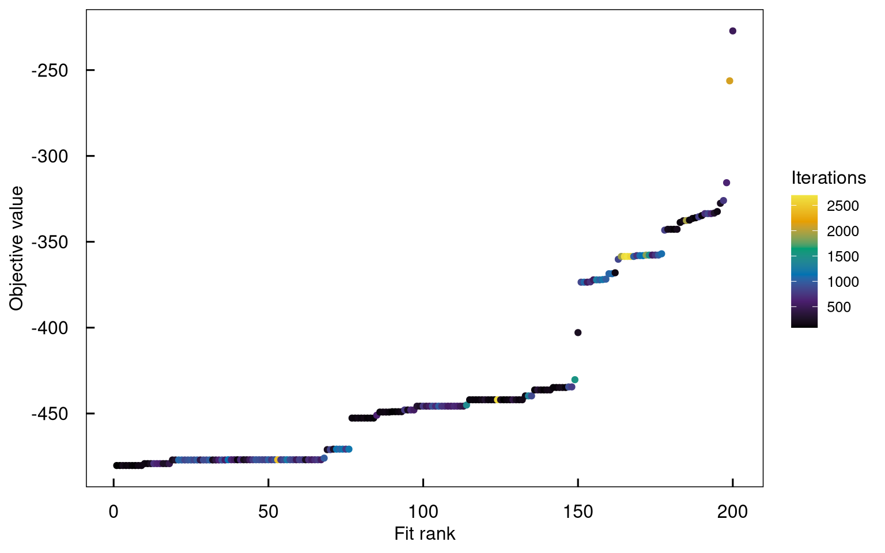
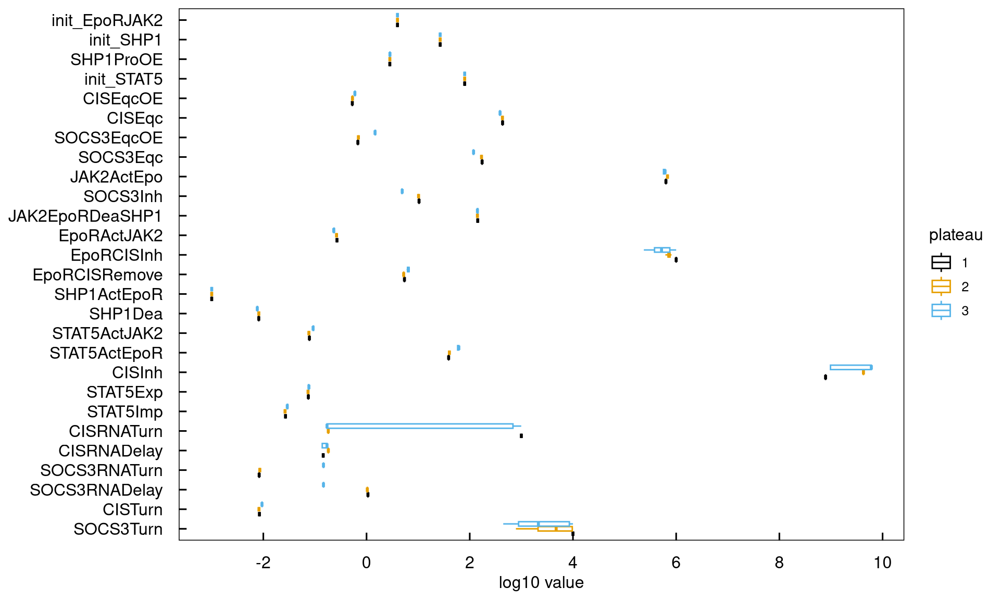
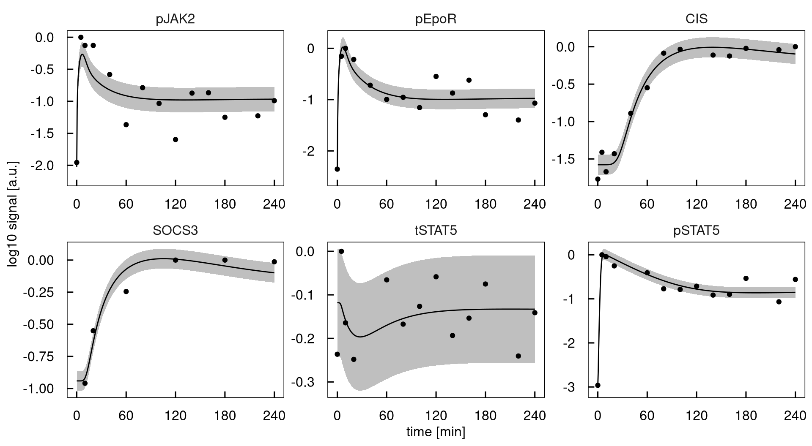
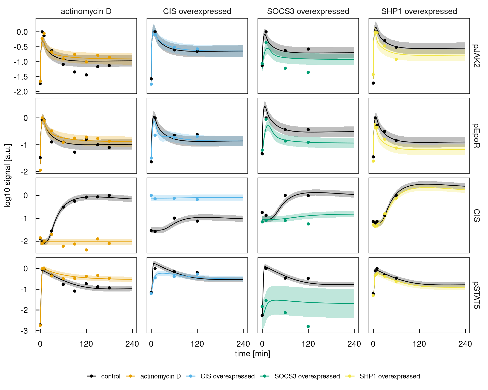
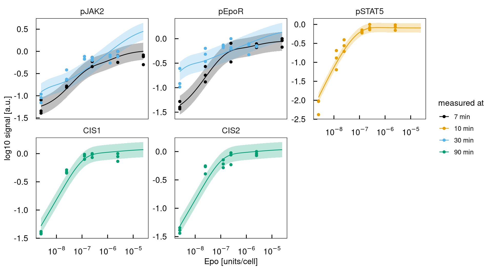

# JAK2-STAT5 signaling (Bachmann 2011)

\[1\] TRUE TRUE TRUE TRUE TRUE

Shows:
[`eqnlist()`](https://dmodverse.github.io/dMod2/reference/eqnlist.md),
[`odemodel()`](https://dmodverse.github.io/dMod2/reference/odemodel.md),
[`Y()`](https://dmodverse.github.io/dMod2/reference/Y.md),
[`normL2()`](https://dmodverse.github.io/dMod2/reference/normL2.md),
[`constraintL2()`](https://dmodverse.github.io/dMod2/reference/constraintL2.md),
[`mstrust()`](https://dmodverse.github.io/dMod2/reference/mstrust.md),
[`plotCombined()`](https://dmodverse.github.io/dMod2/reference/plotCombined.md),
[`importPEtab()`](https://dmodverse.github.io/dMod2/reference/importPEtab.md),
[`exportPEtab()`](https://dmodverse.github.io/dMod2/reference/exportPEtab.md).

JAK2-STAT5 signaling in CFU-E cells with the feedbacks of CIS, SOCS3 and
SHP1, after Bachmann et al. (2011), Mol Syst Biol 7:516. 541
measurements from 13 experiments in 36 conditions, 20 observables, 113
parameters, fitted within the bounds of the publication. The guide
chapter
[PEtab](https://dmodverse.github.io/dMod2/articles/guide-petab.html)
imports the problem from the PEtab benchmark collection.

## Files

| file | content |
|----|----|
| `model.R` | data, reactions, observables, error model, conditions, compiling, objective |
| `fit.R` | multistart of 200 fits, saves `results/fits.rds` |
| `plots.R` | figures from the saved results |
| `petab.R` | the problem from the PEtab files, compared with `model.R`, and `model.R` written as PEtab |
| `results/` | saved fits |

## Run

With this folder as working directory:

``` r

source("model.R")     # compiles into build/
source("fit.R")
source("plots.R")
```

`model.R` uses the free cores of the machine. The guide chapter [Remote
computing](https://dmodverse.github.io/dMod2/articles/guide-remote-computing.html)
shows how to run a multistart on other machines. `plots.R` only reads
`results/`.

## Fit

200 of 200 fits returned, 200 converged. The best value of -2 log L is
-480.298, reached by 9 fits within 1. The published optimum has
-480.298.





## Prediction

Reference time course, 5 units/ml Epo:



Perturbations, control against perturbed:



Dose responses:


