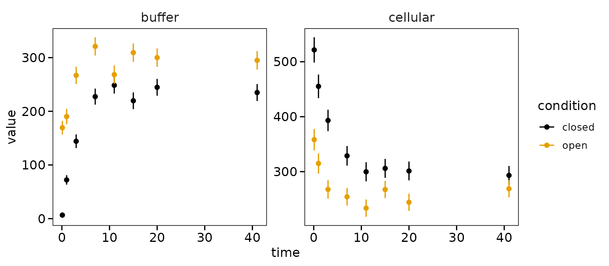
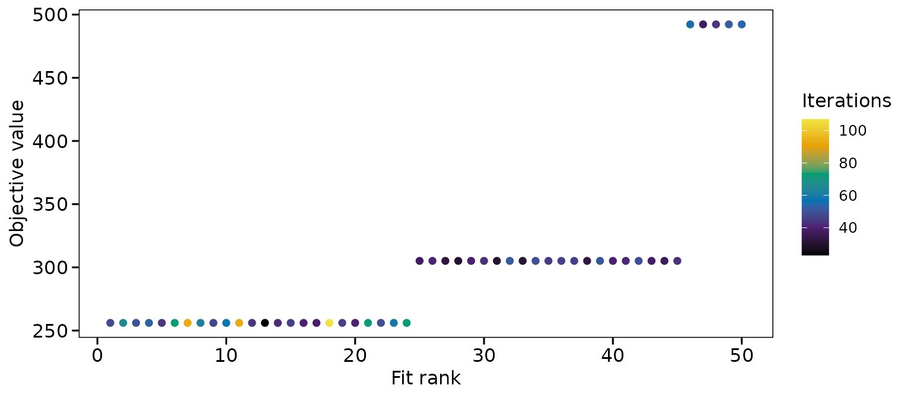
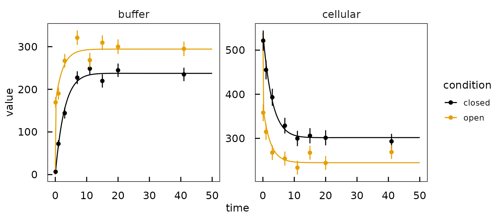
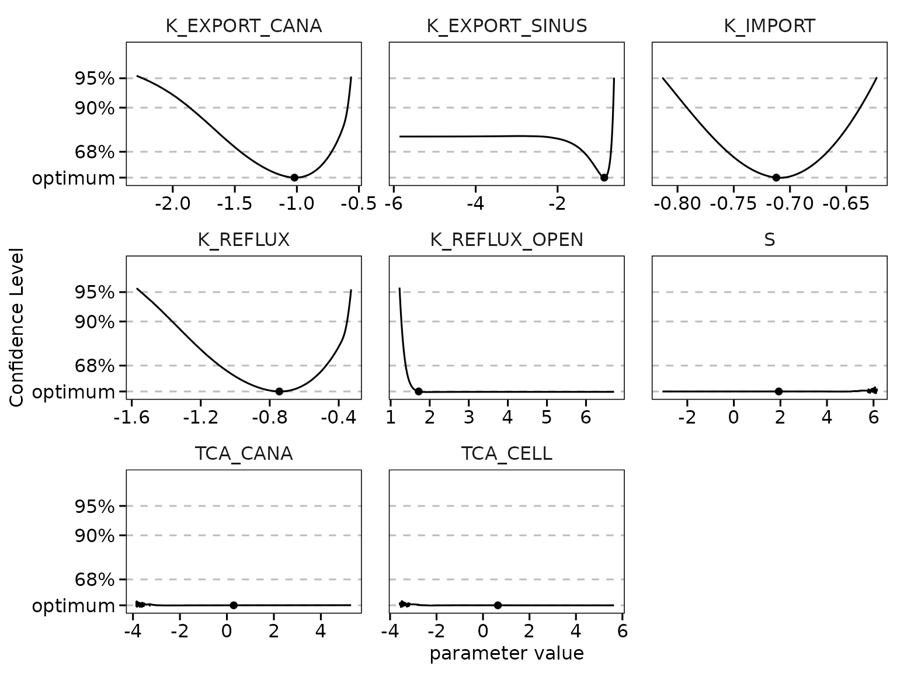

# Get started

A model of bile acid transport in hepatocytes, fitted to two
experimental conditions from many starts and profiled. The
[guide](https://dmodverse.github.io/dMod2/articles/guide-model.md)
covers each step on a larger model.

``` r

library(dMod2)
options(dMod2.outdir = tempdir())
```

## Data and conditions

Bile acid in buffer and cells, measured with closed and opened tight
junctions, one data set per condition. A condition, here `closed` or
`open`, is one experimental setting with own data and own model
parameters.

``` r

data(badata)
data <- as.datalist(badata)
```

``` r

plot(data)
```



## Model definition

Bile acid moves from the buffer into the cells, from the cells into
buffer or canaliculi, and from the canaliculi back into the buffer.

``` r

reactions <- eqnlist() |>
  addReaction("TCA_buffer", "TCA_cell", "k_import*TCA_buffer", "uptake") |>
  addReaction("TCA_cell", "TCA_buffer", "k_export_sinus*TCA_cell", "sinusoidal export") |>
  addReaction("TCA_cell", "TCA_cana", "k_export_cana*TCA_cell", "canalicular export") |>
  addReaction("TCA_cana", "TCA_buffer", "k_reflux*TCA_cana", "reflux into the buffer")
reactions
#> Conserved quantities:
#>   totalTCA = 1*TCA_buffer+1*TCA_cell+1*TCA_cana
#> 
#>   Check      Educt ->    Product                    Rate            Description
#> 1       TCA_buffer ->   TCA_cell     k_import*TCA_buffer                 uptake
#> 2         TCA_cell -> TCA_buffer k_export_sinus*TCA_cell      sinusoidal export
#> 3         TCA_cell ->   TCA_cana  k_export_cana*TCA_cell     canalicular export
#> 4         TCA_cana -> TCA_buffer       k_reflux*TCA_cana reflux into the buffer
```

[`odemodel()`](https://dmodverse.github.io/dMod2/reference/odemodel.md)
generates C++ code for ODE and sensitivities,
[`Xs()`](https://dmodverse.github.io/dMod2/reference/Xs.md) makes the
prediction function (`prdfn`) from parameters to trajectories,
[`Y()`](https://dmodverse.github.io/dMod2/reference/Y.md) the
observation function (`obsfn`) from trajectories to observables: cells
and canaliculi are measured together, both observables with scale `s`.
Expressions follow the [expression language of
cppDE](https://dmodverse.github.io/cppDE/reference/expressions.html),
including switches such as `piecewise()`.

``` r

x <- Xs(odemodel(reactions, modelname = "start_x", compile = FALSE))
observables <- eqnvec(buffer = "s*TCA_buffer", cellular = "s*(TCA_cana + TCA_cell)")
g <- Y(observables, x, modelname = "start_g", compile = FALSE)
```

[`P()`](https://dmodverse.github.io/dMod2/reference/P.md) is a parameter
transformation (`parfn`). It maps the outer parameters, which the
optimizer sees (`K_IMPORT`, `S`, … on log10 scale), to the inner
parameters of ODE and observables in one condition (`k_import`, `s`, …),
with an empty buffer at the start.
[`branch()`](https://dmodverse.github.io/dMod2/reference/define.md)
makes one transformation per condition, open junctions with a separate
reflux rate `K_REFLUX_OPEN`. All three function objects compile into one
shared object.

``` r

trafo <- eqnvec() |>
  define("x <- x", x = getParameters(x, g)) |>
  define("TCA_buffer <- 0") |>
  insert("x <- 10^y", x = .currentSymbols, y = toupper(.currentSymbols)) |>
  branch(conditions = c("closed", "open")) |>
  insert("K_REFLUX <- K_REFLUX_OPEN", conditionMatch = "open")
trafo
#> $closed
#> Idx          Inner <- Outer
#>   1  k_export_cana <- 10^K_EXPORT_CANA
#>   2 k_export_sinus <- 10^K_EXPORT_SINUS
#>   3       k_import <- 10^K_IMPORT
#>   4       k_reflux <- 10^K_REFLUX
#>   5              s <- 10^S
#>   6     TCA_buffer <- 0
#>   7       TCA_cana <- 10^TCA_CANA
#>   8       TCA_cell <- 10^TCA_CELL
#> 
#> $open
#> Idx          Inner <- Outer
#>   1  k_export_cana <- 10^K_EXPORT_CANA
#>   2 k_export_sinus <- 10^K_EXPORT_SINUS
#>   3       k_import <- 10^K_IMPORT
#>   4       k_reflux <- 10^K_REFLUX_OPEN
#>   5              s <- 10^S
#>   6     TCA_buffer <- 0
#>   7       TCA_cana <- 10^TCA_CANA
#>   8       TCA_cell <- 10^TCA_CELL
#> 
#> attr(,"tree")
#>        condition
#> closed    closed
#> open        open
p <- P(trafo, modelname = "start_p", compile = FALSE)
compile(x, g, p, output = "start", cores = 6)
```

`+` and
[`branch()`](https://dmodverse.github.io/dMod2/reference/define.md) join
conditions; `*` composes function objects by the chain rule, so every
call returns values with their derivatives in the outer parameters, the
objective value, gradient and Hessian.

## Likelihood, prior and fit

[`normL2()`](https://dmodverse.github.io/dMod2/reference/normL2.md)
returns an objective function (`objfn`), here \\-2 \log L\\ of the data;
a weak prior from
[`constraintL2()`](https://dmodverse.github.io/dMod2/reference/constraintL2.md)
keeps parameters the data do not determine finite, and the sum is \\-2
\log\\ of the posterior.

``` r

outerpars <- getParameters(p)
pouter <- structure(rep(-1, length(outerpars)), names = outerpars)
obj <- normL2(data, g * x * p, attrName = "data") +
  constraintL2(pouter, sigma = 4, attrName = "prior")
```

[`trust()`](https://dmodverse.github.io/dMod2/reference/trust.md) is a
trust-region fit from one start;
[`mstrust()`](https://dmodverse.github.io/dMod2/reference/mstrust.md)
runs it from 50 random starts around `pouter`, standard deviation 4 on
log10 scale
([options](https://dmodverse.github.io/dMod2/articles/guide-optimization.md)).

``` r

set.seed(5555)
fits <- mstrust(obj, pouter, sd = 4, fits = 50, cores = 6)
fits <- as.parframe(fits)
```

[`plotValues()`](https://dmodverse.github.io/dMod2/reference/plotValues.md)
sorts the fits by value; a plateau at the lowest value indicates the
global optimum.

``` r

plotValues(fits)
```



[`as.parvec()`](https://dmodverse.github.io/dMod2/reference/parvec.md)
takes the best fit.

``` r

best <- as.parvec(fits)
```

``` r

fits[1, c("value", "converged", "iterations")]
#>      value converged iterations
#> 1 256.0645      TRUE         66
best
#> Parameter vector:
#>         TCA_CELL :  0.640397
#>         TCA_CANA :  0.290498
#>         K_IMPORT : -0.712177
#>   K_EXPORT_SINUS : -0.860144
#>         K_REFLUX : -0.744263
#>    K_EXPORT_CANA : -1.01911
#>                S :  1.93089
#>    K_REFLUX_OPEN :  1.71784
#> 
#> Attributes:
#>   deriv  : <none>
#>   deriv2 : <none>
#>   fixed  : <none>
plot((g * x * p)(seq(0, 50, length.out = 200), best, deriv = FALSE), data)
```



## Profile likelihood

[`profile()`](https://dmodverse.github.io/dMod2/reference/profile.md)
moves each parameter away from the optimum, the others following the
path on which they stay optimal. A confidence interval ends where the
profile crosses the threshold.

``` r

profiles <- profile(obj, best, whichPar = names(best), method = "integrate", cores = 6,
                    limits = c(lower = -5, upper = 5), stepControl = list(stop = "data"))
```

``` r

plotProfile(profiles, mode == "data")
```



``` r

confint(profiles, val.column = "data")
#>                          name      value       lower      upper
#> K_EXPORT_CANA   K_EXPORT_CANA -1.0191117  -2.2432552 -0.5640135
#> K_EXPORT_SINUS K_EXPORT_SINUS -0.8601437        -Inf -0.6216848
#> K_IMPORT             K_IMPORT -0.7121767  -0.8129339 -0.6231449
#> K_REFLUX             K_REFLUX -0.7442631  -1.5463901 -0.3295161
#> K_REFLUX_OPEN   K_REFLUX_OPEN  1.7178431   1.2327520        Inf
#> S                           S  1.9308943        -Inf        Inf
#> TCA_CANA             TCA_CANA  0.2904975 -39.4477946        Inf
#> TCA_CELL             TCA_CELL  0.6403968        -Inf        Inf
```

`S`, `TCA_CELL` and `TCA_CANA` are flat, a structural
non-identifiability: smaller initial amounts compensate a larger scale.
[Symmetries](https://dmodverse.github.io/dMod2/articles/guide-symmetries.md)
finds and removes it systematically; the [bile acid
project](https://dmodverse.github.io/dMod2/articles/bileAcidTransport.md)
fixes the scale, starts the canaliculi in steady state and goes on to
prediction bands. `K_EXPORT_SINUS` and `K_REFLUX_OPEN` are bounded on
one side only, a practical non-identifiability.

[1. Setting up models
→](https://dmodverse.github.io/dMod2/articles/guide-model.md)
