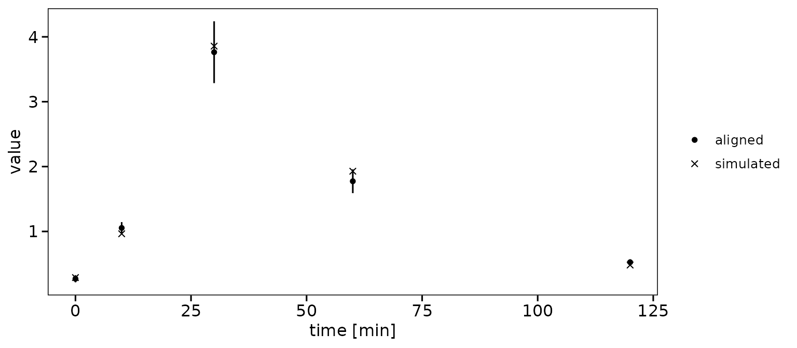
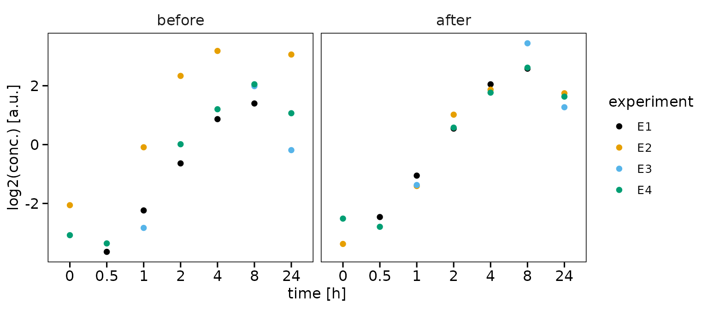
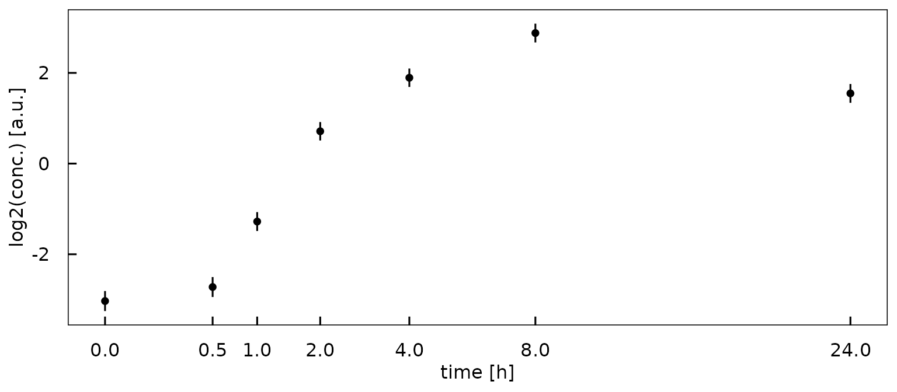
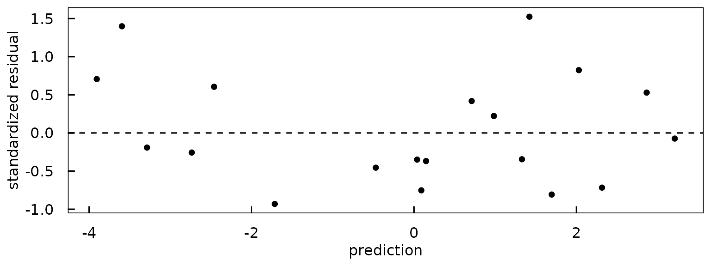
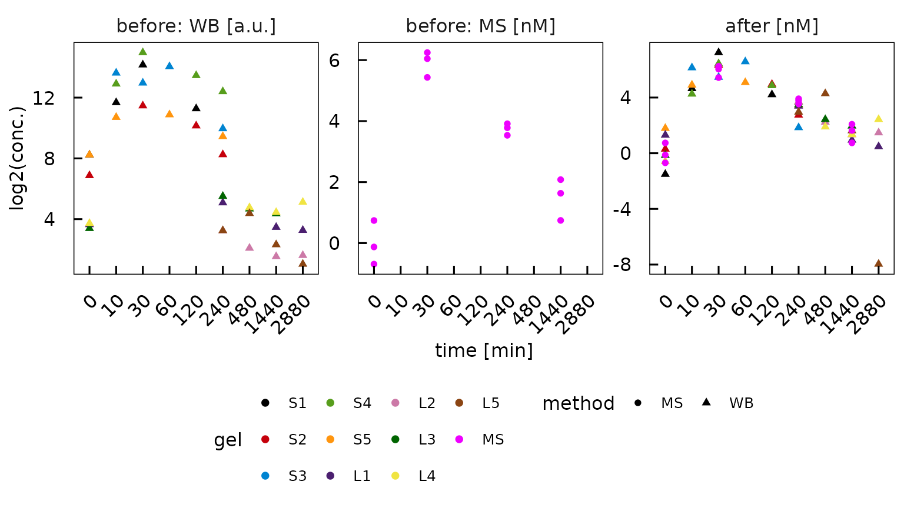
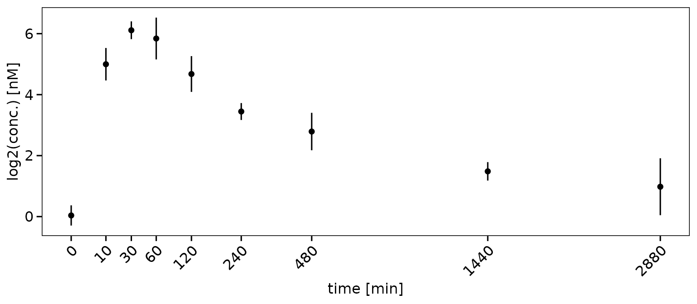
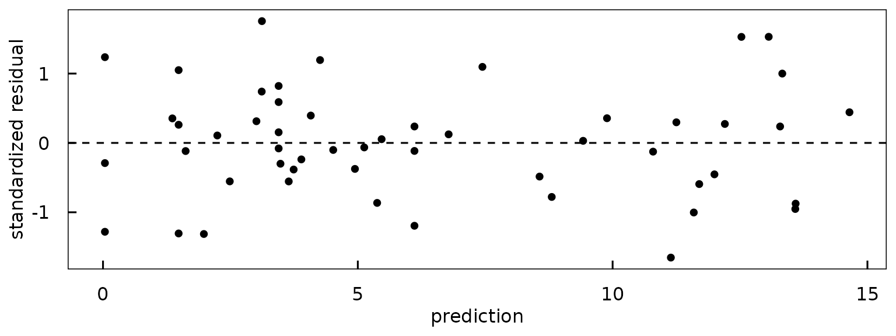
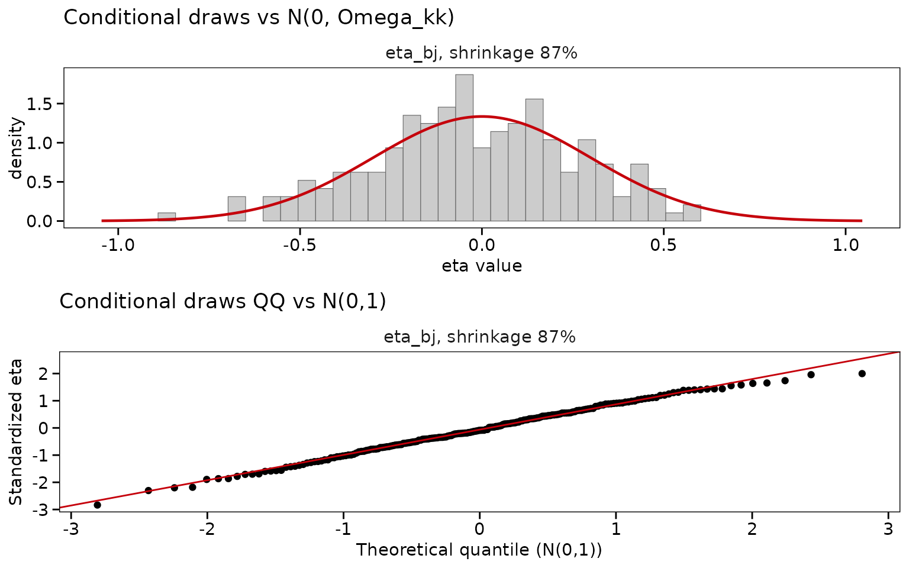
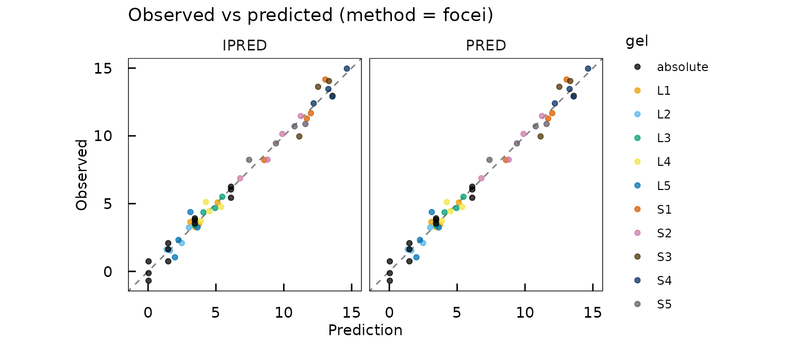

# 9. Alignment of relative data measurements

Western blots, plate readers and similar assays read on
experiment-specific scales.
[`alignmentModel()`](https://dmodverse.github.io/dMod2/reference/alignmentModel.md)
and [`align()`](https://dmodverse.github.io/dMod2/reference/align.md)
bring all experiments onto one common scale by [maximum
likelihood](https://dmodverse.github.io/dMod2/articles/methods-objective.html#def-maximum-likelihood),
with the reading model written as an expression, as in the R package
[blotIt](https://github.com/JetiLab/blotIt).

``` r

library(dMod2)
library(ggplot2)
options(dMod2.outdir = file.path(tempdir(), "guide-alignment"))
dir.create(getOption("dMod2.outdir"), showWarnings = FALSE)
```

## Simulated blot data

A phosphorylation at five time points, six biological replicates on six
gels, every sample in three lanes. Simulated: 20 % biological
variability per sample, exposure and background per gel, 15 % technical
noise per lane.

``` r

set.seed(1)
times <- c(0, 10, 30, 60, 120)
truth <- c(0.3, 1, 4, 2, 0.5)
gels <- paste0("G", 1:6)
samples <- expand.grid(time = times, gel = gels, stringsAsFactors = FALSE)
samples$level <- truth[match(samples$time, times)] * rlnorm(nrow(samples), 0, 0.2)
scale <- setNames(rlnorm(6, 7, 0.5), gels)
background <- setNames(rlnorm(6, log(100), 0.3), gels)
lane <- rep(seq_len(nrow(samples)), each = 3)
d <- data.frame(samples[lane, c("time", "gel")], lane = 1:3, row.names = NULL)
d$value <- (scale[d$gel] * samples$level[lane] + background[d$gel]) * rlnorm(nrow(d), 0, 0.15)
head(d)
#>   time gel lane     value
#> 1    0  G1    1  734.2677
#> 2    0  G1    2  718.9765
#> 3    0  G1    3  596.4622
#> 4   10  G1    1 2098.0641
#> 5   10  G1    2 2464.1000
#> 6   10  G1    3 2618.0225
```

## Alignment model

A reading is value `yi` times gel scale `sj` plus background `bj`, with
[relative
error](https://dmodverse.github.io/dMod2/articles/methods-objective.html#def-relative-error).
Each symbol is a linear predictor over the data columns, on log scale.
`technical = "lane"` averages the lanes of a sample, see [technical and
biological replicates](#technical-and-biological-replicates).

``` r

logs <- c("yi <- exp(yi)", "sj <- exp(sj)", "bj <- exp(bj)", "sigmaR <- exp(sigmaR)")
m <- alignmentModel(d, model = "yi * sj + bj", errmodel = "sigmaR * prediction",
                    biological = yi ~ time, scaling = sj ~ gel, error = bj + sigmaR ~ 1, trafo = logs,
                    technical = "lane")
m
#> alignmentModel: 30 readings, model yi * sj + bj, error sigmaR * prediction
#>   yi         biological    5 parameters, yi = exp(yi)
#>   sj         scaling       6 parameters, sj = exp(sj)
#>   bj         error         1 parameter, bj = exp(bj)
#>   sigmaR     error         1 parameter, sigmaR = exp(sigmaR)
#>   technical replicates over lane: 90 readings, their geometric means
#>   mean of yi normalized in 1 block of experiments
```

The geometric mean of the values is held at 1 within each block of
experiments sharing values.

## Fit by restricted likelihood

[`align()`](https://dmodverse.github.io/dMod2/reference/align.md) fits
from several perturbed starts and keeps the best; [error
parameters](https://dmodverse.github.io/dMod2/articles/methods-objective.html#def-error-parameters)
by restricted maximum likelihood. The fits of this chapter are loaded
from `results/guide-alignment.rds`, computed by
`results/guide-alignment.R`.

``` r

fit <- align(m, fits = 4)
fit
```

    #> alignment: 30 readings, 5 biological values, 12 parameters
    #>   restricted likelihood (REML, 2 rounds): -2 log L 443.68, AIC 467.68
    #>   maximum likelihood fits, REML from the best: -2 log L 402.98 402.98 402.98 402.98

Aligned values with standard errors:

``` r

fit$aligned
#>   time symbol    estimate         se     value      sigma
#> 1    0     yi -1.30707047 0.20234907 0.2706117 0.05475802
#> 2   10     yi  0.05228793 0.08559828 1.0536791 0.09019312
#> 3   30     yi  1.32520196 0.12659089 3.7629452 0.47635457
#> 4   60     yi  0.57316985 0.10333915 1.7738811 0.18331136
#> 5  120     yi -0.64358926 0.08604543 0.5254032 0.04520855
```

## Comparison with the simulation

Error (log ratio of aligned to simulated course) against the standard
error `se`:

``` r

simulated <- data.frame(time = times, value = truth / exp(mean(log(truth))))
errors <- function(fit) {
  a <- fit$aligned[match(times, fit$aligned$time), ]
  data.frame(time = times, simulated = simulated$value, aligned = a$value,
             error = log(a$value / simulated$value), se = a$se)
}
signif(errors(fit), 2)
#>   time simulated aligned  error    se
#> 1    0      0.29    0.27 -0.067 0.200
#> 2   10      0.96    1.10  0.089 0.086
#> 3   30      3.90    3.80 -0.025 0.130
#> 4   60      1.90    1.80 -0.084 0.100
#> 5  120      0.48    0.53  0.086 0.086
```

``` r

ggplot(fit$aligned, aes(time, value)) +
  geom_errorbar(aes(ymin = value - sigma, ymax = value + sigma), width = 0) +
  geom_point(aes(shape = "aligned")) +
  geom_point(data = simulated, aes(shape = "simulated")) +
  scale_shape_manual(values = c(aligned = 16, simulated = 4), name = NULL) +
  labs(x = "time [min]", y = "value") + theme_dMod2()
```



## Technical and biological replicates

Technical replicates (lanes, wells) measure the same sample and share
the biological deviation of that sample. `technical = "lane"` averages
them before the alignment; readings agreeing in all columns but `value`,
`lloq` and the technical columns form one sample. The mean is geometric
for a relative [error
model](https://dmodverse.github.io/dMod2/articles/methods-objective.html#def-error-model),
arithmetic for an absolute one. The same data with every lane as a
reading:

``` r

mLanes <- alignmentModel(d, model = "yi * sj + bj", errmodel = "sigmaR * prediction",
                         biological = yi ~ time, scaling = sj ~ gel, error = bj + sigmaR ~ 1,
                         trafo = logs)
fitLanes <- align(mLanes, fits = 4)
fitLanes
```

    #> alignment: 90 readings, 5 biological values, 12 parameters
    #>   restricted likelihood (REML, 2 rounds): -2 log L 1293.87, AIC 1317.87
    #>   maximum likelihood fits, REML from the best: -2 log L 1243.44 1243.44 1243.44 1243.44

``` r

signif(errors(fitLanes), 2)
#>   time simulated aligned  error    se
#> 1    0      0.29    0.27 -0.051 0.120
#> 2   10      0.96    1.10  0.086 0.050
#> 3   30      3.90    3.70 -0.040 0.074
#> 4   60      1.90    1.80 -0.084 0.060
#> 5  120      0.48    0.53  0.089 0.050
```

The lane fit reports standard errors smaller by about \\\sqrt{3}\\; the
errors reach 1.8 standard errors, those of the fit of means stay within
two.

## Random background per gel

A [random
effect](https://dmodverse.github.io/dMod2/articles/methods-nlme.html#def-random-effect)
per gel around a common background, integrated by
[FOCEI](https://dmodverse.github.io/dMod2/articles/methods-nlme.html#def-focei)
as in [Nonlinear mixed-effects
models](https://dmodverse.github.io/dMod2/articles/guide-nlme.md). A
[prior](https://dmodverse.github.io/dMod2/articles/methods-objective.html#def-prior)
on `omega_bj_bj`, the log standard deviation, normal around \\\log 0.3\\
with standard deviation 0.3:

``` r

m2 <- alignmentModel(d, model = "yi * sj + bj", errmodel = "sigmaR * prediction",
                     biological = yi ~ time, scaling = list(sj ~ gel, bj ~ 1 + (1 | gel)),
                     error = sigmaR ~ 1, trafo = logs, technical = "lane",
                     prior = constraintL2(mu = c(omega_bj_bj = log(0.3)), sigma = 0.3))
fit2 <- align(m2, fits = 4)
fit2
```

    #> alignment: 30 readings, 5 biological values, 13 parameters
    #>   restricted likelihood (REML, 5 rounds): -2 log L 443.86, AIC 469.86
    #>   maximum likelihood fits, REML from the best: -2 log L 402.18 402.18 402.18 535.83
    #>   standard errors from the Gauss-Newton information, the Hessian of the marginal is not positive definite

``` r

signif(errors(fit2), 2)
#>   time simulated aligned  error    se
#> 1    0      0.29    0.30  0.037 0.180
#> 2   10      0.96    1.00  0.066 0.080
#> 3   30      3.90    3.50 -0.084 0.120
#> 4   60      1.90    1.70 -0.120 0.098
#> 5  120      0.48    0.53  0.100 0.084
```

Background per gel against the simulation:

``` r

bg <- exp(fit2$parameters[["bj"]] + fit2$random$mode[match(gels, fit2$random$group)])
data.frame(gel = gels, simulated = round(background), common = round(exp(fit$parameters[["bj"]])),
           random = round(bg))
#>    gel simulated common random
#> G1  G1        89    113     58
#> G2  G2        98    113     56
#> G3  G3       139    113     66
#> G4  G4       126    113     57
#> G5  G5        95    113     61
#> G6  G6        93    113     62
```

Values change by less than their standard errors. Bands far above the
background leave it unresolved; gels with weak lanes resolve it, see
[Western blots](#western-blot-and-targeted-mass-spectrometry).

## Fit options

| argument | default | controls |
|----|----|----|
| `fits` | `10` | fits from perturbed starts |
| `sd` | `0.5` | standard deviation of the perturbation |
| `reml` | `TRUE` | error parameters and random-effect spreads by restricted likelihood |
| `method` | `"focei"` | with random terms, `"focei"` or `"quadrature"` |
| `cores` | `1` | fits in parallel |

Fits stop at tolerances of about \\10^{-8}\\. Absolute readings, such as
mass spectrometry concentrations, are marked in a column `absolute` and
fix the scale of their block.

## qPCR with censored wells

Target mRNA at seven time points in four experiments, each on a subset
of time points, every sample in two wells. 36 - Ct is the log2
concentration in arbitrary units; a well without Ct after 40 cycles lies
below -4.

### qPCR data

Column `lloq` holds the limit of each reading; an `NA` reading is
censored there, known only to lie below the limit. Standard deviation
0.5 cycles between samples, 0.25 between wells.

``` r

set.seed(5)
times <- c(0, 0.5, 1, 2, 4, 8, 24)
log2fold <- c(0, 0.3, 1.6, 3.6, 5.2, 5.6, 4.4)
runs <- list(E1 = times[1:6], E2 = times[c(1, 3:5, 7)], E3 = times[c(2, 3, 6, 7)], E4 = times[c(1, 2, 4:7)])
samples <- do.call(rbind, lapply(names(runs), function(e) data.frame(experiment = e, time = runs[[e]])))
offset <- setNames(rnorm(length(runs)), names(runs))
samples$ct <- 39.3 - log2fold[match(samples$time, times)] - offset[samples$experiment] +
  rnorm(nrow(samples), 0, 0.5)
well <- rep(seq_len(nrow(samples)), each = 2)
qpcr <- data.frame(samples[well, c("experiment", "time")], well = 1:2, row.names = NULL)
ct <- samples$ct[well] + rnorm(nrow(qpcr), 0, 0.25)
qpcr$value <- ifelse(ct < 40, 36 - ct, NA)
qpcr$lloq <- -4
head(qpcr)
#>   experiment time well     value lloq
#> 1         E1  0.0    1        NA   -4
#> 2         E1  0.0    2        NA   -4
#> 3         E1  0.5    1 -3.914095   -4
#> 4         E1  0.5    2 -3.375131   -4
#> 5         E1  1.0    1 -2.091573   -4
#> 6         E1  1.0    2 -2.383751   -4
sum(is.na(qpcr$value))
#> [1] 4
```

### qPCR model

A reading is `yi + sj`, log2 concentration plus experiment offset, with
absolute error. `technical = "well"` averages the wells; a sample with
one well below the limit is censored at the mean of the other well and
the limit.

``` r

m <- alignmentModel(qpcr, model = "yi + sj", errmodel = "sigma",
                    biological = yi ~ time,
                    scaling    = sj ~ experiment,
                    error      = sigma ~ 1,
                    trafo = "sigma <- exp(sigma)", technical = "well")
m
#> alignmentModel: 21 readings, model yi + sj, error sigma
#>   yi         biological    7 parameters
#>   sj         scaling       4 parameters
#>   sigma      error         1 parameter, sigma = exp(sigma)
#>   technical replicates over well: 42 readings, their arithmetic means
#>   2 readings censored at their lloq
#>   mean of yi normalized in 1 block of experiments
```

### qPCR fit

The mean of the values is held at 0; `log2fc` is relative to the
untreated value.

``` r

fit <- align(m, fits = 1)
fit
```

    #> alignment: 21 readings, 7 biological values, 11 parameters
    #>   restricted likelihood (REML, 3 rounds): -2 log L 31.96, AIC 53.96
    #>   maximum likelihood fit, the start of REML: -2 log L 4.08

``` r

a <- fit$aligned
a$log2fc <- a$estimate - a$estimate[a$time == 0]
cbind(a[c("time", "estimate", "se", "log2fc")], simulated = log2fold[match(a$time, times)])
#>   time   estimate        se    log2fc simulated
#> 1  0.0 -3.0318756 0.2207319 0.0000000       0.0
#> 2  0.5 -2.7228982 0.2198579 0.3089774       0.3
#> 3  1.0 -1.2785138 0.2080716 1.7533617       1.6
#> 4  2.0  0.7126685 0.2030375 3.7445441       3.6
#> 5  4.0  1.8934505 0.2030375 4.9253261       5.2
#> 6  8.0  2.8791506 0.2068818 5.9110262       5.6
#> 7 24.0  1.5480179 0.2072289 4.5798935       4.4
```

Sample means before and after alignment, censored samples not drawn:

``` r

s <- fit$scaled[!fit$scaled$bloq, ]
both <- rbind(data.frame(s[c("experiment", "time")], stage = "before", value = s$value),
              data.frame(s[c("experiment", "time")], stage = "after", value = s$scaled))
both$stage <- factor(both$stage, c("before", "after"))
```

``` r

ggplot(both, aes(factor(time), value, color = experiment)) +
  geom_point() + facet_wrap(~ stage) +
  labs(x = "time [h]", y = "log2(conc.) [a.u.]", color = "experiment") +
  scale_color_dMod2() + theme_dMod2()
```



``` r

plotAligned(fit) + scale_x_sqrt(breaks = times) + labs(x = "time [h]", y = "log2(conc.) [a.u.]")
```



``` r

plotResiduals(fit)
```



### Aligned values as data

``` r

as.datalist(fit)
#> C1:
#>   name time      value     sigma lloq
#> 1   yi  0.0 -3.0318756 0.2207319 -Inf
#> 2   yi  0.5 -2.7228982 0.2198579 -Inf
#> 3   yi  1.0 -1.2785138 0.2080716 -Inf
#> 4   yi  2.0  0.7126685 0.2030375 -Inf
#> 5   yi  4.0  1.8934505 0.2030375 -Inf
#> 6   yi  8.0  2.8791506 0.2068818 -Inf
#> 7   yi 24.0  1.5480179 0.2072289 -Inf
```

## Western blot and targeted mass spectrometry

A phosphoprotein on ten gels, five with a short course up to 4 h and
five with a long one up to 48 h, sharing the untreated lane and 4 h, and
by targeted mass spectrometry in nM at four time points. The background
per gel is a normal random effect. Mass spectrometry readings are marked
in column `absolute`, predicted by the expression `absolute` (by default
the first biological symbol) and have gel `NA`; the block comes out in
nM.

### Blot and mass spectrometry data

Log2 band in arbitrary units or log2 concentration in nM; gels S1 to S5
short, L1 to L5 long.

``` r

set.seed(6)
short <- c(0, 10, 30, 60, 120, 240)
long <- c(0, 240, 480, 1440, 2880)
times <- sort(union(short, long))
conc <- c(1, 40, 85, 60, 25, 10, 6, 3, 2)
gels <- c(sprintf("S%d", 1:5), sprintf("L%d", 1:5))
course <- setNames(rep(c("short", "long"), each = 5), gels)
shift <- setNames(ifelse(course == "short", 6, 1) + rnorm(10, 0, 1.5), gels)
background <- setNames(1.5 + rnorm(10, 0, 0.3), gels)
wb <- do.call(rbind, lapply(gels, function(g)
  data.frame(method = "WB", gel = g, time = sort(sample(if (course[[g]] == "short") short else long, 4)))))
wb$value <- log2(conc[match(wb$time, times)] + 2^background[wb$gel]) + shift[wb$gel] +
  rnorm(nrow(wb), 0, 0.7)
ms <- data.frame(method = "MS", gel = NA, time = rep(c(0, 30, 240, 1440), each = 3))
ms$value <- log2(conc[match(ms$time, times)]) + rnorm(nrow(ms), 0, 0.5)
wbms <- rbind(cbind(wb, absolute = FALSE), cbind(ms, absolute = TRUE))
head(wbms)
#>   method gel time     value absolute
#> 1     WB  S1    0  8.219017    FALSE
#> 2     WB  S1   10 11.673758    FALSE
#> 3     WB  S1   30 14.158178    FALSE
#> 4     WB  S1  120 11.274899    FALSE
#> 5     WB  S2    0  6.870860    FALSE
#> 6     WB  S2   30 11.463610    FALSE
```

### Blot and mass spectrometry model

A band reads `log2(2^yi + 2^(b + bj)) + sj`, a mass spectrometry reading
`yi`, with absolute error per method. Priors: `omega_bj_bj` normal
around \\\log 0.3\\ with standard deviation 0.3, `b` normal around 0
with standard deviation 2.

``` r

m <- alignmentModel(wbms, model = "log2(2^yi + 2^(b + bj)) + sj", errmodel = "sigma",
                    biological = yi ~ time,
                    scaling    = list(sj ~ gel, b ~ 1, bj ~ 0 + (1 | gel)),
                    error      = sigma ~ method,
                    trafo = "sigma <- exp(sigma)",
                    prior = constraintL2(mu = c(omega_bj_bj = log(0.3), b = 0),
                                         sigma = c(omega_bj_bj = 0.3, b = 2)))
m
#> alignmentModel: 52 readings, model log2(2^yi + 2^(b + bj)) + sj, error sigma
#>   yi         biological    9 parameters
#>   sj         scaling      10 parameters
#>   b          scaling       1 parameter
#>   bj         scaling       0 parameters, random over gel
#>   sigma      error         2 parameters, sigma = exp(sigma)
#>   prior on omega_bj_bj, b 
#>   12 absolute readings, model yi: 1 of 1 block on their scale
```

### Blot and mass spectrometry fit

Values in log2 nM, also at time points without mass spectrometry:

``` r

fit <- align(m, fits = 1)
fit
```

    #> alignment: 52 readings, 9 biological values, 23 parameters
    #>   restricted likelihood (REML, 3 rounds): -2 log L 87.55, AIC 133.55
    #>   maximum likelihood fit, the start of REML: -2 log L 83.41

``` r

a <- fit$aligned[order(fit$aligned$time), ]
cbind(a[c("time", "estimate", "se")], nM = round(2^a$estimate, 1), simulated = conc[match(a$time, times)])
#>   time  estimate        se   nM simulated
#> 1    0 0.0376694 0.3314669  1.0         1
#> 2   10 4.9974367 0.5324013 31.9        40
#> 3   30 6.1116212 0.2913086 69.1        85
#> 6   60 5.8406229 0.6858245 57.3        60
#> 4  120 4.6766044 0.5870124 25.6        25
#> 5  240 3.4463781 0.2776347 10.9        10
#> 9  480 2.7898484 0.6140610  6.9         6
#> 7 1440 1.4840426 0.3025079  2.8         3
#> 8 2880 0.9797516 0.9334751  2.0         2
```

Background in nM and standard deviations of both methods on log2 scale:

``` r

p <- fit$parameters
round(2^p[["b"]], 2)
#> [1] 2.2
c(MS = exp(p[["sigma"]]), WB = exp(p[["sigma"]] + p[["sigma_methodWB"]]))
#>        MS        WB 
#> 0.5679049 0.7157826
```

Readings before and after alignment; absolute readings stay unchanged:

``` r

s <- fit$scaled
s$gel <- factor(ifelse(s$absolute, "MS", s$gel), c(gels, "MS"))
panel <- c("before: WB [a.u.]", "before: MS [nM]", "after [nM]")
both <- rbind(data.frame(s[c("gel", "method", "time")], reading = s$value,
                         panel = ifelse(s$absolute, panel[2], panel[1])),
              data.frame(s[c("gel", "method", "time")], reading = s$scaled, panel = panel[3]))
both$panel <- factor(both$panel, panel)
```

``` r

ggplot(both[is.finite(both$reading), ], aes(factor(time), reading, color = gel, shape = method)) +
  geom_point() + facet_wrap(~ panel, scales = "free_y") +
  guides(x = guide_axis(angle = 45)) +
  labs(x = "time [min]", y = "log2(conc.)", color = "gel", shape = "method") +
  scale_color_dMod2(palette = "dMod") + theme_dMod2() + theme(legend.position = "bottom")
```



``` r

plotAligned(fit) + scale_x_sqrt(breaks = times) + guides(x = guide_axis(angle = 45)) +
  labs(x = "time [min]", y = "log2(conc.) [nM]")
```



``` r

plotResiduals(fit)
```



### Random background

Standard deviation of the log2 background between gels, and per gel the
[mode](https://dmodverse.github.io/dMod2/articles/methods-sparsity-priors.html#def-mode)
with [conditional standard
error](https://dmodverse.github.io/dMod2/articles/methods-nlme.html#def-conditional-standard-error):

``` r

fit$omega
#>     type eta1 eta2  estimate         se
#> row   sd   bj   bj 0.2988148 0.08553806
fit$random
#>    group eta parameter         mode        se
#> 1     S1  bj eta_bj_S1 -0.044369073 0.2873683
#> 2     S2  bj eta_bj_S2 -0.001118166 0.2865965
#> 3     S3  bj eta_bj_S3 -0.020851705 0.2979396
#> 4     S4  bj eta_bj_S4  0.002113228 0.2977890
#> 5     S5  bj eta_bj_S5  0.089740487 0.2861226
#> 6     L1  bj eta_bj_L1  0.020769453 0.2762448
#> 7     L2  bj eta_bj_L2  0.006686826 0.2852103
#> 8     L3  bj eta_bj_L3  0.004758834 0.2810873
#> 9     L4  bj eta_bj_L4  0.026913625 0.2755418
#> 10    L5  bj eta_bj_L5 -0.039047130 0.2856489
```

Shrinkage \\1 - \operatorname{SD}(\text{modes}) / \omega\\; aligned
values, `b` and \\\omega\\ do not depend on the modes.

``` r

fit$fit$shrinkage
#> eta_bj 
#> 0.8728
```

Conditional draws from the
[posterior](https://dmodverse.github.io/dMod2/articles/methods-nlme.html#def-posterior)
against the estimated normal:

``` r

plotRandomEffects(fit$fit)
```



Individual (IPRED) and population prediction (PRED), as in [Model
diagnostics](https://dmodverse.github.io/dMod2/articles/guide-nlme.html#model-diagnostics):

``` r

plot(fit$fit) + theme(legend.position = "right") + labs(color = "gel")
```



Reference:
[`alignmentModel()`](https://dmodverse.github.io/dMod2/reference/alignmentModel.md),
[`align()`](https://dmodverse.github.io/dMod2/reference/align.md),
[`plotAligned()`](https://dmodverse.github.io/dMod2/reference/plotAligned.md),
[`plotResiduals()`](https://dmodverse.github.io/dMod2/reference/plotResiduals.md),
[`plotRandomEffects()`](https://dmodverse.github.io/dMod2/reference/plotRandomEffects.md)

[← 8. Sparse
deviations](https://dmodverse.github.io/dMod2/articles/guide-sparse-deviations.md)
\| [10. PEtab import and export
→](https://dmodverse.github.io/dMod2/articles/guide-petab.md)
