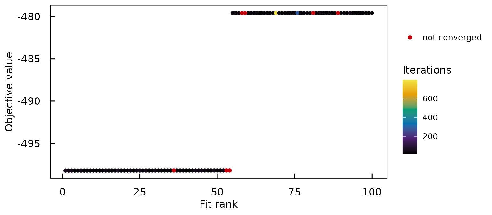
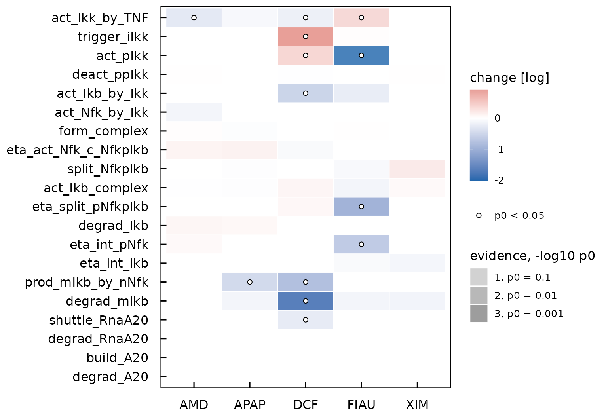
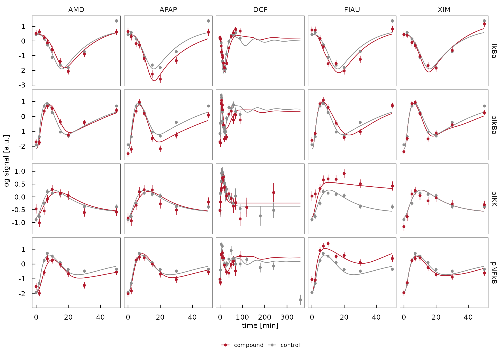

# 8. Group-specific effects

Oppelt et al. [\[1\]](#ref-oppelt2018model) also measured the TNFα
response under drugs causing liver injury: diclofenac (DCF) with the
imaging and blots of the first chapters, and amiodarone (AMD),
paracetamol (APAP), fialuridine (FIAU) and ximelagatran (XIM) with four
blots. Which pathway processes does each compound change? The
publication answered this for DCF with an L1 penalty on the differences
of all rate constants between treated and untreated cells, scanned over
the penalty strength. Here all five compounds are the groups of a
spike-and-slab random effect: a compound leaves a rate constant
unchanged or changes it by a normal draw, with probability and spread of
changes estimated from all compounds together. Code: `compounds.R`, on
the reduced model of [Profile
likelihood](https://dmodverse.github.io/dMod2/articles/guide-profiles.md);
random effects and
[`em()`](https://dmodverse.github.io/dMod2/reference/em.md) are
introduced in [Nonlinear mixed-effects
models](https://dmodverse.github.io/dMod2/articles/guide-nlme.md).

The second part lists the sparse random-effect distributions (Laplace,
spike-and-slab, Dirichlet-process) and what their fits report;
derivations are in [Methods \> Sparse random
effects](https://dmodverse.github.io/dMod2/articles/methods-sparse-random-effects.md).

## Compound data

Each compound has a separate control: DCF on the blots and imaging of
the first chapters, the other four on a third blot set with their own
untreated, stimulated control. A condition without compound belongs to
no group (`NA` in column `compound`).

``` r

# HepG2 cells: the first blot scale with and without TNFα and DCF, the third with TNFα and the
# other four compounds; a condition without a compound belongs to no group
cells <- subset(raw, cell == "HepG2" & (scale == 1 | (scale == 3 & treatment == "TNF")) &
                  (scale == 3 | compound %in% c("no", "DCF")))
cells$compound[cells$compound == "no"] <- NA
cells$blot <- paste0("blot", cells$scale)
cells$condition <- with(cells, paste(ifelse(treatment == "TNF", "TNF", "control"),
                                     ifelse(is.na(compound), "none", compound), blot, sep = "_"))
dataCompounds <- as.datalist(cells[c("name", "time", "value", "sigma", "condition", "treatment",
                                     "compound", "blot")],
                             splitBy = "condition", keepCovariates = c("treatment", "compound", "blot"))
```

``` r

covariates(dataCompounds)
#>                             condition treatment compound  blot
#> TNF_none_blot1         TNF_none_blot1       TNF     <NA> blot1
#> control_none_blot1 control_none_blot1        no     <NA> blot1
#> TNF_DCF_blot1           TNF_DCF_blot1       TNF      DCF blot1
#> control_DCF_blot1   control_DCF_blot1        no      DCF blot1
#> TNF_none_blot3         TNF_none_blot3       TNF     <NA> blot3
#> TNF_AMD_blot3           TNF_AMD_blot3       TNF      AMD blot3
#> TNF_APAP_blot3         TNF_APAP_blot3       TNF     APAP blot3
#> TNF_FIAU_blot3         TNF_FIAU_blot3       TNF     FIAU blot3
#> TNF_XIM_blot3           TNF_XIM_blot3       TNF      XIM blot3
```

## Spike-and-slab random effects

With \\\theta_k\\ the log rate constant \\k\\ and \\\eta\_{ik}\\ the
change by compound \\i\\, a condition with compound \\i\\ uses
\\\theta_k + \eta\_{ik}\\, one without uses \\\theta_k\\. The
spike-and-slab distribution [\[2\]](#ref-mitchell1988bayesian),
[\[3\]](#ref-george1993variable) of a change is

\\p(\eta\_{ik}) = (1 - \rho)\\ \delta(\eta\_{ik}) + \rho\\
\mathcal{N}(\eta\_{ik};\\ 0, \tau^2),\\

a spike at 0 with weight \\1 - \rho\\ and a normal slab of standard
deviation \\\tau\\ with weight \\\rho\\. Changes are independent across
compounds and rate constants; \\\rho\\, \\\tau\\ are shared.
[`em()`](https://dmodverse.github.io/dMod2/reference/em.md) estimates
\\\theta\\, \\\rho\\ and \\\tau\\ from the likelihood with the changes
integrated out, a sum over the subsets of changed rate constants
([Methods \> Sparse random
effects](https://dmodverse.github.io/dMod2/articles/methods-sparse-random-effects.html#approximate-marginal)).
The posterior spike probability \\p_0 = \Pr(\eta\_{ik} = 0 \mid y)\\
near 0 means a change, near the prior \\1 - \rho\\ no evidence, above it
evidence against a change.

Each compound has 20 candidate rate constants, and the subset sum is
exact; beyond a term budget
[`em()`](https://dmodverse.github.io/dMod2/reference/em.md) uses the
expectation consistent (EC) approximation ([Methods \> Spike and
slab](https://dmodverse.github.io/dMod2/articles/methods-sparse-random-effects.html#spike-and-slab)).
Comparison with the L1 penalty: [Methods \> Selection of
deviations](https://dmodverse.github.io/dMod2/articles/methods-sparse-random-effects.html#selection-of-deviations).

## Compound model

The reduced model of [Profile
likelihood](https://dmodverse.github.io/dMod2/articles/guide-profiles.md)
with second derivatives for
[`em()`](https://dmodverse.github.io/dMod2/reference/em.md). Its resting
state (all NFκB bound to IκBα, all IKK inactive) holds for all rate
constants, so a compound changes the dynamics only from TNFα on:

``` r

# the reduced model with second derivatives forward over reverse, which the mixed-effects fit uses;
# the resting state of reduced.R holds for every value of the rate constants, so a compound
# changes the dynamics from the time of TNFα on
dm <- c("forward", "reverse", "forward-reverse")
candidates <- setdiff(getParameters(odemodel(reactionsReduced, compile = FALSE)),
                      c(reactionsReduced$states, names(gauge), names(fixedReduced), "dose_TNF"))
modelCompounds <- odemodel(reactionsReduced, events = events, modelname = "oppelt_cmp_ode",
                           compile = FALSE, derivMode = dm)
xCompounds <- Xs(modelCompounds, options = list(atol = 1e-10, rtol = 1e-8))
gCompounds <- Y(observablesReduced, xCompounds, modelname = "oppelt_cmp_obs", compile = FALSE,
                derivMode = dm)
eCompounds <- Y(errors, gCompounds, modelname = "oppelt_cmp_err", compile = FALSE, derivMode = dm)
```

`x ~ 1 + (1 | gr(compound, dist = spikeSlab()))` in
[`insert()`](https://dmodverse.github.io/dMod2/reference/define.md)
replaces rate constant `x` by a fixed effect plus a compound random
effect. Candidates are the rate constants the reduced model estimates,
all but gauge and fixed values of the publication. Scales and offsets of
the third blot set are separate parameters, except `off_IkBa`, fixed at
0 by the reduced model.

``` r

# every rate constant the reduced model estimates, with a spike-and-slab random effect over the
# compounds; the blots of the third scale with scales and offsets of their own
blot3 <- setdiff(c("s_IkBa", "off_IkBa", "s_pIkBa", "off_pIkBa", "s_pIKK", "off_pIKK", "s_pNFkB",
                   "off_pNFkB"), names(fixedReduced))
trafoCompounds <- eqnvec() |>
  define("x <- x", x = setdiff(getParameters(xCompounds, gCompounds, eCompounds),
                               reactionsReduced$states)) |>
  define("x <- y", x = names(fixedReduced), y = fixedReduced) |>
  define("x <- y", x = names(resting), y = resting) |>
  insert("x <- exp(x)", x = .currentSymbols) |>
  define("TNF <- 0") |>
  branch(covariates(dataCompounds)) |>
  define("dose_TNF <- 0", conditionMatch = "^control") |>
  define("dose_TNF <- 1", conditionMatch = "^TNF") |>
  insert("x <- y", x = blot3, y = paste0(blot3, "_blot3"), conditionMatch = "blot3$") |>
  insert(x ~ 1 + (1 | gr(compound, dist = spikeSlab())), x = candidates)
pCompounds <- P(trafoCompounds, method = "explicit", modelname = "oppelt_cmp_par", compile = FALSE,
                derivMode = dm)

compile(gCompounds, xCompounds, pCompounds, eCompounds, output = "oppelt_cmp",
        cores = getOption("dMod2.cores"))
prdCompounds <- gCompounds * xCompounds * pCompounds
objCompounds <- normL2(dataCompounds, prdCompounds, eCompounds)
```

## Joint fit of all compounds

[`em()`](https://dmodverse.github.io/dMod2/reference/em.md) estimates
fixed effects, change modes, \\\rho\\ and \\\tau\\ together.
`compounds.R` runs 200 starts, the reduced optimum with changes at 0 and
199 around it, redrawing failed starts, split into
[`distributedComputing()`](https://dmodverse.github.io/dMod2/reference/distributedComputing.md)
tasks by `msem(which = )` ([Remote
computing](https://dmodverse.github.io/dMod2/articles/guide-remote-computing.md)):

``` r

# the fixed effects from the reduced model at the optimum, those of the third blot from the first;
# the effects of the compounds start at 0, the hyperparameters at a few changes of moderate size
bestReduced <- as.parvec(readRDS("results/reduced.rds")$fits)
random <- randomEffects(pCompounds)
population <- setdiff(getParameters(prdCompounds), c(unlist(random$etas), names(gaugeReduced)))
init <- bestReduced[intersect(population, names(bestReduced))]
init[paste0(blot3, "_blot3")] <- bestReduced[blot3]
init[c("prob_compound", "tau_compound")] <- c(0.2, 0.5)
# the prior of model.R, that of the first blot also for the third
third <- function(v) c(v, setNames(v[blot3], paste0(blot3, "_blot3")))[population]
priorCompounds <- constraintL2(third(muReduced), sigma = third(sigmaReduced))
# the spread of the starts: per fixed effect half the 68 % profile interval of the reduced model,
# between 0.1 and 0.5 on the log scale, 0.5 where the profile is open and for the hyperparameters
ci <- confint(readRDS("results/reduced.rds")$profiles, level = 0.68)
width <- setNames(pmin(pmax((ci$upper - ci$lower) / 2, 0.1), 0.5), ci$name)
width <- c(width, setNames(width[intersect(blot3, names(width))], paste0(intersect(blot3, names(width)), "_blot3")))
sdStart <- setNames(rep(0.5, length(init)), names(init))
known <- intersect(names(sdStart), names(width)[!is.na(width)])
sdStart[known] <- width[known]
# 200 starts: the one above and 199 moved by sdStart, the probability of a change on the logit
# scale and the spread by a factor; a start whose fit fails is drawn again; every start runs to the
# end, with up to 1000 iterations of the trust region, one core each
set.seed(3)
fitCompounds <- msem(objCompounds + priorCompounds, random, init, fixed = gaugeReduced,
                     control = list(laplace = list(maxOuter = 1000, trustControl = list(tolControl = tolerances))),
                     fits = 200, sd = sdStart, keepFits = TRUE,
                     cores = getOption("dMod2.cores"))
```

The best fit is saved with a table of all starts:

``` r

# the best fit with the table and the fits of all starts, saved without the model, which an
# evaluation at the estimates restores
saved <- fitCompounds
saved[c("design", "prdfn", "errfn", "data")] <- NULL
# the md5 of the files the result is computed from, which the guide checks on reading
sources <- c("model.R", "reduced.R", "compounds.R", "data/oppelt2018.csv", "results/reduced.rds")
attr(saved, "stamp") <- list(md5 = tools::md5sum(sources), dMod2 = packageVersion("dMod2"))
saveRDS(saved, "results/compounds.rds")
```

``` r

fit <- readRDS("results/compounds.rds")
c(value = fit$value, converged = fit$converged, iterations = fit$iterations)
#>      value  converged iterations 
#>  -498.2197     1.0000    54.0000
fit$argument[c("prob_compound", "tau_compound")]
#> prob_compound  tau_compound 
#>     0.5693377     0.8098347
fit$coupling
#> NULL
```

`value` is \\-2 \log L\\ of the approximate marginal, `iterations` the
steps of the joint trust region of fixed effects and hyperparameters,
`coupling` the integral over coupled changes, here none: every compound
is integrated exactly.

## Multistart optimization

The objective has local optima.
[`msem()`](https://dmodverse.github.io/dMod2/reference/msem.md) redraws
a start whose fit fails, e.g. where EC does not converge. `$multistart`
has per start `value`, `converged`, `iterations`, attempts (`tries`) and
the `error` of a start that failed every attempt. The waterfall shows
the best 100 starts; a plateau is one optimum.

``` r

plotValues(fit, rank(value, ties.method = "first") <= 100)
```



Of the 200 starts, 54 end within 1 of the best -2 log L, 20 did not
converge and 0 failed.

## Changes by compound

Changes with \\p_0 \< 0.05\\, with log-scale modes:

``` r

changes <- fit$random[fit$random$p0 < 0.05, c("group", "eta", "mode", "se", "p0")]
changes <- changes[order(changes$group, changes$p0), ]
rownames(changes) <- NULL
changes
#>    group                eta       mode         se           p0
#> 1    AMD     act_Ikk_by_TNF -0.6236264 0.19984152 5.547170e-03
#> 2   APAP  prod_mIkb_by_nNfk -0.6792685 0.15466351 1.393103e-04
#> 3    DCF  prod_mIkb_by_nNfk -0.7921479 0.05803567 0.000000e+00
#> 4    DCF        degrad_mIkb -1.6578420 0.08888813 0.000000e+00
#> 5    DCF       trigger_iIkk  0.9114912 0.18657175 8.075395e-07
#> 6    DCF           act_pIkk  0.5766576 0.13598920 1.991485e-04
#> 7    DCF     act_Ikb_by_Ikk -0.9749201 0.27060278 1.087037e-03
#> 8    DCF     shuttle_RnaA20 -0.6644005 0.14014366 1.617996e-02
#> 9    DCF     act_Ikk_by_TNF -0.5580331 0.16521016 2.794079e-02
#> 10  FIAU eta_split_pNfkpIkb -0.9531715 0.14002365 3.392044e-08
#> 11  FIAU       eta_int_pNfk -0.7848230 0.16207891 1.383356e-05
#> 12  FIAU           act_pIkk -2.0243687 0.42216213 1.614711e-05
#> 13  FIAU     act_Ikk_by_TNF  0.7828162 0.28374356 4.366442e-03
```

DCF changes 7 of the 20 rate constants, AMD 1, APAP 1, FIAU 4 and XIM 0.
The probability of a change is 0.57, and a change has a spread of 0.81
on the log scale, a factor of about 2.2. Of the 7 rate constants the L1
scan of the publication selected for DCF, the spike and slab finds 6:
IKK activation by TNFα (`act_Ikk_by_TNF`), IKK recovery
(`trigger_iIkk`), IKK phosphorylation (`act_pIkk`), IκBα phosphorylation
by pIKK (`act_Ikb_by_Ikk`), IκBα transcription (`prod_mIkb_by_nNfk`) and
IκBα transcript degradation (`degrad_mIkb`); not A20 translation
(`build_A20`), but the delay of the A20 transcript (`shuttle_RnaA20`).
[\[1\]](#ref-oppelt2018model)

``` r

shown <- fit$random
shown$eta <- factor(shown$eta, levels = unique(shown$eta))
shown$evidence <- -log10(pmax(shown$p0, 1e-6))
ggplot2::ggplot(shown, ggplot2::aes(group, eta)) +
  ggplot2::geom_tile(ggplot2::aes(fill = mode, alpha = evidence), color = "white") +
  ggplot2::geom_point(data = shown[shown$p0 < 0.05, ], ggplot2::aes(shape = "p0 < 0.05"),
                      fill = "white") +
  ggplot2::scale_y_discrete(limits = rev) +
  ggplot2::scale_fill_gradient2(low = "#2166ac", mid = "white", high = "#b2182b") +
  ggplot2::scale_alpha(range = c(0.1, 1), limits = c(0, 6), breaks = 1:3,
                       labels = c("1, p0 = 0.1", "2, p0 = 0.01", "3, p0 = 0.001"),
                       guide = ggplot2::guide_legend(override.aes = list(fill = "gray30"))) +
  ggplot2::scale_shape_manual(values = 21) +
  ggplot2::labs(x = NULL, y = NULL, fill = "change [log]", alpha = "evidence, -log10 p0", shape = NULL) +
  theme_dMod()
```



Each tile is one \\\eta\_{ik}\\; rate constants follow the pathway from
IKK (top) to A20 (bottom). Color is the log-scale mode of the most
probable structure: red increase, blue decrease, white no change
(wherever the spike is more probable than the slab); \\-0.7\\ halves a
rate constant. Opacity is the evidence \\-\log\_{10} p_0\\, full from 6
on (\\p_0 \< 10^{-6}\\). A pale tile is a small change, or \\p_0\\ near
or above \\1 - \rho\\; circles mark \\p_0 \< 0.05\\, the table above. A
colored tile without circle has \\p_0\\ between 0.05 and 0.5.

## Data and fit by compound

Prediction per compound at the estimated fixed effects and changes
against the compound data, each point with its measured standard
deviation, which the blots have in place of an error model; gray: the
untreated, stimulated control of the same blots at the fixed effects
alone. DCF blots span six hours, the others 50 minutes:

``` r

outer <- getParameters(prdCompounds)
estimates <- c(fit$argument, fit$fixed, setNames(fit$random$mode, fit$random$parameter))
pars <- setNames(numeric(length(outer)), outer)
pars[intersect(outer, names(estimates))] <- estimates[intersect(outer, names(estimates))]

treated <- grep("^TNF_[A-Z]", names(dataCompounds), value = TRUE)
controls <- sub("^TNF_[A-Z]+_", "TNF_none_", treated)
observed <- as.data.frame(dataCompounds)
times <- sort(unique(c(seq(0, 60, length.out = 200), seq(0, max(observed$time), length.out = 200))))
prediction <- as.data.frame(prdCompounds(times, pars, deriv = FALSE, conditions = union(treated, controls)))

# every compound with the untreated control on the same blots
blots <- c("IkBa", "pIkBa", "pIKK", "pNFkB")
byCompound <- function(frame) do.call(rbind, Map(function(cond, ctl) {
  rows <- frame[frame$condition %in% c(cond, ctl) & frame$name %in% blots,
                c("time", "name", "value", "sigma", "condition")]
  rows$compound <- sub("^TNF_([A-Z]+)_.*", "\\1", cond)
  rows$treatment <- ifelse(rows$condition == cond, "compound", "control")
  rows
}, treated, controls))
points <- byCompound(observed)
# the curves over the time range of the data of the compound
curves <- byCompound(prediction)
curves <- curves[curves$time <= tapply(points$time, points$compound, max)[curves$compound], ]
colors <- c(compound = "#b2182b", control = "gray55")
ggplot2::ggplot(mapping = ggplot2::aes(time, value, color = treatment)) +
  ggplot2::geom_line(data = curves) +
  ggplot2::geom_errorbar(data = points, ggplot2::aes(ymin = value - sigma, ymax = value + sigma),
                         width = 0) +
  ggplot2::geom_point(data = points) +
  ggplot2::facet_grid(name ~ compound, scales = "free") +
  ggplot2::scale_x_continuous(breaks = scales::breaks_pretty(n = 3)) +
  ggplot2::scale_color_manual(values = colors) +
  ggplot2::labs(x = "time [min]", y = "log signal [a.u.]", color = NULL) +
  theme_dMod() +
  ggplot2::theme(legend.position = "bottom")
```



## Sparse random-effect distributions

`gr(group, dist = )` sets the random-effect distribution of a term.
Besides
[`normal()`](https://dmodverse.github.io/dMod2/reference/normal.md),
three have deviations exactly zero unless the data need them:

| distribution | a deviation \\\eta\\ of a group | hyperparameters |
|----|----|----|
| [`laplace()`](https://dmodverse.github.io/dMod2/reference/normal.md) | density \\\tfrac{\lambda}{2} e^{-\lambda \lvert \eta \rvert}\\ | `lambda_<grouping>` |
| [`spikeSlab()`](https://dmodverse.github.io/dMod2/reference/normal.md) | \\0\\ with probability \\1 - \rho\\, else \\\mathcal{N}(0, \tau^2)\\ | `prob_<grouping>`, `tau_<grouping>` |
| [`dirichletProcess()`](https://dmodverse.github.io/dMod2/reference/normal.md) | cluster value: \\0\\ for the population cluster, else one \\\mathcal{N}(0, \tau^2)\\ draw | `concentration_<grouping>`, `tau_<grouping>` |

Hyperparameters are shared by the symbols of a term, numbered `_1`,
`_2`, … for several terms of one grouping, and estimated with the fixed
effects unless given, as in `laplace(lambda = 2)`. A Laplace mode is
exactly zero unless the data pull it away, which sorts shared from
group-specific parameters, one \\\lambda\\ per term. A spike-and-slab
deviation is zero with a probability reported per group. Under the
Dirichlet process groups share deviations in clusters with the
population value, see [Dirichlet-process random
effects](#dirichlet-process-random-effects). Normal and sparse random
effects of one grouping combine; `em(method = "focei")` fits all,
Dirichlet-process ones also `method = "saem"`.

## Fitting sparse random effects

`em(method = "focei")` integrates sparse random effects on the Laplace
approximation of the data term at the joint mode of a group, exactly
where possible, by EC where the data couple them. Fixed effects and
hyperparameters move in one trust region: no EM iteration count, no
random numbers. `fit$coupling` is `"expectationConsistent"` if a group
needed EC, `NULL` if all are exact. Integral, gradient and
hyperparameter steps: [Methods \> Approximate
marginal](https://dmodverse.github.io/dMod2/articles/methods-sparse-random-effects.html#approximate-marginal),
[Methods \> Expectation consistent
approximation](https://dmodverse.github.io/dMod2/articles/methods-sparse-random-effects.html#expectation-consistent-approximation)
and [Methods \> Joint trust
region](https://dmodverse.github.io/dMod2/articles/methods-sparse-random-effects.html#joint-trust-region).

| entry of `control$laplace` | default | controls |
|----|----|----|
| `maxOuter` | `200` | joint trust-region iterations, all runs |
| `trustControl` | `rinit = 1`, `rmax = 10`, `ftol = 1e-10`, `mtol = 1e-5` | joint trust region, as [`trust()`](https://dmodverse.github.io/dMod2/reference/trust.md) |

Other entries are an error. The compound fit uses the `trustControl`
tolerances of [Setting up
models](https://dmodverse.github.io/dMod2/articles/guide-model.md),
above the solver error in value and gradient. A run stopping short of
`mtol` restarts while runs lower \\-2 \log L\\ by more than `mtol`.
[`msem()`](https://dmodverse.github.io/dMod2/reference/msem.md) perturbs
strengths, concentrations and slab standard deviations on log scale,
slab probabilities on logit scale.

## Reported structure

The fit reports the most probable structure: subset of deviations (spike
and slab) or partition (Dirichlet process). Spike deviations are exactly
zero, slab deviations the posterior mean given the structure, Laplace
deviations the joint mode ([Methods \> Reported
structure](https://dmodverse.github.io/dMod2/articles/methods-sparse-random-effects.html#reported-structure)).
`fit$random` has a row per group and random effect:

- `mode`, this value;
- `se`, posterior standard deviation over spike and slab;
- spike-and-slab and Dirichlet process: `cluster`, 0 for the population
  value, 1, 2, … for deviating groups or clusters in group order, and
  `p0`, posterior probability of zero deviation;
- `data`, whether the random effect reaches data of the group, where
  some do not.

A sparse random effect reaching no data of the group (through
transformations, ODE, observables, error model) rests at 0 with the
prior standard deviation and, for spike and slab, \\p_0 = 1 - \rho\\.
`fit$strengths` lists Laplace strengths, `fit$slab` probabilities,
concentrations and slab standard deviations, each with term symbols,
estimate and whether fixed.

## Standard errors

With Laplace or spike-and-slab random effects `fit$hessian` is `NULL`;
[`vcov()`](https://rdrr.io/r/stats/vcov.html) inverts `fit$information`,
the empirical information from the group scores. It needs more groups
than parameters, or conditions without random effects plus priors for
the other directions; otherwise
[`vcov()`](https://rdrr.io/r/stats/vcov.html) is an error and standard
errors are `NA`. In the compound fit the conditions without compound and
the prior complete the five compounds.
[`dirichletProcess()`](https://dmodverse.github.io/dMod2/reference/normal.md)
fits have neither; `confint(method = "profile")` gives intervals.
Details: [Methods \> Standard
errors](https://dmodverse.github.io/dMod2/articles/methods-sparse-random-effects.html#standard-errors).

## Dirichlet-process random effects

With `gr(group, dist = dirichletProcess())` groups and population value
form clusters; the concentration \\\alpha\\ sets how readily a group
opens a new one. The population cluster has deviation zero, every other
cluster one common deviation from \\\mathcal{N}(0, \tau^2)\\. \\\alpha\\
and \\\tau\\ are estimated by marginal maximum likelihood in one fit,
with no penalty to scan. The reported structure is that of spike and
slab with clusters in place of single deviations; the compounds here are
fitted without it.

`method = "focei"` sums exactly over partitions of up to 14 groups.
`method = "saem"` draws partitions, allowing normal random effects
alongside but no other sparse ones, and reports the most frequent
partition after burn-in, with standard error `valueSE` of \\-2 \log L\\.
`control$saem$particles` sets the importance-sampling particles, default
500; `converged` says whether burn-in ended by the drift test. An SAEM
fit has no gradient, Hessian or empirical information. Details: [Methods
\> Sparse random
effects](https://dmodverse.github.io/dMod2/articles/methods-sparse-random-effects.html#dirichlet-process-random-effects).

Reference:
[`randomEffects()`](https://dmodverse.github.io/dMod2/reference/randomEffects.md),
[`laplace()`](https://dmodverse.github.io/dMod2/reference/normal.md),
[`spikeSlab()`](https://dmodverse.github.io/dMod2/reference/normal.md),
[`dirichletProcess()`](https://dmodverse.github.io/dMod2/reference/normal.md),
[`em()`](https://dmodverse.github.io/dMod2/reference/em.md),
[`msem()`](https://dmodverse.github.io/dMod2/reference/msem.md),
[`plotValues()`](https://dmodverse.github.io/dMod2/reference/plotValues.md)

[← 7. Nonlinear mixed-effects
models](https://dmodverse.github.io/dMod2/articles/guide-nlme.md) \| [9.
Alignment of relative data measurements
→](https://dmodverse.github.io/dMod2/articles/guide-alignment.md)

## References

\[1\]

A. Oppelt *et al.*, “Model-based identification of TNFα-induced
IKKβ-mediated and IκBα-mediated regulation of NFκB signal transduction
as a tool to quantify the impact of drug-induced liver injury
compounds,” *npj Systems Biology and Applications*, vol. 4, p. 23, 2018,
doi:
[10.1038/s41540-018-0058-z](https://doi.org/10.1038/s41540-018-0058-z).

\[2\]

T. J. Mitchell and J. J. Beauchamp, “Bayesian variable selection in
linear regression,” *Journal of the American Statistical Association*,
vol. 83, no. 404, pp. 1023–1032, 1988, doi:
[10.1080/01621459.1988.10478694](https://doi.org/10.1080/01621459.1988.10478694).

\[3\]

E. I. George and R. E. McCulloch, “Variable selection via Gibbs
sampling,” *Journal of the American Statistical Association*, vol. 88,
no. 423, pp. 881–889, 1993, doi:
[10.1080/01621459.1993.10476353](https://doi.org/10.1080/01621459.1993.10476353).
