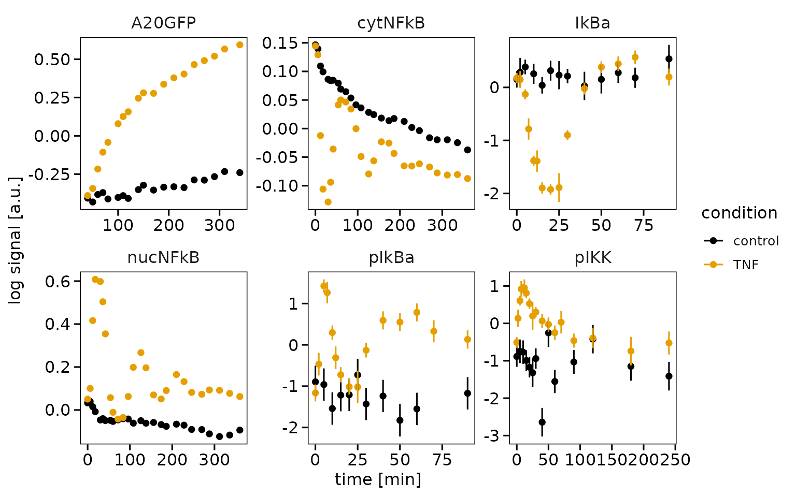
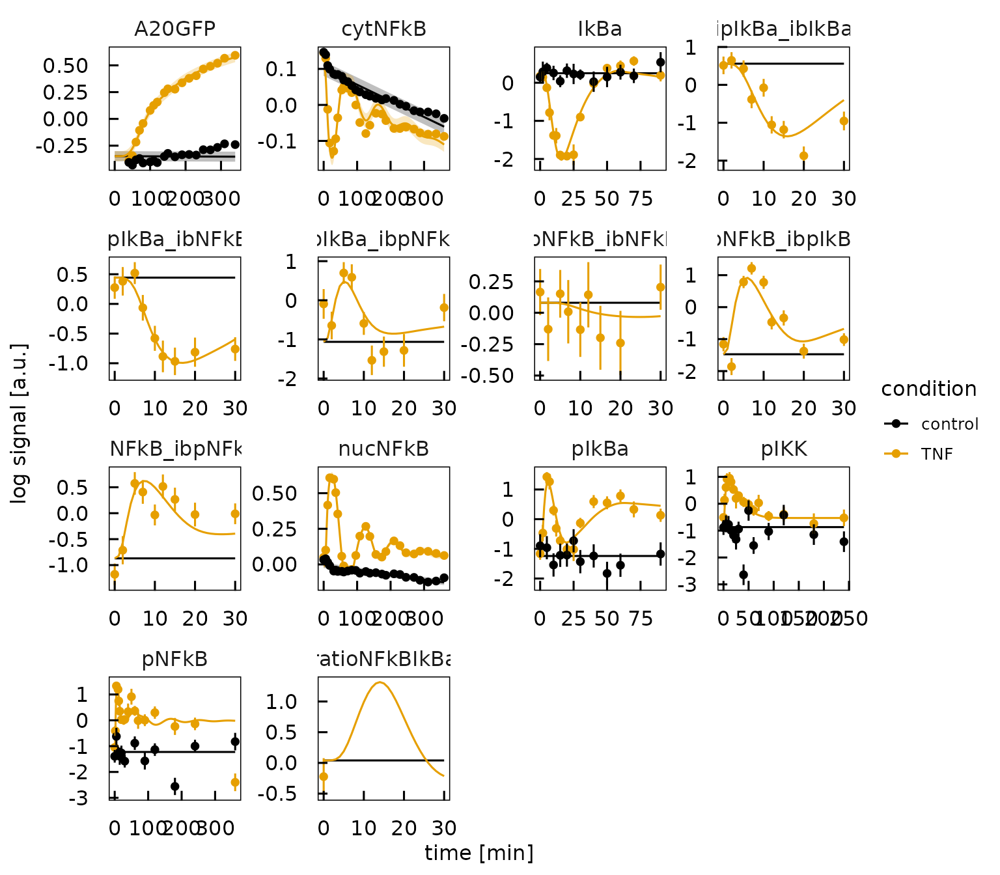

# 1. Setting up models

A model in dMod2 is a chain of function objects, each returning an
output together with its derivatives with respect to the parameters:

| class | constructors | mapping |
|----|----|----|
| `parfn` | [`P()`](https://dmodverse.github.io/dMod2/reference/P.md), [`Pexpl()`](https://dmodverse.github.io/dMod2/reference/Pexpl.md), [`Pimpl()`](https://dmodverse.github.io/dMod2/reference/Pimpl.md) | outer to inner parameters per condition, or parameters to a steady state ([`Pimpl()`](https://dmodverse.github.io/dMod2/reference/Pimpl.md)) |
| `prdfn` | [`Xs()`](https://dmodverse.github.io/dMod2/reference/Xs.md), [`Xf()`](https://dmodverse.github.io/dMod2/reference/Xf.md) | parameters to state trajectories, with sensitivities ([`Xs()`](https://dmodverse.github.io/dMod2/reference/Xs.md)) or without ([`Xf()`](https://dmodverse.github.io/dMod2/reference/Xf.md)) |
| `obsfn` | [`Y()`](https://dmodverse.github.io/dMod2/reference/Y.md) | states to observables, observables to standard deviations (error model) |
| `objfn` | [`normL2()`](https://dmodverse.github.io/dMod2/reference/normL2.md), [`constraintL2()`](https://dmodverse.github.io/dMod2/reference/constraintL2.md), [`datapointL2()`](https://dmodverse.github.io/dMod2/reference/datapointL2.md), [`constraintStability()`](https://dmodverse.github.io/dMod2/reference/constraintStability.md) | parameters to \\-2 \log L\\ with gradient and Hessian |

`*` concatenates two objects by the chain rule. For \\y =
g(x(p(\theta)))\\,

\\\frac{\partial y}{\partial \theta} = \frac{\partial g}{\partial
x}\\\frac{\partial x}{\partial p}\\ \frac{\partial p}{\partial
\theta},\\

each factor computed exactly by the object it belongs to, the middle one
from the sensitivity equations. `g*x*pSS*p` maps the outer parameters to
the observables of all conditions, `normL2(data, g*x*pSS*p, e)` is the
objective, and `+` adds objectives, e.g. a prior. Inner parameters are
the symbols of the equations, with values per condition; outer
parameters are those of the fit, shared by all conditions they enter.

The guide uses the model of Oppelt et al. [\[1\]](#ref-oppelt2018model),
NFκB signaling in HepG2 cells after TNFα, from the project
[`examples/oppeltNPJSystBiolAppl2018`](https://github.com/dModverse/dMod2/tree/master/examples/oppeltNPJSystBiolAppl2018).
This chapter follows `model.R`, the full model of the publication.

``` r

library(dMod2)

# generated sources and shared objects in build/, reused when nothing changed
dir.create("build", showWarnings = FALSE)
options(dMod2.outdir = "build", dMod2.cores = detectFreeCores())
```

## Reaction network

TNFα activates the receptor, the receptor activates IKK, and IKK
phosphorylates IκBα and NFκB in their complex. Phosphorylated IκBα is
degraded, free NFκB enters the nucleus and induces IκBα and A20. IκBα
exports NFκB, A20 inhibits IKK activation; the two negative feedbacks
give damped oscillations of nuclear NFκB. IKK passes through the states
`Ikk`, `pIkk`, `ppIkk` and the refractory `iIkk`.

[`addReaction()`](https://dmodverse.github.io/dMod2/reference/addReaction.md)
adds a reaction to an `eqnlist`.
[`assignCompartment()`](https://dmodverse.github.io/dMod2/reference/assignCompartment.md)
places the four nuclear species in the nucleus of volume `Vnuc` relative
to the cytoplasm. Rates are concentration rates in the compartment of
the educts, of the products for a reaction without net educts, so

\\\dot x_i = \frac{1}{V_i} \sum_r S\_{ri}\\ V\_{f(r)}\\ v_r(x, p),\\

with \\S\_{ri}\\ the stoichiometry and \\V\_{f(r)}\\ the volume of the
compartment of reaction \\r\\. TNFα is not used up: the reaction
`TNF -> TNF + TNFR` keeps it constant as a catalyst.

| reaction | rate | description |
|:---|:---|:---|
| `TNF` → `TNF + TNFR` | `uptake * TNF` | receptor activation |
| `TNFR` → ∅ | `deact_TNFR * TNFR` | receptor deactivation |
| `Ikk` → `pIkk` | `act_Ikk_by_TNF / (1 + A20 / inh_Ikk) * TNFR * Ikk` | IKK activation |
| `Ikk` → `pIkk` | `act_Ikk_Base * Ikk` | basal IKK activation |
| `pIkk` → `ppIkk` | `act_pIkk * pIkk` | IKK phosphorylation |
| `ppIkk` → `iIkk` | `deact_ppIkk * ppIkk` | IKK inactivation |
| `iIkk` → `Ikk` | `trigger_iIkk * iIkk` | IKK recovery |
| `NfkIkb` → `NfkpIkb` | `act_Ikb_Base * NfkIkb` | basal IkBa phosphorylation |
| `NfkIkb` → `NfkpIkb` | `act_Ikb_by_Ikk * pIkk * NfkIkb` | IkBa phosphorylation by pIKK |
| `NfkIkb` → `NfkpIkb` | `act_Ikb_by_Ikk * eta_s_ppIkk * ppIkk * NfkIkb` | IkBa phosphorylation by ppIKK |
| `NfkIkb` → `pNfkIkb` | `act_Nfk_Base * NfkIkb` | basal NFkB phosphorylation |
| `NfkIkb` → `pNfkIkb` | `act_Nfk_by_Ikk * pIkk * NfkIkb` | NFkB phosphorylation by pIKK |
| `NfkIkb` → `pNfkIkb` | `act_Nfk_by_Ikk * eta_s_ppIkk * ppIkk * NfkIkb` | NFkB phosphorylation by ppIKK |
| `pNfkIkb` → `pNfkpIkb` | `act_Ikb_Base * eta_act_Ikb_Base_c_pNfkIkb * pNfkIkb` | basal IkBa phosphorylation, pNFkB complex |
| `pNfkIkb` → `pNfkpIkb` | `act_Ikb_by_Ikk * eta_act_Ikb_c_pNfkIkb * pIkk * pNfkIkb` | IkBa phosphorylation by pIKK, pNFkB complex |
| `pNfkIkb` → `pNfkpIkb` | `act_Ikb_by_Ikk * eta_s_ppIkk * eta_act_Ikb_c_pNfkIkb * ppIkk * pNfkIkb` | IkBa phosphorylation by ppIKK, pNFkB complex |
| `NfkpIkb` → `pNfkpIkb` | `act_Nfk_Base * eta_act_Nfk_Base_c_NfkpIkb * NfkpIkb` | basal NFkB phosphorylation, pIkBa complex |
| `NfkpIkb` → `pNfkpIkb` | `act_Nfk_by_Ikk * eta_act_Nfk_c_NfkpIkb * pIkk * NfkpIkb` | NFkB phosphorylation by pIKK, pIkBa complex |
| `NfkpIkb` → `pNfkpIkb` | `act_Nfk_by_Ikk * eta_s_ppIkk * eta_act_Nfk_c_NfkpIkb * ppIkk * NfkpIkb` | NFkB phosphorylation by ppIKK, pIkBa complex |
| `NfkpIkb` → `Nfk + pIkb` | `split_NfkpIkb * NfkpIkb` | release of NFkB |
| `pNfkpIkb` → `pNfk + pIkb` | `split_NfkIkb * eta_split_pNfkpIkb * pNfkpIkb` | release of pNFkB |
| `Nfk + Ikb` → `NfkIkb` | `form_complex * Nfk * Ikb` | complex formation |
| ∅ → `mIkb` | `prod_mIkb_by_nNfk * nNfk` | IkBa transcription |
| `mIkb` → ∅ | `degrad_mIkb * mIkb` | IkBa transcript degradation |
| ∅ → `Ikb` | `prod_Ikb * mIkb` | IkBa translation |
| `pIkb` → ∅ | `degrad_Ikb * pIkb` | pIkBa degradation |
| `Ikb` → `nIkb` | `int_Nfk * eta_int_Ikb * Ikb` | IkBa import |
| `pNfk` → `pnNfk` | `int_Nfk * eta_int_pNfk * pNfk` | pNFkB import |
| `Nfk` → `nNfk` | `int_Nfk * Nfk` | NFkB import |
| `pnNfk` → `nNfk` | `deact_pnNfk * pnNfk` | nuclear pNFkB dephosphorylation |
| `nIkb + nNfk` → `nNfkIkb` | `form_complex * eta_form_complex_nuc * nNfk * nIkb` | nuclear complex formation |
| `nNfkIkb` → `NfkIkb` | `ext_nNfkIkb * nNfkIkb` | complex export |
| ∅ → `RnaA20_1` | `build_RnaA20 * nNfk` | A20 transcription |
| `RnaA20_1` → `RnaA20_2` | `shuttle_RnaA20 * RnaA20_1` | A20 transcript, delay 1 |
| `RnaA20_2` → `RnaA20` | `shuttle_RnaA20 * RnaA20_2` | A20 transcript, delay 2 |
| `RnaA20` → ∅ | `degrad_RnaA20 * RnaA20` | A20 transcript degradation |
| ∅ → `A20` | `build_A20 * RnaA20` | A20 translation |
| `A20` → ∅ | `degrad_A20 * A20` | A20 degradation |

Code

``` r

reactions <- eqnlist() |>
  assignCompartment(nIkb = "nucleus", pnNfk = "nucleus", nNfk = "nucleus", nNfkIkb = "nucleus",
                    volume = "Vnuc") |>
  # receptors activated by TNFα in the medium, which they do not use up
  addReaction("TNF", "TNF + TNFR", "uptake * TNF", "receptor activation") |>
  addReaction("TNFR", "", "deact_TNFR * TNFR", "receptor deactivation") |>
  # IKK cycle: activation by receptors, inhibited by A20, and basal; inactivation and recovery
  addReaction("Ikk", "pIkk", "act_Ikk_by_TNF / (1 + A20 / inh_Ikk) * TNFR * Ikk", "IKK activation") |>
  addReaction("Ikk", "pIkk", "act_Ikk_Base * Ikk", "basal IKK activation") |>
  addReaction("pIkk", "ppIkk", "act_pIkk * pIkk", "IKK phosphorylation") |>
  addReaction("ppIkk", "iIkk", "deact_ppIkk * ppIkk", "IKK inactivation") |>
  addReaction("iIkk", "Ikk", "trigger_iIkk * iIkk", "IKK recovery") |>
  # IκBα and NFκB phosphorylated in their complex, basal and by pIKK and ppIKK
  addReaction("NfkIkb", "NfkpIkb", "act_Ikb_Base * NfkIkb", "basal IkBa phosphorylation") |>
  addReaction("NfkIkb", "NfkpIkb", "act_Ikb_by_Ikk * pIkk * NfkIkb", "IkBa phosphorylation by pIKK") |>
  addReaction("NfkIkb", "NfkpIkb", "act_Ikb_by_Ikk * eta_s_ppIkk * ppIkk * NfkIkb",
              "IkBa phosphorylation by ppIKK") |>
  addReaction("NfkIkb", "pNfkIkb", "act_Nfk_Base * NfkIkb", "basal NFkB phosphorylation") |>
  addReaction("NfkIkb", "pNfkIkb", "act_Nfk_by_Ikk * pIkk * NfkIkb", "NFkB phosphorylation by pIKK") |>
  addReaction("NfkIkb", "pNfkIkb", "act_Nfk_by_Ikk * eta_s_ppIkk * ppIkk * NfkIkb",
              "NFkB phosphorylation by ppIKK") |>
  addReaction("pNfkIkb", "pNfkpIkb", "act_Ikb_Base * eta_act_Ikb_Base_c_pNfkIkb * pNfkIkb",
              "basal IkBa phosphorylation, pNFkB complex") |>
  addReaction("pNfkIkb", "pNfkpIkb", "act_Ikb_by_Ikk * eta_act_Ikb_c_pNfkIkb * pIkk * pNfkIkb",
              "IkBa phosphorylation by pIKK, pNFkB complex") |>
  addReaction("pNfkIkb", "pNfkpIkb",
              "act_Ikb_by_Ikk * eta_s_ppIkk * eta_act_Ikb_c_pNfkIkb * ppIkk * pNfkIkb",
              "IkBa phosphorylation by ppIKK, pNFkB complex") |>
  addReaction("NfkpIkb", "pNfkpIkb", "act_Nfk_Base * eta_act_Nfk_Base_c_NfkpIkb * NfkpIkb",
              "basal NFkB phosphorylation, pIkBa complex") |>
  addReaction("NfkpIkb", "pNfkpIkb", "act_Nfk_by_Ikk * eta_act_Nfk_c_NfkpIkb * pIkk * NfkpIkb",
              "NFkB phosphorylation by pIKK, pIkBa complex") |>
  addReaction("NfkpIkb", "pNfkpIkb",
              "act_Nfk_by_Ikk * eta_s_ppIkk * eta_act_Nfk_c_NfkpIkb * ppIkk * NfkpIkb",
              "NFkB phosphorylation by ppIKK, pIkBa complex") |>
  # release of NFκB from the complex with phosphorylated IκBα, and complex formation
  addReaction("NfkpIkb", "Nfk + pIkb", "split_NfkpIkb * NfkpIkb", "release of NFkB") |>
  addReaction("pNfkpIkb", "pNfk + pIkb", "split_NfkIkb * eta_split_pNfkpIkb * pNfkpIkb",
              "release of pNFkB") |>
  addReaction("Nfk + Ikb", "NfkIkb", "form_complex * Nfk * Ikb", "complex formation") |>
  # IκBα transcript, induced by nuclear NFκB, the translation, and degradation of pIκBα
  addReaction("", "mIkb", "prod_mIkb_by_nNfk * nNfk", "IkBa transcription") |>
  addReaction("mIkb", "", "degrad_mIkb * mIkb", "IkBa transcript degradation") |>
  addReaction("", "Ikb", "prod_Ikb * mIkb", "IkBa translation") |>
  addReaction("pIkb", "", "degrad_Ikb * pIkb", "pIkBa degradation") |>
  # nuclear import, dephosphorylation of pNFκB, the nuclear complex and the complex export
  addReaction("Ikb", "nIkb", "int_Nfk * eta_int_Ikb * Ikb", "IkBa import") |>
  addReaction("pNfk", "pnNfk", "int_Nfk * eta_int_pNfk * pNfk", "pNFkB import") |>
  addReaction("Nfk", "nNfk", "int_Nfk * Nfk", "NFkB import") |>
  addReaction("pnNfk", "nNfk", "deact_pnNfk * pnNfk", "nuclear pNFkB dephosphorylation") |>
  addReaction("nIkb + nNfk", "nNfkIkb", "form_complex * eta_form_complex_nuc * nNfk * nIkb",
              "nuclear complex formation") |>
  addReaction("nNfkIkb", "NfkIkb", "ext_nNfkIkb * nNfkIkb", "complex export") |>
  # A20 transcript with two delay stages, and A20 protein
  addReaction("", "RnaA20_1", "build_RnaA20 * nNfk", "A20 transcription") |>
  addReaction("RnaA20_1", "RnaA20_2", "shuttle_RnaA20 * RnaA20_1", "A20 transcript, delay 1") |>
  addReaction("RnaA20_2", "RnaA20", "shuttle_RnaA20 * RnaA20_2", "A20 transcript, delay 2") |>
  addReaction("RnaA20", "", "degrad_RnaA20 * RnaA20", "A20 transcript degradation") |>
  addReaction("", "A20", "build_A20 * RnaA20", "A20 translation") |>
  addReaction("A20", "", "degrad_A20 * A20", "A20 degradation")
```

Expressions follow the [expression language of
cppDE](https://dmodverse.github.io/cppDE/reference/expressions.html).
Factors named `eta_` relate two rates, e.g. `eta_form_complex_nuc` the
nuclear to the cytoplasmic complex formation.

``` r

length(reactions$states)
#> [1] 23
as.eqnvec(reactions)[c("NfkIkb", "nNfk", "TNF", "TNFR")]
#> Idx  Inner <- Outer
#>   1 NfkIkb <- -1*(act_Ikb_Base*NfkIkb)-1*(act_Ikb_by_Ikk*pIkk*NfkIkb)-1*(act_Ikb_by_Ikk*eta_s_ppIkk*ppIkk*NfkIkb)-1*(act_Nfk_Base*NfkIkb)-1*(act_Nfk_by_Ikk*pIkk*NfkIkb)-1*(act_Nfk_by_Ikk*eta_s_ppIkk*ppIkk*NfkIkb)+1*(form_complex*Nfk*Ikb)+1*(ext_nNfkIkb*nNfkIkb)*(Vnuc/1)
#>   2   nNfk <- 1*(int_Nfk*Nfk)*(1/Vnuc)+1*(deact_pnNfk*pnNfk)-1*(form_complex*eta_form_complex_nuc*nNfk*nIkb)
#>   3    TNF <- 0
#>   4   TNFR <- 1*(uptake*TNF)-1*(deact_TNFR*TNFR)
```

## Observation functions

The data are live-cell imaging of NFκB and A20-GFP, immunoblots of the
cytoplasm, and immunoblots after immunoprecipitation of NFκB or IκBα.
Each readout but the ratio `ratioNFkBIkBa` measures a sum of species up
to a scale `s_` and an offset `off_`; imaging signals bleach with rate
`tau_`. On the natural log scale of the data,

\\y = \log(s\\ x + o) - \tau t .\\

``` r

nfkbCyt <- "NfkIkb + NfkpIkb + pNfkIkb + pNfkpIkb + pNfk + Nfk"
ikbCyt <- "NfkIkb + NfkpIkb + pNfkIkb + pNfkpIkb + pIkb + Ikb"
pNfkb <- "pNfkpIkb + pNfkIkb + pNfk"
# log of scale times species plus offset; the imaging signals bleach exponentially, which
# subtracts a term linear in time
logOf <- function(stem, species, bleach = FALSE)
  sprintf(if (bleach) "log(s_%1$s * (%2$s) + off_%1$s) - tau_%1$s * time"
          else "log(s_%1$s * (%2$s) + off_%1$s)", stem, species)

observables <- eqnvec(
  nucNFkB        = logOf("nucNFkB", "pnNfk + nNfk + nNfkIkb", bleach = TRUE),
  cytNFkB        = logOf("cytNFkB", nfkbCyt, bleach = TRUE),
  A20GFP         = logOf("A20GFP", "A20", bleach = TRUE),
  IkBa           = logOf("IkBa", "NfkIkb + pNfkIkb + NfkpIkb + pIkb + Ikb"),
  pNFkB          = logOf("pNFkB", pNfkb),
  pIkBa          = logOf("pIkBa", "NfkpIkb + pNfkpIkb + pIkb"),
  pIKK           = logOf("pIKK", "pIkk + ppIkk"),
  ipIkBa_ibIkBa  = logOf("ipIkBa_ibIkBa", "NfkIkb + pNfkIkb + NfkpIkb + pIkb + Ikb"),
  ipNFkB_ibNFkB  = logOf("ipNFkB_ibNFkB", nfkbCyt),
  ipNFkB_ibpIkBa = logOf("ipNFkB_ibpIkBa", "NfkpIkb + pNfkpIkb"),
  ipNFkB_ibpNFkB = logOf("ipNFkB_ibpNFkB", pNfkb),
  ipIkBa_ibpNFkB = logOf("ipIkBa_ibpNFkB", "pNfkpIkb + pNfkIkb"),
  ipIkBa_ibNFkB  = logOf("ipIkBa_ibNFkB", "NfkIkb + NfkpIkb + pNfkIkb + pNfkpIkb"),
  ratioNFkBIkBa  = sprintf("log((%s) / (%s))", nfkbCyt, ikbCyt))
```

## Error model

Blots have a standard deviation per point in the column `sigma`. The
imaging readouts get an estimated standard deviation on the log scale;
rows with a value in `sigma` ignore the error model.

``` r

# a constant standard deviation on the log scale for each imaging readout
errors <- eqnvec(nucNFkB = "sigma_nucNFkB", cytNFkB = "sigma_cytNFkB", A20GFP = "sigma_A20GFP")
```

## Steady-state constraints

The cells rest before TNFα. NFκB and IKK are conserved, so \\f(x, p) =
0\\ determines the resting state only together with the totals:

``` r

conservedQuantities(reactions)
#> $TNF
#> [1] "1*TNF"
#> 
#> $totalIkk
#> [1] "1*Ikk+1*pIkk+1*ppIkk+1*iIkk"
#> 
#> $totalNfk
#> [1] "1*NfkIkb+1*NfkpIkb+1*pNfkIkb+1*pNfkpIkb+1*Nfk+1*pNfk+1*Vnuc*pnNfk+1*Vnuc*nNfk+1*Vnuc*nNfkIkb"
```

[`Pimpl()`](https://dmodverse.github.io/dMod2/reference/Pimpl.md) solves
the steady state numerically in every evaluation, with the totals
`totalNfk` and `totalIkk` as parameters, `TNF` held at 0, and exact
derivatives of the root ([Methods \> Steady
states](https://dmodverse.github.io/dMod2/articles/methods-steady-states.md)).
[`steadyStates()`](https://dmodverse.github.io/dMod2/reference/steadyStates.md),
the analytic alternative, finds no positive closed form for this
network.

``` r

# the cells rest before TNFα is added: a steady state with the amounts of NFκB and IKK conserved;
# an unstable one is returned rather than refused, the objective below keeps it stable
pSS <- Pimpl(reactions, modelname = "oppelt_ss", compile = FALSE, deriv2 = TRUE,
             controlsPTC = list(stability = FALSE))
```

## Events and switches

TNFα is added at time 0: an event replaces `TNF` by `dose_TNF`, 1 under
stimulation and 0 in the control. Event times and values may be
parameters; the sensitivities pass the event. A switch on a state needs
no event: `"piecewise(kon, A > A0, koff)"` switches the rate when `A`
crosses `A0`, with exact sensitivities ([cppDE \>
Events](https://dmodverse.github.io/cppDE/articles/methods-events.html)).

## Prediction functions

[`odemodel()`](https://dmodverse.github.io/dMod2/reference/odemodel.md)
generates C++ code for the right-hand side and the sensitivity
equations; [`Xs()`](https://dmodverse.github.io/dMod2/reference/Xs.md)
turns it into the `prdfn` `x`,
[`Y()`](https://dmodverse.github.io/dMod2/reference/Y.md) builds the
observables `g` and the error model `e`. `compile = FALSE` defers
compilation to one joint
[`compile()`](https://dmodverse.github.io/dMod2/reference/compile.md).

``` r

# TNFα is added at time 0
events <- addEvent(NULL, var = "TNF", time = 0, value = "dose_TNF", method = "replace")
model <- odemodel(reactions, events = events, modelname = "oppelt_ode", compile = FALSE)
x <- Xs(model, options = list(atol = 1e-10, rtol = 1e-8))
g <- Y(observables, x, modelname = "oppelt_obs", compile = FALSE)
e <- Y(errors, g, modelname = "oppelt_err", compile = FALSE)
```

The default backend `"cppDE"` integrates by BDF with first- and, with
`deriv2 = TRUE`, second-order sensitivities; `backend = "Sundials"` uses
CVODES, `"deSolve"` deSolve. A step is accepted if the weighted RMS norm
of the local errors is at most one, \\\bigl(\tfrac1n \sum_i
\varepsilon_i^2 / (\mathrm{atol} + \mathrm{rtol}\\\|x_i\|)^2\bigr)^{1/2}
\le 1\\:

| option | default | controls |
|----|----|----|
| `atol`, `rtol` | `1e-6`, `1e-6` | absolute and relative error per step |
| `maxsteps` | `1e6` | steps per solve |
| `maxattempts` | `50` | rejected steps in a row |
| `hini` | `0` | first step, 0 estimates it |
| `sensErrCon` | `TRUE` | (`optionsSens` only) sensitivities in the error test |

Logarithmic observables magnify the relative error of small states;
`model.R` sets `rtol = 1e-8`, `atol = 1e-10`.

## Experimental data

`model.R` reads the CSV of the publication and keeps HepG2 cells without
compound: 312 points in two conditions.

``` r

# the data set of the publication, values on the natural log scale; the imaging readouts have
# no standard deviation, the error model supplies one
raw <- read.csv("data/oppelt2018.csv", skip = 15)
readouts <- c(
  "nuclear NFkB"       = "nucNFkB",
  "cytoplasmic NFkB"   = "cytNFkB",
  "A20"                = "A20GFP",
  "IkBa"               = "IkBa",
  "pIkBa"              = "pIkBa",
  "pNFkB"              = "pNFkB",
  "pIKK"               = "pIKK",
  "IP:IkBa | IB:IkBa"  = "ipIkBa_ibIkBa",
  "IP:NFkB | IB:NFkB"  = "ipNFkB_ibNFkB",
  "IP:NFkB | IB:pIkBa" = "ipNFkB_ibpIkBa",
  "IP:NFkB | IB:pNFkB" = "ipNFkB_ibpNFkB",
  "IP:IkBa | IB:pNFkB" = "ipIkBa_ibpNFkB",
  "NFkB/IkBa ratio"    = "ratioNFkBIkBa")
raw$name[grepl("^IP:IkBa \\| IB:NFkB", raw$name)] <- "ipIkBa_ibNFkB"
raw$name <- ifelse(raw$name %in% names(readouts), readouts[raw$name], raw$name)
raw$sigma[raw$name %in% c("nucNFkB", "cytNFkB", "A20GFP")] <- NA

# HepG2 cells without a compound, on the first blot scale
hepg2 <- subset(raw, cell == "HepG2" & scale == 1 & compound == "no")
hepg2$condition <- ifelse(hepg2$treatment == "TNF", "TNF", "control")
data <- as.datalist(hepg2[c("name", "time", "value", "sigma", "condition", "treatment")],
                    splitBy = "condition", keepCovariates = "treatment")
```

``` r

table(hepg2$name, hepg2$condition)
#>                 
#>                  control TNF
#>   A20GFP              19  19
#>   cytNFkB             26  26
#>   IkBa                13  15
#>   ipIkBa_ibIkBa        0   9
#>   ipIkBa_ibNFkB        0   9
#>   ipIkBa_ibpNFkB       0   9
#>   ipNFkB_ibNFkB        0   9
#>   ipNFkB_ibpIkBa       0   9
#>   ipNFkB_ibpNFkB       0   9
#>   nucNFkB             26  26
#>   pIkBa               11  15
#>   pIKK                14  18
#>   pNFkB               12  17
#>   ratioNFkBIkBa        0   1
covariates(data)
#>         condition treatment
#> TNF           TNF       TNF
#> control   control        no
```

[`as.datalist()`](https://dmodverse.github.io/dMod2/reference/datalist.md)
splits the data by condition;
[`covariates()`](https://dmodverse.github.io/dMod2/reference/covariates.md)
lists the columns that describe the conditions.

``` r

plotData(data, name %in% c("nucNFkB", "cytNFkB", "A20GFP", "IkBa", "pIkBa", "pIKK")) +
  ggplot2::labs(x = "time [min]", y = "log signal [a.u.]")
```



## Parameter transformation

[`define()`](https://dmodverse.github.io/dMod2/reference/define.md) and
[`insert()`](https://dmodverse.github.io/dMod2/reference/define.md)
build the assignments of the `parfn` `p`:

- `define("x <- x", x = ...)` takes every parameter of `pSS`, `x`, `g`
  and `e` except the states, whose values come from the steady state;
- `insert("x <- exp(x)", x = ...)` puts every symbol on the log scale;
- `define("TNF <- 0")` sets TNFα to 0 for the steady state;
- `branch(covariates(data))` copies the assignments per condition,
  `define(..., conditionMatch =)` sets the dose.

``` r

# every parameter on the log scale; at rest no TNFα, the dose is the unit of TNFα
trafo <- eqnvec() |>
  define("x <- x", x = setdiff(getParameters(pSS, x, g, e), reactions$states)) |>
  insert("x <- exp(x)", x = .currentSymbols) |>
  define("TNF <- 0") |>
  branch(covariates(data)) |>
  define("dose_TNF <- 0", conditionMatch = "control") |>
  define("dose_TNF <- 1", conditionMatch = "TNF")
p <- P(trafo, modelname = "oppelt_par", compile = FALSE)
```

``` r

getEquations(p, conditions = "TNF")[c("dose_TNF", "TNF", "totalNfk", "Vnuc")]
#> Idx    Inner <- Outer
#>   1 dose_TNF <- 1
#>   2      TNF <- 0
#>   3 totalNfk <- exp(totalNfk)
#>   4     Vnuc <- exp(Vnuc)
getEquations(p, conditions = "control")[c("dose_TNF", "TNF")]
#> Idx    Inner <- Outer
#>   1 dose_TNF <- 0
#>   2      TNF <- 0
```

[`compile()`](https://dmodverse.github.io/dMod2/reference/compile.md)
builds all sources into one shared object in `getOption("dMod2.outdir")`
and reuses object files whose source and flags are unchanged.

``` r

compile(g, x, pSS, p, e, output = "oppelt", cores = 6)
prd <- g * x * pSS * p
```

``` r

length(getParameters(prd))
#> [1] 71
```

## Likelihood and prior

`normL2(data, prd, e)` returns \\-2 \log L\\ with gradient and
Gauss-Newton Hessian ([Methods \> Likelihood and
prior](https://dmodverse.github.io/dMod2/articles/methods-objective.md)).
[`constraintL2()`](https://dmodverse.github.io/dMod2/reference/constraintL2.md)
adds a Gaussian prior on the log scale, which keeps parameters the data
do not determine finite; the multistart of
[Optimization](https://dmodverse.github.io/dMod2/articles/guide-optimization.md)
draws the starts from it. Mean 0 and standard deviation 4, a factor of
\\e^4 \approx 55\\, for parameters of unknown magnitude; narrower where
the magnitude is known:

| parameters | mean | sd | reason |
|----|----|----|----|
| bleaching rates `tau_*` | \\\log(0.1/360)\\ | 2 | a few percent of signal lost over six hours |
| imaging noise `sigma_*` | \\\log 0.05\\ | 1 | replicates scatter by about 5 % |
| basal rates `*_Base` | \\-8\\ | 2 | activation without TNFα far slower than with it |
| `shuttle_RnaA20`, `degrad_RnaA20`, `build_A20`, `degrad_A20`, `degrad_mIkb` | \\\log(1/60)\\ | 2 | transcripts and A20 turn over within about an hour |
| `trigger_iIkk` | \\\log(1/240)\\ | 2 | IKK recovers over hours |

Starts far outside these ranges end on plateaus where a signal bleaches
away, the noise explains every residual or A20 follows NFκB within
minutes.

`pSS` returns unstable roots too
(`controlsPTC = list(stability = FALSE)`);
[`constraintStability()`](https://dmodverse.github.io/dMod2/reference/constraintStability.md)
adds a term that is zero while every perturbation of the resting state
decays within the six hours of data and rises to 100 at the stability
boundary. It needs `Pimpl(deriv2 = TRUE)`. Profiles with `stop = "data"`
and likelihood ratios read the data term without it ([Methods \> Steady
states](https://dmodverse.github.io/dMod2/articles/methods-steady-states.html#stability)).

``` r

# a weak prior on the log scale: mean 0, standard deviation 4, a factor of about 55, narrower
# where the order of magnitude is known before the fit
outer <- getParameters(prd)
mu <- structure(rep(0, length(outer)), names = outer)
sigma <- structure(rep(4, length(outer)), names = outer)
# bleaching removes at most a few percent of the signal over the time of the data
bleach <- grep("^tau_", outer, value = TRUE)
mu[bleach] <- log(0.1 / max(as.data.frame(data)$time))
sigma[bleach] <- 2
# the imaging readouts scatter by about 5%
noise <- grep("^sigma_", outer, value = TRUE)
mu[noise] <- log(0.05)
sigma[noise] <- 1
# without TNFα, IKK, IκBα and NFκB are activated far more slowly than after it
basal <- grep("_Base$", outer, value = TRUE)
mu[basal] <- -8
sigma[basal] <- 2
# transcripts and A20 are made and degraded within about an hour
turnover <- c("shuttle_RnaA20", "degrad_RnaA20", "build_A20", "degrad_A20", "degrad_mIkb")
mu[turnover] <- log(1 / 60)
sigma[turnover] <- 2
# IKK recovers from its inactive form over hours
mu["trigger_iIkk"] <- log(1 / 240)
sigma["trigger_iIkk"] <- 2
# the cells rest: a term that rises where an eigenvalue of the resting state decays more slowly
# than over the six hours of data and reaches 100 where the resting state loses stability
stability <- constraintStability(pSS, p, duration = max(as.data.frame(data)$time))
obj <- normL2(data, prd, e) + constraintL2(mu, sigma = sigma) + stability
```

``` r

# the stopping tolerances of trust(), above the error that the solver settings leave: ftol and
# mtol an order of magnitude above that of the value (about 2e-6), gtol two above that of the
# gradient (about 8e-5)
tolerances <- list(ftol = 1e-4, mtol = 1e-4, gtol = 1e-2)
```

## Model evaluation

At the best fit of
[Optimization](https://dmodverse.github.io/dMod2/articles/guide-optimization.md),
with the parameters fixed by the gauge of
[Symmetries](https://dmodverse.github.io/dMod2/articles/guide-symmetries.md):

``` r

best <- as.parvec(readRDS("results/fits.rds"))
value <- obj(best, fixed = gauge)
c(value = value$value, data = attr(value, "data"), prior = attr(value, "prior"))
#>      value       data      prior 
#> -488.67483 -511.16226   22.48742
max(abs(value$gradient))
#> [1] 0.009282248
```

The prediction against the data, with one standard deviation of the
error model as a band, each observable up to the last time point of the
data:

``` r

times <- seq(0, 360, length.out = 361)
last <- pmax(with(lbind(data), tapply(time, name, max)), 30)
plotCombined(prd(times, c(best, gauge), deriv = FALSE), data, time <= last[as.character(name)],
             errfn = e) +
  ggplot2::facet_wrap(~name, scales = "free", ncol = 4) +
  ggplot2::labs(x = "time [min]", y = "log signal [a.u.]")
```



Reference:
[`addReaction()`](https://dmodverse.github.io/dMod2/reference/addReaction.md),
[`assignCompartment()`](https://dmodverse.github.io/dMod2/reference/assignCompartment.md),
[`conservedQuantities()`](https://dmodverse.github.io/dMod2/reference/conservedQuantities.md),
[`Pimpl()`](https://dmodverse.github.io/dMod2/reference/Pimpl.md),
[`steadyStates()`](https://dmodverse.github.io/dMod2/reference/steadyStates.md),
[`odemodel()`](https://dmodverse.github.io/dMod2/reference/odemodel.md),
[`Xs()`](https://dmodverse.github.io/dMod2/reference/Xs.md),
[`Y()`](https://dmodverse.github.io/dMod2/reference/Y.md),
[`as.datalist()`](https://dmodverse.github.io/dMod2/reference/datalist.md),
[`covariates()`](https://dmodverse.github.io/dMod2/reference/covariates.md),
[`define()`](https://dmodverse.github.io/dMod2/reference/define.md),
[`insert()`](https://dmodverse.github.io/dMod2/reference/define.md),
[`branch()`](https://dmodverse.github.io/dMod2/reference/define.md),
[`P()`](https://dmodverse.github.io/dMod2/reference/P.md),
[`compile()`](https://dmodverse.github.io/dMod2/reference/compile.md),
[`normL2()`](https://dmodverse.github.io/dMod2/reference/normL2.md),
[`constraintL2()`](https://dmodverse.github.io/dMod2/reference/constraintL2.md),
[`constraintStability()`](https://dmodverse.github.io/dMod2/reference/constraintStability.md),
[`plotData()`](https://dmodverse.github.io/dMod2/reference/plotData.md),
[`plotCombined()`](https://dmodverse.github.io/dMod2/reference/plotCombined.md)

[← Get started](https://dmodverse.github.io/dMod2/articles/dMod2.md) \|
[2. Symmetries
→](https://dmodverse.github.io/dMod2/articles/guide-symmetries.md)

## References

\[1\]

A. Oppelt *et al.*, “Model-based identification of TNFα-induced
IKKβ-mediated and IκBα-mediated regulation of NFκB signal transduction
as a tool to quantify the impact of drug-induced liver injury
compounds,” *npj Systems Biology and Applications*, vol. 4, p. 23, 2018,
doi:
[10.1038/s41540-018-0058-z](https://doi.org/10.1038/s41540-018-0058-z).
