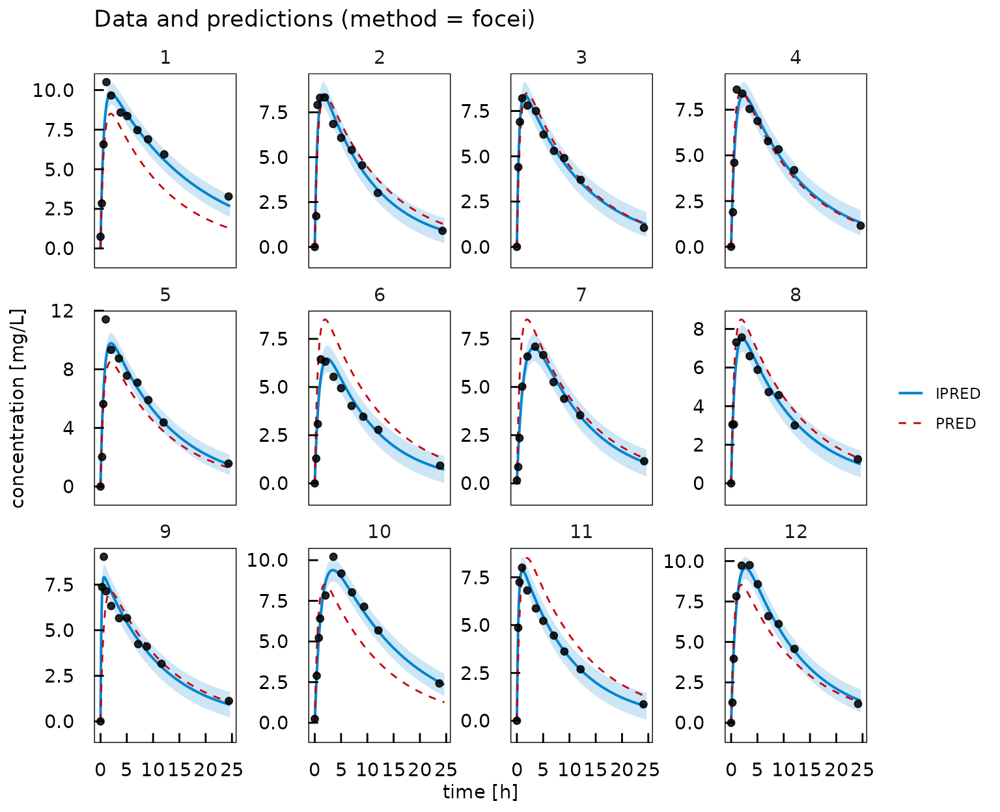
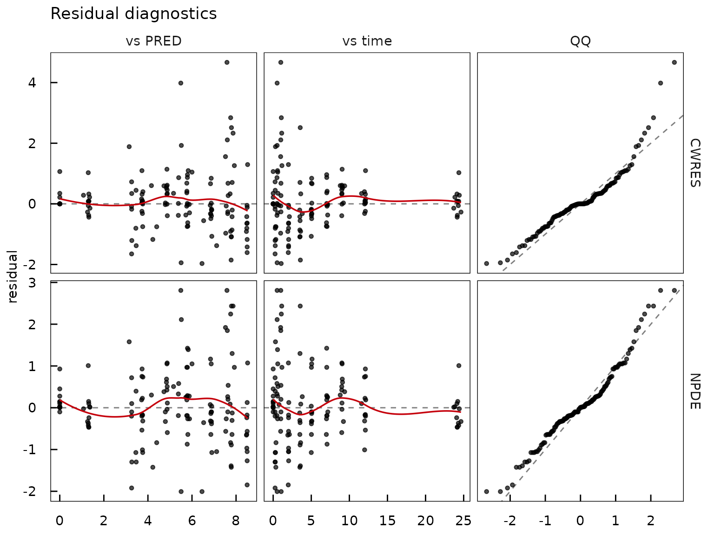
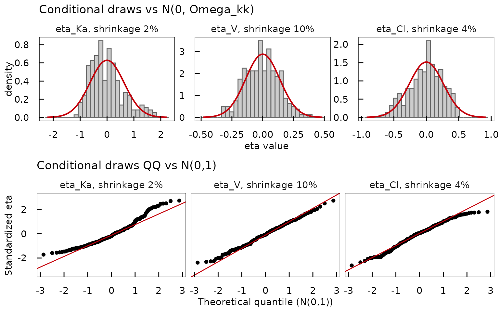
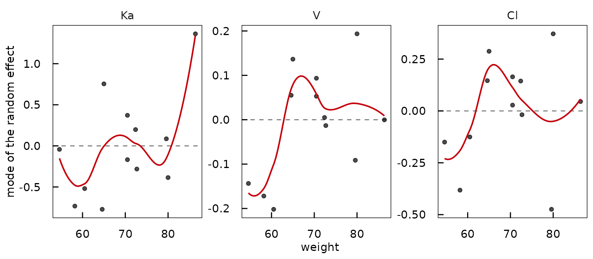
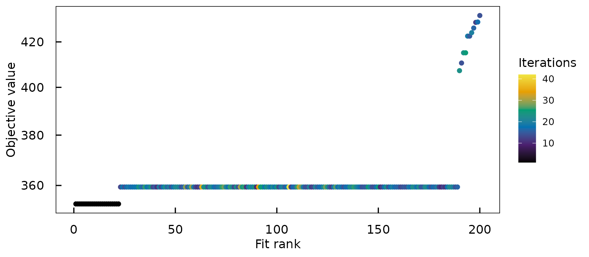
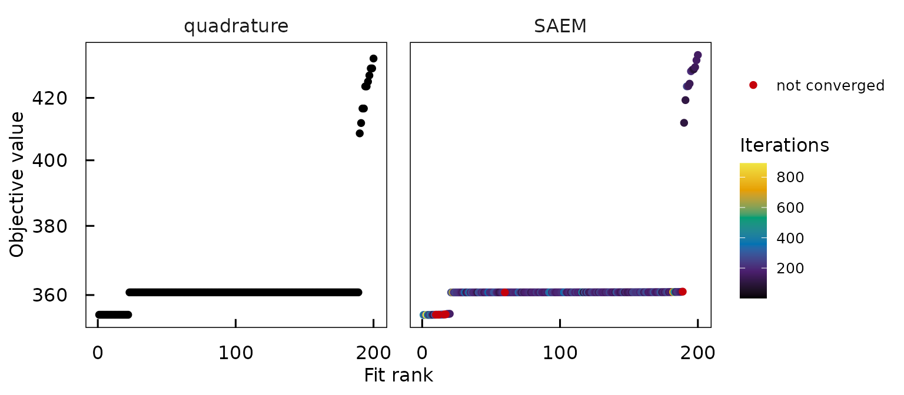

# 7. Nonlinear mixed-effects models

A mixed-effects model writes each individual parameter (subject, cell,
cell line) as a population value plus a random deviation, estimates
population values and spread, and integrates the deviations out of the
likelihood. In dMod2 random effects are declared in the `parfn`;
[`em()`](https://dmodverse.github.io/dMod2/reference/em.md) fits by one
of four approximations of the integral, all instances of the EM
algorithm. Example: theophylline, twelve subjects, one oral dose each,
plasma concentrations over a day.

``` r

library(dMod2)
options(dMod2.outdir = file.path(tempdir(), "guide-mixed-effects"))
dir.create(getOption("dMod2.outdir"), showWarnings = FALSE)
```

## Pharmacokinetic model

The dose enters a depot, is absorbed into the central compartment of
volume \\V\\ and cleared by the flux \\\mathrm{Cl}\\ C_c\\ in the unit
frame: clearance \\\mathrm{Cl}\\ is a volume per time, the concentration
falls at rate \\\mathrm{Cl}/V\\.

``` r

reactions <- eqnlist() |>
  assignCompartment(Ag = "depot") |>
  assignCompartment(Cc = "central", volume = "V") |>
  setCompartmentVolume(unit = "1") |>
  addReaction("Ag", "Cc", "Ka * Ag", "absorption") |>
  addReaction("Cc", "", "Cl * Cc", "elimination", rateCompartment = "unit")
as.eqnvec(reactions)
#> Idx Inner <- Outer
#>   1    Ag <- -1*(Ka*Ag)
#>   2    Cc <- 1*(Ka*Ag)*(1/V)-1*(Cl*Cc)*(1/V)
```

[`em()`](https://dmodverse.github.io/dMod2/reference/em.md) needs second
derivatives: build with `deriv2 = TRUE` and the forward-over-reverse
derivative modes.

``` r

dm <- c("forward", "reverse", "forward-reverse")
x <- Xs(odemodel(reactions, modelname = "theo", compile = FALSE, deriv2 = TRUE, derivMode = dm))
g <- Y(c(cp = "Cc"), x, modelname = "theo_g", compile = FALSE, deriv2 = TRUE, derivMode = dm)
e <- Y(c(cp = "sigma"), g, attachInput = FALSE, modelname = "theo_e", compile = FALSE, deriv2 = TRUE,
       derivMode = dm)
```

## Theophylline data

Each subject is a condition; the condition table holds dose in mg and
body weight.

``` r

data(Theoph, package = "datasets")
Theoph$Subject <- as.character(Theoph$Subject)
data <- as.datalist(data.frame(name = "cp", time = Theoph$Time, value = Theoph$conc, sigma = NA_real_,
                               condition = Theoph$Subject))
subjects <- sort(unique(Theoph$Subject))
table <- data.frame(ID = subjects, dose = tapply(Theoph$Dose * Theoph$Wt, Theoph$Subject, `[`, 1)[subjects],
                    weight = tapply(Theoph$Wt, Theoph$Subject, `[`, 1)[subjects], row.names = subjects)
```

``` r

head(table)
#>    ID    dose weight
#> 1   1 319.992   79.6
#> 10 10 320.100   58.2
#> 11 11 319.800   65.0
#> 12 12 320.650   60.5
#> 2   2 318.560   72.4
#> 3   3 319.365   70.5
plotData(data) +
  ggplot2::labs(x = "time [h]", y = "concentration [mg/L]", color = "Subject")
```


## Random-effect formulas

`define("x <- x", x = ...)` starts the transformation as in [Setting up
models](https://dmodverse.github.io/dMod2/articles/guide-model.md),
[`branch()`](https://dmodverse.github.io/dMod2/reference/define.md)
copies it per table row, and
[`insert()`](https://dmodverse.github.io/dMod2/reference/define.md) sets
the dose into the depot, an empty central compartment and log-scale
parameters. An effect formula turns a symbol into a linear predictor
with fixed and random effects in lme4 notation:

``` r

trafo <- eqnvec() |>
  define("x <- x", x = c("Ka", "V", "Cl", "Ag", "Cc", "sigma")) |>
  branch(table = table) |>
  insert("Ag <- dose", dose = dose) |>
  insert("Cc <- 0") |>
  insert("x <- exp(x)", x = c("Ka", "V", "Cl", "sigma")) |>
  insert(Ka + V + Cl ~ 1 + (1 | ID))
p <- P(trafo, method = "explicit", modelname = "theo_p", compile = FALSE, deriv2 = TRUE, derivMode = dm)
compile(x, g, e, p, output = "theo", cores = 6)
random <- randomEffects(p)
random
#> Random effects: 3 terms over ID
#>   block 1 (normal, ID): eta_Ka
#>   block 2 (normal, ID): eta_V
#>   block 3 (normal, ID): eta_Cl
#>   fixed effects: Ka, V, Cl
```

The formula acts after the log transformation, so \\\log \mathrm{Cl}\_i
= \mathrm{Cl} + \eta\_{\mathrm{Cl},i}\\, \\\eta\_{\mathrm{Cl},i} \sim
\mathcal{N}(0, \omega\_{\mathrm{Cl}}^2)\\: log-normal individual
parameters. Further forms:

- `Cl ~ 1 + (1 | ID)`: random intercept per subject.
- `Cl ~ 1 + logWeight + (1 | ID)`: a covariate, fixed effect
  `Cl_logWeight` on a table column.
- `Ka + Cl ~ 1 + (1 | p | ID)`: random effects of `Ka` and `Cl`
  correlated (same ID `p`).
- `Cl ~ 1 + wt + (1 + dose | p | ID)`: a covariate and a random slope,
  correlated with the intercept.
- `Cl ~ 1 + (1 | ID) + (1 | ID:OCC)`: variability between subjects and
  between occasions.
- `Cl ~ 1 + (1 | gr(ID, dist = laplace()))`: Laplace instead of normal
  random effects.

A group (a level of the grouping, such as a subject) may own several
conditions, which share the group random effects; a condition outside
every group has none. The random effects of one ID, or of one term
without ID, form a block with full covariance, so \\\Omega\\ is block
diagonal; `omega_<a>_<b>` are the entries of the Cholesky factor of each
block, log standard deviations on the diagonal. This chapter treats
normal random effects; Laplace, spike-and-slab and Dirichlet-process
ones are in [Group-specific
effects](https://dmodverse.github.io/dMod2/articles/guide-group-effects.md).

## Marginal likelihood

[`em()`](https://dmodverse.github.io/dMod2/reference/em.md) maximizes
the likelihood of fixed effects, \\\Omega\\ and error parameters with
the random effects of every group integrated out. It takes the data
objective `normL2(data, g * x * p, errmodel = e)` and builds the
random-effect prior from `randomEffects(p)`; `normT(..., df = 4)`
instead of
[`normL2()`](https://dmodverse.github.io/dMod2/reference/normL2.md)
gives Student-t residuals. `method` picks the approximation:

| method | use | reported \\-2 \log L\\ |
|----|----|----|
| `"focei"` | default, fast, Laplace’s approximation at the modes | Laplace |
| `"quadrature"` | skewed posteriors, few random effects per group | quadrature |
| `"laplaceEM"` | EM on the Laplace approximation | quadrature of level \\K + 2\\ |
| `"saem"` | many random effects per group, non-Gaussian posteriors | quadrature of level \\K + 2\\ |

\\K\\ is the number of random effects of a group. Derivations: [Methods
\> Marginal
likelihood](https://dmodverse.github.io/dMod2/articles/methods-nlme.html#marginal-likelihood)
and [Methods \> EM
algorithm](https://dmodverse.github.io/dMod2/articles/methods-nlme.html#em-algorithm).

## First-order conditional estimation (FOCEI)

First-order conditional estimation with interaction replaces each
integral by Laplace’s approximation at the mode of the group; \\-2 \log
L\\ may lie above or below the exact one. Inner and outer trust regions
and gradient: [Methods \>
FOCEI](https://dmodverse.github.io/dMod2/articles/methods-nlme.html#focei).

### FOCEI fit

`init` holds the parameters that are neither random effects nor created
by effect formulas (those start at 0); random-effect standard deviations
start at `control$sd`.

``` r

init <- c(Ka = 0, V = 3, Cl = 0.7, sigma = log(0.5))
fit <- em(obj = normL2(data, g * x * p, errmodel = e), random = random, init = init, verbose = FALSE)
summary(fit)
```

    #> EM summary (focei): -2 log L 359.403232, converged TRUE, 10 iterations
    #>   without the 2 pi constant of the data (NONMEM OBJ): 116.803459
    #> 
    #> Parameters:
    #>             estimate      se rsePct
    #> Ka            0.4639 0.19150 41.290
    #> V             3.4600 0.04700  1.358
    #> Cl            1.0120 0.08320  8.220
    #> sigma        -0.3647 0.07124 19.540
    #> omega_Ka_Ka  -0.4552 0.23380 51.360
    #> omega_V_V    -1.9770 0.28860 14.600
    #> omega_Cl_Cl  -1.3360 0.24810 18.570
    #> 
    #> Random effects:
    #>  type eta1 eta2 estimate      se
    #>    sd   Ka   Ka   0.6343 0.14830
    #>    sd    V    V   0.1384 0.03995
    #>    sd   Cl   Cl   0.2629 0.06521
    #> 
    #> Shrinkage: eta_Ka = 0.018, eta_V = 0.103, eta_Cl = 0.039

`omega_*` are log standard deviations, shown on natural scale in the
random-effects table. Shrinkage near 0 means the modes spread as widely
as the random effects, near 1 that the data of a subject hardly move the
individual parameter.

`value` is \\-2 \log L\\ with all data constants; `valueNonmem`, \\-2
\log L\\ less \\N\_{\text{obs}} \log(2\pi)\\, compares with the NONMEM
`OBJ`. The fit holds `argument`, `Omega`, `omega` (standard deviations
and correlations with standard errors), `random` (modes per group with
conditional standard errors), `etaModes`, `etaSE` and `shrinkage`.
Methods: [`coef()`](https://rdrr.io/r/stats/coef.html),
[`vcov()`](https://rdrr.io/r/stats/vcov.html),
[`confint()`](https://rdrr.io/r/stats/confint.html) (Wald or
`method = "profile"`),
[`logLik()`](https://rdrr.io/r/stats/logLik.html),
[`AIC()`](https://rdrr.io/r/stats/AIC.html),
[`BIC()`](https://rdrr.io/r/stats/AIC.html),
[`anova()`](https://rdrr.io/r/stats/anova.html) of nested fits,
[`predict()`](https://rdrr.io/r/stats/predict.html) (individual and
population), [`residuals()`](https://rdrr.io/r/stats/residuals.html),
[`simulate()`](https://rdrr.io/r/stats/simulate.html) and the plots
below.

### FOCEI settings

| entry of `control` | default | controls |
|----|----|----|
| `sd` | `0.3` | start of standard deviations not in `init` |
| `innerControl` | `rinit = 1`, `rmax = 10`, `iterlim = 30`, `steptol = 1e-8`, `mtol = 1e-12` | trust region of the modes |
| `trustControl` | `rinit = 1`, `rmax = 10`, `iterlim = 200`, `ftol = 1e-7`, `mtol = 1e-5` | trust region of population parameters |
| `derivMode` | `"forward-reverse"` | volume-term second derivatives, or `"forward-forward"` |
| `secondOrderCorrection` | `TRUE` | derivative of the volume term |

`"forward-forward"` needs `deriv2 = TRUE`;
[`summary()`](https://rdrr.io/r/base/summary.html) says whether the
Hessian is exact; `secondOrderCorrection = FALSE` biases the estimates
([Methods \> Volume
term](https://dmodverse.github.io/dMod2/articles/methods-nlme.html#volume-term)).
`fixed` holds parameters at given values. `sparse = TRUE` uses sparse
Hessians for many fixed effects, `"auto"` decides as
[`trust()`](https://dmodverse.github.io/dMod2/reference/trust.md). The
outer `mtol` is a predicted change of \\10^{-5}\\ in \\-2 \log L\\, the
inner tolerances are tighter; the solver error must stay below them.
`em(cores = )` spreads groups and conditions over threads, [Remote
computing](https://dmodverse.github.io/dMod2/articles/guide-remote-computing.html#threads-and-processes).

## Adaptive sparse-grid quadrature

Laplace’s approximation biases \\\Omega\\ most for skewed posteriors,
e.g. oral doses sampled near absorption. `method = "quadrature"` starts
from the converged FOCEI fit and integrates on a sparse grid around each
group mode at the level `tol` requires; level \\K\\ is Laplace’s
approximation. A certificate flags groups whose posterior the grid does
not resolve. Grid, stages and certificate: [Methods \> Adaptive
sparse-grid
quadrature](https://dmodverse.github.io/dMod2/articles/methods-nlme.html#adaptive-sparse-grid-quadrature).

| entry of `control$quadrature` | default | controls |
|----|----|----|
| `tol` | `0.1` | allowed change of \\-2 \log L\\ by the next level, split over groups; `Inf` keeps stage levels |
| `levels` | `K + 1` | stages; level `K + s` is exact for total degree `2 s + 1` |
| `maxLevel` | `K + 8` | highest level |
| `tolDecrement` | `1e-4` | Newton decrement that ends a stage |
| `maxEcmPerStage` | `10` | rebuilds per stage |
| `cm1Control`, `maxCm1Iter` | `rinit = 1`, `ftol = mtol = 1e-8`; `30` | [`trust()`](https://dmodverse.github.io/dMod2/reference/trust.md) settings and iterations of a step |
| `pruneTol` | `Inf` | drop nodes with log weight this far below the largest |
| `certificate` | `points = 256`, `seed = 1` | importance-sampling check, `FALSE` skips |

A quadrature fit holds `stageTrace` (per rebuild: stage level, value,
Newton decrement, resolution, highest level, node count), `etaCov`
(posterior covariance \\\hat M_i - \hat m_i \hat m_i^\top\\ per group)
and `certificate`. `plotTrace(fit)` draws the trace,
`plotRandomEffects(fit)` histograms and QQ plots of conditional draws,
or with `type = "modes"` of the modes, against the fitted
\\\mathcal{N}(0, \Omega\_{kk})\\ (see [Model
diagnostics](#model-diagnostics)).

## Laplace EM

`method = "laplaceEM"` runs expectation conditional maximization on the
Laplace approximation and reports the quadrature of level \\K + 2\\.
Settings in `control$quadrature`: convergence tolerance `epsEcm`
(default `1e-5`), iterations `maxEcm` (default 200), and those of the
quadrature above. Details: [Methods \> Laplace
EM](https://dmodverse.github.io/dMod2/articles/methods-nlme.html#laplace-em).

## Stochastic approximation EM (SAEM)

`method = "saem"` draws the random effects from the posterior and
averages over iterations, after a burn-in with falling step sizes;
suited to many random effects and skewed, heavy-tailed or multimodal
posteriors. [`set.seed()`](https://rdrr.io/r/base/Random.html)
reproduces a fit.
[`em()`](https://dmodverse.github.io/dMod2/reference/em.md) reports the
quadrature of level \\K + 2\\ at the estimate, with standard errors from
the Hessian of that quadrature. Details: [Methods \>
SAEM](https://dmodverse.github.io/dMod2/articles/methods-nlme.html#saem).

| entry of `control$saem` | default | controls |
|----|----|----|
| `nBurnin`, `nEM` | `200`, `300` | most burn-in and averaging iterations |
| `nMcmc`, `nLaplace` | `3`, `3` | random-walk and independence steps per iteration |
| `laplaceEvery` | `5` | iterations between mode refreshes |
| `laplaceScale` | `1.5` | covariance factor of the independence proposal |
| `window` | `25` | iterations of drift test and averaging start |
| `mcTol` | `0.05` | Monte Carlo increase of \\-2 \log L\\ that ends averaging |

## Comparison of methods

The four methods from the same start:

``` r

obj <- normL2(data, g * x * p, errmodel = e)
set.seed(1)
fits <- list(focei = fit,
             quadrature = em(obj, random, init, method = "quadrature", verbose = FALSE),
             saem = em(obj, random, init, method = "saem", verbose = FALSE))
round(sapply(fits, function(f) c(f$argument[names(fit$argument)], minus2logL = f$value)), 3)
```

    #>               focei quadrature    saem
    #> Ka            0.464      0.464   0.456
    #> V             3.460      3.460   3.452
    #> Cl            1.012      1.012   1.014
    #> sigma        -0.365     -0.365  -0.369
    #> omega_Ka_Ka  -0.455     -0.455  -0.458
    #> omega_V_V    -1.977     -1.977  -2.003
    #> omega_Cl_Cl  -1.336     -1.336  -1.305
    #> minus2logL  359.403    360.754 360.750

``` r

laplaceEM <- em(obj, random, init, method = "laplaceEM", verbose = FALSE)
round(c(laplaceEM$argument[names(fit$argument)], minus2logL = laplaceEM$value), 3)
```

    #>          Ka           V          Cl       sigma omega_Ka_Ka   omega_V_V 
    #>       0.459       3.453       1.008      -0.357      -0.475      -2.000 
    #> omega_Cl_Cl  minus2logL 
    #>      -1.330     360.745

Estimates agree within their standard errors. Each \\-2 \log L\\
approximates the same integral; Laplace EM and SAEM report the
quadrature. FOCEI may lie below it: Laplace’s method is no bound, and a
lower value is approximation error, not a better fit. Stage trace and
certificate of the quadrature fit:

``` r

fits$quadrature$stageTrace[, c("level", "ecmIter", "OFV", "decrement", "resolution", "maxLevel", "nodes")]
#>   level ecmIter      OFV  decrement resolution maxLevel nodes
#> 1     4       1 360.7537 0.02511167 0.03793249        5   216
fits$quadrature$certificate
#>    group level quadrature importance         se        khat   levelError  flag
#> 1      1     5   33.03330   33.03301 0.02410581 -0.07519053 9.408602e-04 FALSE
#> 2     10     5   28.19364   28.17603 0.01995943 -0.07414228 5.747749e-06 FALSE
#> 3     11     5   23.58603   23.57722 0.02147607  0.11302022 6.562171e-03 FALSE
#> 4     12     5   29.67134   29.67827 0.02298445  0.04569984 1.713038e-03 FALSE
#> 5      2     5   38.27781   38.28608 0.02371650 -0.04000564 8.041358e-04 FALSE
#> 6      3     5   20.48229   20.46302 0.02091582 -0.04901759 3.861348e-03 FALSE
#> 7      4     5   31.41522   31.41893 0.02258385 -0.22256689 3.670869e-04 FALSE
#> 8      5     5   49.67818   49.69364 0.02501296 -0.21613602 3.721449e-03 FALSE
#> 9      6     5   27.88497   27.88237 0.02132903  0.33201224 5.527878e-03 FALSE
#> 10     7     4   22.42612   22.41126 0.02089849 -0.11726035 6.074177e-03 FALSE
#> 11     8     5   27.19411   27.18768 0.02047366  0.06988404 3.507729e-03 FALSE
#> 12     9     5   28.91073   28.91295 0.02755326  0.06009504 4.846870e-03 FALSE
```

Here one rebuild ends the fit: the Newton decrement on the rebuilt nodes
lies below what the nodes resolve, so the estimate of FOCEI stands, with
the value of the quadrature. No group is flagged.
[`plotTrace()`](https://dmodverse.github.io/dMod2/reference/plotTrace.md)
draws the trace of a fit with several rebuilds.

## Model diagnostics

[`plotCombined()`](https://dmodverse.github.io/dMod2/reference/plotCombined.md)
draws each subject with individual (IPRED, random effects at the modes)
and population prediction (PRED, random effects 0):

``` r

plotCombined(fit, ncol = 4) +
  ggplot2::labs(x = "time [h]", y = "concentration [mg/L]")
```



Conditional weighted residuals (CWRES) linearize around the modes;
normalized prediction distribution errors (NPDE) come from simulations,
decorrelated per subject, without linearization. Both should look like
standard normal noise against prediction and time.

``` r

plotResiduals(fit, type = c("CWRES", "NPDE"), nsim = 200, seed = 1)
```



The visual predictive check compares data percentiles with simulated
prediction intervals per time bin.

``` r

plotVPC(fit, nsim = 200, bins = 8, seed = 1)
```


Histograms and QQ plots of draws from the conditional distributions of
the random effects against the fitted \\\mathcal{N}(0, \Omega\_{kk})\\:

``` r

plotRandomEffects(fit)
```



Against a covariate, random effects show whether it explains part of the
variability:

``` r

plotRandomEffects(fit, covariates = table["weight"])
```



## Covariate effects

Clearance and volume usually scale with body weight, entered as a fixed
effect on a table column, centered on log scale:

``` r

table$logWeight <- log(table$weight / 70)
trafo2 <- eqnvec() |>
  define("x <- x", x = c("Ka", "V", "Cl", "Ag", "Cc", "sigma")) |>
  branch(table = table) |>
  insert("Ag <- dose", dose = dose) |>
  insert("Cc <- 0") |>
  insert("x <- exp(x)", x = c("Ka", "V", "Cl", "sigma")) |>
  insert(Ka + V ~ 1 + (1 | ID)) |>
  insert(Cl ~ 1 + logWeight + (1 | ID))
p2 <- P(trafo2, method = "explicit", modelname = "theo_p2", compile = FALSE, deriv2 = TRUE, derivMode = dm)
compile(p2, output = "theo2", cores = 6)
fit2 <- em(normL2(data, g * x * p2, errmodel = e), randomEffects(p2), init, verbose = FALSE)
comparison <- anova(fit, fit2)
comparison
```

    #>   model npar    value      AIC      BIC     chisq df         p
    #> 1     1    7 359.4032 373.4032 393.5828        NA NA        NA
    #> 2     2    8 358.6210 374.6210 397.6834 0.7822652  1 0.3764493

[`anova()`](https://rdrr.io/r/stats/anova.html) compares nested fits by
likelihood ratio. Weight lowers \\-2 \log L\\ by 0.78, p-value 0.38:
among twelve subjects of similar weight it explains little clearance
spread, and the simpler model stays.

## Nested and crossed groups

Further groupings, nested (occasions within subjects) or crossed
(patients and centers), are further formula terms.
[`em()`](https://dmodverse.github.io/dMod2/reference/em.md) integrates
them by FOCEI per connected component of the conditions; the
[pharmacometrics
project](https://dmodverse.github.io/dMod2/articles/pharmacometrics.md)
fits mavoglurant with between-occasion variability this way:

``` r

insert(trafo, Cl ~ 1 + (1 | ID) + (1 | ID:OCC))
```

Which groups differ at all, rather than by how much: [Group-specific
effects](https://dmodverse.github.io/dMod2/articles/guide-group-effects.md).

## Multistart optimization

[`msem()`](https://dmodverse.github.io/dMod2/reference/msem.md) runs
[`em()`](https://dmodverse.github.io/dMod2/reference/em.md) from `fits`
starts perturbed around `init` with standard deviation `sd` and returns
the best fit, all starts in `$multistart`. `theophyllineMultistart.R` of
the project `pharmacometrics` runs 200 starts each for FOCEI, quadrature
and SAEM from the same draws:

``` r

# 200 starts per method, from the same draws, each run to the end; SAEM with up to 500 burn-in and
# 1000 averaging iterations
methods <- c(FOCEI = "focei", quadrature = "quadrature", SAEM = "saem")
controls <- list(FOCEI = list(), quadrature = list(), SAEM = list(saem = list(nBurnin = 500, nEM = 1000)))
ms <- lapply(names(methods), function(m) {
  set.seed(1)
  msem(obj, random, init, method = methods[[m]], fits = 200, sd = 1,
       control = controls[[m]], cores = getOption("dMod2.cores", 1))
})
names(ms) <- names(methods)
```

FOCEI waterfall of all 200 starts:

``` r

plotValues(saved$multistart$FOCEI, pseudoLog = wide)
```



Quadrature and SAEM, both valued by the quadrature, so comparable:

``` r

plotValues(saved$multistart[c("quadrature", "SAEM")], pseudoLog = wide)
```



All three methods find the same two optima, with method-specific \\-2
\log L\\. Most starts end on the upper plateau, the fit above; about 21
of 200 per method reach the lower one, the flip-flop solution:

``` r

flipflop <- saved$best$FOCEI
signif(rbind(fit = c(exp(fit$argument[c("Ka", "V", "Cl")]), minus2logL = fit$value),
             flipflop = c(exp(flipflop[c("Ka", "V", "Cl")]),
                          minus2logL = min(saved$multistart$FOCEI$value, na.rm = TRUE))), 4)
#>               Ka      V    Cl minus2logL
#> fit      1.59000 31.810 2.752      359.4
#> flipflop 0.08483  1.682 2.724      352.9
```

With one oral dose and no intravenous data, absorption and elimination
can swap. In the flip-flop solution absorption is the slow step, the
volume shrinks to 1.7 L and the `Ka` random effect vanishes. The
likelihood prefers it by 6.5, but theophylline spreads through the body
water, about 0.5 L/kg, not a few liters; drug knowledge or a prior on
`V` selects the upper plateau.

### Zero variance components

At the flip-flop solution the `Ka` variance runs to 0.
[`em()`](https://dmodverse.github.io/dMod2/reference/em.md) returns the
fit with that variance at 0 and names it in `fit$boundary`;
`control$boundary` (default 0.1) is the accepted rise of \\-2 \log L\\,
`FALSE` switches it off ([Methods \> Zero variance
components](https://dmodverse.github.io/dMod2/articles/methods-nlme.html#variance-at-the-boundary)).
On the lower plateau every method does so:

``` r

sapply(saved$multistart, function(t) sum(t$boundary == "omega_Ka_Ka"))
#>      FOCEI quadrature       SAEM 
#>         22         22         19
sapply(saved$best, function(b) signif(b[c("Ka", "V", "Cl")], 4))
#>      FOCEI quadrature    SAEM
#> Ka -2.4670    -2.4670 -2.4610
#> V   0.5201     0.5201  0.5263
#> Cl  1.0020     1.0020  1.0060
```

`theophyllineMultistart.R` refits the best fit of each method by every
other method from the estimates of that fit:

``` r

# the best fit of every method refitted by every other method from the estimates of that fit, so that the
# values of the optima compare on the scale of each method
best <- lapply(ms, function(f) f$argument)
cross <- do.call(rbind, lapply(names(best), function(from) do.call(rbind, lapply(names(methods), function(by) {
  fit <- tryCatch(em(obj, random, best[[from]], method = methods[[by]], control = controls[[by]],
                     verbose = FALSE),
                  error = function(err) NULL)
  data.frame(from = from, by = by, value = if (is.null(fit)) NA else fit$value,
             converged = !is.null(fit) && isTRUE(fit$converged),
             Ka = if (is.null(fit)) NA else exp(fit$argument[["Ka"]]),
             V = if (is.null(fit)) NA else exp(fit$argument[["V"]]))
}))))
```

``` r

saved$cross
#>         from         by    value converged         Ka        V
#> 1      FOCEI      FOCEI 352.9345      TRUE 0.08483006 1.682221
#> 2      FOCEI quadrature 354.4876      TRUE 0.08483021 1.682224
#> 3      FOCEI       SAEM 354.4760     FALSE 0.08611933 1.710162
#> 4 quadrature      FOCEI 352.9345      TRUE 0.08483006 1.682221
#> 5 quadrature quadrature 354.4876      TRUE 0.08483014 1.682220
#> 6 quadrature       SAEM 354.5376      TRUE 0.08405681 1.652563
#> 7       SAEM      FOCEI 352.9345      TRUE 0.08483010 1.682227
#> 8       SAEM quadrature 354.4876      TRUE 0.08483021 1.682224
#> 9       SAEM       SAEM 354.4930      TRUE 0.08446507 1.670658
```

From every start each method reaches the same estimates, with
method-specific \\-2 \log L\\: FOCEI about 1.6 below the quadrature,
which integrates more accurately than Laplace’s method; SAEM, valued by
the quadrature of level \\K + 2\\ at the SAEM estimate, within 0.05 of
it.

[`msem()`](https://dmodverse.github.io/dMod2/reference/msem.md) draws
all starts and seeds before spreading fits over `cores`, so
[`set.seed()`](https://rdrr.io/r/base/Random.html) reproduces a run;
`cores = c(fits = , conditions = )` splits cores between parallel fits
and threads, see [Remote
computing](https://dmodverse.github.io/dMod2/articles/guide-remote-computing.html#threads-and-processes).
Every start runs to convergence;
[`plotValues()`](https://dmodverse.github.io/dMod2/reference/plotValues.md)
draws `$multistart` as a waterfall.

Reference:
[`randomEffects()`](https://dmodverse.github.io/dMod2/reference/randomEffects.md),
[`em()`](https://dmodverse.github.io/dMod2/reference/em.md),
[`msem()`](https://dmodverse.github.io/dMod2/reference/msem.md),
[`anova()`](https://rdrr.io/r/stats/anova.html),
[`plotResiduals()`](https://dmodverse.github.io/dMod2/reference/plotResiduals.md),
[`plotVPC()`](https://dmodverse.github.io/dMod2/reference/plotVPC.md),
[`plotRandomEffects()`](https://dmodverse.github.io/dMod2/reference/plotRandomEffects.md),
[`plotTrace()`](https://dmodverse.github.io/dMod2/reference/plotTrace.md),
[`plotValues()`](https://dmodverse.github.io/dMod2/reference/plotValues.md)

[← 6. Prediction
uncertainty](https://dmodverse.github.io/dMod2/articles/guide-prediction-uncertainty.md)
\| [8. Group-specific effects
→](https://dmodverse.github.io/dMod2/articles/guide-group-effects.md)

## References
