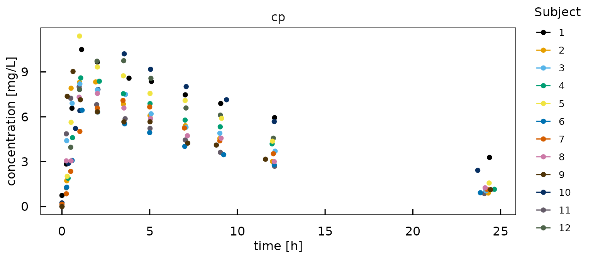
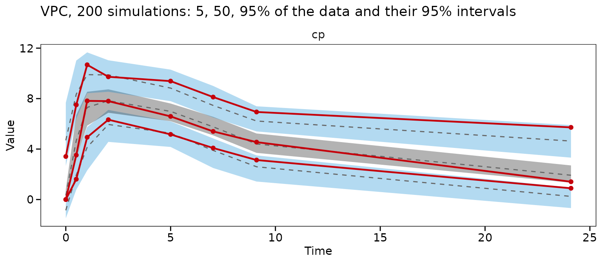

# 7. Nonlinear mixed-effects models

A mixed-effects model writes each individual parameter as a population
value plus a random deviation and integrates the deviations out of the
[likelihood](https://dmodverse.github.io/dMod2/articles/methods-objective.html#def-likelihood).
[Random
effects](https://dmodverse.github.io/dMod2/articles/methods-nlme.html#def-random-effect)
are declared in the `parfn`;
[`em()`](https://dmodverse.github.io/dMod2/reference/em.md) fits the
model. Example: theophylline, twelve subjects, one oral dose each.

``` r

library(dMod2)
options(dMod2.outdir = file.path(tempdir(), "guide-mixed-effects"))
dir.create(getOption("dMod2.outdir"), showWarnings = FALSE)
```

## Pharmacokinetic model

Depot, central compartment of volume \\V\\, clearance \\\mathrm{Cl}\\
(volume per time).

``` r

reactions <- eqnlist() |>
  assignCompartment(Ag = "depot") |>
  assignCompartment(Cc = "central", volume = "V") |>
  setCompartmentVolume(unit = "1") |>
  addReaction("Ag", "Cc", "Ka * Ag", "absorption") |>
  addReaction("Cc", "", "Cl * Cc", "elimination", rateCompartment = "unit")
as.eqnvec(reactions)
#> Idx Inner <- Outer
#>   1    Ag <- -1*(Ka*Ag)
#>   2    Cc <- 1*(Ka*Ag)*(1/V)-1*(Cl*Cc)*(1/V)
```

[`em()`](https://dmodverse.github.io/dMod2/reference/em.md) needs second
derivatives: `derivMode` with `"forward-forward"` and the
forward-over-reverse directions.

``` r

dm <- c("forward", "reverse", "forward-forward", "forward-reverse")
x <- Xs(odemodel(reactions, modelname = "theo", compile = FALSE, derivMode = dm))
g <- Y(c(cp = "Cc"), x, modelname = "theo_g", compile = FALSE, derivMode = dm)
e <- Y(c(cp = "sigma"), g, attachInput = FALSE, modelname = "theo_e", compile = FALSE,
       derivMode = dm)
```

## Theophylline data

One condition per subject; the condition table holds dose in mg and body
weight.

``` r

data(Theoph, package = "datasets")
Theoph$Subject <- as.character(Theoph$Subject)
data <- as.datalist(data.frame(name = "cp", time = Theoph$Time, value = Theoph$conc, sigma = NA_real_,
                               condition = Theoph$Subject))
subjects <- sort(unique(Theoph$Subject))
table <- data.frame(ID = subjects, dose = tapply(Theoph$Dose * Theoph$Wt, Theoph$Subject, `[`, 1)[subjects],
                    weight = tapply(Theoph$Wt, Theoph$Subject, `[`, 1)[subjects], row.names = subjects)
```

``` r

head(table)
#>    ID    dose weight
#> 1   1 319.992   79.6
#> 10 10 320.100   58.2
#> 11 11 319.800   65.0
#> 12 12 320.650   60.5
#> 2   2 318.560   72.4
#> 3   3 319.365   70.5
plotData(data) +
  ggplot2::labs(x = "time [h]", y = "concentration [mg/L]", color = "Subject")
```



## Random-effect formulas

[`define()`](https://dmodverse.github.io/dMod2/reference/define.md)
starts the transformation as in [Setting up
models](https://dmodverse.github.io/dMod2/articles/guide-model.md),
[`branch()`](https://dmodverse.github.io/dMod2/reference/define.md)
copies it per table row,
[`insert()`](https://dmodverse.github.io/dMod2/reference/define.md) sets
dose, initial values and log parameters. Effect formulas in lme4
notation give the linear predictors:

``` r

trafo <- eqnvec() |>
  define("x <- x", x = c("Ka", "V", "Cl", "Ag", "Cc", "sigma")) |>
  branch(table = table) |>
  insert("Ag <- dose", dose = dose) |>
  insert("Cc <- 0") |>
  insert("x <- exp(x)", x = c("Ka", "V", "Cl", "sigma")) |>
  insert(Ka + V + Cl ~ 1 + (1 | ID))
p <- P(trafo, method = "explicit", modelname = "theo_p", compile = FALSE, derivMode = dm)
compile(x, g, e, p, output = "theo", cores = 6)
random <- randomEffects(p)
random
#> Random effects: 3 terms over ID
#>   block 1 (normal, ID): eta_Ka
#>   block 2 (normal, ID): eta_V
#>   block 3 (normal, ID): eta_Cl
#>   fixed effects: Ka, V, Cl
```

The formula acts after the log transformation: \\\log \mathrm{Cl}\_i =
\mathrm{Cl} + \eta\_{\mathrm{Cl},i}\\, \\\eta\_{\mathrm{Cl},i} \sim
\mathcal{N}(0, \omega\_{\mathrm{Cl}}^2)\\. Further forms:

- `Cl ~ 1 + (1 | ID)`: random intercept per subject.
- `Cl ~ 1 + logWeight + (1 | ID)`: a covariate, [fixed
  effect](https://dmodverse.github.io/dMod2/articles/methods-nlme.html#def-fixed-effect)
  `Cl_logWeight` on a table column.
- `Ka + Cl ~ 1 + (1 | p | ID)`: random effects of `Ka` and `Cl`
  correlated (same ID `p`).
- `Cl ~ 1 + wt + (1 + dose | p | ID)`: a covariate and a random slope,
  correlated with the intercept.
- `Cl ~ 1 + (1 | ID) + (1 | ID:OCC)`: variability between subjects and
  between occasions.
- `Cl ~ 1 + (1 | gr(ID, dist = spikeSlab()))`:
  [spike-and-slab](https://dmodverse.github.io/dMod2/articles/methods-nlme.html#def-spike-and-slab)
  instead of normal random effects.

Conditions of one
[group](https://dmodverse.github.io/dMod2/articles/methods-nlme.html#def-group)
share the group random effects. The random effects of one ID form a
[block](https://dmodverse.github.io/dMod2/articles/methods-nlme.html#def-block)
with full covariance; `omega_<a>_<b>` are the entries of the Cholesky
factor of the block, with the log of the diagonal. Spike-and-slab and
Dirichlet-process random effects: [Sparse
deviations](https://dmodverse.github.io/dMod2/articles/guide-sparse-deviations.md).

## Marginal likelihood

[`em()`](https://dmodverse.github.io/dMod2/reference/em.md) maximizes
the marginal likelihood of fixed effects, \\\Omega\\ and [error
parameters](https://dmodverse.github.io/dMod2/articles/methods-objective.html#def-error-parameters)
with the random effects integrated out. It takes
`normL2(data, g * x * p, errmodel = e)`, or `normT(..., df = 4)` for
Student-t residuals, and builds the prior from `randomEffects(p)`.
`method`:

| method | use | reported \\-2 \log L\\ |
|----|----|----|
| `"focei"` | default, fast, Laplace’s approximation at the [modes](https://dmodverse.github.io/dMod2/articles/methods-sparsity-priors.html#def-mode) | Laplace |
| `"quadrature"` | skewed [posteriors](https://dmodverse.github.io/dMod2/articles/methods-nlme.html#def-posterior), few random effects per group | quadrature |
| `"laplaceEM"` | EM on the Laplace approximation | quadrature of level \\K + 2\\ |
| `"saem"` | many random effects per group, non-Gaussian posteriors | quadrature of level \\K + 2\\ |

\\K\\ is the number of random effects of a group. Derivations: [Methods
\> Marginal
likelihood](https://dmodverse.github.io/dMod2/articles/methods-nlme.html#marginal-likelihood),
[Methods \> EM
algorithm](https://dmodverse.github.io/dMod2/articles/methods-nlme.html#em-algorithm).

## First-order conditional estimation (FOCEI)

Laplace’s approximation at the mode of each group, [Methods \>
FOCEI](https://dmodverse.github.io/dMod2/articles/methods-nlme.html#focei).

### FOCEI fit

`init` holds the parameters other than random effects and effect-formula
coefficients (those start at 0); standard deviations start at
`control$sd`.

``` r

init <- c(Ka = 0, V = 3, Cl = 0.7, sigma = log(0.5))
fit <- em(obj = normL2(data, g * x * p, errmodel = e), random = random, init = init, verbose = FALSE)
summary(fit)
```

The fit is loaded from `results/guide-nlme.rds`, computed by
`results/guide-nlme.R`.

    #> EM summary (focei): -2 log L 359.403232, converged TRUE, 10 iterations
    #>   without the 2 pi constant of the data (NONMEM OBJ): 116.803459
    #> 
    #> Parameters:
    #>             estimate      se rsePct
    #> Ka            0.4639 0.19150 41.290
    #> V             3.4600 0.04700  1.358
    #> Cl            1.0120 0.08320  8.220
    #> sigma        -0.3647 0.07124 19.540
    #> omega_Ka_Ka  -0.4552 0.23380 51.360
    #> omega_V_V    -1.9770 0.28860 14.600
    #> omega_Cl_Cl  -1.3360 0.24810 18.570
    #> 
    #> Random effects:
    #>  type eta1 eta2 estimate      se
    #>    sd   Ka   Ka   0.6343 0.14830
    #>    sd    V    V   0.1384 0.03995
    #>    sd   Cl   Cl   0.2629 0.06521
    #> 
    #> Shrinkage: eta_Ka = 0.018, eta_V = 0.103, eta_Cl = 0.039

`omega_*` are log standard deviations here. Shrinkage near 1 means the
data of a subject hardly move the individual parameter.

`value` is [\\-2 \log
L\\](https://dmodverse.github.io/dMod2/articles/methods-nlme.html#def-minus-2-log-l);
`valueNonmem` compares with the NONMEM `OBJ` (`NA` for
[`normT()`](https://dmodverse.github.io/dMod2/reference/normT.md)). The
fit holds `Omega`, `omega`, `random`, `etaModes`, `etaSE` and
`shrinkage`. Methods: [`coef()`](https://rdrr.io/r/stats/coef.html),
[`vcov()`](https://rdrr.io/r/stats/vcov.html),
[`confint()`](https://rdrr.io/r/stats/confint.html) (Wald or
`method = "profile"`),
[`logLik()`](https://rdrr.io/r/stats/logLik.html),
[`AIC()`](https://rdrr.io/r/stats/AIC.html),
[`BIC()`](https://rdrr.io/r/stats/AIC.html),
[`anova()`](https://rdrr.io/r/stats/anova.html),
[`predict()`](https://rdrr.io/r/stats/predict.html),
[`residuals()`](https://rdrr.io/r/stats/residuals.html),
[`simulate()`](https://rdrr.io/r/stats/simulate.html) and the plots
below.

### FOCEI settings

| entry of `control` | default | controls |
|----|----|----|
| `sd` | `0.3` | start of standard deviations not in `init` |
| `innerControl` | `rinit = 1`, `rmax = 10`, `iterlim = 30`, `steptol = 1e-8`, `mtol = 1e-12` | [trust region](https://dmodverse.github.io/dMod2/articles/methods-trust.html#def-trust-region) of the modes |
| `trustControl` | `rinit = 1`, `rmax = 10`, `iterlim = 200`, `ftol = 1e-7`, `mtol = 1e-5` | trust region of population parameters |
| `derivMode` | `"forward-reverse"` | [volume-term](https://dmodverse.github.io/dMod2/articles/methods-nlme.html#volume-term) second derivatives, or `"forward-forward"` |
| `secondOrderCorrection` | `TRUE` | derivative of the volume term |

`"forward-forward"` needs models built with
`derivMode = "forward-forward"`. `secondOrderCorrection = FALSE` biases
the estimates ([Methods \> Volume
term](https://dmodverse.github.io/dMod2/articles/methods-nlme.html#volume-term)).
`fixed` holds parameters at given values, `sparse = TRUE` uses sparse
Hessians. The solver error must stay below the tolerances.
`em(cores = )`: [Remote
computing](https://dmodverse.github.io/dMod2/articles/guide-remote-computing.html#threads-and-processes).

## Adaptive sparse-grid quadrature

`method = "quadrature"` starts from the FOCEI fit and integrates on a
[sparse
grid](https://dmodverse.github.io/dMod2/articles/methods-nlme.html#def-sparse-grid)
around each group mode;
[level](https://dmodverse.github.io/dMod2/articles/methods-nlme.html#def-level)
\\K\\ is Laplace’s approximation. A certificate flags groups whose
posterior the grid does not resolve. [Methods \> Adaptive sparse-grid
quadrature](https://dmodverse.github.io/dMod2/articles/methods-nlme.html#adaptive-sparse-grid-quadrature).

| entry of `control$quadrature` | default | controls |
|----|----|----|
| `tol` | `0.1` | allowed change of \\-2 \log L\\ by the next level, split over groups; `Inf` keeps stage levels |
| `levels` | `K + 1` | stages; level `K + s` is exact for total degree `2 s + 1` |
| `maxLevel` | `K + 8` | highest level |
| `tolDecrement` | `1e-4` | [Newton decrement](https://dmodverse.github.io/dMod2/articles/methods-nlme.html#def-newton-decrement) that ends a stage |
| `maxECMPerStage` | `10` | rebuilds per stage |
| `cm1Control`, `maxCm1Iter` | `rinit = 1`, `ftol = mtol = 1e-8`; `30` | [`trust()`](https://dmodverse.github.io/dMod2/reference/trust.md) settings and iterations of a step |
| `pruneTol` | `Inf` | drop nodes with log weight this far below the largest |
| `certificate` | `points = 256`, `seed = 1` | importance-sampling check, `FALSE` skips |

The fit holds `stageTrace`, `etaCov` (posterior covariance per group)
and `certificate`; `plotTrace(fit)` draws the trace.

## Laplace EM

`method = "laplaceEM"`: expectation conditional maximization on the
Laplace approximation, reporting the quadrature of level \\K + 2\\,
without certificate. `control$quadrature` takes `epsECM` (default
`1e-5`), `maxECM` (default 200) and `cm1Control`, `maxCm1Iter`,
`pruneTol`, `maxLevel`. [Methods \> Laplace
EM](https://dmodverse.github.io/dMod2/articles/methods-nlme.html#laplace-em).

## Stochastic approximation EM (SAEM)

`method = "saem"` samples the random effects from the posterior and
averages over iterations after a burn-in;
[`set.seed()`](https://rdrr.io/r/base/Random.html) reproduces a fit.
Value and standard errors come from the quadrature of level \\K + 2\\.
[Methods \>
SAEM](https://dmodverse.github.io/dMod2/articles/methods-nlme.html#saem).

| entry of `control$saem` | default | controls |
|----|----|----|
| `nBurnin`, `nEM` | `200`, `300` | most burn-in and averaging iterations |
| `nMcmc`, `nLaplace` | `3`, `3` | random-walk and independence steps per iteration |
| `laplaceEvery` | `5` | iterations between mode refreshes |
| `laplaceScale` | `1.5` | covariance factor of the independence proposal |
| `window` | `25` | iterations of drift test and averaging start |
| `mcTol` | `0.05` | Monte Carlo increase of \\-2 \log L\\ that ends averaging |

## Comparison of methods

The four methods from the same start:

``` r

obj <- normL2(data, g * x * p, errmodel = e)
set.seed(1)
fits <- list(focei = fit,
             quadrature = em(obj, random, init, method = "quadrature", verbose = FALSE),
             saem = em(obj, random, init, method = "saem", verbose = FALSE))
round(sapply(fits, function(f) c(f$argument[names(fit$argument)], minus2logL = f$value)), 3)
```

    #>               focei quadrature    saem
    #> Ka            0.464      0.458   0.456
    #> V             3.460      3.454   3.452
    #> Cl            1.012      1.012   1.014
    #> sigma        -0.365     -0.365  -0.369
    #> omega_Ka_Ka  -0.455     -0.456  -0.458
    #> omega_V_V    -1.977     -2.003  -2.003
    #> omega_Cl_Cl  -1.336     -1.327  -1.305
    #> minus2logL  359.403    360.736 360.750

``` r

laplaceEM <- em(obj, random, init, method = "laplaceEM", verbose = FALSE)
round(c(laplaceEM$argument[names(fit$argument)], minus2logL = laplaceEM$value), 3)
```

    #>          Ka           V          Cl       sigma omega_Ka_Ka   omega_V_V 
    #>       0.459       3.453       1.008      -0.357      -0.475      -2.000 
    #> omega_Cl_Cl  minus2logL 
    #>      -1.330     360.745

Estimates agree within their standard errors. FOCEI may lie below the
quadrature: Laplace’s method is no bound.

``` r

fits$quadrature$stageTrace[, c("level", "ecmIter", "OFV", "decrement", "resolution", "maxLevel", "nodes")]
#>   level ecmIter      OFV    decrement resolution maxLevel nodes
#> 1     4       1 360.7537 2.511155e-02 0.03793258        5   216
#> 2     4       2 360.7360 2.069641e-05 0.03716135        5   216
fits$quadrature$certificate
#>    group level quadrature importance         se        khat   levelError capped
#> 1      1     5   32.90385   32.90340 0.02411012 -0.07228639 0.0008212683  FALSE
#> 2     10     5   28.07147   28.05387 0.02001133 -0.06603975 0.0001283021  FALSE
#> 3     11     5   23.71219   23.70321 0.02139642  0.10476665 0.0065223733  FALSE
#> 4     12     5   29.60478   29.61167 0.02302448  0.04149025 0.0016092704  FALSE
#> 5      2     5   38.26724   38.27522 0.02364013 -0.04894503 0.0009505509  FALSE
#> 6      3     5   20.51039   20.49096 0.02087663 -0.05571955 0.0038963377  FALSE
#> 7      4     5   31.37884   31.38223 0.02253427 -0.22478000 0.0001964500  FALSE
#> 8      5     5   49.61472   49.63003 0.02501056 -0.21762335 0.0036150673  FALSE
#> 9      6     5   28.05938   28.05605 0.02098541  0.31447183 0.0057162384  FALSE
#> 10     7     4   22.42988   22.41580 0.02083017 -0.09619858 0.0049346222  FALSE
#> 11     8     5   27.25380   27.24710 0.02036513  0.05859222 0.0036082926  FALSE
#> 12     9     5   28.92942   28.93133 0.02751150  0.06553239 0.0051625770  FALSE
#>     flag
#> 1  FALSE
#> 2  FALSE
#> 3  FALSE
#> 4  FALSE
#> 5  FALSE
#> 6  FALSE
#> 7  FALSE
#> 8  FALSE
#> 9  FALSE
#> 10 FALSE
#> 11 FALSE
#> 12 FALSE
```

Here the fit takes 2 rebuilds. No group is flagged.

## Model diagnostics

Individual (IPRED, random effects at the modes) and population
prediction (PRED, random effects 0):

``` r

plotCombined(fit, ncol = 4) +
  ggplot2::labs(x = "time [h]", y = "concentration [mg/L]")
```


Conditional weighted residuals (CWRES) linearize around the modes;
normalized prediction distribution errors (NPDE) come from simulations.
Both should be standard normal.

``` r

plotResiduals(fit, type = c("CWRES", "NPDE"), nsim = 200, seed = 1)
```


Visual predictive check, the 5th, 50th and 95th percentiles of the
readings per time bin against the prediction intervals of the same
percentiles of data simulated from the fit:

``` r

plotVPC(fit, nsim = 200, bins = 8, seed = 1)
```



Conditional draws of the random effects against the fitted
\\\mathcal{N}(0, \Omega\_{kk})\\:

``` r

plotRandomEffects(fit)
```


Random effects against a covariate:

``` r

plotRandomEffects(fit, covariates = table["weight"])
```


## Covariate effects

Body weight as a fixed effect on a table column, centered on log scale:

``` r

table$logWeight <- log(table$weight / 70)
trafo2 <- eqnvec() |>
  define("x <- x", x = c("Ka", "V", "Cl", "Ag", "Cc", "sigma")) |>
  branch(table = table) |>
  insert("Ag <- dose", dose = dose) |>
  insert("Cc <- 0") |>
  insert("x <- exp(x)", x = c("Ka", "V", "Cl", "sigma")) |>
  insert(Ka + V ~ 1 + (1 | ID)) |>
  insert(Cl ~ 1 + logWeight + (1 | ID))
p2 <- P(trafo2, method = "explicit", modelname = "theo_p2", compile = FALSE, derivMode = dm)
compile(p2, output = "theo2", cores = 6)
fit2 <- em(normL2(data, g * x * p2, errmodel = e), randomEffects(p2), init, verbose = FALSE)
comparison <- anova(fit, fit2)
comparison
```

    #>   model npar    value      AIC      BIC     chisq df         p
    #> 1     1    7 359.4032 373.4032 393.5828        NA NA        NA
    #> 2     2    8 358.6210 374.6210 397.6834 0.7822652  1 0.3764493

[`anova()`](https://rdrr.io/r/stats/anova.html) compares nested fits by
likelihood ratio. Weight lowers \\-2 \log L\\ by 0.78, p-value 0.38; the
simpler model stays.

## Nested and crossed groups

Nested groupings (occasions within subjects) or crossed ones (patients
and centers) are further formula terms, integrated by FOCEI per
connected component of the conditions. The [pharmacometrics
project](https://dmodverse.github.io/dMod2/articles/pharmacometrics.md)
fits mavoglurant with between-occasion variability:

``` r

insert(trafo, Cl ~ 1 + (1 | ID) + (1 | ID:OCC))
```

Which groups differ at all: [Sparse
deviations](https://dmodverse.github.io/dMod2/articles/guide-sparse-deviations.md).

## Multistart optimization

[`msem()`](https://dmodverse.github.io/dMod2/reference/msem.md) runs
[`em()`](https://dmodverse.github.io/dMod2/reference/em.md) from `fits`
starts, the first at `init`, the others perturbed with standard
deviation `sd`, and returns the best fit, all starts in `$multistart`.
`theophyllineMultistart.R` of the project `pharmacometrics` runs 200
starts each for FOCEI, quadrature and SAEM; the result is loaded from
`results/multistart.rds` of the project.

``` r

# 200 starts per method, from the same draws, each run to the end; SAEM with up to 500 burn-in and
# 1000 averaging iterations
methods <- c(FOCEI = "focei", quadrature = "quadrature", SAEM = "saem")
controls <- list(FOCEI = list(), quadrature = list(), SAEM = list(saem = list(nBurnin = 500, nEM = 1000)))
ms <- lapply(names(methods), function(m) {
  set.seed(1)
  msem(obj, random, init, method = methods[[m]], fits = 200, sd = 1,
       control = controls[[m]], cores = getOption("dMod2.cores", 1))
})
names(ms) <- names(methods)
```

FOCEI:

``` r

plotValues(saved$multistart$FOCEI, pseudoLog = wide)
```


Quadrature and SAEM, both valued by the quadrature:

``` r

plotValues(saved$multistart[c("quadrature", "SAEM")], pseudoLog = wide)
```


All three methods find the same two optima. About 21 of 200 starts per
method reach the lower one, the flip-flop solution:

``` r

flipflop <- saved$best$FOCEI
signif(rbind(fit = c(exp(fit$argument[c("Ka", "V", "Cl")]), minus2logL = fit$value),
             flipflop = c(exp(flipflop[c("Ka", "V", "Cl")]),
                          minus2logL = min(saved$multistart$FOCEI$value, na.rm = TRUE))), 4)
#>               Ka      V    Cl minus2logL
#> fit      1.59000 31.810 2.752      359.4
#> flipflop 0.08483  1.682 2.724      352.9
```

With one oral dose, absorption and elimination can swap: absorption
becomes the slow step, the volume shrinks to 1.7 L and the `Ka` random
effect vanishes. The likelihood prefers it by 6.5, but theophylline
spreads through the body water, about 0.5 L/kg; a prior on `V` selects
the upper plateau.

### Zero variance components

A variance that runs to 0 is returned at 0 and named in `fit$boundary`;
`control$boundary` (default 0.1) is the accepted rise of \\-2 \log L\\,
`FALSE` switches it off ([Methods \> Zero variance
components](https://dmodverse.github.io/dMod2/articles/methods-nlme.html#variance-at-the-boundary)).
On the lower plateau every method does so:

``` r

sapply(saved$multistart, function(t) sum(t$boundary == "omega_Ka_Ka"))
#>      FOCEI quadrature       SAEM 
#>         22         22         19
sapply(saved$best, function(b) signif(b[c("Ka", "V", "Cl")], 4))
#>      FOCEI quadrature    SAEM
#> Ka -2.4670    -2.4670 -2.4610
#> V   0.5201     0.5201  0.5263
#> Cl  1.0020     1.0020  1.0060
```

`theophyllineMultistart.R` refits the best fit of each method by every
other method:

``` r

# the best fit of every method refitted by every other method from the estimates of that fit, so that the
# values of the optima compare on the scale of each method
best <- lapply(ms, function(f) f$argument)
cross <- do.call(rbind, lapply(names(best), function(from) do.call(rbind, lapply(names(methods), function(by) {
  fit <- tryCatch(em(obj, random, best[[from]], method = methods[[by]], control = controls[[by]],
                     verbose = FALSE),
                  error = function(err) NULL)
  data.frame(from = from, by = by, value = if (is.null(fit)) NA else fit$value,
             converged = !is.null(fit) && isTRUE(fit$converged),
             Ka = if (is.null(fit)) NA else exp(fit$argument[["Ka"]]),
             V = if (is.null(fit)) NA else exp(fit$argument[["V"]]))
}))))
```

``` r

saved$cross
#>         from         by    value converged         Ka        V
#> 1      FOCEI      FOCEI 352.9345      TRUE 0.08483006 1.682221
#> 2      FOCEI quadrature 354.4876      TRUE 0.08483021 1.682224
#> 3      FOCEI       SAEM 354.4760     FALSE 0.08611933 1.710162
#> 4 quadrature      FOCEI 352.9345      TRUE 0.08483006 1.682221
#> 5 quadrature quadrature 354.4876      TRUE 0.08483014 1.682220
#> 6 quadrature       SAEM 354.5376      TRUE 0.08405681 1.652563
#> 7       SAEM      FOCEI 352.9345      TRUE 0.08483010 1.682227
#> 8       SAEM quadrature 354.4876      TRUE 0.08483021 1.682224
#> 9       SAEM       SAEM 354.4930      TRUE 0.08446507 1.670658
```

Each method reaches the same estimates from every start. FOCEI lies
about 1.6 below the quadrature, SAEM within 0.05 of it.

[`msem()`](https://dmodverse.github.io/dMod2/reference/msem.md) draws
all starts and seeds before spreading fits over `cores`, so
[`set.seed()`](https://rdrr.io/r/base/Random.html) reproduces a run;
`cores = c(fits = , conditions = )`: see [Remote
computing](https://dmodverse.github.io/dMod2/articles/guide-remote-computing.html#threads-and-processes).

Reference:
[`randomEffects()`](https://dmodverse.github.io/dMod2/reference/randomEffects.md),
[`em()`](https://dmodverse.github.io/dMod2/reference/em.md),
[`msem()`](https://dmodverse.github.io/dMod2/reference/msem.md),
[`anova()`](https://rdrr.io/r/stats/anova.html),
[`plotResiduals()`](https://dmodverse.github.io/dMod2/reference/plotResiduals.md),
[`plotVPC()`](https://dmodverse.github.io/dMod2/reference/plotVPC.md),
[`plotRandomEffects()`](https://dmodverse.github.io/dMod2/reference/plotRandomEffects.md),
[`plotTrace()`](https://dmodverse.github.io/dMod2/reference/plotTrace.md),
[`plotValues()`](https://dmodverse.github.io/dMod2/reference/plotValues.md)

[← 6. Prediction
uncertainty](https://dmodverse.github.io/dMod2/articles/guide-prediction-uncertainty.md)
\| [8. Sparse deviations
→](https://dmodverse.github.io/dMod2/articles/guide-sparse-deviations.md)

## References
