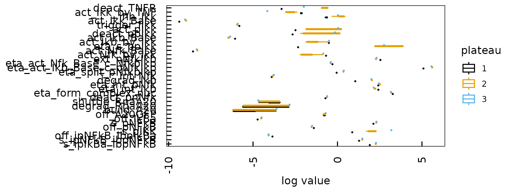

# 4. Optimization

dMod2 [\[1\]](#ref-kaschek2019dmod) minimizes \\-2 \log L\\, with a
prior \\-2 \log\\ of the posterior, by a trust-region method on the
exact gradient,
[`trust()`](https://dmodverse.github.io/dMod2/reference/trust.md), run
from many starts by
[`mstrust()`](https://dmodverse.github.io/dMod2/reference/mstrust.md).
The fits below use the model of [Setting up
models](https://dmodverse.github.io/dMod2/articles/guide-model.md) with
the gauge of
[Symmetries](https://dmodverse.github.io/dMod2/articles/guide-symmetries.md),
by `fit.R`, `onefit.R` and `plots.R` of the project. Derivations:
[Methods \> Trust-region
optimization](https://dmodverse.github.io/dMod2/articles/methods-trust.md).

## Trust-region method

Each iteration minimizes a quadratic model of the objective inside a
ball of radius \\r\\; the ratio of actual to predicted decrease decides
on the step and the radius. `rinit` is the first radius in the units of
the parameters, on the log scale `0.1` is ten percent of a rate. A trial
point at which the objective fails counts as rejected, so no bounds are
needed to keep a fit where the model can be evaluated.
`stepControl$nonmonotone` in \\(0, 1)\\ also accepts steps that raise
the value; the result is then the best iterate.

`parlower` and `parupper` set bounds. `boundary = "reflective"`
(default) keeps the iterates strictly inside and reports the parameters
held by a bound in `atBound`; `boundary = "clip"` takes them out of the
subproblem, runs a single Gauss-Newton phase, reads only `ftol` and
`mtol` and stops with `"fvalue"` or `"iterlim"`.

### Termination criteria

`stopReason` names the test that ended the run:

| `stopReason` | test | `converged` |
|----|----|----|
| `"gradient"` | largest gradient entry, scaled by the distance to a bound, at most `gtol` | `TRUE` |
| `"fvalue"` | an accepted step changed the value by less than `ftol` | `TRUE` |
| `"preddiff"` | predicted decrease below `mtol` | `TRUE` |
| `"step"` | step norm below `xtol` (default 0, off) | `TRUE` |
| `"stagnation"` | five rejected steps in a row, value flat within `ftol` | `TRUE` |
| `"radius"` | radius below `rmin`, or a step that no longer changes the parameters | `FALSE` |
| `"objfun"` | three failed evaluations in a row | `FALSE` |
| `"iterlim"` | `iterlim` iterations | `FALSE` |

Only `"gradient"` tests first-order optimality; the last quasi-Newton
phase ignores the value, model and step tests ([Hessian
phases](#hessian-phases-and-reverse-sweep)). `"gradient"`, `"fvalue"`
and `"preddiff"` end a run of
[`trust()`](https://dmodverse.github.io/dMod2/reference/trust.md) or
[`trustL1()`](https://dmodverse.github.io/dMod2/reference/trust.md) only
where the full Newton step also predicts a decrease of at most `mtol`
([Methods \> Termination
criteria](https://dmodverse.github.io/dMod2/articles/methods-trust.html#termination-criteria)).
`ftol` and `gtol` belong at or above the numerical error of value and
gradient; `model.R` defines them as `tolerances`, which the fitting
scripts pass as `tolControl`.

## Model Hessian

| `hessianMethod` | model Hessian | the objective returns |
|----|----|----|
| `"gn"` | Gauss-Newton | value, gradient, Gauss-Newton Hessian |
| `"exact"` | exact (Newton) | value, gradient, exact Hessian |
| `"bfgs"` | damped BFGS update, positive definite | value, gradient |
| `"sr1"` | symmetric rank-one update, possibly indefinite | value, gradient |

The exact Hessian needs second-order sensitivities, `deriv2 = TRUE` or
`derivMode = "forward-reverse"`
([Sensitivities](https://dmodverse.github.io/dMod2/articles/guide-sensitivities.md)).
The quasi-Newton settings are entries of `qnControl`:

| entry | default | controls |
|----|----|----|
| `hessianInit` | `"gn"` | seed: Gauss-Newton at the start, `"identity"`, or `"exact"` |
| `hessianReseed` | `"never"` | `"stall"`: reseed at the current iterate instead of stopping on stagnation or on a step that no longer moves it, where the iterate moved since the last reseed, at most eight times per phase |
| `qnMemory` | `0` | `0` accumulates all updates; \\m \> 0\\ rebuilds from the last \\m\\ pairs |
| `qnCautious` | `1e-8` | cautious test of BFGS; `0` turns it off |
| `qnRejected` | `TRUE` for `"sr1"` | SR1 also updates from rejected trial points |

With `hessianInit = "identity"` the objective needs to return gradients
only.

### Hessian phases and reverse sweep

`phases` runs several sources in turn. Each phase is a list with
`hessianMethod` and optionally `iterlim`, `sweep` and `qnControl`. A
phase ends on a value, model, step or stagnation stop or on the
`iterlim` of the phase and hands over to the next; `"gradient"` ends the
run. `switches` bounds the handovers (default: one fewer than phases).

``` r

fit <- trust(obj, best, fixed = gauge, tolControl = tolerances,
             phases = list(list(hessianMethod = "gn"), list(hessianMethod = "sr1")))
fit[c("phaseIterations", "evalBySource", "nSwitch", "stopReason")]
```

`sweep = "reverse"` computes the gradient of a quasi-Newton phase by one
backward sweep, for models built with
`derivMode = c("forward", "reverse")`; by default a `"bfgs"` or `"sr1"`
phase of `phases` sweeps backwards where it can, while a run without
`phases` sweeps only with `sweep = "reverse"`. With `phases`,
`phaseSweep` reports the sweep per phase.

### Sparse Hessians

`sparse = TRUE` solves the subproblem on sparse Cholesky factors of the
Hessian, for many parameters that each act on few conditions; a part of
the Hessian that couples many parameters at once, such as the
normalization of an alignment, comes as a low-rank part. The steps,
phases, bounds and stops are those of the dense path, so both reach the
same fit. The default `"auto"` selects the sparse path from 100
parameters on where a step on the sparse Hessian costs fewer flops than
one on the dense Hessian;
`options(dMod2.sparseAuto = list(parameters = , fill = ))` moves the
lower bound or replaces the cost by an upper bound of the fill.

### Arguments and result

| argument | default | controls |
|----|----|----|
| `rinit`, `rmax` | `0.1`, `10` | first and largest radius |
| `iterlim` | `1000` | iterations over all phases |
| `hessianMethod` | `"gn"` | source of the model Hessian |
| `phases`, `switches` | none | several sources in turn |
| `parlower`, `parupper`, `boundary` | none, `"reflective"` | bounds |
| `tolControl` | `ftol`, `mtol`, `gtol` `1e-6`; `xtol`, `rmin` `0`; `ctol` `1e-6` | termination; `ctol` for multiple shooting |
| `qnControl` | see above | quasi-Newton update |
| `stepControl` | `thetaMax = 0.99995`, `nonmonotone = 0` | step; further entries for multiple shooting |
| `minimize` | `TRUE` | `FALSE` maximizes |
| `sparse` | `"auto"` | sparse path |
| `blather`, `printIter`, `traceFile` | `FALSE`, `FALSE`, none | trace in the result, printed values, CSV log |

Other arguments go to the objective, such as `fixed`. The result, a
`trustfit`, holds `argument`, `value`, `gradient`, `hessian`,
`iterations`, `neval`, `converged`, `atBound` and `stopReason`; with
`blather = TRUE` also the path of iterates and trial points. `vcov(fit)`
inverts half the Hessian.

## Single fit

`onefit.R` fits from one start drawn with standard deviation 0.5 around
the best fit;
[`mstrust()`](https://dmodverse.github.io/dMod2/reference/mstrust.md)
draws again where the model cannot be evaluated:

``` r

# the start drawn with standard deviation 0.5 around the best fit, and drawn again where the
# model cannot be evaluated
best <- as.parvec(readRDS("results/fits.rds"))
set.seed(1)
fit <- mstrust(obj, best, fixed = gauge, sd = 0.5, fits = 1, rinit = 0.1, rmax = 10,
               iterlim = 1000, tolControl = tolerances)[[1]]
```

``` r

fit <- readRDS("results/onefit.rds")
fit[c("value", "converged", "iterations", "stopReason")]
#> $value
#> [1] -488.6772
#> 
#> $converged
#> [1] TRUE
#> 
#> $iterations
#> [1] 263
#> 
#> $stopReason
#> [1] "fvalue"
```

## Multistart fitting

[`mstrust()`](https://dmodverse.github.io/dMod2/reference/mstrust.md)
fits from many starts and returns a list of fits;
[`as.parframe()`](https://dmodverse.github.io/dMod2/reference/as.parframe.md)
sorts them by value. `fit.R` draws 200 starts from the prior of [Setting
up
models](https://dmodverse.github.io/dMod2/articles/guide-model.html#likelihood-and-prior):

``` r

# 200 fits from starts drawn from the prior; a start at which the model cannot be evaluated is
# replaced by the next draw. helix.R runs the same fits as 100 array tasks of 2 fits each.
free <- setdiff(names(mu), names(gauge))
set.seed(1)
fits <- mstrust(obj, mu[free], fixed = gauge, sd = sigma[free], fits = 200, iterlim = 1000,
                tolControl = tolerances, cores = getOption("dMod2.cores")) |>
  as.parframe()
```

Arguments go by name to
[`trust()`](https://dmodverse.github.io/dMod2/reference/trust.md), to
the sampler (`sd` to [`rnorm()`](https://rdrr.io/r/stats/Normal.html))
or to the objective. All starts are drawn before the fits are
distributed, so [`set.seed()`](https://rdrr.io/r/base/Random.html)
reproduces a run for any `cores`.

| argument | default | controls |
|----|----|----|
| `center` |  | center of the starts, or a parframe of starts |
| `fits` | `20` | number of fits |
| `samplefun` | `"rnorm"` | sampler of the offsets |
| `startFromCenter` | `FALSE` | first fit starts at `center` |
| `retry`, `nTries` | `TRUE`, `10` | a failed fit restarts from the next draw |
| `cores` | `1` | parallel fits, or `c(fits = , conditions = )` |
| `optmethod` | `"trust"` | optimizer, e.g. `"trustL1"` |
| `output`, `cautiousMode` | `FALSE` | `output` writes every fit to `resultPath/name/trial-<k>-<date>/interRes/` while the run goes on and the parameter list at the end of the run; `cautiousMode` adds a deparsed `.R` copy of every fit, kept after the run |

[`msParframe()`](https://dmodverse.github.io/dMod2/reference/msParframe.md)
draws starts from a separate seed, so several runs can share them;
[`load.parlist()`](https://dmodverse.github.io/dMod2/reference/load.parlist.md)
reads the fits in `interRes/` of a run that is still going or was
aborted, since a finished run removes them and leaves
`parameterList.Rda`. `helix.R` runs the 200 fits as 100 array tasks
([Remote
computing](https://dmodverse.github.io/dMod2/articles/guide-remote-computing.md)):

``` r

library(ggplot2)
fits <- readRDS("results/fits.rds")
best <- as.parvec(fits)
```

``` r

c(fits = nrow(fits), converged = sum(fits$converged), best = min(fits$value),
  withinOne = sum(fits$value < min(fits$value) + 1))
#>      fits converged      best withinOne 
#>  200.0000  152.0000 -488.6773   11.0000
```

The waterfall plot shows the sorted values; each plateau is a local
optimum, the length of the plateau the size of the basin of attraction:

``` r

# every fit on a pseudo-log scale; each plateau is a local optimum
plotValues(fits, pseudoLog = TRUE)
```


The parameters that differ by more than 0.1 between the plateaus within
5 of the best:

``` r

pl <- plotPars(fits, value < min(value) + 5)
med <- with(pl$data, tapply(parvalue, list(name, step), median))
differ <- rownames(med)[apply(med, 1, function(m) diff(range(m, na.rm = TRUE))) > 0.1]
pl %+% subset(pl$data, name %in% differ) +
  coord_flip() +
  scale_x_discrete(limits = rev) +
  labs(x = NULL, y = "log value", color = "plateau")
#> Warning: <ggplot> %+% x was deprecated in ggplot2 4.0.0.
#> ℹ Please use <ggplot> + x instead.
#> This warning is displayed once per session.
#> Call `lifecycle::last_lifecycle_warnings()` to see where this warning was
#> generated.
```



## Comparison of Hessian sources

`optimizers.R` fits from the same 100 starts with Gauss-Newton, BFGS and
SR1 on the reverse gradient, the exact Hessian, and Gauss-Newton
followed by BFGS. `hits` counts the starts that end within 5 of the best
value:

``` r

opt <- readRDS("results/optimizers.rds")
top <- min(opt$value, na.rm = TRUE)
tapply(opt$value < top + 5, factor(opt$method, unique(opt$method)), sum, na.rm = TRUE)
#>  Gauss-Newton          BFGS           SR1         exact GN, then BFGS 
#>            20            14            13            11            11
```

Costs and the full comparison: [Methods \> Forward and reverse
derivatives on the Oppelt
fit](https://dmodverse.github.io/dMod2/articles/methods-trust.html#forward-and-reverse-derivatives-on-the-oppelt-fit).

## L1 penalties

[`trustL1()`](https://dmodverse.github.io/dMod2/reference/trust.md) adds
\\\sum_i \lambda_i \lvert \theta_i - \mu_i \rvert\\ for the parameters
named in `mu`, with strength `lambda`. A penalized parameter stays at
the reference until the data pull with a force above \\\lambda_i\\; a
scan over `lambda` selects the parameters that differ.
`one.sided = TRUE` penalizes one side only, `gate` lets parameters leave
upward only, `fuse` penalizes differences within blocks of parameters.
Bounds and tolerances are those of
[`trust()`](https://dmodverse.github.io/dMod2/reference/trust.md);
`mstrust(optmethod = "trustL1")` runs it from many starts. Details:
[Methods \> L1
penalties](https://dmodverse.github.io/dMod2/articles/methods-trust.html#l1-penalties).

## Multiple shooting

Multiple shooting integrates segments of the time axis from separate
node values and makes continuity a constraint, which helps for
oscillating or spiking systems ([Methods \> Multiple
shooting](https://dmodverse.github.io/dMod2/articles/methods-multiple-shooting.md)).
It is a control of the objective:

``` r

obj <- normL2(data, g * x * p, multipleShootingControl = TRUE)
fit <- trust(obj, start)
fit$multipleShooting$violation
controls(obj, "multipleShootingControl") <- NULL   # single shooting again
```

The chain must be `g * x * p` with one
[`Xs()`](https://dmodverse.github.io/dMod2/reference/Xs.md) built on
`odemodel(..., includeTimeZero = FALSE)`. Not available with it:
`hessianMethod = "exact"`, `qnControl$hessianInit = "exact"`, several
phases, `switches`, `hessianReseed`, `qnMemory`, `nonmonotone`,
`boundary = "clip"`, `minimize = FALSE`, `traceFile`.

| entry of `multipleShootingControl` | default | controls |
|----|----|----|
| `nodes` | `"auto"` | `"auto"`, `"transitions"`, or node times |
| `growth`, `misfit` | `10`, `3` | thresholds at which `"auto"` cuts a segment |
| `minPoints` | states + 1 | data points per half of a cut |
| `charts` | all linear | `"log10"`, `"linear"` or `"angle"` per state |
| `scale` | from the data | scale of the gaps and node steps |
| `init` | `"data"` | node values: `"data"`, `"spline"`, `"simulation"` or a list |
| `breaks` | none | node times without continuity |

| entry of `stepControl` | default | controls |
|----|----|----|
| `acceptance` | `"filter"` | `"filter"`, `"merit"` or `"natural"` |
| `soc` | `TRUE` | second-order correction of a rejected step |
| `anneal` | `TRUE` | penalty on the gaps raised in stages |
| `twoPhase`, `restore`, `regularize` | off | further globalizations |

`converged = TRUE` requires the scaled gaps below `tolControl$ctol`. The
result has a list `multipleShooting` with `nodes`, `gaps`, `violation`
and the counts of the globalization.

Reference:
[`trust()`](https://dmodverse.github.io/dMod2/reference/trust.md),
[`mstrust()`](https://dmodverse.github.io/dMod2/reference/mstrust.md),
[`trustL1()`](https://dmodverse.github.io/dMod2/reference/trust.md),
[`msParframe()`](https://dmodverse.github.io/dMod2/reference/msParframe.md),
[`as.parframe()`](https://dmodverse.github.io/dMod2/reference/as.parframe.md),
[`load.parlist()`](https://dmodverse.github.io/dMod2/reference/load.parlist.md),
[`plotValues()`](https://dmodverse.github.io/dMod2/reference/plotValues.md),
[`plotPars()`](https://dmodverse.github.io/dMod2/reference/plotPars.md),
[`normL2()`](https://dmodverse.github.io/dMod2/reference/normL2.md)

[← 3.
Sensitivities](https://dmodverse.github.io/dMod2/articles/guide-sensitivities.md)
\| [5. Profile likelihood
→](https://dmodverse.github.io/dMod2/articles/guide-profiles.md)

## References

\[1\]

D. Kaschek, W. Mader, M. Fehling-Kaschek, M. Rosenblatt, and J. Timmer,
“dMod: Efficient parameter estimation and uncertainty analysis for
dynamic models,” *Journal of Statistical Software*, vol. 88, no. 10, pp.
1–32, 2019, doi:
[10.18637/jss.v088.i10](https://doi.org/10.18637/jss.v088.i10).
