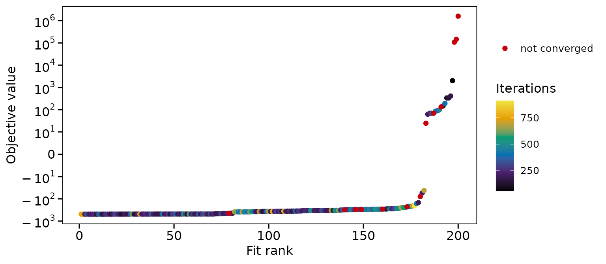
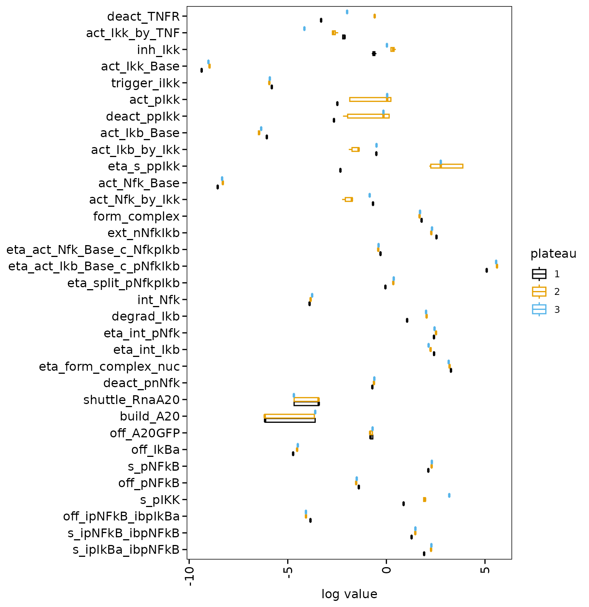

# 4. Optimization

dMod2 [\[1\]](#ref-kaschek2019dmod) minimizes \\-2 \log L\\ (with a
prior, \\-2 \log\\ of the posterior) by the trust-region method
[`trust()`](https://dmodverse.github.io/dMod2/reference/trust.md), from
many starts by
[`mstrust()`](https://dmodverse.github.io/dMod2/reference/mstrust.md),
here on the model of [Setting up
models](https://dmodverse.github.io/dMod2/articles/guide-model.md) with
the gauge of
[Symmetries](https://dmodverse.github.io/dMod2/articles/guide-symmetries.md).
Derivations: [Methods \> Trust-region
optimization](https://dmodverse.github.io/dMod2/articles/methods-trust.md).

## Trust-region method

Each iteration minimizes a quadratic model inside a ball of radius
\\r\\, first `rinit`; the ratio of actual to predicted decrease decides
on step and radius. A trial point where the objective fails counts as
rejected. `stepControl$nonmonotone` in \\(0, 1)\\ also accepts rising
steps and returns the best iterate.

`parlower` and `parupper` set bounds. `boundary = "reflective"`
(default) keeps the iterates strictly inside and lists bound parameters
in `atBound`; `boundary = "clip"` removes them from the subproblem and
runs Gauss-Newton only, with `ftol` and `mtol`.

### Termination criteria

`stopReason` names the test that ended the run:

| `stopReason` | test | `converged` |
|----|----|----|
| `"gradient"` | largest gradient entry, scaled by the distance to a bound, at most `gtol` | `TRUE` |
| `"fvalue"` | an accepted step changed the value by less than `ftol` | `TRUE` |
| `"preddiff"` | predicted decrease below `mtol` | `TRUE` |
| `"step"` | step norm below `xtol` (default 0, off) | `TRUE` |
| `"stagnation"` | five rejected steps in a row, value flat within `ftol` | `TRUE` where the full Newton step predicts at most `mtol` |
| `"radius"` | radius below `rmin`, or a step that no longer changes the parameters | `FALSE` |
| `"objfun"` | three failed evaluations in a row | `FALSE` |
| `"iterlim"` | `iterlim` iterations | `FALSE` |

`"gradient"`, `"fvalue"` and `"preddiff"` stop only where the full
Newton step also predicts at most `mtol` ([Methods \> Termination
criteria](https://dmodverse.github.io/dMod2/articles/methods-trust.html#termination-criteria)).
`ftol` and `gtol` belong at or above the numerical error; `model.R`
defines them as `tolerances`, passed as `tolControl`.

## Model Hessian

| `hessianMethod` | model Hessian | the objective returns |
|----|----|----|
| `"gn"` | Gauss-Newton | value, gradient, Gauss-Newton Hessian |
| `"exact"` | exact (Newton) | value, gradient, exact Hessian |
| `"bfgs"` | damped BFGS update, positive definite | value, gradient |
| `"sr1"` | symmetric rank-one update, possibly indefinite | value, gradient |

The default is the hybrid of Fides [\[2\]](#ref-froehlich2022fides):
Gauss-Newton until the radius stayed the same for 20 iterations, then
BFGS ([Methods \> Hessian
phases](https://dmodverse.github.io/dMod2/articles/methods-trust.html#hessian-phases)).
The sparse path, multiple shooting and `boundary = "clip"` run
Gauss-Newton. `"exact"` needs `deriv2 = TRUE` or
`derivMode = "forward-reverse"`
([Sensitivities](https://dmodverse.github.io/dMod2/articles/guide-sensitivities.md)).
Quasi-Newton settings, entries of `qnControl`:

| entry | default | controls |
|----|----|----|
| `hessianInit` | `"gn"` | seed: `"gn"`, `"identity"`, `"exact"`, or `"tracked"` (later phases) |
| `hessianReseed` | `"never"` | `"stall"`: reseed instead of stopping on stagnation, up to 8 times |
| `qnMemory` | `0` | `0` accumulates all updates; \\m \> 0\\ rebuilds from the last \\m\\ pairs |
| `qnCautious` | `1e-8` | cautious test of BFGS; `0` turns it off |
| `qnRejected` | `TRUE` for `"sr1"` | SR1 also updates from rejected trial points |

### Hessian phases and reverse sweep

`phases` runs several sources in turn, each a list with `hessianMethod`
and optionally `iterlim`, `radiusStall`, `sweep`, `keepRadius`, `onStop`
and `qnControl`. A phase hands over on a stop other than `"gradient"`,
on `iterlim` or after `radiusStall` iterations at one radius; `switches`
bounds the handovers.

``` r

fit <- trust(obj, best, fixed = gauge, tolControl = tolerances,
             phases = list(list(hessianMethod = "gn"), list(hessianMethod = "sr1")))
fit[c("phaseIterations", "evalBySource", "nSwitch", "stopReason")]
```

`sweep = "reverse"` computes the gradient of a quasi-Newton phase by one
backward sweep, for models built with
`derivMode = c("forward", "reverse")`; a `"bfgs"` or `"sr1"` phase does
so by default.

### Sparse Hessians

`sparse = TRUE` uses sparse Cholesky factors, plus a low-rank part, for
many parameters that each act on few conditions; it reaches the same fit
as the dense path. `"auto"` (default) takes it from 100 parameters on
where it costs fewer flops (`options(dMod2.sparseAuto = )`).

### Arguments and result

| argument | default | controls |
|----|----|----|
| `rinit`, `rmax` | `0.1`, `10` | first and largest radius |
| `iterlim` | `1000` | iterations over all phases |
| `hessianMethod` | Gauss-Newton, then BFGS | source of the model Hessian |
| `phases`, `switches` | none | several sources in turn |
| `parlower`, `parupper`, `boundary` | none, `"reflective"` | bounds |
| `tolControl` | `ftol`, `mtol`, `gtol` `1e-6`; `xtol`, `rmin` `0`; `ctol` `1e-6` | termination; `ctol` for multiple shooting |
| `qnControl` | see above | quasi-Newton update |
| `stepControl` | `thetaMax = 0.99995`, `nonmonotone = 0` | step; further entries for multiple shooting |
| `minimize` | `TRUE` | `FALSE` maximizes |
| `sparse` | `"auto"` | sparse path |
| `blather`, `printIter`, `traceFile` | `FALSE`, `FALSE`, none | trace in the result, printed values, CSV log |

Other arguments go to the objective, such as `fixed`. The `trustfit`
holds `argument`, `value`, `gradient`, `hessian`, `iterations`,
`converged`, `atBound` and `stopReason`.

## Single fit

`onefit.R` fits from one start drawn with standard deviation 0.5 around
the best fit; the fit is loaded from `results/onefit.rds`:

``` r

# the start drawn with standard deviation 0.5 around the best fit, and drawn again where the
# model cannot be evaluated
best <- as.parvec(readRDS("results/fits.rds"))
set.seed(1)
fit <- mstrust(obj, best, fixed = gauge, sd = 0.5, fits = 1, rinit = 0.1, rmax = 10,
               iterlim = 1000, tolControl = tolerances)[[1]]
```

``` r

fit <- readRDS("results/onefit.rds")
fit[c("value", "converged", "iterations", "stopReason")]
#> $value
#> [1] -488.6772
#> 
#> $converged
#> [1] TRUE
#> 
#> $iterations
#> [1] 51
#> 
#> $stopReason
#> [1] "fvalue"
```

## Multistart fitting

[`mstrust()`](https://dmodverse.github.io/dMod2/reference/mstrust.md)
fits from many starts;
[`as.parframe()`](https://dmodverse.github.io/dMod2/reference/as.parframe.md)
sorts the fits by value. `fit.R` draws 200 starts from the prior of
[Setting up
models](https://dmodverse.github.io/dMod2/articles/guide-model.html#likelihood-and-prior):

``` r

# 200 fits from starts drawn from the prior; a start at which the model cannot be evaluated is
# replaced by the next draw. helix.R runs the same fits as 100 array tasks of 2 fits each.
free <- setdiff(names(mu), names(gauge))
set.seed(1)
fits <- mstrust(obj, mu[free], fixed = gauge, sd = sigma[free], fits = 200, iterlim = 1000,
                tolControl = tolerances, cores = getOption("dMod2.cores")) |>
  as.parframe()
```

Arguments go by name to
[`trust()`](https://dmodverse.github.io/dMod2/reference/trust.md), the
sampler or the objective;
[`set.seed()`](https://rdrr.io/r/base/Random.html) reproduces a run for
any `cores`.

| argument | default | controls |
|----|----|----|
| `center` |  | center of the starts, or a parframe of starts |
| `fits` | `20` | number of fits |
| `samplefun` | `"rnorm"` | sampler of the offsets |
| `startFromCenter` | `FALSE` | first fit starts at `center` |
| `retry`, `nTries` | `TRUE`, `10` | a failed fit restarts from the next draw |
| `cores` | `1` | parallel fits, or `c(fits = , conditions = )` |
| `optmethod` | `"trust"` | optimizer, e.g. `"trustL1"` |
| `output`, `cautiousMode` | `FALSE` | write fits to `resultPath` during the run |

[`msParframe()`](https://dmodverse.github.io/dMod2/reference/msParframe.md)
draws shareable starts;
[`load.parlist()`](https://dmodverse.github.io/dMod2/reference/load.parlist.md)
reads the fits of a running or aborted run. The fits of `fit.R` ([Remote
computing](https://dmodverse.github.io/dMod2/articles/guide-remote-computing.md))
are loaded from `results/fits.rds`:

``` r

library(ggplot2)
fits <- readRDS("results/fits.rds")
best <- as.parvec(fits)
```

``` r

c(fits = nrow(fits), converged = sum(fits$converged), best = min(fits$value),
  withinOne = sum(fits$value < min(fits$value) + 1))
#>      fits converged      best withinOne 
#>  200.0000  187.0000 -488.6774   15.0000
```

Sorted values; each plateau is a local optimum:

``` r

# every fit on a pseudo-log scale; each plateau is a local optimum
plotValues(fits, pseudoLog = TRUE)
```



Parameters that differ by more than 0.1 between the plateaus within 5 of
the best:

``` r

pl <- plotPars(fits, value < min(value) + 5)
med <- with(pl$data, tapply(parvalue, list(name, step), median))
differ <- rownames(med)[apply(med, 1, function(m) diff(range(m, na.rm = TRUE))) > 0.1]
pl$data <- subset(pl$data, name %in% differ)
```

``` r

pl +
  coord_flip() +
  scale_x_discrete(limits = rev) +
  labs(x = NULL, y = "log value", color = "plateau")
```



## Comparison of Hessian sources

`optimizers.R` fits from the same 100 starts with several Hessian
sources, loaded from `results/optimizers.rds`. `hits` counts the fits
within 5 of the best value:

``` r

opt <- readRDS("results/optimizers.rds")
top <- min(opt$value, na.rm = TRUE)
shown <- c("default (Fides hybrid)", "Gauss-Newton", "BFGS", "exact", "GN, then BFGS", "GN, then BFGS at stall 50", "SSR1, scaled",
           "GNSBFGS")
opt <- opt[opt$method %in% shown, ]
method <- factor(opt$method, shown)
t(rbind(converged = tapply(opt$converged, method, sum),
        hits = tapply(opt$value < top + 5, method, sum, na.rm = TRUE),
        secondsPerHit = round(tapply(opt$elapsed, method, sum, na.rm = TRUE) /
                              tapply(opt$value < top + 5, method, sum, na.rm = TRUE))))
#>                           converged hits secondsPerHit
#> default (Fides hybrid)           92   21           238
#> Gauss-Newton                     84   21           222
#> BFGS                             85   17            91
#> exact                            97   15          1247
#> GN, then BFGS                    91   21            64
#> GN, then BFGS at stall 50        85   21           114
#> SSR1, scaled                     95   25           161
#> GNSBFGS                          88   20           154
```

The exact Hessian converges most often, scaled SR1 reaches the best
plateaus most often, and Gauss-Newton followed by BFGS on the reverse
gradient needs the least time per hit. Details: [Methods \> Forward and
reverse derivatives on the Oppelt
fit](https://dmodverse.github.io/dMod2/articles/methods-trust.html#forward-and-reverse-derivatives-on-the-oppelt-fit).

## L1 penalties

[`trustL1()`](https://dmodverse.github.io/dMod2/reference/trust.md) adds
\\\sum_i \lambda_i \lvert \theta_i - \mu_i \rvert\\ for the parameters
named in `mu`; a scan over `lambda` selects the parameters that differ
from the reference. `one.sided`, `gate` and `fuse` vary the penalty
([Methods \> L1
penalties](https://dmodverse.github.io/dMod2/articles/methods-trust.html#l1-penalties)).

Multiple shooting for oscillating or spiking systems: [Methods \>
Multiple
shooting](https://dmodverse.github.io/dMod2/articles/methods-multiple-shooting.md).

Reference:
[`trust()`](https://dmodverse.github.io/dMod2/reference/trust.md),
[`mstrust()`](https://dmodverse.github.io/dMod2/reference/mstrust.md),
[`trustL1()`](https://dmodverse.github.io/dMod2/reference/trust.md),
[`msParframe()`](https://dmodverse.github.io/dMod2/reference/msParframe.md),
[`as.parframe()`](https://dmodverse.github.io/dMod2/reference/as.parframe.md),
[`load.parlist()`](https://dmodverse.github.io/dMod2/reference/load.parlist.md),
[`plotValues()`](https://dmodverse.github.io/dMod2/reference/plotValues.md),
[`plotPars()`](https://dmodverse.github.io/dMod2/reference/plotPars.md),
[`normL2()`](https://dmodverse.github.io/dMod2/reference/normL2.md)

[← 3.
Sensitivities](https://dmodverse.github.io/dMod2/articles/guide-sensitivities.md)
\| [5. Profile likelihood
→](https://dmodverse.github.io/dMod2/articles/guide-profiles.md)

## References

\[1\]

D. Kaschek, W. Mader, M. Fehling-Kaschek, M. Rosenblatt, and J. Timmer,
“Dynamic modeling, parameter estimation, and uncertainty analysis in R,”
*Journal of Statistical Software*, vol. 88, no. 10, pp. 1–32, 2019, doi:
[10.18637/jss.v088.i10](https://doi.org/10.18637/jss.v088.i10).

\[2\]

F. Fröhlich and P. K. Sorger, “Fides: Reliable trust-region optimization
for parameter estimation of ODE models,” *PLOS Computational Biology*,
vol. 18, no. 7, p. e1010322, 2022, doi:
[10.1371/journal.pcbi.1010322](https://doi.org/10.1371/journal.pcbi.1010322).
