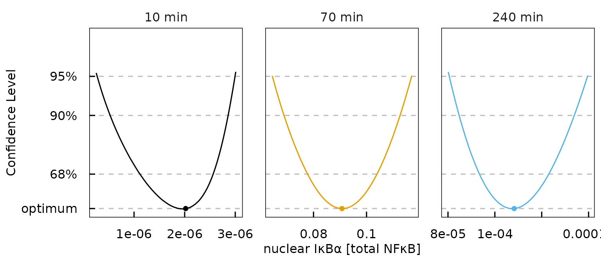
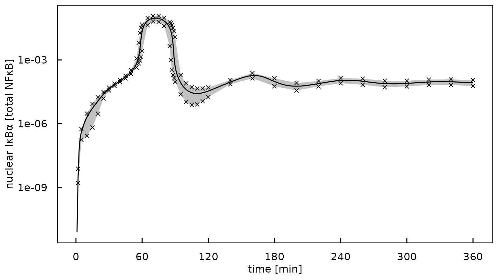
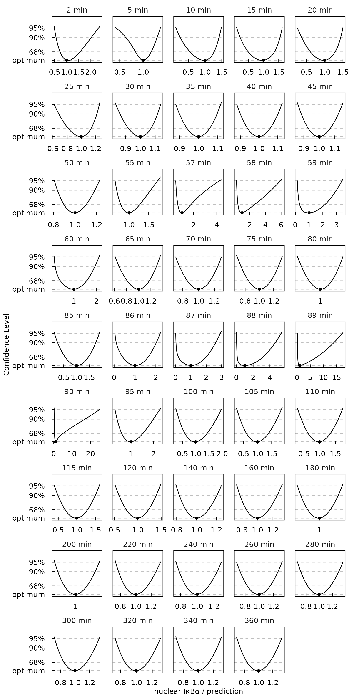

# 6. Prediction uncertainty

The prediction profile likelihood [\[1\]](#ref-kreutz2012likelihood)
gives the confidence band of a model prediction directly, without
parameter intervals. This chapter computes the band of nuclear IκBα
after TNFα in the reduced model of [Profile
likelihood](https://dmodverse.github.io/dMod2/articles/guide-profiles.md);
nuclear IκBα is not measured and decides when NFκB leaves the nucleus
[\[2, Fig. 5\]](#ref-oppelt2018model). The code is `prediction.R`.

## Prediction profiles and validation data points

The prediction profile is the objective minimized over all parameters
with the prediction held at a value; the values within the \\\chi^2_1\\
threshold form the confidence interval.
[`datapointL2()`](https://dmodverse.github.io/dMod2/reference/datapointL2.md)
turns the prediction into a parameter `v`, tied to the model by a
validation data point of small standard deviation; the profile of `v` is
the prediction profile.
[`normL2()`](https://dmodverse.github.io/dMod2/reference/normL2.md)
predicts at the time of the point (`times = t`); `attrName = "data"`
adds the validation term to the data term, so `stop = "data"` and
`confint(val.column = "data")` leave the prior out ([Methods \>
Prediction
profiles](https://dmodverse.github.io/dMod2/articles/methods-profiles.html#prediction-profiles)).

## Prediction band

`prediction.R` computes the profile in the stimulated condition at 44
times, densest at the flanks of the pulse. The prediction spans seven
orders of magnitude, so the validation point has standard deviation
\\0.01\\\hat v(t)\\ and the steps are fractions of \\\hat v(t)\\. The
profiles run on the linear scale since the resting state holds no
nuclear IκBα; the times start at 2 minutes.

``` r

# the readouts of the reduced model and nuclear IκBα, which is 0 at rest
gPrediction <- Y(c(observablesReduced, nIkb = "nIkb"), xReduced,
                 modelname = "oppelt_red_prediction", compile = FALSE)
ePrediction <- Y(errors, gPrediction, modelname = "oppelt_red_prediction_err", compile = FALSE)
compile(gPrediction, ePrediction, output = "oppelt_red_prediction")
prdPrediction <- gPrediction * xReduced * pReduced
bestReduced <- as.parvec(readRDS("results/reduced.rds")$fits)
predicted <- function(t) {
  out <- prdPrediction(t, c(bestReduced, gaugeReduced), deriv = FALSE)$TNF
  unname(out[match(t, out[, "time"]), "nIkb"])
}
# densest at the flanks of the pulse of nuclear IκBα
times <- c(2, seq(5, 55, 5), 57:59, seq(60, 85, 5), 86:89, seq(90, 120, 5), seq(140, 360, 20))
```

``` r

# at time t the prediction is a parameter v, tied to the model by a data point of standard
# deviation 1 % of the prediction that enters the data term; steps relative to the prediction
predictionProfile <- function(t) {
  v <- predicted(t)
  objV <- normL2(data, prdPrediction, ePrediction, times = t) +
    constraintL2(muReduced, sigma = sigmaReduced) +
    datapointL2(name = "nIkb", time = t, parameter = "v", sigma = 0.01 * v, condition = "TNF",
                attrName = "data")
  start <- c(setNames(as.numeric(bestReduced), names(bestReduced)), v = v)
  profile(objV, start, "v", fixed = gaugeReduced,
          stepControl = list(stop = "data", stepsize = 0.01 * v, min = 1e-3 * v),
          algoControl = list(reoptimize = TRUE),
          optControl = list(iterlim = 100, tolControl = tolerances))
}
predictionProfiles <- parallel::mclapply(times, predictionProfile, mc.cores = getOption("dMod2.cores"),
                                         mc.preschedule = FALSE)
```

[`confint()`](https://rdrr.io/r/stats/confint.html) reads the interval
from the data term:

``` r

band <- do.call(rbind, Map(function(t, pr) {
  ci <- confint(pr, level = 0.95, val.column = "data")
  data.frame(time = t, value = predicted(t), lower = ci$lower, upper = ci$upper)
}, times, predictionProfiles))
```

``` r

saved <- readRDS("results/prediction.rds")
band <- saved$band
band[band$time %in% c(0, 10, 30, 55, 60, 70, 85, 90, 120, 240, 360), ]
#>    time        value        lower        upper
#> 3    10 2.020110e-06 2.709126e-07 2.995447e-06
#> 7    30 4.396783e-05 3.660774e-05 5.001520e-05
#> 12   55 6.835130e-04 4.411350e-04 1.180329e-03
#> 16   60 2.176148e-02 2.693198e-03 4.596473e-02
#> 18   70 9.074645e-02 6.448150e-02 1.170152e-01
#> 21   85 3.227417e-02 4.491027e-03 6.096757e-02
#> 26   90 4.750388e-04 9.344731e-05 1.188119e-02
#> 32  120 3.424165e-05 1.781479e-05 5.058673e-05
#> 38  240 1.082625e-04 8.055950e-05 1.395448e-04
#> 44  360 8.493611e-05 5.922032e-05 1.124327e-04
```

Prediction profiles at three times; all times are in [All prediction
profiles](#all-prediction-profiles):

``` r

times <- c(10, 70, 240)
shown <- setNames(saved$profiles[match(times, band$time)], paste(times, "min"))
plotProfile(shown, mode == "data") +
  ggplot2::facet_wrap(~proflist, scales = "free_x") +
  ggplot2::scale_x_continuous(breaks = scales::breaks_pretty(n = 3), labels = function(x) signif(x, 2)) +
  ggplot2::guides(color = "none", x = ggplot2::guide_axis(check.overlap = TRUE)) +
  ggplot2::theme(panel.spacing.x = grid::unit(1.5, "lines")) +
  ggplot2::labs(x = "nuclear IκBα [total NFκB]")
```



The band around the prediction of the best fit:

``` r

controls(gReduced, name = "attachInput") <- TRUE
bestReduced <- as.parvec(readRDS("results/reduced.rds")$fits)
out <- prdReduced(1:360, c(bestReduced, gaugeReduced), deriv = FALSE)$TNF
# the resting state holds no nuclear IκBα, which the log scale leaves out
course <- subset(data.frame(time = out[, "time"], value = out[, "nIkb"]), value > 0)
ggplot2::ggplot(course, ggplot2::aes(time, value)) +
  ggplot2::geom_ribbon(data = band, ggplot2::aes(x = time, ymin = lower, ymax = upper),
                       inherit.aes = FALSE, alpha = 0.3) +
  ggplot2::geom_line() +
  ggplot2::geom_point(data = band, ggplot2::aes(y = lower), shape = 4) +
  ggplot2::geom_point(data = band, ggplot2::aes(y = upper), shape = 4) +
  ggplot2::scale_x_continuous(breaks = seq(0, 360, 60)) +
  ggplot2::scale_y_log10() +
  ggplot2::labs(x = "time [min]", y = "nuclear IκBα [total NFκB]") +
  theme_dMod()
```



Concentrations are in units of total NFκB, set by the gauge of
[Symmetries](https://dmodverse.github.io/dMod2/articles/guide-symmetries.md).

## All prediction profiles

The axis is in units of the prediction \\\hat v(t)\\ of the best fit:

``` r

relative <- Map(function(pr, v) { pr$v <- pr$v / v; pr }, saved$profiles, band$value)
names(relative) <- paste(band$time, "min")
plotProfile(relative, mode == "data") +
  ggplot2::facet_wrap(~factor(proflist, levels = names(relative)), ncol = 5, scales = "free_x") +
  ggplot2::scale_x_continuous(breaks = scales::breaks_pretty(n = 3)) +
  ggplot2::scale_color_manual(values = rep("black", length(relative)), guide = "none") +
  ggplot2::guides(x = ggplot2::guide_axis(check.overlap = TRUE)) +
  ggplot2::labs(x = "nuclear IκBα / prediction")
```



Reference:
[`datapointL2()`](https://dmodverse.github.io/dMod2/reference/datapointL2.md),
[`profile()`](https://rdrr.io/r/stats/profile.html),
[`confint()`](https://rdrr.io/r/stats/confint.html),
[`plotProfile()`](https://dmodverse.github.io/dMod2/reference/plotProfile.md)

[← 5. Profile
likelihood](https://dmodverse.github.io/dMod2/articles/guide-profiles.md)
\| [7. Nonlinear mixed-effects models
→](https://dmodverse.github.io/dMod2/articles/guide-nlme.md)

## References

\[1\]

C. Kreutz, A. Raue, and J. Timmer, “Likelihood based observability
analysis and confidence intervals for predictions of dynamic models,”
*BMC Systems Biology*, vol. 6, p. 120, 2012, doi:
[10.1186/1752-0509-6-120](https://doi.org/10.1186/1752-0509-6-120).

\[2\]

A. Oppelt *et al.*, “Model-based identification of TNFα-induced
IKKβ-mediated and IκBα-mediated regulation of NFκB signal transduction
as a tool to quantify the impact of drug-induced liver injury
compounds,” *npj Systems Biology and Applications*, vol. 4, p. 23, 2018,
doi:
[10.1038/s41540-018-0058-z](https://doi.org/10.1038/s41540-018-0058-z).
