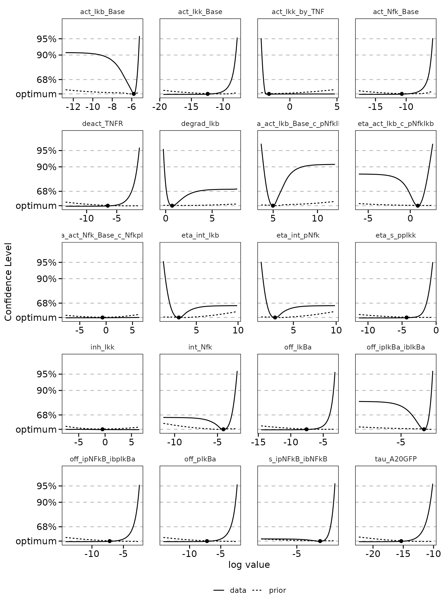
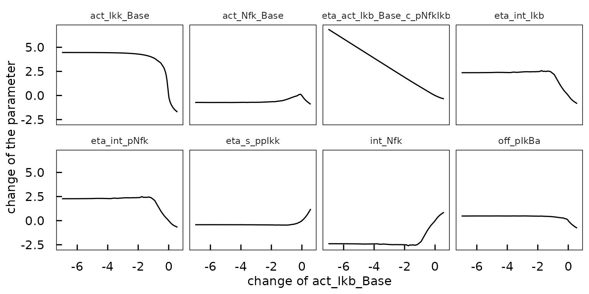
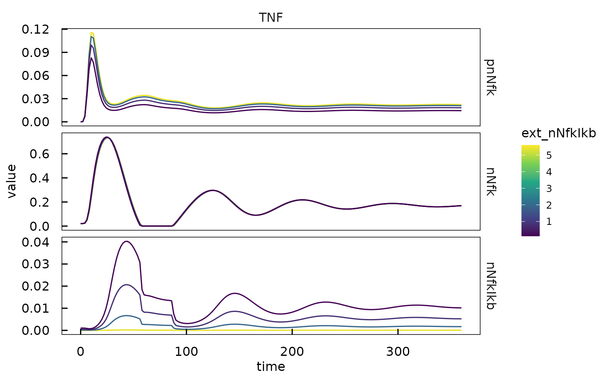
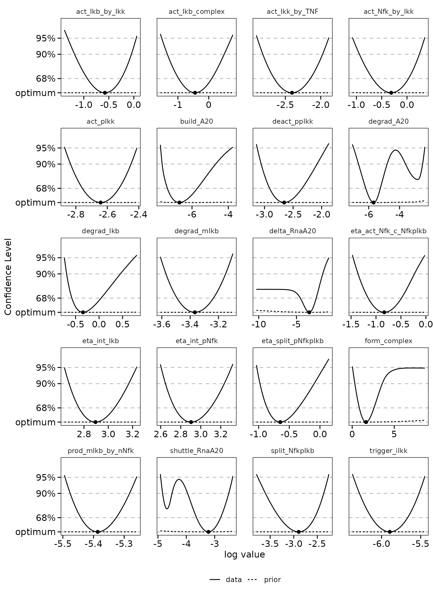

# 5. Profile likelihood

The profile likelihood [\[1\]](#ref-raue2009structural) shows how well
the data constrain each parameter. This chapter profiles the full model
at the best fit of
[Optimization](https://dmodverse.github.io/dMod2/articles/guide-optimization.md),
tests the core model of the publication and fits a reduced model.

## Profile likelihood and confidence intervals

The profile of a parameter is the data term along the path on which the
other parameters minimize the objective with that parameter fixed. Here
the objective has a prior of standard deviation 20 on the log scale at
the best fit, so that the data term shapes the profiles. Data terms
within 3.84, the 95 % quantile of \\\chi^2_1\\, of the minimum form the
95 % confidence interval ([Methods \> Profile
likelihood](https://dmodverse.github.io/dMod2/articles/methods-profiles.md)).
`stepControl = list(stop = "data")` ends a profile there,
`confint(val.column = "data")` reads the interval,
[`profileThreshold()`](https://dmodverse.github.io/dMod2/reference/profileThreshold.md)
gives other levels. A profile open towards \\-\infty\\ means the process
can be switched off, towards \\+\infty\\ that it can be instantaneous
([Methods \>
Shapes](https://dmodverse.github.io/dMod2/articles/methods-profiles.html#shapes)).

`method = "integrate"` (default) follows the constrained optimum as a
curve, with `algoControl = list(reoptimize = TRUE)` corrected by
[`trust()`](https://dmodverse.github.io/dMod2/reference/trust.md);
`method = "optimize"` refits at every step.

| entry of `stepControl` | `"integrate"` | `"optimize"` | controls |
|----|----|----|----|
| `stepsize` | `1e-4` | `1e-2` | first step |
| `min`, `max` | `1e-4`, `Inf` | `1e-4`, `Inf` | bounds of the step |
| `atol`, `rtol` | `1e-2` | `1e-1` | mismatch of predicted and actual change |
| `limit` | `500` | `100` | steps per side |
| `stop` | `"value"` | `"value"` | part of the objective compared with the threshold |

`limits` bounds the profiled parameter, `side` profiles one side,
`cores` profiles in parallel ([Remote
computing](https://dmodverse.github.io/dMod2/articles/guide-remote-computing.html#threads-and-processes)).

## Profiles of the full model

`profiles.R` refits the best fit of the multistart to the tolerances of
the profiles,

``` r

# the best fit of the multistart, refitted to the tolerances of the profiles
refit <- trust(obj, as.parvec(readRDS("results/fits.rds")), fixed = gauge, rinit = 0.1, rmax = 10,
               iterlim = 1000, tolControl = tolerances)
```

fits the objective of the profiles once,

``` r

# the profiles replace the prior of model.R by one of standard deviation 20 at the refit, so that
# the data term shapes them; they start at the optimum of that objective, one fit from the refit
objProfile <- normL2(data, prd, e) + constraintL2(refit$argument, sigma = 20) + stability
fitProfile <- trust(objProfile, refit$argument, fixed = gauge, rinit = 0.1, rmax = 10,
                    iterlim = 1000, tolControl = tolerances)
best <- fitProfile$argument
```

and profiles each side until the data term has risen by the threshold or
the parameter has moved by 7. The profiles are loaded from
`results/profiles.rds`:

``` r

# the profiles integrated, every step re-optimized, each side until the data term has risen by the
# threshold or the parameter has moved by 7 on the natural log scale, the settings of refit.R.
# helix.R runs one profile per array task.
limits <- c(lower = -7, upper = 7)
profiles <- profile(objProfile, best, names(best), fixed = gauge, limits = limits,
                    stepControl = list(stop = "data"), algoControl = list(reoptimize = TRUE),
                    optControl = list(iterlim = 100, tolControl = tolerances),
                    cores = getOption("dMod2.cores"))
```

``` r

saved <- readRDS("results/profiles.rds")
refit <- saved$refit
fitProfile <- saved$fitProfile
profiles <- saved$profiles
```

The data term at the refit and at the optimum of the profiles:

``` r

dataTerm <- function(p) attr(obj(p, fixed = gauge), "data")
c(refit = dataTerm(refit$argument), profiles = dataTerm(fitProfile$argument))
#>     refit  profiles 
#> -511.1690 -516.6701
```

Without the prior of `model.R` the data term falls by 5.5. No profile
lies below the fit:

``` r

c(fit = fitProfile$value, lowest = min(profiles$value))
#>       fit    lowest 
#> -516.4301 -516.4321
```

``` r

intervals <- confint(profiles, level = 0.95, val.column = "data")
intervals$shape <- with(intervals, ifelse(is.finite(lower) & is.finite(upper), "finite",
                       ifelse(is.finite(lower), "open above",
                              ifelse(is.finite(upper), "open below", "open on both sides"))))
table(intervals$shape)
#> 
#>             finite         open above         open below open on both sides 
#>                 43                  5                 13                  2
rownames(intervals) <- NULL
intervals[intervals$shape != "finite", c("name", "value", "lower", "upper", "shape")]
#>                          name       value      lower       upper
#> 1                act_Ikb_Base  -5.7919000       -Inf  -5.2235302
#> 3                act_Ikk_Base -12.4290599       -Inf  -7.7809870
#> 4              act_Ikk_by_TNF  -2.2158982 -3.0482695         Inf
#> 5                act_Nfk_Base -10.7053150       -Inf  -5.6748730
#> 11                 deact_TNFR  -6.4916921       -Inf  -1.2841902
#> 13                 degrad_Ikb   0.6960847 -0.2419782         Inf
#> 16 eta_act_Ikb_Base_c_pNfkIkb   4.9730426  3.7242550         Inf
#> 17      eta_act_Ikb_c_pNfkIkb   0.8955969       -Inf   2.5506495
#> 18 eta_act_Nfk_Base_c_NfkpIkb  -0.6876100       -Inf         Inf
#> 21                eta_int_Ikb   2.9003857  1.0610826         Inf
#> 22               eta_int_pNfk   2.8593583  1.2383545         Inf
#> 23                eta_s_ppIkk  -4.3338331       -Inf  -0.5029478
#> 27                    inh_Ikk  -0.4859866       -Inf         Inf
#> 28                    int_Nfk  -4.3108096       -Inf  -2.7384181
#> 31                   off_IkBa  -7.5714193       -Inf  -3.2170736
#> 32          off_ipIkBa_ibIkBa  -2.5303205       -Inf  -1.6106014
#> 36         off_ipNFkB_ibpIkBa  -7.1843412       -Inf  -2.4733675
#> 39                  off_pIkBa  -7.2101743       -Inf  -2.3816122
#> 48            s_ipNFkB_ibNFkB  -2.2371895       -Inf  -0.4943420
#> 60                 tau_A20GFP -15.3359687       -Inf -10.1752749
#>                 shape
#> 1          open below
#> 3          open below
#> 4          open above
#> 5          open below
#> 11         open below
#> 13         open above
#> 16         open above
#> 17         open below
#> 18 open on both sides
#> 21         open above
#> 22         open above
#> 23         open below
#> 27 open on both sides
#> 28         open below
#> 31         open below
#> 32         open below
#> 36         open below
#> 39         open below
#> 48         open below
#> 60         open below
```

The open profiles; on an open side the prior rises by up to 0.5:

``` r

# panels wide enough for the parameter names, few ticks and the legend below
readable <- list(ggplot2::scale_x_continuous(breaks = scales::breaks_pretty(n = 3)),
                 ggplot2::guides(x = ggplot2::guide_axis(check.overlap = TRUE)),
                 ggplot2::theme(strip.text = ggplot2::element_text(size = 9),
                                panel.spacing.x = grid::unit(1.5, "lines"), legend.position = "bottom"),
                 ggplot2::labs(x = "log value", color = NULL, linetype = NULL))
```

``` r

open <- intervals$name[intervals$shape != "finite"]
plotProfile(profiles, mode %in% c("data", "prior"), name %in% open, ncol = 4) + readable
```



## Parameter paths

[`plotPaths()`](https://dmodverse.github.io/dMod2/reference/plotPaths.md)
shows how the other parameters compensate along a profile. Along
`act_Ikb_Base`, `eta_act_Ikb_Base_c_pNfkIkb` rises by the same amount:
the data determine the product. Shown are the parameters that move by
more than 1:

``` r

# the parameters that move along the profile of `par` by more than `by` on the log scale
movers <- function(par, by = 1) {
  d <- as.data.frame(profiles)[profiles$whichPar == par, ]
  others <- setdiff(names(fitProfile$argument), par)
  others[vapply(d[others], function(v) diff(range(v)) > by, NA)]
}
for (par in c("act_Ikb_Base", "int_Nfk"))
  print(plotPaths(profiles, partner %in% movers(par), whichPar = par) +
          ggplot2::facet_wrap(ggplot2::vars(partner), ncol = 4) +
          ggplot2::scale_x_continuous(breaks = scales::breaks_pretty(n = 3)) +
          ggplot2::theme(strip.text = ggplot2::element_text(size = 9)) +
          ggplot2::labs(x = paste("change of", par), y = "change of the parameter"))
```



## Predictions along a profile

[`plotArray()`](https://dmodverse.github.io/dMod2/reference/plotArray.md)
predicts along one side of a profile, colored by the profiled parameter;
`fixed` adds the gauge. Along the upper side of `degrad_RnaA20`,
`RnaA20` falls by two orders of magnitude while A20 stays nearly the
same:

``` r

states <- x * pSS * p
minutes <- seq(0, 360, 2)
chain <- c("RnaA20_1", "RnaA20_2", "RnaA20", "A20")
plotArray("degrad_RnaA20", profiles, states, minutes, name %in% chain, condition == "TNF",
          direction = "up", nSim = 5, fixed = gauge)
```


Along the lower side of `ext_nNfkIkb` the nuclear complex builds up at
the expense of free and phosphorylated nuclear NFκB; their sum, read out
by nucNFkB, stays the same:

``` r

plotArray("ext_nNfkIkb", profiles, states, minutes, name %in% c("nNfk", "pnNfk", "nNfkIkb"),
          condition == "TNF", direction = "down", nSim = 5, fixed = gauge)
```



## Core model of the publication

The core model of the publication has 29 reactions
[\[2\]](#ref-oppelt2018model), Table S5 and fixed values (Tables S8 and
S9), on the log scale:

| setting of the core model | parameter of the full model | value |
|----|----|----|
| IKK activated by the receptors only: no basal activation | `act_Ikk_Base` | \\-\infty\\ |
| no inhibition of IKK by A20 | `inh_Ikk` | \\\infty\\ |
| basal phosphorylation of IκBα only in the complex with pNFκB, at a rate `act_Ikb_complex` | `act_Ikb_Base` | \\-\infty\\ |
| IκBα phosphorylated by pIKK in the complexes with NFκB and pNFκB at the same rate | `eta_act_Ikb_c_pNfkIkb` | 0 |
| NFκB phosphorylated by pIKK only | `act_Nfk_Base` | \\-\infty\\ |
| ppIKK phosphorylates neither IκBα nor NFκB | `eta_s_ppIkk` | \\-\infty\\ |
| pNFκB released without a separate factor, at `split_NfkIkb` | `eta_split_pNfkpIkb` | 0 |
| slow receptor deactivation, 0.001 per minute | `deact_TNFR` | \\\ln 10^{-3}\\ |
| slow import of NFκB, 0.01 per minute | `int_Nfk` | \\\ln 10^{-2}\\ |
| fast dephosphorylation of nuclear pNFκB, 1000 per minute | `deact_pnNfk` | \\\ln 10^{3}\\ |
| fast formation of the nuclear complex, 1000 per minute | `eta_form_complex_nuc` | \\\ln 10^{3}\\ minus `form_complex` |
| fast export of the complex, 1000 per minute | `ext_nNfkIkb` | \\\ln 10^{3}\\ |
| no offset of the IκBα blots, no bleaching of A20-GFP | `off_IkBa`, `off_ipIkBa_ibIkBa`, `tau_A20GFP` | \\-\infty\\ |
| one delay step of the A20 transcript instead of two | none |  |

Against the intervals of the full model:

``` r

core <- c(act_Ikk_Base = -Inf, inh_Ikk = Inf, act_Ikb_Base = -Inf, eta_act_Ikb_c_pNfkIkb = 0,
          act_Nfk_Base = -Inf, eta_s_ppIkk = -Inf, eta_split_pNfkpIkb = 0,
          deact_TNFR = log(1e-3), int_Nfk = log(1e-2), deact_pnNfk = log(1000),
          eta_form_complex_nuc = log(1000) - fitProfile$argument[["form_complex"]],
          ext_nNfkIkb = log(1000), off_IkBa = -Inf, off_ipIkBa_ibIkBa = -Inf, tau_A20GFP = -Inf)
settings <- intervals[match(names(core), intervals$name), c("name", "lower", "upper", "shape")]
settings$core <- core
settings$inside <- with(settings, core >= lower & core <= upper)
rownames(settings) <- NULL
settings
#>                     name      lower       upper              shape      core
#> 1           act_Ikk_Base       -Inf  -7.7809870         open below      -Inf
#> 2                inh_Ikk       -Inf         Inf open on both sides       Inf
#> 3           act_Ikb_Base       -Inf  -5.2235302         open below      -Inf
#> 4  eta_act_Ikb_c_pNfkIkb       -Inf   2.5506495         open below  0.000000
#> 5           act_Nfk_Base       -Inf  -5.6748730         open below      -Inf
#> 6            eta_s_ppIkk       -Inf  -0.5029478         open below      -Inf
#> 7     eta_split_pNfkpIkb -0.8470426   1.4910851             finite  0.000000
#> 8             deact_TNFR       -Inf  -1.2841902         open below -6.907755
#> 9                int_Nfk       -Inf  -2.7384181         open below -4.605170
#> 10           deact_pnNfk -1.3227174   0.4162159             finite  6.907755
#> 11  eta_form_complex_nuc  0.2494872  11.5817034             finite  4.966203
#> 12           ext_nNfkIkb  0.1601604   8.5930735             finite  6.907755
#> 13              off_IkBa       -Inf  -3.2170736         open below      -Inf
#> 14     off_ipIkBa_ibIkBa       -Inf  -1.6106014         open below      -Inf
#> 15            tau_A20GFP       -Inf -10.1752749         open below      -Inf
#>    inside
#> 1    TRUE
#> 2    TRUE
#> 3    TRUE
#> 4    TRUE
#> 5    TRUE
#> 6    TRUE
#> 7    TRUE
#> 8    TRUE
#> 9    TRUE
#> 10  FALSE
#> 11   TRUE
#> 12   TRUE
#> 13   TRUE
#> 14   TRUE
#> 15   TRUE
```

Every setting but one lies in the 95 % interval; the data bound
`deact_pnNfk` to 0.27 to 1.5 per minute, below the fixed 1000. No
profile tests the single delay step, and the publication gives no reason
for it. The likelihood ratio test takes all settings together:
`variants.R` fits the core model and the variants that release one
setting, loaded from `results/variants.rds`:

| released                              | lower by | above full | threshold |
|:--------------------------------------|---------:|-----------:|----------:|
| two delay steps of the A20 transcript |     4.74 |      22.45 |     27.59 |
| separate factor `eta_split_pNfkpIkb`  |     3.39 |      23.80 |     26.30 |
| `deact_TNFR` estimated                |    -0.40 |      27.60 |     26.30 |
| `int_Nfk` estimated                   |     0.15 |      27.05 |     26.30 |
| `deact_pnNfk` estimated               |     1.21 |      25.98 |     26.30 |
| `form_complex_nuc` estimated          |     0.00 |      27.19 |     26.30 |
| `ext_nNfkIkb` estimated               |    -0.08 |      27.28 |     26.30 |
| `off_IkBa` estimated                  |    -0.45 |      27.65 |     26.30 |
| `off_ipIkBa_ibIkBa` estimated         |     3.01 |      24.18 |     26.30 |
| `tau_A20GFP` estimated                |    -1.45 |      28.65 |     26.30 |

The core model lies 27.2 above the full model, against the threshold
27.59 for 17 removed parameters, and is accepted. The two delay steps
and the separate factor together lower the data term by 8.14 at one
added parameter, more than 3.84; `reduced.R` takes both and sets the
scale `s_ipNFkB_ibNFkB`, whose profile is open below, to 0.

## Reduced model

The core model with two delay steps, the separate factor and the scale
`s_ipNFkB_ibNFkB` at 0:

``` r

# the core model of the publication (Table S5 of the supplement), with the two delay steps of the
# A20 transcript of the full model and a separate factor for the release of pNFκB
reactionsReduced <- eqnlist() |>
  assignCompartment(nIkb = "nucleus", pnNfk = "nucleus", nNfk = "nucleus", nNfkIkb = "nucleus",
                    volume = "Vnuc") |>
  addReaction("TNF", "TNF + TNFR", "uptake * TNF", "receptor activation") |>
  addReaction("TNFR", "", "deact_TNFR * TNFR", "receptor deactivation") |>
  # IKK activated by the receptors alone, without basal activation and inhibition by A20
  addReaction("Ikk", "pIkk", "act_Ikk_by_TNF * TNFR * Ikk", "IKK activation") |>
  addReaction("pIkk", "ppIkk", "act_pIkk * pIkk", "IKK phosphorylation") |>
  addReaction("ppIkk", "iIkk", "deact_ppIkk * ppIkk", "IKK inactivation") |>
  addReaction("iIkk", "Ikk", "trigger_iIkk * iIkk", "IKK recovery") |>
  # IκBα phosphorylated by pIKK in both complexes and basally only in the complex with pNFκB;
  # NFκB phosphorylated by pIKK only; ppIKK phosphorylates neither
  addReaction("NfkIkb", "NfkpIkb", "act_Ikb_by_Ikk * pIkk * NfkIkb", "IkBa phosphorylation by pIKK") |>
  addReaction("pNfkIkb", "pNfkpIkb", "act_Ikb_complex * pNfkIkb",
              "basal IkBa phosphorylation, pNFkB complex") |>
  addReaction("pNfkIkb", "pNfkpIkb", "act_Ikb_by_Ikk * pIkk * pNfkIkb",
              "IkBa phosphorylation by pIKK, pNFkB complex") |>
  addReaction("NfkIkb", "pNfkIkb", "act_Nfk_by_Ikk * pIkk * NfkIkb", "NFkB phosphorylation by pIKK") |>
  addReaction("NfkpIkb", "pNfkpIkb", "act_Nfk_by_Ikk * eta_act_Nfk_c_NfkpIkb * pIkk * NfkpIkb",
              "NFkB phosphorylation by pIKK, pIkBa complex") |>
  addReaction("NfkpIkb", "Nfk + pIkb", "split_NfkpIkb * NfkpIkb", "release of NFkB") |>
  addReaction("pNfkpIkb", "pNfk + pIkb", "split_NfkIkb * eta_split_pNfkpIkb * pNfkpIkb",
              "release of pNFkB") |>
  addReaction("Nfk + Ikb", "NfkIkb", "form_complex * Nfk * Ikb", "complex formation") |>
  addReaction("", "mIkb", "prod_mIkb_by_nNfk * nNfk", "IkBa transcription") |>
  addReaction("mIkb", "", "degrad_mIkb * mIkb", "IkBa transcript degradation") |>
  addReaction("", "Ikb", "prod_Ikb * mIkb", "IkBa translation") |>
  addReaction("pIkb", "", "degrad_Ikb * pIkb", "pIkBa degradation") |>
  addReaction("Ikb", "nIkb", "int_Nfk * eta_int_Ikb * Ikb", "IkBa import") |>
  addReaction("pNfk", "pnNfk", "int_Nfk * eta_int_pNfk * pNfk", "pNFkB import") |>
  addReaction("Nfk", "nNfk", "int_Nfk * Nfk", "NFkB import") |>
  addReaction("pnNfk", "nNfk", "deact_pnNfk * pnNfk", "nuclear pNFkB dephosphorylation") |>
  addReaction("nIkb + nNfk", "nNfkIkb", "form_complex_nuc * nNfk * nIkb",
              "nuclear complex formation") |>
  addReaction("nNfkIkb", "NfkIkb", "ext_nNfkIkb * nNfkIkb", "complex export") |>
  addReaction("", "RnaA20_1", "build_RnaA20 * nNfk", "A20 transcription") |>
  addReaction("RnaA20_1", "RnaA20_2", "shuttle_RnaA20 * RnaA20_1", "A20 transcript, delay 1") |>
  addReaction("RnaA20_2", "RnaA20", "shuttle_RnaA20 * RnaA20_2", "A20 transcript, delay 2") |>
  addReaction("RnaA20", "", "degrad_RnaA20 * RnaA20", "A20 transcript degradation") |>
  addReaction("", "A20", "build_A20 * RnaA20", "A20 translation") |>
  addReaction("A20", "", "degrad_A20 * A20", "A20 degradation")
```

``` r

# the readout whose scale goes to 0 is the offset
observablesReduced <- observables
observablesReduced["ipNFkB_ibNFkB"] <- "log(off_ipNFkB_ibNFkB)"
```

As in the publication, all NFκB rests in the complex with IκBα and all
IKK is inactive, a steady state for every parameter value, so neither
[`Pimpl()`](https://dmodverse.github.io/dMod2/reference/Pimpl.md) nor a
stability term is needed:

``` r

# at rest all NFκB is bound to IκBα and all IKK inactive, the other states are 0: without basal
# activation this is a steady state for every parameter value, as in the publication; TNFα added
# at time 0 as in model.R
modelReduced <- odemodel(reactionsReduced, events = events, modelname = "oppelt_red_ode", compile = FALSE)
xReduced <- Xs(modelReduced, options = list(atol = 1e-10, rtol = 1e-8))
gReduced <- Y(observablesReduced, xReduced, modelname = "oppelt_red_obs", compile = FALSE)
eReduced <- Y(errors, gReduced, modelname = "oppelt_red_err", compile = FALSE)
resting <- c(NfkIkb = "totalNfk", Ikk = "totalIkk")
resting <- c(resting, structure(rep("0", length(setdiff(reactionsReduced$states, names(resting)))),
                                names = setdiff(reactionsReduced$states, names(resting))))

# the fixed values of the publication (Tables S8 and S9): fast processes at 1000 per minute, slow
# receptor deactivation and NFκB import, offsets and bleaching that vanish
fixedReduced <- c(deact_TNFR = 1e-3, int_Nfk = 1e-2, deact_pnNfk = 1000, form_complex_nuc = 1000,
                  ext_nNfkIkb = 1000, off_IkBa = 0, off_ipIkBa_ibIkBa = 0, tau_A20GFP = 0)
trafoReduced <- eqnvec() |>
  define("x <- x", x = setdiff(getParameters(xReduced, gReduced, eReduced),
                               reactionsReduced$states)) |>
  define("x <- y", x = names(fixedReduced), y = fixedReduced) |>
  define("x <- y", x = names(resting), y = resting) |>
  insert("x <- exp(x)", x = .currentSymbols) |>
  define("TNF <- 0") |>
  branch(covariates(data)) |>
  define("dose_TNF <- 0", conditionMatch = "control") |>
  define("dose_TNF <- 1", conditionMatch = "TNF")
pReduced <- P(trafoReduced, modelname = "oppelt_red_par", compile = FALSE)
```

``` r

compile(gReduced, xReduced, pReduced, eReduced, output = "oppelt_red",
        cores = getOption("dMod2.cores"))
prdReduced <- gReduced * xReduced * pReduced
```

The prior of the full model on the remaining parameters:

``` r

# the prior of model.R on the parameters that remain
outerReduced <- getParameters(prdReduced)
# the basal phosphorylation in the pNFκB complex at the product of the two rates it replaces
muReduced <- c(mu, act_Ikb_complex = mu[["act_Ikb_Base"]] + mu[["eta_act_Ikb_Base_c_pNfkIkb"]])[outerReduced]
sigmaReduced <- c(sigma, act_Ikb_complex = sqrt(sigma[["act_Ikb_Base"]]^2 +
                                                  sigma[["eta_act_Ikb_Base_c_pNfkIkb"]]^2))[outerReduced]
gaugeReduced <- gauge[intersect(names(gauge), outerReduced)]
objReduced <- normL2(data, prdReduced, eReduced) + constraintL2(muReduced, sigma = sigmaReduced)
```

`refit.R` fits from the full model and from 50 starts around that fit;
the result is loaded from `results/reduced.rds`:

``` r

# from the full model refitted in profiles.R, the basal phosphorylation in the pNFκB complex at
# the product of the two rates it replaces, then a multistart around that fit
full <- readRDS("results/profiles.rds")$refit
start <- c(full$argument, gauge, act_Ikb_complex = full$argument[["act_Ikb_Base"]] +
             full$argument[["eta_act_Ikb_Base_c_pNfkIkb"]])[outerReduced]
freeReduced <- setdiff(outerReduced, names(gaugeReduced))
fit <- trust(objReduced, start[freeReduced], fixed = gaugeReduced, rinit = 0.1, rmax = 10,
             iterlim = 1000, tolControl = tolerances)
set.seed(1)
fitsReduced <- mstrust(objReduced, fit$argument, fixed = gaugeReduced, sd = 1, fits = 50,
                       startFromCenter = TRUE, iterlim = 1000, tolControl = tolerances,
                       cores = getOption("dMod2.cores")) |>
  as.parframe()
bestReduced <- as.parvec(fitsReduced)
```

``` r

# the data terms of the two models, the difference against the 95% quantile of chi-square with
# the number of parameters the reduction removed
dataFull <- normL2(data, prd, e)(full$argument, fixed = gauge)$value
dataReduced <- normL2(data, prdReduced, eReduced)(bestReduced, fixed = gaugeReduced)$value
removed <- length(full$argument) - length(bestReduced)
ratio <- c(full = dataFull, reduced = dataReduced, difference = dataReduced - dataFull,
           removed = removed, threshold = qchisq(0.95, removed))
```

``` r

saved <- readRDS("results/reduced.rds")
saved$ratio
#>       full    reduced difference    removed  threshold 
#> -511.16897 -492.11682   19.05215   16.00000   26.29623
```

With 16 fewer parameters the data term is higher by 19.05, below the
threshold 26.3.

## Profiles of the reduced model

With the prior and settings of the profiles of the full model:

``` r

# the prior of the profiles of profiles.R, standard deviation 20 at the best fit, and one fit from
# there
objReducedProfile <- normL2(data, prdReduced, eReduced) + constraintL2(bestReduced, sigma = 20)
fitReducedProfile <- trust(objReducedProfile, bestReduced, fixed = gaugeReduced, rinit = 0.1,
                           rmax = 10, iterlim = 1000, tolControl = tolerances)
bestReducedProfile <- fitReducedProfile$argument
```

``` r

# the settings of the full model
profilesReduced <- profile(objReducedProfile, bestReducedProfile, names(bestReducedProfile),
                           fixed = gaugeReduced, limits = c(lower = -7, upper = 7),
                           stepControl = list(stop = "data"), algoControl = list(reoptimize = TRUE),
                           optControl = list(iterlim = 100, tolControl = tolerances),
                           cores = getOption("dMod2.cores"))
```

``` r

intervalsReduced <- confint(saved$profiles, level = 0.95, val.column = "data")
intervalsReduced$shape <- with(intervalsReduced, ifelse(is.finite(lower) & is.finite(upper), "finite",
                              ifelse(is.finite(lower), "open above",
                                     ifelse(is.finite(upper), "open below", "open on both sides"))))
rownames(intervalsReduced) <- NULL
table(intervalsReduced$shape)
#> 
#>     finite open above 
#>         46          1
intervalsReduced[intervalsReduced$shape != "finite", c("name", "value", "lower", "upper", "shape")]
#>            name    value      lower upper      shape
#> 16 form_complex 1.641204 0.03715742   Inf open above
```

All parameters are identifiable except `form_complex`, bounded below at
0.016 on the log10 scale and open above on a plateau 3.8 above the
optimum; the publication reports (-0.21, 3.03). The profiles of
`degrad_A20`, `degrad_RnaA20` and `shuttle_RnaA20` have a second minimum
inside the interval. The rate constants:

``` r

rates <- setdiff(intervalsReduced$name, grep("^(s|off|sigma|tau)_", intervalsReduced$name, value = TRUE))
intervalsReduced[intervalsReduced$name %in% rates, c("name", "value", "lower", "upper")]
#>                     name      value       lower       upper
#> 1         act_Ikb_by_Ikk -0.5786251 -1.32277075  0.04888621
#> 2        act_Ikb_complex -0.4439880 -1.52654336  0.73659710
#> 3         act_Ikk_by_TNF -2.4055240 -2.89633535 -1.88812862
#> 4         act_Nfk_by_Ikk -0.3114658 -1.07408487  0.34832350
#> 5               act_pIkk -2.6424782 -2.87069116 -2.41229978
#> 6              build_A20 -6.6943231 -7.73028658 -3.80715536
#> 7            deact_ppIkk -2.6563380 -3.12809306 -1.92034115
#> 8             degrad_A20 -5.6818610 -6.98062703 -0.94326105
#> 9             degrad_Ikb -0.3414496 -0.73674978  0.75322162
#> 10           degrad_mIkb -3.3668241 -3.60828178 -3.10788366
#> 11         degrad_RnaA20 -3.2190873 -6.98090634 -0.69387744
#> 12 eta_act_Nfk_c_NfkpIkb -0.8339846 -1.45858000 -0.05026957
#> 13           eta_int_Ikb  2.8945555  2.63874332  3.23312801
#> 14          eta_int_pNfk  2.9033150  2.60405334  3.30735511
#> 15    eta_split_pNfkpIkb -0.6477235 -1.03038957  0.06290221
#> 16          form_complex  1.6412041  0.03715742         Inf
#> 28     prod_mIkb_by_nNfk -5.3862578 -5.49300289 -5.25943580
#> 40        shuttle_RnaA20 -3.2215971 -4.90320558 -2.36789127
#> 44         split_NfkpIkb -2.8945791 -3.76340512 -2.27032950
#> 47          trigger_iIkk -5.8949051 -6.35858279 -5.45137436
```

``` r

plotProfile(saved$profiles, mode %in% c("data", "prior"), name %in% rates, ncol = 4) + readable
```


Exchanging `degrad_A20` and `degrad_RnaA20` leaves every readout and the
prior unchanged, a discrete symmetry ([Symmetries \> Discrete
symmetries](https://dmodverse.github.io/dMod2/articles/guide-symmetries.html#discrete-symmetries)).
Of the 34 best fits of the multistart, 33 lie on the side
`degrad_A20 < degrad_RnaA20` and 1 at the mirror image. The profile of
`degrad_RnaA20` passes through the mirror image of the optimum, within
0.0005 of the data term at the optimum.

The second minimum of `shuttle_RnaA20` is another local optimum, close
to the fixed set of the swap: at `shuttle_RnaA20` = -4.68 the
degradation rates are -2.8 and -2.79, the data term 1.62 above the
optimum, reached by 1 fits of the multistart. The estimates of the
publication, \\-4.72\\ and \\-4.46\\ [\[2\]](#ref-oppelt2018model),
Table S7, also lie close to the fixed set.

## Profiles in the fundamental domain

The fundamental domain `degrad_A20 < degrad_RnaA20` holds the optimum
and removes the swap. `fundamental.R` fits the reduced model in the
chart that `symmetryReduction(branch = "degrad_A20 < degrad_RnaA20")`
returns, with `define("degrad_RnaA20 <- degrad_A20 + delta_RnaA20")`
before `insert("x <- exp(x)")`; the fixed set lies at `delta_RnaA20`
\\\to -\infty\\. Only the parameter transformation is new:

``` r

# the parameters of reduced.R with degrad_RnaA20 above degrad_A20 by exp(delta_RnaA20), the chart
# of symmetryReduction(branch = "degrad_A20 < degrad_RnaA20"); ODE, observables and errors of
# reduced.R
trafoFundamental <- eqnvec() |>
  define("x <- x", x = setdiff(getParameters(xReduced, gReduced, eReduced),
                               reactionsReduced$states)) |>
  define("x <- y", x = names(fixedReduced), y = fixedReduced) |>
  define("x <- y", x = names(resting), y = resting) |>
  define("degrad_RnaA20 <- degrad_A20 + delta_RnaA20") |>
  insert("x <- exp(x)", x = .currentSymbols) |>
  define("TNF <- 0") |>
  branch(covariates(data)) |>
  define("dose_TNF <- 0", conditionMatch = "control") |>
  define("dose_TNF <- 1", conditionMatch = "TNF")
pFundamental <- P(trafoFundamental, modelname = "oppelt_fund_par", compile = FALSE)
compile(pFundamental, output = "oppelt_fund", cores = getOption("dMod2.cores"))
prdFundamental <- gReduced * xReduced * pFundamental
```

`delta_RnaA20` has the prior of `degrad_RnaA20`, mean \\\log(1/60)\\ and
standard deviation 2:

``` r

# the prior of reduced.R; the difference of the two rates with the prior of degrad_RnaA20
outerFundamental <- getParameters(prdFundamental)
muFundamental <- c(muReduced, delta_RnaA20 = muReduced[["degrad_RnaA20"]])[outerFundamental]
sigmaFundamental <- c(sigmaReduced,
                      delta_RnaA20 = sigmaReduced[["degrad_RnaA20"]])[outerFundamental]
objFundamental <- normL2(data, prdFundamental, eReduced) +
  constraintL2(muFundamental, sigma = sigmaFundamental)
```

One fit from the best fit of `refit.R`, loaded with the profiles from
`results/fundamental.rds`:

``` r

# the best fit of refit.R, on the side degrad_A20 < degrad_RnaA20, in the chart
bestReduced <- as.parvec(readRDS("results/reduced.rds")$fits)
ordered <- sort(exp(unclass(bestReduced)[c("degrad_A20", "degrad_RnaA20")]))
start <- unclass(bestReduced)[setdiff(names(bestReduced), "degrad_RnaA20")]
start[c("degrad_A20", "delta_RnaA20")] <- log(c(ordered[[1]], ordered[[2]] - ordered[[1]]))
fitFundamental <- trust(objFundamental, start[setdiff(outerFundamental, names(gaugeReduced))],
                        fixed = gaugeReduced, rinit = 0.1, rmax = 10, iterlim = 1000,
                        tolControl = tolerances)
# the data terms of the best fit of refit.R, of the same point in the chart, and of the fit
dataFundamental <- normL2(data, prdFundamental, eReduced)
dataTermReduced <- normL2(data, prdReduced, eReduced)
dataTerms <- c(reduced = dataTermReduced(bestReduced, fixed = gaugeReduced)$value,
               chart = dataFundamental(start, fixed = gaugeReduced)$value,
               fit = dataFundamental(fitFundamental$argument, fixed = gaugeReduced)$value)
```

``` r

fundamental <- readRDS("results/fundamental.rds")
fundamental$dataTerms
#>   reduced     chart       fit 
#> -492.1168 -492.1168 -492.1082
```

Profiles with the prior and settings of the reduced model:

``` r

# the prior of the profiles of refit.R, standard deviation 20 at the fit, and one fit from there
objFundamentalProfile <- normL2(data, prdFundamental, eReduced) +
  constraintL2(fitFundamental$argument, sigma = 20)
fitFundamentalProfile <- trust(objFundamentalProfile, fitFundamental$argument, fixed = gaugeReduced,
                               rinit = 0.1, rmax = 10, iterlim = 1000, tolControl = tolerances)
bestFundamentalProfile <- fitFundamentalProfile$argument
```

``` r

# the settings of refit.R
profilesFundamental <- profile(objFundamentalProfile, bestFundamentalProfile,
                               names(bestFundamentalProfile), fixed = gaugeReduced,
                               limits = c(lower = -7, upper = 7), stepControl = list(stop = "data"),
                               algoControl = list(reoptimize = TRUE),
                               optControl = list(iterlim = 100, tolControl = tolerances),
                               cores = getOption("dMod2.cores"))
```

``` r

c(reduced = saved$fitProfile$value, fundamental = fundamental$fitProfile$value)
#>     reduced fundamental 
#>   -492.4257   -492.4257
intervalsFundamental <- confint(fundamental$profiles, level = 0.95, val.column = "data")
rownames(intervalsFundamental) <- NULL
swapped <- c("degrad_A20", "delta_RnaA20", "shuttle_RnaA20")
intervalsFundamental[intervalsFundamental$name %in% swapped, c("name", "value", "lower", "upper")]
#>              name     value     lower      upper
#> 8      degrad_A20 -5.681904 -6.980624 -2.3702114
#> 11   delta_RnaA20 -3.308272      -Inf -0.7057431
#> 40 shuttle_RnaA20 -3.221512 -4.902937 -2.3687925
```

``` r

ratesFundamental <- setdiff(intervalsFundamental$name,
                            grep("^(s|off|sigma|tau)_", intervalsFundamental$name, value = TRUE))
plotProfile(fundamental$profiles, mode %in% c("data", "prior"), name %in% ratesFundamental,
            ncol = 4) + readable
```



No profile crosses into the mirror image. The profile of `delta_RnaA20`
is open below, leveling off 1.62 above the optimum at the fixed set. The
upper bound of `degrad_A20` falls from -0.94 to -2.37; the other
intervals change by at most 0.0006.

Reference:
[`profile()`](https://dmodverse.github.io/dMod2/reference/profile.md),
[`profileThreshold()`](https://dmodverse.github.io/dMod2/reference/profileThreshold.md),
[`confint()`](https://rdrr.io/r/stats/confint.html),
[`plotProfile()`](https://dmodverse.github.io/dMod2/reference/plotProfile.md),
[`plotPaths()`](https://dmodverse.github.io/dMod2/reference/plotPaths.md),
[`plotArray()`](https://dmodverse.github.io/dMod2/reference/plotArray.md)

[← 4.
Optimization](https://dmodverse.github.io/dMod2/articles/guide-optimization.md)
\| [6. Prediction uncertainty
→](https://dmodverse.github.io/dMod2/articles/guide-prediction-uncertainty.md)

## References

\[1\]

A. Raue *et al.*, “Structural and practical identifiability analysis of
partially observed dynamical models by exploiting the profile
likelihood,” *Bioinformatics*, vol. 25, no. 15, pp. 1923–1929, 2009,
doi:
[10.1093/bioinformatics/btp358](https://doi.org/10.1093/bioinformatics/btp358).

\[2\]

A. Oppelt *et al.*, “Model-based identification of TNFα-induced
IKKβ-mediated and IκBα-mediated regulation of NFκB signal transduction
as a tool to quantify the impact of drug-induced liver injury
compounds,” *npj Systems Biology and Applications*, vol. 4, no. 1, p.
23, 2018, doi:
[10.1038/s41540-018-0058-z](https://doi.org/10.1038/s41540-018-0058-z).
