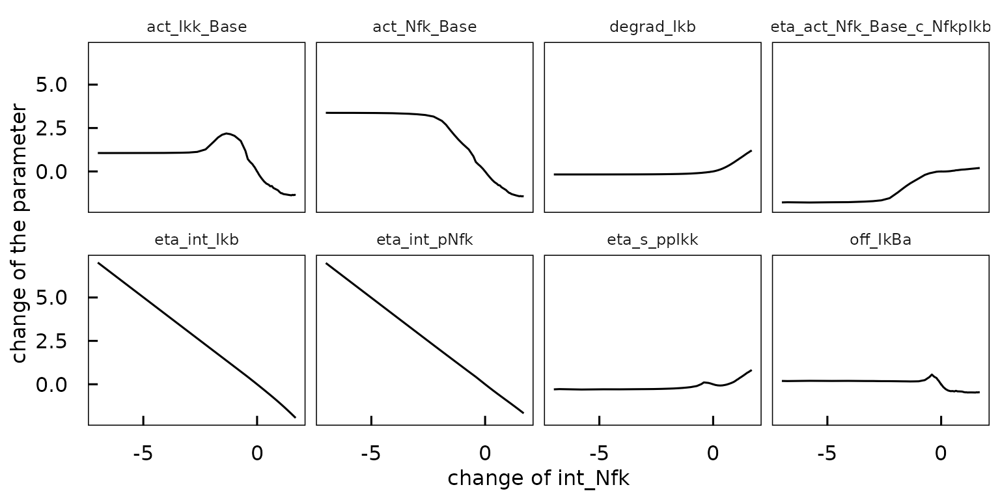
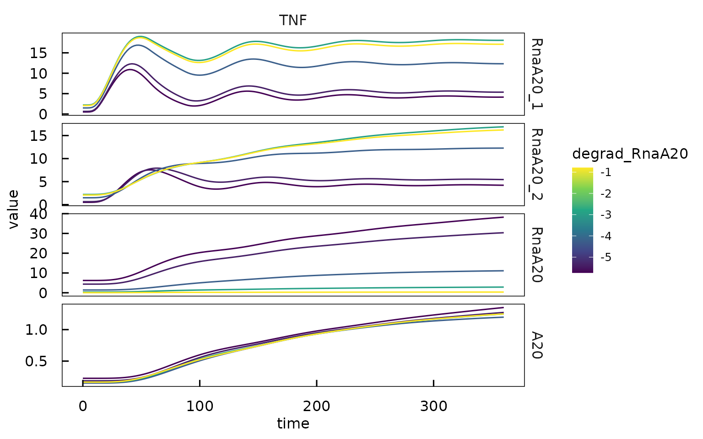
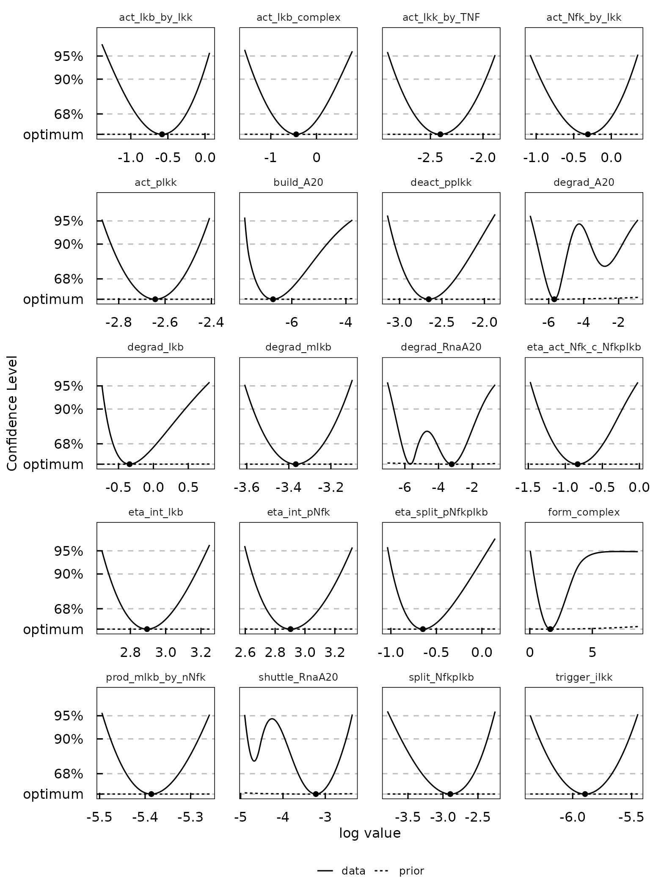

# 5. Profile likelihood

The profile likelihood [\[1\]](#ref-raue2009structural) determines how
well the data constrain each parameter. This chapter profiles all
parameters of the full model at the best fit of
[Optimization](https://dmodverse.github.io/dMod2/articles/guide-optimization.md),
tests the core model of the publication, and fits a reduced model, by
`profiles.R`, `variants.R`, `reduced.R` and `refit.R`.

## Profile likelihood and confidence intervals

The profile likelihood of a parameter is the data term along the path on
which the other parameters minimize an objective with that parameter
fixed. Here that objective is the one of the multistart with its prior
replaced by a prior of standard deviation 20 on the log scale at the
best fit, so that the data term, not the prior, shapes the profiles; the
optimum of that objective is the lowest point of every profile. Values
of the data term within the 95 % quantile of \\\chi^2_1\\, 3.84, of its
minimum form the 95 % confidence interval ([Methods \> Profile
likelihood](https://dmodverse.github.io/dMod2/articles/methods-profiles.md)).
`stepControl = list(stop = "data")` ends a profile there,
`confint(val.column = "data")` reads the interval off, and
[`profileThreshold()`](https://dmodverse.github.io/dMod2/reference/profileThreshold.md)
gives other levels. A profile open towards \\-\infty\\ on the log scale
means the process can be switched off, towards \\+\infty\\ that it can
be instantaneous ([Methods \>
Shapes](https://dmodverse.github.io/dMod2/articles/methods-profiles.html#shapes)).

`method = "integrate"` (default) follows the constrained optimum as a
curve, with `algoControl = list(reoptimize = TRUE)` corrected at every
step by a
[`trust()`](https://dmodverse.github.io/dMod2/reference/trust.md) fit
with the settings of `optControl`; `method = "optimize"` refits at every
step.

| entry of `stepControl` | `"integrate"` | `"optimize"` | controls |
|----|----|----|----|
| `stepsize` | `1e-4` | `1e-2` | first step |
| `min`, `max` | `1e-4`, `Inf` | `1e-4`, `Inf` | bounds of the step |
| `atol`, `rtol` | `1e-2` | `1e-1` | mismatch of predicted and actual change |
| `limit` | `500` | `100` | steps per side |
| `stop` | `"value"` | `"value"` | part of the objective compared with the threshold |

`limits` bounds the profiled parameter relative to the optimum, `side`
profiles one side, `cores` profiles parameters in parallel ([Remote
computing](https://dmodverse.github.io/dMod2/articles/guide-remote-computing.html#threads-and-processes)).

## Profiles of the full model

`profiles.R` refits the best fit of the multistart to the tolerances of
the profiles:

``` r

# the best fit of the multistart, refitted to the tolerances of the profiles
refit <- trust(obj, as.parvec(readRDS("results/fits.rds")), fixed = gauge, rinit = 0.1, rmax = 10,
               iterlim = 1000, tolControl = tolerances)
```

and fits the objective of the profiles from there:

``` r

# the profiles replace the prior of model.R by one of standard deviation 20 at the refit, so that
# the data term shapes them; they start at the optimum of that objective
objProfile <- normL2(data, prd, e) + constraintL2(refit$argument, sigma = 20) + stability
fitProfile <- trust(objProfile, refit$argument, fixed = gauge, rinit = 0.1, rmax = 10,
                    iterlim = 1000, tolControl = tolerances)
best <- fitProfile$argument
```

Each side runs until the data term has risen by the threshold or the
parameter has moved by 7 on the log scale; a profile below the fit
restarts the fit from the lowest point. `helix.R` runs one parameter per
cluster task.

``` r

# the profiles integrated, every step re-optimized, each side until the data term has risen by the
# threshold or the parameter has moved by 7 on the natural log scale, the settings of refit.R.
# Where a profile reaches a lower value than the fit, the fit restarts from there and all
# profiles run again. helix.R runs one profile per array task.
limits <- c(lower = -7, upper = 7)
repeat {
  profiles <- profile(objProfile, best, names(best), fixed = gauge, limits = limits,
                      stepControl = list(stop = "data"), algoControl = list(reoptimize = TRUE),
                      optControl = list(iterlim = 100, tolControl = tolerances),
                      cores = getOption("dMod2.cores"))
  if (min(profiles$value) > fitProfile$value - 1e-2) break
  fitProfile <- trust(objProfile, as.parvec(profiles)[names(best)], fixed = gauge, rinit = 0.1,
                      rmax = 10, iterlim = 1000, tolControl = tolerances)
  best <- fitProfile$argument
}
```

``` r

saved <- readRDS("results/profiles.rds")
refit <- saved$refit
fitProfile <- saved$fitProfile
profiles <- saved$profiles
```

The data term at the refit and at the optimum of the profiles:

``` r

dataTerm <- function(p) attr(obj(p, fixed = gauge), "data")
c(refit = dataTerm(refit$argument), profiles = dataTerm(fitProfile$argument))
#>     refit  profiles 
#> -511.1623 -516.6201
```

Without the prior of `model.R` the data term falls by 5.46.

No profile lies more than 0.01 below the fit, so the profiles start at
the optimum:

``` r

c(fit = fitProfile$value, lowest = min(profiles$value))
#>      fit   lowest 
#> -516.381 -516.381
```

The intervals and their shapes:

``` r

intervals <- confint(profiles, level = 0.95, val.column = "data")
intervals$shape <- with(intervals, ifelse(is.finite(lower) & is.finite(upper), "finite",
                       ifelse(is.finite(lower), "open above",
                              ifelse(is.finite(upper), "open below", "open on both sides"))))
table(intervals$shape)
#> 
#>             finite         open above         open below open on both sides 
#>                 41                  7                 13                  2
rownames(intervals) <- NULL
intervals[intervals$shape != "finite", c("name", "value", "lower", "upper", "shape")]
#>                          name       value      lower       upper
#> 1                act_Ikb_Base  -5.8332017       -Inf  -5.2722343
#> 3                act_Ikk_Base -12.0110561       -Inf  -7.7725467
#> 4              act_Ikk_by_TNF  -2.2822540 -3.0018130         Inf
#> 5                act_Nfk_Base -10.3621412       -Inf  -5.6671276
#> 11                 deact_TNFR  -5.8862079       -Inf  -1.2760000
#> 13                 degrad_Ikb   0.6304596 -0.2332254         Inf
#> 16 eta_act_Ikb_Base_c_pNfkIkb   4.9894331  3.7188255         Inf
#> 17      eta_act_Ikb_c_pNfkIkb   0.9246619       -Inf   2.5525882
#> 18 eta_act_Nfk_Base_c_NfkpIkb  -0.8123812       -Inf         Inf
#> 20       eta_form_complex_nuc   6.7243105  0.3740472         Inf
#> 21                eta_int_Ikb   3.0148611  1.0684955         Inf
#> 22               eta_int_pNfk   2.9452523  1.2334470         Inf
#> 23                eta_s_ppIkk  -4.6153017       -Inf  -0.5808329
#> 25                ext_nNfkIkb   5.6011287  0.1651337         Inf
#> 27                    inh_Ikk  -0.2313481       -Inf         Inf
#> 28                    int_Nfk  -4.4140529       -Inf  -2.7359319
#> 31                   off_IkBa  -7.7087244       -Inf  -3.2226496
#> 32          off_ipIkBa_ibIkBa  -2.5290309       -Inf  -1.6111918
#> 36         off_ipNFkB_ibpIkBa  -7.2911418       -Inf  -2.4761357
#> 39                  off_pIkBa  -7.2816256       -Inf  -2.3774188
#> 48            s_ipNFkB_ibNFkB  -2.2346193       -Inf  -0.4932869
#> 60                 tau_A20GFP -15.4019051       -Inf -10.1806273
#>                 shape
#> 1          open below
#> 3          open below
#> 4          open above
#> 5          open below
#> 11         open below
#> 13         open above
#> 16         open above
#> 17         open below
#> 18 open on both sides
#> 20         open above
#> 21         open above
#> 22         open above
#> 23         open below
#> 25         open above
#> 27 open on both sides
#> 28         open below
#> 31         open below
#> 32         open below
#> 36         open below
#> 39         open below
#> 48         open below
#> 60         open below
```

The open profiles, data term and prior separately; on an open side the
data term stays below 3.84, and the prior rises by up to 0.5:

``` r

# panels wide enough for the parameter names, few ticks and the legend below
readable <- list(ggplot2::scale_x_continuous(breaks = scales::breaks_pretty(n = 3)),
                 ggplot2::guides(x = ggplot2::guide_axis(check.overlap = TRUE)),
                 ggplot2::theme(strip.text = ggplot2::element_text(size = 9),
                                panel.spacing.x = grid::unit(1.5, "lines"), legend.position = "bottom"),
                 ggplot2::labs(x = "log value", color = NULL, linetype = NULL))
```

``` r

open <- intervals$name[intervals$shape != "finite"]
plotProfile(profiles, mode %in% c("data", "prior"), name %in% open, ncol = 4) + readable
```


## Parameter paths

[`plotPaths()`](https://dmodverse.github.io/dMod2/reference/plotPaths.md)
shows how the other parameters compensate along a profile. Along
`act_Ikb_Base`, `eta_act_Ikb_Base_c_pNfkIkb` rises by the same amount:
the data determine the product, the phosphorylation of IκBα in the
complex with pNFκB. `int_Nfk` trades in the same way against the import
factors of IκBα and pNFκB. Parameters with an open profile, such as
`act_Ikk_Base`, drift along without changing the data term. Shown are
the parameters that move by more than 1:

``` r

# the parameters that move along the profile of `par` by more than `by` on the log scale
movers <- function(par, by = 1) {
  d <- as.data.frame(profiles)[profiles$whichPar == par, ]
  others <- setdiff(names(fitProfile$argument), par)
  others[vapply(d[others], function(v) diff(range(v)) > by, NA)]
}
for (par in c("act_Ikb_Base", "int_Nfk"))
  print(plotPaths(profiles, partner %in% movers(par), whichPar = par) +
          ggplot2::facet_wrap(ggplot2::vars(partner), ncol = 4) +
          ggplot2::scale_x_continuous(breaks = scales::breaks_pretty(n = 3)) +
          ggplot2::theme(strip.text = ggplot2::element_text(size = 9)) +
          ggplot2::labs(x = paste("change of", par), y = "change of the parameter"))
```



## Predictions along a profile

[`plotArray()`](https://dmodverse.github.io/dMod2/reference/plotArray.md)
predicts the model at points along one side of a profile, from the
optimum to its end, colored by the profiled parameter; `fixed` adds the
gauge the profiles held fixed. Within the threshold the measured
readouts stay within the noise of the data, so the states show what a
profile leaves open. Along the upper side of `degrad_RnaA20`, which ends
where the data term has risen by the threshold, the last stage of the
A20 transcript, `RnaA20`, falls by two orders of magnitude and the delay
stages before it rise, while A20, the protein that A20GFP reads out,
stays nearly the same:

``` r

states <- x * pSS * p
minutes <- seq(0, 360, 2)
chain <- c("RnaA20_1", "RnaA20_2", "RnaA20", "A20")
plotArray("degrad_RnaA20", profiles, states, minutes, name %in% chain, condition == "TNF",
          direction = "up", nSim = 5, fixed = gauge)
```



Along the lower side of `ext_nNfkIkb`, a slower export of the complex of
NFκB and IκBα from the nucleus, the complex builds up to a few percent
of total NFκB at the expense of free and phosphorylated nuclear NFκB, so
that their sum, which nucNFkB reads out, stays the same:

``` r

plotArray("ext_nNfkIkb", profiles, states, minutes, name %in% c("nNfk", "pnNfk", "nNfkIkb"),
          condition == "TNF", direction = "down", nSim = 5, fixed = gauge)
```


## Core model of the publication

The publication reduced the full model to a core model of 29 reactions
[\[2\]](#ref-oppelt2018model), Table S5 with fixed values (Tables S8 and
S9). Its settings on the log scale:

| setting of the core model | parameter of the full model | value |
|----|----|----|
| IKK activated by the receptors only: no basal activation | `act_Ikk_Base` | \\-\infty\\ |
| no inhibition of IKK by A20 | `inh_Ikk` | \\\infty\\ |
| basal phosphorylation of IκBα only in the complex with pNFκB, at a rate `act_Ikb_complex` | `act_Ikb_Base` | \\-\infty\\ |
| IκBα phosphorylated by pIKK in the complexes with NFκB and pNFκB at the same rate | `eta_act_Ikb_c_pNfkIkb` | 0 |
| NFκB phosphorylated by pIKK only | `act_Nfk_Base` | \\-\infty\\ |
| ppIKK phosphorylates neither IκBα nor NFκB | `eta_s_ppIkk` | \\-\infty\\ |
| pNFκB released without a separate factor, at `split_NfkIkb` | `eta_split_pNfkpIkb` | 0 |
| slow receptor deactivation, 0.001 per minute | `deact_TNFR` | \\\ln 10^{-3}\\ |
| slow import of NFκB, 0.01 per minute | `int_Nfk` | \\\ln 10^{-2}\\ |
| fast dephosphorylation of nuclear pNFκB, 1000 per minute | `deact_pnNfk` | \\\ln 10^{3}\\ |
| fast formation of the nuclear complex, 1000 per minute | `eta_form_complex_nuc` | \\\ln 10^{3}\\ minus `form_complex` |
| fast export of the complex, 1000 per minute | `ext_nNfkIkb` | \\\ln 10^{3}\\ |
| no offset of the IκBα blots, no bleaching of A20-GFP | `off_IkBa`, `off_ipIkBa_ibIkBa`, `tau_A20GFP` | \\-\infty\\ |
| one delay step of the A20 transcript instead of two | none |  |

Against the intervals of the full model:

``` r

core <- c(act_Ikk_Base = -Inf, inh_Ikk = Inf, act_Ikb_Base = -Inf, eta_act_Ikb_c_pNfkIkb = 0,
          act_Nfk_Base = -Inf, eta_s_ppIkk = -Inf, eta_split_pNfkpIkb = 0,
          deact_TNFR = log(1e-3), int_Nfk = log(1e-2), deact_pnNfk = log(1000),
          eta_form_complex_nuc = log(1000) - fitProfile$argument[["form_complex"]],
          ext_nNfkIkb = log(1000), off_IkBa = -Inf, off_ipIkBa_ibIkBa = -Inf, tau_A20GFP = -Inf)
settings <- intervals[match(names(core), intervals$name), c("name", "lower", "upper", "shape")]
settings$core <- core
settings$inside <- with(settings, core >= lower & core <= upper)
rownames(settings) <- NULL
settings
#>                     name      lower       upper              shape      core
#> 1           act_Ikk_Base       -Inf  -7.7725467         open below      -Inf
#> 2                inh_Ikk       -Inf         Inf open on both sides       Inf
#> 3           act_Ikb_Base       -Inf  -5.2722343         open below      -Inf
#> 4  eta_act_Ikb_c_pNfkIkb       -Inf   2.5525882         open below  0.000000
#> 5           act_Nfk_Base       -Inf  -5.6671276         open below      -Inf
#> 6            eta_s_ppIkk       -Inf  -0.5808329         open below      -Inf
#> 7     eta_split_pNfkpIkb -0.8384583   1.4120132             finite  0.000000
#> 8             deact_TNFR       -Inf  -1.2760000         open below -6.907755
#> 9                int_Nfk       -Inf  -2.7359319         open below -4.605170
#> 10           deact_pnNfk -1.3246633   0.4145779             finite  6.907755
#> 11  eta_form_complex_nuc  0.3740472         Inf         open above  5.034834
#> 12           ext_nNfkIkb  0.1651337         Inf         open above  6.907755
#> 13              off_IkBa       -Inf  -3.2226496         open below      -Inf
#> 14     off_ipIkBa_ibIkBa       -Inf  -1.6111918         open below      -Inf
#> 15            tau_A20GFP       -Inf -10.1806273         open below      -Inf
#>    inside
#> 1    TRUE
#> 2    TRUE
#> 3    TRUE
#> 4    TRUE
#> 5    TRUE
#> 6    TRUE
#> 7    TRUE
#> 8    TRUE
#> 9    TRUE
#> 10  FALSE
#> 11   TRUE
#> 12   TRUE
#> 13   TRUE
#> 14   TRUE
#> 15   TRUE
```

Every setting but one lies in the 95 % interval; the data bound
`deact_pnNfk` to 0.27 to 1.5 per minute, below the fixed 1000. A profile
tests one setting with all others free; the likelihood ratio test takes
them together. `variants.R` fits the core model and the variants that
release one setting, each with the prior of `model.R`, and compares the
data terms with the full model:

| released                              | lower by | above full | threshold |
|:--------------------------------------|---------:|-----------:|----------:|
| two delay steps of the A20 transcript |     4.74 |      22.45 |     27.59 |
| separate factor `eta_split_pNfkpIkb`  |     3.39 |      23.80 |     26.30 |
| `deact_TNFR` estimated                |    -0.40 |      27.59 |     26.30 |
| `int_Nfk` estimated                   |     0.15 |      27.04 |     26.30 |
| `deact_pnNfk` estimated               |     1.21 |      25.98 |     26.30 |
| `form_complex_nuc` estimated          |     0.00 |      27.19 |     26.30 |
| `ext_nNfkIkb` estimated               |    -0.08 |      27.27 |     26.30 |
| `off_IkBa` estimated                  |    -0.46 |      27.64 |     26.30 |
| `off_ipIkBa_ibIkBa` estimated         |     3.01 |      24.18 |     26.30 |
| `tau_A20GFP` estimated                |    -1.45 |      28.64 |     26.30 |

The core model lies 27.19 above the full model, against the threshold
27.59 for 17 removed parameters, and is accepted. A negative decrease
means that the prior on the released parameter costs more than the data
gain. The two delay steps and the separate factor lower the data term
most; together they lower it by 8.14 at one added parameter, more than
the threshold 3.84 of one degree of freedom. `reduced.R` takes these two
deviations from the publication. In that model the scale
`s_ipNFkB_ibNFkB` of the NFκB blot after NFκB precipitation has a
profile open below, compensated only by the offset; `reduced.R` sets the
scale to 0.

## Reduced model

The core model with the two delay steps and the separate factor for the
release of pNFκB, and the NFκB blot after NFκB precipitation reading the
offset alone:

``` r

# the core model of the publication (Table S5 of the supplement), with the two delay steps of the
# A20 transcript of the full model and a separate factor for the release of pNFκB
reactionsReduced <- eqnlist() |>
  assignCompartment(nIkb = "nucleus", pnNfk = "nucleus", nNfk = "nucleus", nNfkIkb = "nucleus",
                    volume = "Vnuc") |>
  addReaction("TNF", "TNF + TNFR", "uptake * TNF", "receptor activation") |>
  addReaction("TNFR", "", "deact_TNFR * TNFR", "receptor deactivation") |>
  # IKK activated by the receptors alone, without basal activation and inhibition by A20
  addReaction("Ikk", "pIkk", "act_Ikk_by_TNF * TNFR * Ikk", "IKK activation") |>
  addReaction("pIkk", "ppIkk", "act_pIkk * pIkk", "IKK phosphorylation") |>
  addReaction("ppIkk", "iIkk", "deact_ppIkk * ppIkk", "IKK inactivation") |>
  addReaction("iIkk", "Ikk", "trigger_iIkk * iIkk", "IKK recovery") |>
  # IκBα phosphorylated by pIKK in both complexes and basally only in the complex with pNFκB;
  # NFκB phosphorylated by pIKK only; ppIKK phosphorylates neither
  addReaction("NfkIkb", "NfkpIkb", "act_Ikb_by_Ikk * pIkk * NfkIkb", "IkBa phosphorylation by pIKK") |>
  addReaction("pNfkIkb", "pNfkpIkb", "act_Ikb_complex * pNfkIkb",
              "basal IkBa phosphorylation, pNFkB complex") |>
  addReaction("pNfkIkb", "pNfkpIkb", "act_Ikb_by_Ikk * pIkk * pNfkIkb",
              "IkBa phosphorylation by pIKK, pNFkB complex") |>
  addReaction("NfkIkb", "pNfkIkb", "act_Nfk_by_Ikk * pIkk * NfkIkb", "NFkB phosphorylation by pIKK") |>
  addReaction("NfkpIkb", "pNfkpIkb", "act_Nfk_by_Ikk * eta_act_Nfk_c_NfkpIkb * pIkk * NfkpIkb",
              "NFkB phosphorylation by pIKK, pIkBa complex") |>
  addReaction("NfkpIkb", "Nfk + pIkb", "split_NfkpIkb * NfkpIkb", "release of NFkB") |>
  addReaction("pNfkpIkb", "pNfk + pIkb", "split_NfkIkb * eta_split_pNfkpIkb * pNfkpIkb",
              "release of pNFkB") |>
  addReaction("Nfk + Ikb", "NfkIkb", "form_complex * Nfk * Ikb", "complex formation") |>
  addReaction("", "mIkb", "prod_mIkb_by_nNfk * nNfk", "IkBa transcription") |>
  addReaction("mIkb", "", "degrad_mIkb * mIkb", "IkBa transcript degradation") |>
  addReaction("", "Ikb", "prod_Ikb * mIkb", "IkBa translation") |>
  addReaction("pIkb", "", "degrad_Ikb * pIkb", "pIkBa degradation") |>
  addReaction("Ikb", "nIkb", "int_Nfk * eta_int_Ikb * Ikb", "IkBa import") |>
  addReaction("pNfk", "pnNfk", "int_Nfk * eta_int_pNfk * pNfk", "pNFkB import") |>
  addReaction("Nfk", "nNfk", "int_Nfk * Nfk", "NFkB import") |>
  addReaction("pnNfk", "nNfk", "deact_pnNfk * pnNfk", "nuclear pNFkB dephosphorylation") |>
  addReaction("nIkb + nNfk", "nNfkIkb", "form_complex_nuc * nNfk * nIkb",
              "nuclear complex formation") |>
  addReaction("nNfkIkb", "NfkIkb", "ext_nNfkIkb * nNfkIkb", "complex export") |>
  addReaction("", "RnaA20_1", "build_RnaA20 * nNfk", "A20 transcription") |>
  addReaction("RnaA20_1", "RnaA20_2", "shuttle_RnaA20 * RnaA20_1", "A20 transcript, delay 1") |>
  addReaction("RnaA20_2", "RnaA20", "shuttle_RnaA20 * RnaA20_2", "A20 transcript, delay 2") |>
  addReaction("RnaA20", "", "degrad_RnaA20 * RnaA20", "A20 transcript degradation") |>
  addReaction("", "A20", "build_A20 * RnaA20", "A20 translation") |>
  addReaction("A20", "", "degrad_A20 * A20", "A20 degradation")
```

``` r

# the readout whose scale goes to 0 is the offset
observablesReduced <- observables
observablesReduced["ipNFkB_ibNFkB"] <- "log(off_ipNFkB_ibNFkB)"
```

Without basal activation the resting states form a continuum. As in the
publication, all NFκB rests in the complex with IκBα and all IKK is
inactive, a steady state for every parameter value; the reduced model
needs neither
[`Pimpl()`](https://dmodverse.github.io/dMod2/reference/Pimpl.md) nor a
stability term:

``` r

# at rest all NFκB is bound to IκBα and all IKK inactive, the other states are 0: without basal
# activation this is a steady state for every parameter value, as in the publication; TNFα added
# at time 0 as in model.R
modelReduced <- odemodel(reactionsReduced, events = events, modelname = "oppelt_red_ode", compile = FALSE)
xReduced <- Xs(modelReduced, options = list(atol = 1e-10, rtol = 1e-8))
gReduced <- Y(observablesReduced, xReduced, modelname = "oppelt_red_obs", compile = FALSE)
eReduced <- Y(errors, gReduced, modelname = "oppelt_red_err", compile = FALSE)
resting <- c(NfkIkb = "totalNfk", Ikk = "totalIkk")
resting <- c(resting, structure(rep("0", length(setdiff(reactionsReduced$states, names(resting)))),
                                names = setdiff(reactionsReduced$states, names(resting))))

# the fixed values of the publication (Tables S8 and S9): fast processes at 1000 per minute, slow
# receptor deactivation and NFκB import, offsets and bleaching that vanish
fixedReduced <- c(deact_TNFR = 1e-3, int_Nfk = 1e-2, deact_pnNfk = 1000, form_complex_nuc = 1000,
                  ext_nNfkIkb = 1000, off_IkBa = 0, off_ipIkBa_ibIkBa = 0, tau_A20GFP = 0)
trafoReduced <- eqnvec() |>
  define("x <- x", x = setdiff(getParameters(xReduced, gReduced, eReduced),
                               reactionsReduced$states)) |>
  define("x <- y", x = names(fixedReduced), y = fixedReduced) |>
  define("x <- y", x = names(resting), y = resting) |>
  insert("x <- exp(x)", x = .currentSymbols) |>
  define("TNF <- 0") |>
  branch(covariates(data)) |>
  define("dose_TNF <- 0", conditionMatch = "control") |>
  define("dose_TNF <- 1", conditionMatch = "TNF")
pReduced <- P(trafoReduced, modelname = "oppelt_red_par", compile = FALSE)
```

``` r

compile(gReduced, xReduced, pReduced, eReduced, output = "oppelt_red",
        cores = getOption("dMod2.cores"))
prdReduced <- gReduced * xReduced * pReduced
```

The prior of the full model on the remaining parameters:

``` r

# the prior of model.R on the parameters that remain
outerReduced <- getParameters(prdReduced)
# the basal phosphorylation in the pNFκB complex at the product of the two rates it replaces
muReduced <- c(mu, act_Ikb_complex = mu[["act_Ikb_Base"]] + mu[["eta_act_Ikb_Base_c_pNfkIkb"]])[outerReduced]
sigmaReduced <- c(sigma, act_Ikb_complex = sqrt(sigma[["act_Ikb_Base"]]^2 +
                                                  sigma[["eta_act_Ikb_Base_c_pNfkIkb"]]^2))[outerReduced]
gaugeReduced <- gauge[intersect(names(gauge), outerReduced)]
objReduced <- normL2(data, prdReduced, eReduced) + constraintL2(muReduced, sigma = sigmaReduced)
```

`refit.R` fits from the full model and from 50 starts around that fit,
then compares the data terms:

``` r

# from the full model refitted in profiles.R, the basal phosphorylation in the pNFκB complex at
# the product of the two rates it replaces, then a multistart around that fit
full <- readRDS("results/profiles.rds")$refit
start <- c(full$argument, gauge, act_Ikb_complex = full$argument[["act_Ikb_Base"]] +
             full$argument[["eta_act_Ikb_Base_c_pNfkIkb"]])[outerReduced]
freeReduced <- setdiff(outerReduced, names(gaugeReduced))
fit <- trust(objReduced, start[freeReduced], fixed = gaugeReduced, rinit = 0.1, rmax = 10,
             iterlim = 1000, tolControl = tolerances)
set.seed(1)
fitsReduced <- mstrust(objReduced, fit$argument, fixed = gaugeReduced, sd = 1, fits = 50,
                       startFromCenter = TRUE, iterlim = 1000, tolControl = tolerances,
                       cores = getOption("dMod2.cores")) |>
  as.parframe()
bestReduced <- as.parvec(fitsReduced)
```

``` r

# the data terms of the two models, the difference against the 95% quantile of chi-square with
# the number of parameters the reduction removed
dataFull <- normL2(data, prd, e)(full$argument, fixed = gauge)$value
dataReduced <- normL2(data, prdReduced, eReduced)(bestReduced, fixed = gaugeReduced)$value
removed <- length(full$argument) - length(bestReduced)
ratio <- c(full = dataFull, reduced = dataReduced, difference = dataReduced - dataFull,
           removed = removed, threshold = qchisq(0.95, removed))
```

``` r

saved <- readRDS("results/reduced.rds")
saved$ratio
#>       full    reduced difference    removed  threshold 
#> -511.16226 -492.11360   19.04866   16.00000   26.29623
```

With 16 fewer parameters the data term is higher by 19.05, below the
threshold 26.3: the reduced model is accepted.

## Profiles of the reduced model

With the prior and the settings of the profiles of the full model, from
the optimum of that objective:

``` r

# the prior of the profiles of profiles.R, standard deviation 20 at the best fit
objReducedProfile <- normL2(data, prdReduced, eReduced) + constraintL2(bestReduced, sigma = 20)
fitReducedProfile <- trust(objReducedProfile, bestReduced, fixed = gaugeReduced, rinit = 0.1,
                           rmax = 10, iterlim = 1000, tolControl = tolerances)
bestReducedProfile <- fitReducedProfile$argument
```

``` r

# the settings of the full model, with the same restart from a lower point of a profile
repeat {
  profilesReduced <- profile(objReducedProfile, bestReducedProfile, names(bestReducedProfile),
                             fixed = gaugeReduced, limits = c(lower = -7, upper = 7),
                             stepControl = list(stop = "data"), algoControl = list(reoptimize = TRUE),
                             optControl = list(iterlim = 100, tolControl = tolerances),
                             cores = getOption("dMod2.cores"))
  if (min(profilesReduced$value) > fitReducedProfile$value - 1e-2) break
  fitReducedProfile <- trust(objReducedProfile, as.parvec(profilesReduced)[names(bestReducedProfile)],
                             fixed = gaugeReduced, rinit = 0.1, rmax = 10, iterlim = 1000,
                             tolControl = tolerances)
  bestReducedProfile <- fitReducedProfile$argument
}
```

``` r

intervalsReduced <- confint(saved$profiles, level = 0.95, val.column = "data")
intervalsReduced$shape <- with(intervalsReduced, ifelse(is.finite(lower) & is.finite(upper), "finite",
                              ifelse(is.finite(lower), "open above",
                                     ifelse(is.finite(upper), "open below", "open on both sides"))))
rownames(intervalsReduced) <- NULL
table(intervalsReduced$shape)
#> 
#>     finite open above 
#>         46          1
intervalsReduced[intervalsReduced$shape != "finite", c("name", "value", "lower", "upper", "shape")]
#>            name    value      lower upper      shape
#> 16 form_complex 1.640366 0.03697376   Inf open above
```

All parameters are identifiable except `form_complex`, bounded below at
0.016 on the log10 scale and open above on a plateau 3.8 above the
optimum; the publication reports (-0.21, 3.03). The profiles of
`degrad_A20`, `degrad_RnaA20` and `shuttle_RnaA20` have a second minimum
inside the interval. The rate constants:

``` r

rates <- setdiff(intervalsReduced$name, grep("^(s|off|sigma|tau)_", intervalsReduced$name, value = TRUE))
intervalsReduced[intervalsReduced$name %in% rates, c("name", "value", "lower", "upper")]
#>                     name      value       lower       upper
#> 1         act_Ikb_by_Ikk -0.5786769 -1.32277502  0.04888701
#> 2        act_Ikb_complex -0.4446753 -1.52655348  0.73659980
#> 3         act_Ikk_by_TNF -2.4052865 -2.89632767 -1.88812963
#> 4         act_Nfk_by_Ikk -0.3113806 -1.07409360  0.34832462
#> 5               act_pIkk -2.6424929 -2.87070137 -2.41230716
#> 6              build_A20 -6.6920132 -7.73025435 -3.80704985
#> 7            deact_ppIkk -2.6563401 -3.12809508 -1.92040146
#> 8             degrad_A20 -5.6818628 -6.98063651 -0.94324630
#> 9             degrad_Ikb -0.3416333 -0.73674810  0.75322690
#> 10           degrad_mIkb -3.3668352 -3.60828348 -3.10788412
#> 11         degrad_RnaA20 -3.2167915 -6.98100469 -0.69255152
#> 12 eta_act_Nfk_c_NfkpIkb -0.8339450 -1.45858344 -0.05026128
#> 13           eta_int_Ikb  2.8945636  2.63874246  3.23312850
#> 14          eta_int_pNfk  2.9033062  2.60405264  3.30733205
#> 15    eta_split_pNfkpIkb -0.6480638 -1.03039330  0.06290552
#> 16          form_complex  1.6403662  0.03697376         Inf
#> 28     prod_mIkb_by_nNfk -5.3862587 -5.49300296 -5.25943716
#> 40        shuttle_RnaA20 -3.2227083 -4.90322408 -2.36786569
#> 44         split_NfkpIkb -2.8945842 -3.76340936 -2.27033830
#> 47          trigger_iIkk -5.8948990 -6.35863674 -5.45137364
```

``` r

plotProfile(saved$profiles, mode %in% c("data", "prior"), name %in% rates, ncol = 4) + readable
```



Reference: [`profile()`](https://rdrr.io/r/stats/profile.html),
[`profileThreshold()`](https://dmodverse.github.io/dMod2/reference/profileThreshold.md),
[`confint()`](https://rdrr.io/r/stats/confint.html),
[`plotProfile()`](https://dmodverse.github.io/dMod2/reference/plotProfile.md),
[`plotPaths()`](https://dmodverse.github.io/dMod2/reference/plotPaths.md),
[`plotArray()`](https://dmodverse.github.io/dMod2/reference/plotArray.md)

[← 4.
Optimization](https://dmodverse.github.io/dMod2/articles/guide-optimization.md)
\| [6. Prediction uncertainty
→](https://dmodverse.github.io/dMod2/articles/guide-prediction-uncertainty.md)

## References

\[1\]

A. Raue *et al.*, “Structural and practical identifiability analysis of
partially observed dynamical models by exploiting the profile
likelihood,” *Bioinformatics*, vol. 25, no. 15, pp. 1923–1929, 2009,
doi:
[10.1093/bioinformatics/btp358](https://doi.org/10.1093/bioinformatics/btp358).

\[2\]

A. Oppelt *et al.*, “Model-based identification of TNFα-induced
IKKβ-mediated and IκBα-mediated regulation of NFκB signal transduction
as a tool to quantify the impact of drug-induced liver injury
compounds,” *npj Systems Biology and Applications*, vol. 4, p. 23, 2018,
doi:
[10.1038/s41540-018-0058-z](https://doi.org/10.1038/s41540-018-0058-z).
