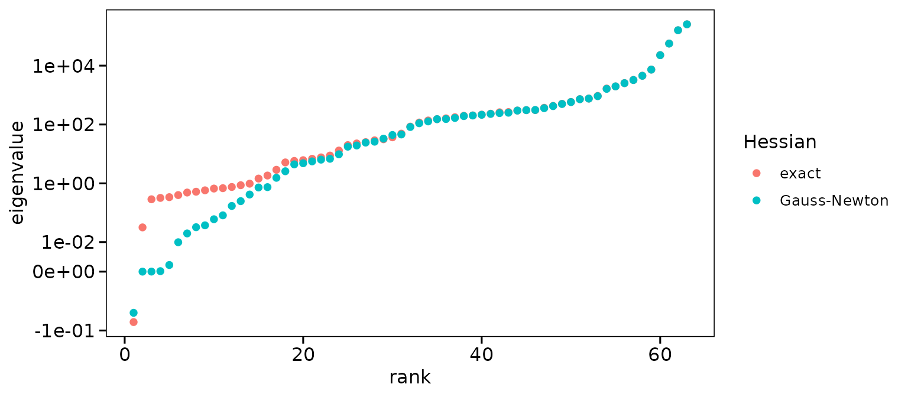

# 3. Sensitivities

Fits, profiles and mixed-effects models need derivatives of the
objective. dMod2 computes them exactly from the ODE sensitivities,
propagated by the chain rule through every function object, without
finite differences. This chapter covers forward, forward over forward,
reverse and forward over reverse, the backends of
[`odemodel()`](https://dmodverse.github.io/dMod2/reference/odemodel.md),
and their costs on the guide model (`sensitivities.R` of the project).
Details: [Methods \> Sensitivities and
Hessians](https://dmodverse.github.io/dMod2/articles/methods-sensitivities.md).

## Forward sensitivities

The default. [`Xs()`](https://dmodverse.github.io/dMod2/reference/Xs.md)
integrates the sensitivities \\\partial x / \partial \theta\\ with the
states, and every function object of `g*x*p` multiplies them by the
Jacobian of that object. The objective returns gradient and Gauss-Newton
Hessian for one solve with a tangent per parameter. `sensErrCon` in
`optionsSens` of
[`Xs()`](https://dmodverse.github.io/dMod2/reference/Xs.md) sets whether
sensitivities enter the error test, by default yes. With fixed standard
deviations the Gauss-Newton Hessian is positive semidefinite, with an
error model it can be indefinite ([Methods \> Gauss-Newton with an error
model](https://dmodverse.github.io/dMod2/articles/methods-sensitivities.html#gauss-newton-with-an-error-model)).

## Forward over forward

`deriv2 = TRUE` in
[`odemodel()`](https://dmodverse.github.io/dMod2/reference/odemodel.md),
[`Y()`](https://dmodverse.github.io/dMod2/reference/Y.md) and
[`P()`](https://dmodverse.github.io/dMod2/reference/P.md) builds
second-order sensitivities; the objective called with `deriv2 = TRUE`
and the forward sweep returns the exact Hessian. The equation count
grows with the square of the parameters, so this suits small models such
as those of [Nonlinear mixed-effects
models](https://dmodverse.github.io/dMod2/articles/guide-nlme.md). The
guide model with 63 parameters uses it once below to show the cost.

## Reverse sweep

The gradient alone comes from one backward sweep of the adjoint system,
at a cost independent of the parameter count ([Methods \> Reverse
sweep](https://dmodverse.github.io/dMod2/articles/methods-sensitivities.html#reverse-sweep)).
Every function object is built with
`derivMode = c("forward", "reverse")` and the model is called with
`sweep = "reverse"`. Both passes use the solver `options` alone; solves
with sensitivities use `optionsSens` merged over `options`.

In [`trust()`](https://dmodverse.github.io/dMod2/reference/trust.md) the
sweep is set per phase:

``` r

fit <- trust(obj, start,
             phases = list(list(hessianMethod = "gn"),
                           list(hessianMethod = "sr1", sweep = "reverse")))
fit$phaseSweep
```

Without `sweep`, `"bfgs"` and `"sr1"` phases sweep backwards if the
objective allows it at the start, otherwise forwards. Gauss-Newton
always runs forwards, since \\J^\top J\\ needs forward sensitivities;
with `sweep = "reverse"` the objective warns and returns no Hessian.
`"exact"` runs forwards by default and backwards with
`sweep = "reverse"`, where `deriv2 = TRUE` gives the exact Hessian by
forward over reverse. A change of sweep between phases evaluates the
current iterate once more.
[Optimization](https://dmodverse.github.io/dMod2/articles/guide-optimization.md)
compares the Hessian sources on the guide model.

The backward sweep follows the step grid of the value pass by default.
On the cppDE backend, `optionsReverse` of
[`Xs()`](https://dmodverse.github.io/dMod2/reference/Xs.md) sets the
accuracy, see
[`cppDE::adjointControl()`](https://dmodverse.github.io/cppDE/reference/adjointControl.html):

``` r

x <- Xs(model, options = list(atol = 1e-8, rtol = 1e-6),
        optionsReverse = list(refine = TRUE, gradtol = 1e-3))
controls(x, "optionsReverse") <- list(refine = FALSE)   # the grid of the value pass again
```

| entry | controls |
|----|----|
| `refine` | `TRUE`: each sweep step passes the error test of the solve, else is redone in substeps |
| `gradtol` | step share of the gradient as absolute tolerance, fraction of the gradient scale |

Under `refine`, value and `chi2` of the reverse objective include the
change from the computed to the refined trajectory, the attribute
`correction` ([Methods \> Accuracy of a reverse
gradient](https://dmodverse.github.io/dMod2/articles/methods-sensitivities.html#accuracy-of-a-reverse-gradient)).

## Forward over reverse

The exact Hessian without second-order sensitivities, one column per
parameter from the backward sweep ([Methods \> Forward over
reverse](https://dmodverse.github.io/dMod2/articles/methods-sensitivities.html#forward-over-reverse)).
Build with `derivMode = c("forward", "reverse", "forward-reverse")` and
call with `sweep = "reverse", deriv2 = TRUE`. FOCEI in [Nonlinear
mixed-effects
models](https://dmodverse.github.io/dMod2/articles/guide-nlme.md) uses
the same sweeps for directional second derivatives.

## ODE backends

`odemodel(backend = )` selects the solver; the function objects above
are the same,
[`Xs()`](https://dmodverse.github.io/dMod2/reference/Xs.md) dispatches
on the model class.

| backend | solver | forward | fwd/fwd | reverse | fwd/rev | use |
|----|----|----|----|----|----|----|
| `"cppDE"` (default) | C++: BDF/NDF, Adams, Rosenbrock, Tsitouras | duals | `deriv2` | discrete adjoint | yes | all models |
| `"Sundials"` | CVODES, [`cppDE::cvode()`](https://dmodverse.github.io/cppDE/reference/cvode.html) | CVODES | no | CVODES ASA | no | first-order derivatives |
| `"deSolve"` | `lsodes`, cOde | sens. equations | no | no | no | dMod models |

See cppDE on
[stepping](https://dmodverse.github.io/cppDE/articles/methods-stepping.html),
[CVODES](https://dmodverse.github.io/cppDE/articles/methods-cvode.html)
and
[benchmarks](https://dmodverse.github.io/cppDE/articles/benchmarks.html)
against CVODES.

## Costs on the guide model

`sensitivities.R` rebuilds the chain of [Setting up
models](https://dmodverse.github.io/dMod2/articles/guide-model.md) with
all directions and evaluates the data term at the best fit of
[Optimization](https://dmodverse.github.io/dMod2/articles/guide-optimization.md):

``` r

# the chain and objective of model.R once more, every function object with the reverse sweep and
# second derivatives; Pimpl() passes the reverse sweep through the Jacobian of the root
dm <- c("forward", "reverse", "forward-reverse")
modelR <- odemodel(reactions, events = events, modelname = "oppelt_rev_ode", deriv2 = TRUE,
                   derivMode = dm, compile = FALSE)
xR <- Xs(modelR, options = list(atol = 1e-10, rtol = 1e-8))
gR <- Y(observables, xR, modelname = "oppelt_rev_obs", compile = FALSE, deriv2 = TRUE, derivMode = dm)
eR <- Y(errors, gR, modelname = "oppelt_rev_err", compile = FALSE, deriv2 = TRUE, derivMode = dm)
pSSR <- Pimpl(reactions, modelname = "oppelt_rev_ss", compile = FALSE, deriv2 = TRUE,
              controlsPTC = list(stability = FALSE))
pR <- P(trafo, modelname = "oppelt_rev_par", compile = FALSE, deriv2 = TRUE, derivMode = dm)
compile(gR, xR, pSSR, pR, eR, output = "oppelt_rev", cores = getOption("dMod2.cores"))
objR <- normL2(data, gR * xR * pSSR * pR, eR) + constraintL2(mu, sigma = sigma) +
  constraintStability(pSSR, pR, duration = max(as.data.frame(data)$time))
```

``` r

s <- readRDS("results/sensitivities.rds")
```

Reverse and forward gradients agree:

``` r

# the data term, whose gradient the prior balances at the optimum, so that it does not vanish
best <- as.parvec(readRDS("results/fits.rds"))
dataTerm <- normL2(data, gR * xR * pSSR * pR, eR)
forward <- dataTerm(best, fixed = gauge, sweep = "forward")
reverse <- dataTerm(best, fixed = gauge, sweep = "reverse")
gradients <- data.frame(forward = forward$gradient,
                        reverse = reverse$gradient[names(forward$gradient)])
# the largest deviation relative to the largest entry of the gradient
max(abs(gradients$forward - gradients$reverse)) / max(abs(gradients$forward))
```

``` r

max(abs(s$gradients$forward - s$gradients$reverse)) / max(abs(s$gradients$forward))
#> [1] 0.0002236365
```

within the solver tolerances, since the sweep without `refine` runs on
the grid of the value pass. Seconds per evaluation, minimum of ten:

``` r

# the shortest of ten evaluations, in seconds
cost <- function(...) {
  args <- c(list(best, fixed = gauge), list(...))
  min(replicate(10, system.time(do.call(dataTerm, args))[["elapsed"]]))
}
timing <- c(value = cost(deriv = FALSE), forward = cost(sweep = "forward"),
            reverse = cost(sweep = "reverse"),
            `forward-reverse` = cost(sweep = "reverse", deriv2 = TRUE))
timing
```

``` r

s$timing
#>           value         forward         reverse forward-reverse 
#>           0.004           0.167           0.011           0.724
```

A reverse gradient costs a few values, a forward gradient one solve with
a tangent per parameter, forward over reverse about 4.3 forward
gradients. Forward over forward, measured once:

``` r

# one evaluation of the exact Hessian forward over forward, with second-order sensitivities in all
# pairs of parameters: the time and the peak memory of the process in GB
peak <- function() as.numeric(gsub("\\D", "", grep("^VmHWM", readLines("/proc/self/status"), value = TRUE))) / 2^20
before <- peak()
forwardForward <- system.time(ff <- dataTerm(best, fixed = gauge, sweep = "forward", deriv2 = TRUE))[["elapsed"]]
memory <- c(before = before, forwardForward = peak())
c(seconds = forwardForward, memory)
```

``` r

c(seconds = s$forwardForward, s$memory)
#>        seconds         before forwardForward 
#>     14.7570000      0.6036758      0.7602196
```

It takes 20 times as long as forward over reverse and raises the peak
memory of the process from 0.6 to 0.8 GB; for this model it is a check,
not a method. Both Hessians agree up to the solver error:

``` r

exact <- dataTerm(best, fixed = gauge, sweep = "reverse", deriv2 = TRUE)$hessian
# the two exact Hessians agree up to the error of the solver
max(abs(ff$hessian[rownames(exact), colnames(exact)] - exact)) / max(abs(exact))
gaussNewton <- forward$hessian[rownames(exact), colnames(exact)]
hessians <- data.frame(exact = sort(eigen(exact, symmetric = TRUE, only.values = TRUE)$values),
                       gaussNewton = sort(eigen(gaussNewton, symmetric = TRUE, only.values = TRUE)$values))
```

``` r

max(abs(s$forwardForwardHessian[rownames(s$exact), colnames(s$exact)] - s$exact)) / max(abs(s$exact))
#> [1] 6.499575e-10
```

Eigenvalues of exact and Gauss-Newton Hessian at the best fit:

``` r

eig <- data.frame(rank = rep(seq_len(nrow(s$hessians)), 2),
                  value = c(s$hessians$exact, s$hessians$gaussNewton),
                  Hessian = rep(c("exact", "Gauss-Newton"), each = nrow(s$hessians)))
ggplot2::ggplot(eig, ggplot2::aes(rank, value, color = Hessian)) +
  ggplot2::geom_point() +
  ggplot2::scale_y_continuous(trans = scales::pseudo_log_trans(sigma = 1e-3, base = 10),
                              breaks = c(-1e-1, 0, 1e-2, 1, 1e2, 1e4)) +
  ggplot2::labs(x = "rank", y = "eigenvalue") +
  theme_dMod()
```



They agree in the large eigenvalues, the well-determined directions. The
exact Hessian is positive definite with smallest eigenvalue -0.053, the
Gauss-Newton Hessian has -0.025: the model estimates the standard
deviations of the imaging readouts, and with an error model Gauss-Newton
can be indefinite ([Gauss-Newton with an error
model](https://dmodverse.github.io/dMod2/articles/methods-sensitivities.html#gauss-newton-with-an-error-model)).
In the flat directions the Hessian sources of
[Optimization](https://dmodverse.github.io/dMod2/articles/guide-optimization.md)
take different steps.

Reference:
[`odemodel()`](https://dmodverse.github.io/dMod2/reference/odemodel.md),
[`Xs()`](https://dmodverse.github.io/dMod2/reference/Xs.md),
[`Y()`](https://dmodverse.github.io/dMod2/reference/Y.md),
[`P()`](https://dmodverse.github.io/dMod2/reference/P.md),
[`Pimpl()`](https://dmodverse.github.io/dMod2/reference/Pimpl.md),
[`normL2()`](https://dmodverse.github.io/dMod2/reference/normL2.md),
[`controls()`](https://dmodverse.github.io/dMod2/reference/controls.md),
[`trust()`](https://dmodverse.github.io/dMod2/reference/trust.md)

[← 2.
Symmetries](https://dmodverse.github.io/dMod2/articles/guide-symmetries.md)
\| [4. Optimization
→](https://dmodverse.github.io/dMod2/articles/guide-optimization.md)
