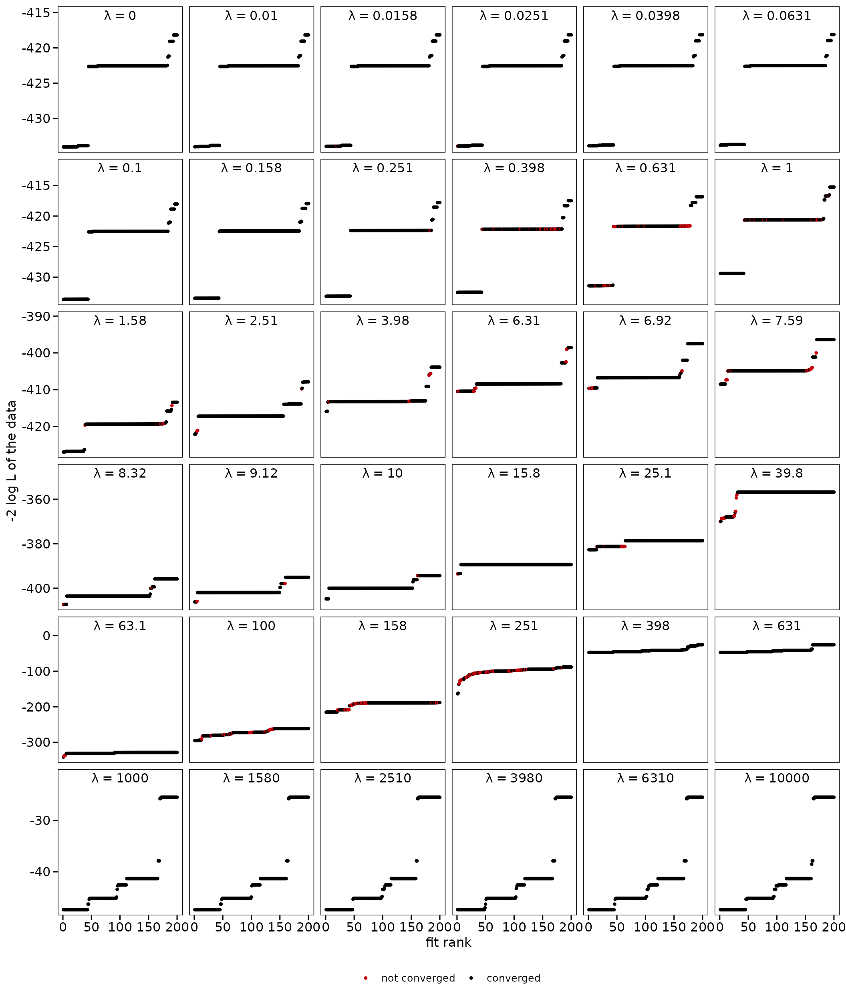
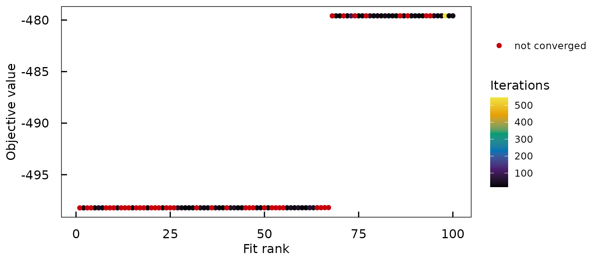
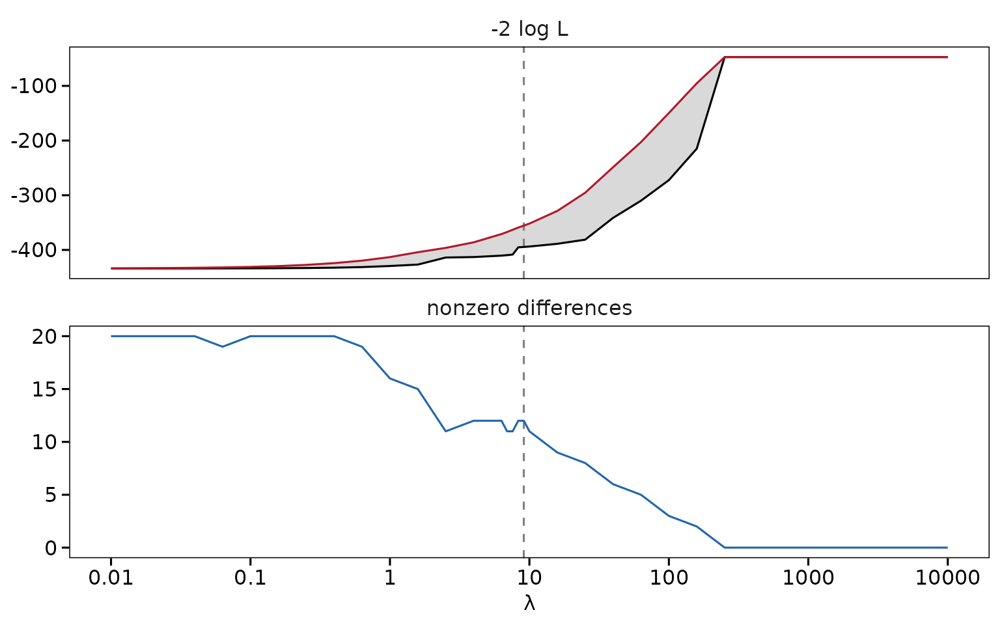
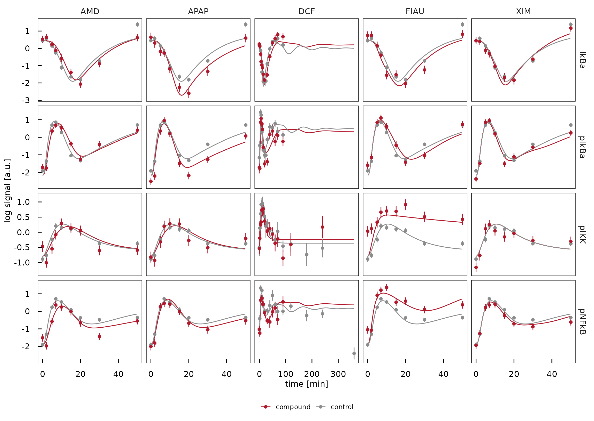
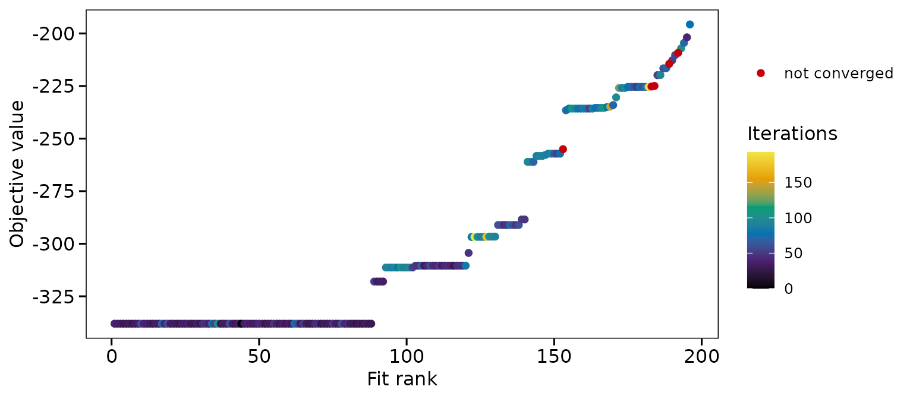
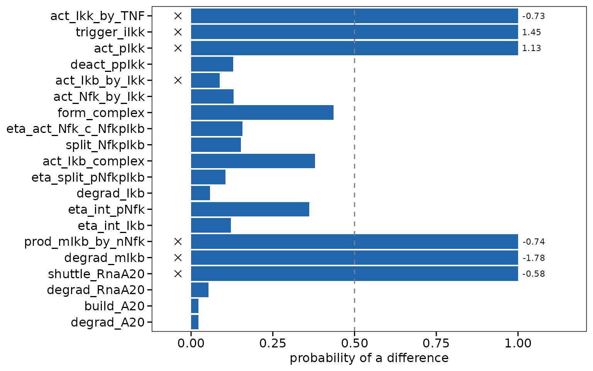
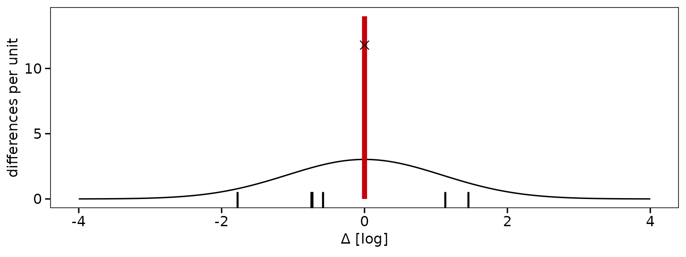
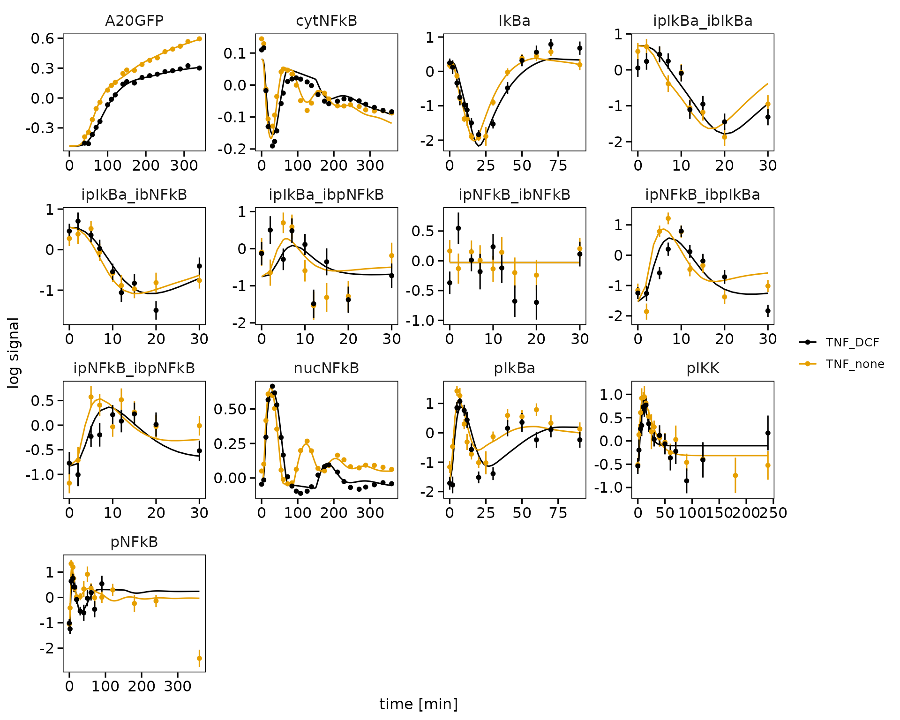

# 8. Sparse deviations

Oppelt et al. [\[1\]](#ref-oppelt2018model) also measured the TNFα
response of HepG2 cells under diclofenac (DCF). Which rate constants
does DCF change? The publication selected differences by an L1 scan and
a likelihood ratio test [\[2\]](#ref-steiert2016l1). This chapter
repeats the scan and answers the same question with
[spike-and-slab](https://dmodverse.github.io/dMod2/articles/methods-nlme.html#def-spike-and-slab)
random effects. Model: the reduced model of [Profile
likelihood](https://dmodverse.github.io/dMod2/articles/guide-profiles.md);
random effects and
[`em()`](https://dmodverse.github.io/dMod2/reference/em.md): [Nonlinear
mixed-effects
models](https://dmodverse.github.io/dMod2/articles/guide-nlme.md).
`dcf.R` computed the fits; the chapter loads them.

The second part lists the sparse random-effect distributions and what
their fits report; derivations: [Methods \> Sparsity
priors](https://dmodverse.github.io/dMod2/articles/methods-sparsity-priors.md),
the terms it uses in the
[Index](https://dmodverse.github.io/dMod2/articles/index-terms.md).

## Data and model

TNFα-stimulated cells of the first blot scale, without (`TNF_none`) and
with DCF (`TNF_DCF`).

``` r

# the TNFα-stimulated cells of the first blot scale, without compound and with DCF
cellsDCF <- subset(raw, cell == "HepG2" & scale == 1 & treatment == "TNF" & compound %in% c("no", "DCF"))
cellsDCF$compound[cellsDCF$compound == "no"] <- NA
cellsDCF$condition <- ifelse(is.na(cellsDCF$compound), "TNF_none", "TNF_DCF")
dataDCF <- as.datalist(cellsDCF[c("name", "time", "value", "sigma", "condition", "treatment", "compound")],
                       splitBy = "condition", keepCovariates = c("treatment", "compound"))
```

With DCF an estimated rate constant \\k\\ becomes \\\log k + \Delta_k\\.
[`insert()`](https://dmodverse.github.io/dMod2/reference/define.md) with
`x ~ 1 + (1 | gr(compound, dist = spikeSlab()))` writes each
\\\Delta_k\\ as a [random
effect](https://dmodverse.github.io/dMod2/articles/methods-nlme.html#def-random-effect)
`eta_<k>_DCF`, 0 without compound; the L1 scan treats the same symbols
as parameters. 24 differences, as in the publication:

``` r

# every rate constant the publication does not fix has a change by DCF, 24 as in the publication,
# a spike-and-slab random effect over the compound; for the spike and slab without the four rate
# constants of the gauge, whose change equals that of a partner; second derivatives forward over
# reverse for em()
ratesDCF <- setdiff(getParameters(odemodel(reactionsReduced, compile = FALSE)),
                    c(reactionsReduced$states, names(fixedReduced), "Vnuc", "TNF", "dose_TNF"))
dm <- c("forward", "reverse", "forward-reverse")
modelDCF <- odemodel(reactionsReduced, events = events, modelname = "oppelt_dcf_ode", compile = FALSE,
                     derivMode = dm)
# solves without sensitivities at atol 1e-12: at atol 1e-10 they can leave the positive orthant, where
# the complex formation is unstable; those with sensitivities hold at 1e-10
xDCF <- Xs(modelDCF, options = list(atol = 1e-12, rtol = 1e-8), optionsSens = list(atol = 1e-10))
gDCF <- Y(observablesReduced, xDCF, modelname = "oppelt_dcf_obs", compile = FALSE, derivMode = dm)
eDCF <- Y(errors, gDCF, modelname = "oppelt_dcf_err", compile = FALSE, derivMode = dm)
trafoBase <- eqnvec() |>
  define("x <- x", x = setdiff(getParameters(xDCF, gDCF, eDCF), reactionsReduced$states)) |>
  define("x <- y", x = names(fixedReduced), y = fixedReduced) |>
  define("x <- y", x = names(resting), y = resting) |>
  insert("x <- exp(x)", x = .currentSymbols) |>
  define("TNF <- 0") |>
  branch(covariates(dataDCF)) |>
  define("dose_TNF <- 1")
ratesSS <- setdiff(ratesDCF, names(gauge))
pDCF <- P(insert(trafoBase, x ~ 1 + (1 | gr(compound, dist = spikeSlab())), x = ratesDCF),
          method = "explicit", modelname = "oppelt_dcf_par", compile = FALSE, derivMode = dm)
pSS <- P(insert(trafoBase, x ~ 1 + (1 | gr(compound, dist = spikeSlab())), x = ratesSS),
         method = "explicit", modelname = "oppelt_dcfss_par", compile = FALSE, derivMode = dm)
compile(gDCF, xDCF, pDCF, pSS, eDCF, output = "oppelt_dcf", cores = getOption("dMod2.cores"))
prdDCF <- gDCF * xDCF * pDCF
```

## L1 scan

The penalty \\\lambda \sum_k \lvert \Delta_k \rvert\\
[\[2\]](#ref-steiert2016l1), [\[3\]](#ref-tibshirani1996regression) is
added to \\-2 \log L\\;
[`trustL1()`](https://dmodverse.github.io/dMod2/reference/trust.md) sets
differences exactly to 0 ([L1
penalties](https://dmodverse.github.io/dMod2/articles/guide-optimization.html#l1-penalties)).

Four rate constants enter the data only as a product with a partner:
`uptake` with `act_Ikk_by_TNF`, `prod_Ikb` with `prod_mIkb_by_nNfk`,
`build_RnaA20` with `build_A20`, and `split_NfkIkb` with
`eta_split_pNfkpIkb`. The reduced model fixes the four as gauge
([Symmetries](https://dmodverse.github.io/dMod2/articles/guide-symmetries.md)),
so their differences are 0, and both methods share the other 20
candidates. The publication penalized all 24 and set partners aside
after the scan.

Each \\\lambda\\, 0 and 31 values from \\10^{-2}\\ to \\10^4\\ evenly on
the log scale, runs 1000 starts around the reduced fit, then starts from
the best fits of the other \\\lambda\\ until none improves. `dcf.R` runs
the fits through `fitTasks()` ([Remote
computing](https://dmodverse.github.io/dMod2/articles/guide-remote-computing.md)):

``` r

# The L1 scan over the 20 candidates of the spike and slab, the changes of the four partners of the
# gauge at 0: the penalty lambda |eta| on every candidate, lambda = 0, 31 values from 1e-2 to 1e4
# evenly on the log scale and four more between 10^0.8 and 10, per lambda 1000 starts, the
# population parameters drawn around the fit of the reduced model with sd 1, the changes at 0, the
# first start the fit itself
zeroDCF <- setNames(numeric(length(changesDCF)), changesDCF)
changesL1 <- paste0("eta_", ratesSS, "_DCF")
offL1 <- setdiff(changesDCF, changesL1)
stopifnot(all(changesL1 %in% changesDCF))
lambdasDCF <- sort(c(0, 10^seq(-2, 4, by = 0.2), 10^seq(0.84, 0.96, by = 0.04)))
startsL1 <- msParframe(c(initDCF, zeroDCF), n = 1000, seed = 12,
                       sd = c(setNames(rep(1, length(initDCF)), names(initDCF)), zeroDCF))
startL1 <- function(i) unlist(startsL1[i, c(names(initDCF), changesL1)])
# a start vector with the population parameters and candidates of `argument`, the others at the start
fullStart <- function(argument) {
  start <- c(initDCF, zeroDCF[changesL1])
  shared <- intersect(names(argument), names(start))
  start[shared] <- argument[shared]
  start
}
# the penalized fit of a task, with -2 log L without the penalty
penalizedDCF <- function(task) {
  fit <- try(trustL1(objDCF, task$start, mu = zeroDCF[changesL1], lambda = task$lambda, rinit = 1,
                     rmax = 10, iterlim = 1000, fixed = c(gaugeReduced, zeroDCF[offL1]),
                     tolControl = tolerances), silent = TRUE)
  if (inherits(fit, "try-error")) return(NULL)
  list(lambda = task$lambda, argument = fit$argument,
       value = objDCF(c(fit$argument, zeroDCF[offL1]), fixed = gaugeReduced, deriv = FALSE)$value,
       converged = fit$converged)
}
# the candidates of a set fitted without penalty, the other changes at 0
refitDCF <- function(task) {
  off <- setdiff(changesDCF, task$set)
  start <- task$start[setdiff(names(task$start), off)]
  fit <- try(trust(objDCF, start, rinit = 1, rmax = 10, iterlim = 1000,
                   fixed = c(gaugeReduced, zeroDCF[off]), tolControl = tolerances), silent = TRUE)
  if (inherits(fit, "try-error")) return(NULL)
  list(set = task$set, argument = fit$argument, value = fit$value, converged = fit$converged)
}
# the penalized objective of every fit in penalizedFits at `x`
penalizedAt <- function(x) vapply(penalizedFits, function(r) r$value + x * sum(abs(r$argument[changesL1])), 0)
# the fits of a list of tasks, one per task; helix.R runs them on the cluster instead
fitTasks <- function(tasks, fn)
  Filter(Negate(is.null), parallel::mclapply(tasks, fn, mc.cores = getOption("dMod2.cores"),
                                             mc.preschedule = FALSE))
```

``` r

# every lambda also from the five best fits of the other lambdas, evaluated at it, and from the
# five best of the lambda itself, until no lambda improves by more than 0.01
bestAt <- function() vapply(lambdasDCF, function(x) {
  own <- vapply(penalizedFits, `[[`, 0, "lambda") == x
  min(penalizedAt(x)[own])
}, 0)
repeat {
  before <- bestAt()
  lambdaOf <- vapply(penalizedFits, `[[`, 0, "lambda")
  tasks <- unlist(lapply(lambdasDCF, function(x) {
    value <- penalizedAt(x)
    other <- which(lambdaOf != x); own <- which(lambdaOf == x)
    pick <- c(other[order(value[other])][1:5], own[order(value[own])][1:5])
    lapply(pick, function(i) list(start = penalizedFits[[i]]$argument[c(names(initDCF), changesL1)], lambda = x))
  }), recursive = FALSE)
  penalizedFits <- c(penalizedFits, fitTasks(tasks, penalizedDCF))
  if (all(before - bestAt() <= 0.01)) break
}
```

``` r

dcfL1 <- stored("results/dcfL1.rds", "dcf.R", envir = new.env())
```

Waterfall of the best 200 values of \\-2 \log L\\ of the data, without
the penalty, per \\\lambda\\, the y axis shared within a row:

``` r

objectiveL1 <- dcfL1$penalized
lambdaL1 <- sort(unique(objectiveL1$lambda))
# the best 200 fits per lambda, six lambdas per row, the y axis shared within a row
best200 <- function(x) {
  x <- head(x[order(x$value), ], 200)
  x$rank <- seq_len(nrow(x))
  x
}
waterL1 <- do.call(rbind, lapply(seq_along(lambdaL1), function(i)
  cbind(best200(objectiveL1[objectiveL1$lambda == lambdaL1[i], ]), row = (i - 1) %/% 6,
        col = (i - 1) %% 6, label = sprintf("lambda == %s", format(signif(lambdaL1[i], 3))))))
ggplot2::ggplot(waterL1, ggplot2::aes(rank, value)) +
  ggplot2::geom_point(ggplot2::aes(color = converged), size = 0.8) +
  ggplot2::geom_text(data = unique(waterL1[c("row", "col", "label")]),
                     ggplot2::aes(x = 100, y = Inf, label = label), parse = TRUE, vjust = 1.4,
                     inherit.aes = FALSE) +
  ggplot2::facet_grid(row ~ col, scales = "free_y") +
  ggplot2::scale_color_manual(values = c(`TRUE` = "black", `FALSE` = dMod2_colors[2]),
                              labels = c(`TRUE` = "converged", `FALSE` = "not converged"),
                              name = NULL) +
  ggplot2::scale_y_continuous(expand = ggplot2::expansion(mult = c(0.05, 0.25))) +
  ggplot2::labs(x = "fit rank", y = "-2 log L of the data") +
  theme_dMod2() +
  ggplot2::theme(strip.text = ggplot2::element_blank(), legend.position = "bottom")
```



Of at least 1010 fits per \\\lambda\\, 11 to 57 reach the best penalized
value within 0.1, a median 43; most others end at local optima or crawl
and stop short.

Differences over \\\lambda\\ (Fig. 2a of the publication), in color
those kept at the selected \\\lambda\\ (dashed):

``` r

paths <- data.frame(lambda = rep(as.numeric(rownames(dcfL1$path)), ncol(dcfL1$path)),
                    difference = rep(sub("^eta_(.*)_DCF$", "\\1", colnames(dcfL1$path)),
                                     each = nrow(dcfL1$path)),
                    value = as.vector(dcfL1$path))
paths <- paths[paths$lambda > 0, ]
kept <- sub("^eta_(.*)_DCF$", "\\1", dcfL1$selected)
ggplot2::ggplot(paths, ggplot2::aes(lambda, value, group = difference)) +
  ggplot2::geom_vline(xintercept = dcfL1$lambda, linetype = 2, color = "gray50") +
  ggplot2::geom_line(data = paths[!paths$difference %in% kept, ], color = "gray75") +
  ggplot2::geom_line(data = paths[paths$difference %in% kept, ], ggplot2::aes(color = difference)) +
  ggplot2::scale_x_log10(breaks = 10^(-2:4), labels = trimws(format(10^(-2:4), scientific = FALSE, drop0trailing = TRUE))) +
  ggplot2::labs(x = expression(lambda), y = expression(Delta ~ "[log]"), color = NULL) +
  theme_dMod2()
```



Over \\\lambda\\ (Fig. 2b): \\-2 \log L\\ of the data (black), plus
penalty (red, penalty gray), and the number of nonzero differences:

``` r

scan <- dcfL1$scan[dcfL1$scan$lambda > 0, ]
curves <- rbind(data.frame(lambda = scan$lambda, value = scan$data, panel = "-2 log L", curve = "data"),
                data.frame(lambda = scan$lambda, value = scan$data + scan$penalty, panel = "-2 log L",
                           curve = "data + penalty"),
                data.frame(lambda = scan$lambda, value = scan$changes, panel = "nonzero differences",
                           curve = "count"))
ggplot2::ggplot(curves, ggplot2::aes(lambda, value)) +
  ggplot2::geom_ribbon(data = data.frame(lambda = scan$lambda, lo = scan$data,
                                         hi = scan$data + scan$penalty, panel = "-2 log L"),
                       ggplot2::aes(x = lambda, ymin = lo, ymax = hi), inherit.aes = FALSE,
                       fill = "gray85") +
  ggplot2::geom_vline(xintercept = dcfL1$lambda, linetype = 2, color = "gray50") +
  ggplot2::geom_line(ggplot2::aes(color = curve)) +
  ggplot2::scale_color_manual(values = c(data = "black", `data + penalty` = "#b2182b",
                                         count = "#2166ac"), guide = "none") +
  ggplot2::scale_x_log10(breaks = 10^(-2:4), labels = trimws(format(10^(-2:4), scientific = FALSE, drop0trailing = TRUE))) +
  ggplot2::facet_wrap(~ panel, ncol = 1, scales = "free_y") +
  ggplot2::labs(x = expression(lambda), y = NULL) +
  theme_dMod2()
```



The differences kept at each \\\lambda\\ are refitted without penalty,
the others at 0, from the best penalized fits and from 300 or more
starts around the reduced fit. Selected is the largest \\\lambda\\ whose
refit the likelihood ratio test against all 20 candidates does not
reject at \\p \< 0.001\\, as in the publication:

``` r

# the likelihood ratio test of the set of each lambda against all candidates, the selection that
# of the largest lambda not worse at p < 0.001, the threshold of the publication
valueOf <- function(set) bestRefit(set)$value
scanDCF <- data.frame(lambda = lambdasDCF, changes = lengths(keptDCF),
                      data = vapply(bestDCF, `[[`, 0, "value"),
                      penalty = lambdasDCF * vapply(bestDCF, function(r) sum(abs(r$argument[changesL1])), 0),
                      refit = vapply(keptDCF, function(set) if (length(set)) valueOf(set) else NA_real_, 0),
                      row.names = NULL)
scanDCF$p <- pchisq(scanDCF$refit - valueOf(changesL1), df = length(changesL1) - scanDCF$changes,
                    lower.tail = FALSE)
scanDCF$p[scanDCF$changes == length(changesL1)] <- 1
lambdaDCF <- max(scanDCF$lambda[!is.na(scanDCF$p) & scanDCF$p >= 0.001])
selectedL1 <- keptDCF[[as.character(lambdaDCF)]]
pathDCF <- t(vapply(bestDCF, function(r) r$argument[changesL1], zeroDCF[changesL1]))
```

The test rejects from \\\lambda = 10\\ on, with 11 differences and 35 in
\\-2 \log L\\ above the refit with all 20; the publication, with 24
candidates, rejected from \\\lambda = 10\\ on, with 11 differences and
34. Kept at \\\lambda = 9.12\\ are 12 differences: `act_Ikb_by_Ikk`,
`act_Ikk_by_TNF`, `act_Nfk_by_Ikk`, `act_pIkk`, `build_A20`,
`degrad_mIkb`, `eta_int_Ikb`, `eta_int_pNfk`, `eta_split_pNfkpIkb`,
`prod_mIkb_by_nNfk`, `shuttle_RnaA20` and `trigger_iIkk`.

Of the 11 differences at \\\lambda = 10\\ the publication kept seven as
independent [\[1\]](#ref-oppelt2018model): it dropped `uptake`,
`prod_Ikb`, `eta_int_pNfk` and `act_Nfk_by_Ikk` and took
`shuttle_RnaA20` in place of `build_A20`. The seven refitted alone,
against the estimates and 95 % intervals of the publication:

``` r

publicationDCF <- dcfL1$publication
publicationDCF$refit <- unname(dcfL1$refitPublication$argument[paste0("eta_", publicationDCF$rate, "_DCF")])
publicationDCF
#>                rate value lower upper       refit
#> 1    act_Ikk_by_TNF -0.72 -0.98 -0.46 -0.67023204
#> 2      trigger_iIkk  1.56  1.10  2.05  1.58838930
#> 3          act_pIkk  0.91  0.57  1.27  1.18094333
#> 4    act_Ikb_by_Ikk -0.94 -1.66 -0.45 -0.04692231
#> 5 prod_mIkb_by_nNfk -0.83 -0.94 -0.73 -0.75843442
#> 6       degrad_mIkb -1.77 -2.06 -1.50 -1.80486970
#> 7    shuttle_RnaA20 -0.96 -1.68 -0.52 -0.57299532
```

6 of the seven estimates, all but `act_Ikb_by_Ikk` (-0.05), lie in the
intervals of the publication. Against the refit with all 20 candidates
the seven give 28 more in \\-2 \log L\\ with 13 fewer parameters, \\p =
0.01\\. All seven are among the 12 kept by the scan, against which they
give 8 more with 5 fewer parameters, \\p = 0.14\\. The model with the
seven differences against the data (Fig. 2c); observables measured once
in the table:

``` r

fitPlot(prdDCF, dcfL1$refitPublication$argument, changesDCF)
```



``` r

fitOnce(prdDCF, dcfL1$refitPublication$argument, changesDCF)
#>            name time condition prediction value sigma
#> 1 ratioNFkBIkBa    0  TNF_none          0 -0.22   0.3
```

## Spike and slab

With \\\theta_k\\ the log rate constant \\k\\, cells with DCF use
\\\theta_k + \Delta_k\\. The spike-and-slab distribution
[\[4\]](#ref-mitchell1988bayesian), [\[5\]](#ref-george1993variable) of
a difference is

\\p(\Delta_k) = (1 - \rho)\\ \delta(\Delta_k) + \rho\\
\mathcal{N}(\Delta_k;\\ 0, \tau^2),\\

with [inclusion
probability](https://dmodverse.github.io/dMod2/articles/methods-sparsity-priors.html#def-inclusion-probability)
\\\rho\\ (`prob_compound`) and slab standard deviation \\\tau\\
(`tau_compound`, log scale).
[`em()`](https://dmodverse.github.io/dMod2/reference/em.md) estimates
\\\theta\\, \\\rho\\ and \\\tau\\ from the marginal likelihood, the
likelihood with the differences integrated out, a sum over
[subsets](https://dmodverse.github.io/dMod2/articles/methods-sparsity-priors.html#def-subset)
([Methods \> Sparsity
priors](https://dmodverse.github.io/dMod2/articles/methods-sparsity-priors.html#approximate-marginal)).
\\p_0 = \Pr(\Delta_k = 0 \mid y)\\ is the posterior spike probability,
one minus the inclusion probability given the data.

The candidates are the same 20 as in the L1 scan; with both partners of
a product as candidates, neither would reach a probability of one half.
`dcf.R` runs 1000 starts of
[`msem()`](https://dmodverse.github.io/dMod2/reference/msem.md) around
the reduced fit, then 200 around the best. Waterfall of the 200:

``` r

# the changes as spike-and-slab random effects: 1000 starts of msem(), the population parameters
# drawn around the fit of the reduced model with sd 1 on the log scale, the probability of a change
# starting at 0.2 and the spread at 0.5
initSS <- c(initDCF, prob_compound = 0.2, tau_compound = 0.5)
set.seed(3)
fitDCF <- msem(objSS, randomSS, initSS, fixed = gaugeReduced,
               control = list(sparseFit = list(trustControl = list(tolControl = tolerances))),
               fits = 1000, sd = 1, cores = getOption("dMod2.cores"))
```

``` r

# 200 more starts around the best fit, sd 1 as above: the waterfall of the optimum
set.seed(4)
moreDCF <- msem(objSS, randomSS, fitDCF$argument, fixed = gaugeReduced,
                control = list(sparseFit = list(trustControl = list(tolControl = tolerances))),
                fits = 200, sd = 1, cores = getOption("dMod2.cores"))
starts <- rbind(cbind(fitDCF$multistart, round = 1L), cbind(moreDCF$multistart, round = 2L))
if (moreDCF$value < fitDCF$value) fitDCF <- moreDCF
fitDCF$multistart <- starts
```

``` r

dcfSS <- stored("results/dcf.rds", "dcf.R", envir = new.env())
plotValues(dcfSS, round == 2)
```



``` r

dcfSS$argument[c("prob_compound", "tau_compound")]
#> prob_compound  tau_compound 
#>     0.4106395     1.0817230
```

1 of the 997 starts around the reduced fit and 88 of the 196 around the
best end within 0.1 of the best value. With \\\rho = 0.41\\ a difference
is expected for 8 of the 20 rate constants; with \\\tau = 1.08\\ a
difference is typically a factor of 2.9. Probability of a difference,
\\1 - p_0\\, labeled with the difference in the most probable subset;
crosses mark the seven of the publication:

``` r

probability <- dcfSS$random[, c("eta", "mode", "p0")]
probability$eta <- factor(probability$eta, levels = rev(probability$eta))
probability$publication <- probability$eta %in% publicationDCF$rate
ggplot2::ggplot(probability, ggplot2::aes(1 - p0, eta)) +
  ggplot2::geom_col(fill = "#2166ac") +
  ggplot2::geom_vline(xintercept = 0.5, linetype = 2, color = "gray50") +
  ggplot2::geom_text(data = probability[probability$mode != 0, ],
                     ggplot2::aes(label = sprintf("%.2f", mode)), hjust = -0.2, size = 3) +
  ggplot2::geom_point(data = probability[probability$publication, ], ggplot2::aes(x = -0.04),
                      shape = 4, size = 2.5) +
  ggplot2::scale_x_continuous(limits = c(-0.06, 1.15), breaks = seq(0, 1, 0.25)) +
  ggplot2::labs(x = "probability of a difference", y = NULL) +
  theme_dMod2()
```



The most probable subset holds 6 differences, 6 of them among the seven
of the publication, with the same signs. Not in it: `act_Ikb_by_Ikk`
(\\p_0 = 0.91\\). Refitted without the slab, the subset gives 28 more in
\\-2 \log L\\ than all 20 candidates, the seven of the publication 28.
Against the seven, the subset gives 0.07 more in \\-2 \log L\\ with 1
parameter fewer, \\p = 0.80\\. The 20 differences are exchangeable under
the model: the nonzero ones against the slab density \\\rho\\
\mathcal{N}(0, \tau^2)\\ (line), the count at 0 against the expected
\\20 (1 - \rho)\\ (bar). With 6 nonzero differences the figure shows
gross departures from the slab, an outlier or separate clusters, but is
no test of the slab shape:

``` r

rho <- dcfSS$argument[["prob_compound"]]
tau <- dcfSS$argument[["tau_compound"]]
nonzero <- dcfSS$random$mode[dcfSS$random$mode != 0]
slab <- data.frame(x = seq(-4, 4, length.out = 401))
slab$density <- 20 * rho * dnorm(slab$x, 0, tau)
ggplot2::ggplot() +
  ggplot2::geom_line(data = slab, ggplot2::aes(x, density)) +
  ggplot2::geom_rug(data = data.frame(x = nonzero), ggplot2::aes(x), sides = "b", linewidth = 0.8,
                    length = grid::unit(0.08, "npc")) +
  ggplot2::geom_segment(ggplot2::aes(x = 0, xend = 0, y = 0, yend = sum(dcfSS$random$mode == 0)),
                        linewidth = 2, color = dMod2_colors[2]) +
  ggplot2::geom_point(ggplot2::aes(x = 0, y = 20 * (1 - rho)), shape = 4, size = 3) +
  ggplot2::labs(x = expression(Delta ~ "[log]"), y = "differences per unit") +
  theme_dMod2()
```



The model at the spike-and-slab estimates against the data:

``` r

parsSS <- c(dcfSS$argument[setdiff(names(dcfSS$argument), c("prob_compound", "tau_compound"))],
            setNames(dcfSS$random$mode, paste0("eta_", dcfSS$random$eta, "_DCF")))
fitPlot(gDCF * xDCF * pSS, parsSS, unique(na.omit(unlist(randomEffects(pSS)$etas))))
```



``` r

fitOnce(gDCF * xDCF * pSS, parsSS, unique(na.omit(unlist(randomEffects(pSS)$etas))))
#>            name time condition prediction value sigma
#> 1 ratioNFkBIkBa    0  TNF_none          0 -0.22   0.3
```

## L1 scan and spike and slab

Both methods see the same data, model, prior and 20 candidates:

| method           | differences | -2 log L | p against all 20 |
|:-----------------|------------:|---------:|-----------------:|
| L1 scan and test |          12 |  -414.40 |            0.012 |
| spike and slab   |           6 |  -405.95 |            0.014 |
| publication      |           7 |  -406.01 |            0.009 |
| all candidates   |          20 |  -434.04 |            1.000 |

The spike and slab is faster and free of shrinkage. It needs one
multistart, no scan over \\\lambda\\ and no refits. The penalty shrinks
every kept difference toward 0, at the selected \\\lambda\\ by a median
0.05 on the log scale against the refit without the penalty, more at
larger \\\lambda\\; the spike and slab leaves the size of a difference
to the slab, and the spike-and-slab differences lie a median 0.03 from
the refit of the same subset. The most probable subset lies within the
12 differences the scan keeps and fits the data not worse than they do,
\\p = 0.21\\ for the 6 others. The L1 scan only tests subsets that are
the penalized optimum at some \\\lambda\\; the spike and slab weighs
every subset ([Methods \> Selection of
deviations](https://dmodverse.github.io/dMod2/articles/methods-sparsity-priors.html#selection-of-deviations)).
The fit reports the most probable subset; the differences with \\p_0 \<
0.5\\, the median probability model, which predicts best under broad
conditions [\[6\]](#ref-barbieri2004optimal), are the same here.

## Sparse random-effect distributions

`gr(group, dist = )` sets the random-effect distribution. Besides
[`normal()`](https://dmodverse.github.io/dMod2/reference/normal.md), two
give deviations exactly zero unless the data need them:

| distribution | a deviation \\\eta\\ of a group | hyperparameters |
|----|----|----|
| [`spikeSlab()`](https://dmodverse.github.io/dMod2/reference/normal.md) | `spike` with probability \\1 - \rho\\, else \\\mathcal{N}(\mu, \tau^2)\\; `spike` and \\\mu\\ (`mean`) default to 0 | `prob_<grouping>`, `tau_<grouping>` |
| [`dirichletProcess()`](https://dmodverse.github.io/dMod2/reference/normal.md) | cluster value: \\0\\ for the population cluster, else one \\\mathcal{N}(0, \tau^2)\\ draw | `concentration_<grouping>`, `tau_<grouping>` |

Hyperparameters are shared by the symbols of a term (`_1`, `_2`, … for
several terms of one grouping) and estimated unless given, as in
`spikeSlab(tau = 0.5)`. Normal and sparse random effects of one grouping
combine; `em(method = "focei")` fits all.

## Switching parameters off

With `spike = -Inf` on a parameter in an exponential,
`insert(trafo, "k <- exp(k)")`, the spike is the rate 0: the reaction is
absent. `gr(dist = )` without a grouping makes one group `all` of all
conditions, so that with `0 +` the random effect is the parameter itself
and the fit selects reactions. For a model `g * x` with data `data` and
the rates `k0`, `k1` in the parameter transformation `trafo`:

``` r

trafo <- insert(trafo, "k <- exp(k)", k = c("k0", "k1"))
trafo <- insert(trafo, k ~ 0 + (1 | gr(dist = spikeSlab(prob = 0.5, tau = 1, mean = log(0.5), spike = -Inf))),
                k = c("k0", "k1"))
fit <- em(normL2(data, g * x * P(trafo)), randomEffects(P(trafo)), init = c(x = 1))
fit$random[, c("eta", "mode", "p0")]
```

`p0` is the posterior probability that the reaction is absent. With a
grouping, `k ~ 1 + (1 | gr(ID, dist = spikeSlab(spike = -Inf)))`
switches the reaction off per group. `em(method = "focei")` and
`em(method = "quadrature")` fit these random effects, also beside normal
ones of the same grouping; `"quadrature"` integrates on a [sparse
grid](https://dmodverse.github.io/dMod2/articles/methods-nlme.html#adaptive-sparse-grid-quadrature)
to `tol` where `"focei"` takes the [Laplace
approximation](https://dmodverse.github.io/dMod2/articles/methods-nlme.html#laplace-approximation).
With few candidates, most of them clearly present, an estimated `prob`
tends to 1; a fixed `prob` is the selection prior. Details: [Methods \>
Spike at a given
value](https://dmodverse.github.io/dMod2/articles/methods-sparsity-priors.html#spike-at-a-given-value).

## Starts far from the data

With a given `mean` or `spike`,
[`em()`](https://dmodverse.github.io/dMod2/reference/em.md) sums over
the subsets of candidates per group. The sum runs in phases, each from
the estimates and inner
[modes](https://dmodverse.github.io/dMod2/articles/methods-sparsity-priors.html#def-mode)
of the phase before; a burn-in may fit the [fixed
effects](https://dmodverse.github.io/dMod2/articles/methods-nlme.html#def-fixed-effect)
first ([Methods \> Phases and
burn-in](https://dmodverse.github.io/dMod2/articles/methods-sparsity-priors.html#phases-and-burn-in)):

| entry of `control$sparseFit` | values | default |
|----|----|----|
| `phases` | `"meanfield"`, `"ec"`, `"exact"` in the order they run; a character vector, or a named list with `maxECM` and `epsECM` per phase | all three; `maxECM = 200`, `epsECM = 1e-2`, in the last phase `1e-6` |
| `burnin` | `FALSE`, `TRUE` or `list(start = , iterlim = )`; `start` `"random"`, `"spike"`, `"slab"` or names of random effects | `FALSE`; `start = "random"`, `iterlim = 200` |
| `termBudget` | the most subsets of the exact sum; beyond it `"exact"` is skipped after `"ec"`, an error without | `4096` |

`"meanfield"` ([mean
field](https://dmodverse.github.io/dMod2/articles/methods-sparsity-priors.html#mean-field))
takes the inclusion of each candidate from the Laplace integrals of a
reference subset and of the subsets that differ from it in one
candidate, \\K + 1\\ integrals for \\K\\ candidates instead of \\2^K\\.
`"ec"`, the [expectation consistent
approximation](https://dmodverse.github.io/dMod2/articles/methods-sparsity-priors.html#expectation-consistent-approximation-in-the-rate),
expands the data term as a Gaussian, at the first step with every
candidate in the slab; from a start far from the data that expansion
does not hold, and EC does not converge. The burn-in fits the fixed
effects in one [trust
region](https://dmodverse.github.io/dMod2/articles/methods-trust.html#def-trust-region)
with the candidates of the start subset in the slab, at the joint mode
with the prior densities as penalty; the others stay at the spike. A
small example: two species, four candidate rates, the start of the
initial values 40 and 10 times too high.

``` r

rates <- c("a0", "a1", "b0", "b1")
xSw <- Xs(odemodel(eqnvec(x = "a0 - a1*x", y = "b0 - b1*y"), modelname = "switch_x", compile = FALSE))
gSw <- Y(eqnvec(x = "x", y = "y"), xSw, modelname = "switch_g", compile = FALSE)
trafoSw <- define(NULL, "p <- p", p = c("x", "y", rates)) |>
  branch(table = data.frame(row.names = "C1", one = 1)) |>
  insert("k <- exp(k)", k = rates) |>
  insert(k ~ 0 + (1 | gr(dist = spikeSlab(prob = 0.5, tau = 1, mean = log(0.5), spike = -Inf))), k = rates)
pSw <- P(trafoSw, modelname = "switch_p", compile = FALSE)
compile(gSw, xSw, pSw, output = "switch")
# x is produced and degraded, y only degraded
times <- seq(0, 10, by = 0.5)
set.seed(2)
noisy <- function(n, v) data.frame(name = n, time = times, value = v + rnorm(length(times), 0, 0.05),
                                   sigma = 0.05)
dataSw <- datalist(C1 = rbind(noisy("x", 2 - 1.5 * exp(-0.5 * times)), noisy("y", 2 * exp(-0.3 * times))))
objSw <- normL2(dataSw, gSw * xSw * pSw)
far <- c(x = 20, y = 20)
```

EC alone fails at this start:

``` r

tryCatch(em(objSw, randomEffects(pSw), init = far, verbose = FALSE,
            control = list(sparseFit = list(phases = "ec"))),
         error = conditionMessage)
#> [1] "em: the expectation consistent (EC) approximation of group all did not converge."
```

A burn-in from a random start subset, then the default phases:

``` r

set.seed(1)
fitSw <- em(objSw, randomEffects(pSw), init = far, verbose = FALSE,
            control = list(sparseFit = list(burnin = TRUE)))
fitSw$burnin
#> [1] "eta_a0_all" "eta_a1_all"
fitSw$phases
#>   phase    approx iterations      value converged seconds failed
#> 1     1    burnin         11 2588.98159      TRUE   0.017      0
#> 2     2 meanfield          2  -95.12004      TRUE   0.076      0
#> 3     3        ec          1  -95.07580      TRUE   0.014      0
#> 4     4     exact          1  -95.12004      TRUE   0.078      0
fitSw$random[, c("eta", "mode", "p0")]
#>   eta        mode        p0
#> 1  a0  0.01735696 0.0000000
#> 2  a1 -0.68584252 0.0000000
#> 3  b0        -Inf 0.9999634
#> 4  b1 -1.18035445 0.0000000
```

`fit$burnin` is the start subset, `fit$phases` has a row per phase:
`value` is -2 log L of the approximation of the phase (for the burn-in
data plus prior at the mode), `failed` the subsets whose inner search
failed. An error names the phase.
[`msem()`](https://dmodverse.github.io/dMod2/reference/msem.md) draws a
start subset per attempt and repeats a failed start (`retry`);
`multistart` lists the start subset in `subset`. Around a fitted model,
as for DCF above, the spike is that model and the start is near the
data: no burn-in is needed, and
[`spikeSlab()`](https://dmodverse.github.io/dMod2/reference/normal.md)
with the default spike 0 takes the joint trust region of the next
section, which has no phases.

## Hyperpriors

With one group, as in the selection of reactions above, `prob` and `tau`
rest on the few candidates of the block: an estimated `prob` ([empirical
Bayes](https://dmodverse.github.io/dMod2/articles/methods-sparsity-priors.html#def-empirical-bayes))
tends to 0 or 1, and an estimated `tau` follows the modes.
[Hyperpriors](https://dmodverse.github.io/dMod2/articles/methods-sparsity-priors.html#def-hyperprior)
replace the estimates:

``` r

spikeSlab(prob = betaPrior(1, 1), tau = halfCauchyPrior(1), mean = log(0.5), spike = -Inf)
```

`betaPrior(1, 1)` integrates `prob` out, every number of candidates in
the slab equally likely; `fit$slab` reports the posterior mean of `prob`
with a 95 % interval. A scale prior on `tau` takes the posterior mode,
with `integrate = TRUE` the phase `"exact"` integrates over `log tau`.
With many groups the estimates stay the default. Details: [Methods \>
Hyperpriors](https://dmodverse.github.io/dMod2/articles/methods-sparsity-priors.html#hyperpriors).

## Fitting sparse random effects

`em(method = "focei")` integrates sparse random effects by the Laplace
approximation at the [joint
mode](https://dmodverse.github.io/dMod2/articles/methods-sparsity-priors.html#joint-mode)
of a group, exactly where possible, and by expectation consistent (EC)
approximation where the data link a
[Dirichlet-process](https://dmodverse.github.io/dMod2/articles/methods-sparsity-priors.html#dirichlet-process-random-effects)
effect to another factor or the subset sum exceeds the budget. Fixed
effects and hyperparameters move in one trust region. `fit$coupling` is
`"expectationConsistent"` if a group needed EC, else `NULL`. Methods:
[Methods \> Approximate
marginal](https://dmodverse.github.io/dMod2/articles/methods-sparsity-priors.html#approximate-marginal),
[Methods \> Expectation consistent
approximation](https://dmodverse.github.io/dMod2/articles/methods-sparsity-priors.html#expectation-consistent-approximation)
and [Methods \> Joint trust
region](https://dmodverse.github.io/dMod2/articles/methods-sparsity-priors.html#joint-trust-region).

| entry of `control$sparseFit` | default | controls |
|----|----|----|
| `maxOuter` | `200` | joint trust-region iterations, all runs |
| `trustControl` | `rinit = 1`, `rmax = 10`, `ftol = 1e-10`, `mtol = 1e-5` | joint trust region, as [`trust()`](https://dmodverse.github.io/dMod2/reference/trust.md) |

Other entries are an error. The DCF fit passes the `tolerances` of
[Setting up
models](https://dmodverse.github.io/dMod2/articles/guide-model.md) in
`trustControl`. A run stopping short of `mtol` restarts while runs lower
\\-2 \log L\\ by more than `mtol`.
[`msem()`](https://dmodverse.github.io/dMod2/reference/msem.md) perturbs
concentrations and slab standard deviations on log scale, probabilities
on logit scale.

## Reported structure

The fit reports the most probable subset (spike and slab) or partition
(Dirichlet process): spike deviations exactly zero, slab deviations the
posterior mean given the structure ([Methods \> Reported
structure](https://dmodverse.github.io/dMod2/articles/methods-sparsity-priors.html#reported-structure)).
`fit$random` has a row per group and random effect:

- `mode`, this value;
- `se`, posterior standard deviation over spike and slab;
- spike-and-slab and Dirichlet process: `cluster`, 0 for the population
  value, 1, 2, … for deviating groups or clusters in group order, and
  `p0`, posterior probability of zero deviation;
- `data`, whether the random effect reaches data of the group, where
  some do not.

A sparse random effect reaching no data of the group rests at 0 with the
prior standard deviation and, for spike and slab, \\p_0 = 1 - \rho\\.
`fit$slab` lists probabilities, concentrations and slab standard
deviations, each with term symbols, estimate and whether fixed.

## Standard errors

With spike-and-slab random effects `fit$hessian` is `NULL`;
[`vcov()`](https://rdrr.io/r/stats/vcov.html) inverts `fit$information`,
the empirical information of the group scores plus the expected
information of the conditions without random effects and the priors
(`hessian = "expected"`). It needs more groups than parameters, or those
terms for the other directions; otherwise
[`vcov()`](https://rdrr.io/r/stats/vcov.html) is an error and standard
errors are `NA`. `fit$information` is not a Hessian of the marginal and
does not detect saddle points. The DCF fit has one group, too few for
the empirical information, and the intervals are missing.
[`dirichletProcess()`](https://dmodverse.github.io/dMod2/reference/normal.md)
fits have neither; `confint(method = "profile")` gives intervals.
Details: [Methods \> Standard
errors](https://dmodverse.github.io/dMod2/articles/methods-sparsity-priors.html#standard-errors).

## Dirichlet-process random effects

With `gr(group, dist = dirichletProcess())` groups and population value
form clusters; the concentration \\\alpha\\ sets how readily a group
opens a new one. The population cluster has deviation zero, every other
cluster one common deviation from \\\mathcal{N}(0, \tau^2)\\. \\\alpha\\
and \\\tau\\ are estimated by marginal maximum likelihood in one fit.

`method = "focei"` sums exactly over partitions of up to 14 groups.
`method = "saem"` draws partitions, allows normal but no other sparse
random effects alongside, and reports the most frequent partition of the
last `window` iterations after burn-in, with standard error `valueSE` of
\\-2 \log L\\. `control$saem$particles` sets the importance-sampling
particles, default 500; `converged` says whether burn-in ended by the
drift test. An SAEM fit has no gradient, Hessian or empirical
information. Details: [Methods \> Sparsity
priors](https://dmodverse.github.io/dMod2/articles/methods-sparsity-priors.html#dirichlet-process-random-effects).

Reference:
[`randomEffects()`](https://dmodverse.github.io/dMod2/reference/randomEffects.md),
[`spikeSlab()`](https://dmodverse.github.io/dMod2/reference/normal.md),
[`dirichletProcess()`](https://dmodverse.github.io/dMod2/reference/normal.md),
[`em()`](https://dmodverse.github.io/dMod2/reference/em.md),
[`msem()`](https://dmodverse.github.io/dMod2/reference/msem.md),
[`plotValues()`](https://dmodverse.github.io/dMod2/reference/plotValues.md),
[`plotTrace()`](https://dmodverse.github.io/dMod2/reference/plotTrace.md),
[`plotRandomEffects()`](https://dmodverse.github.io/dMod2/reference/plotRandomEffects.md),
[`plotPars()`](https://dmodverse.github.io/dMod2/reference/plotPars.md)

[← 7. Nonlinear mixed-effects
models](https://dmodverse.github.io/dMod2/articles/guide-nlme.md) \| [9.
Alignment of relative data measurements
→](https://dmodverse.github.io/dMod2/articles/guide-alignment.md)

## References

\[1\]

A. Oppelt *et al.*, “Model-based identification of TNFα-induced
IKKβ-mediated and IκBα-mediated regulation of NFκB signal transduction
as a tool to quantify the impact of drug-induced liver injury
compounds,” *npj Systems Biology and Applications*, vol. 4, no. 1, p.
23, 2018, doi:
[10.1038/s41540-018-0058-z](https://doi.org/10.1038/s41540-018-0058-z).

\[2\]

B. Steiert, J. Timmer, and C. Kreutz, “L1 regularization facilitates
detection of cell type-specific parameters in dynamical systems,”
*Bioinformatics*, vol. 32, no. 17, pp. i718–i726, 2016, doi:
[10.1093/bioinformatics/btw461](https://doi.org/10.1093/bioinformatics/btw461).

\[3\]

R. Tibshirani, “Regression shrinkage and selection via the lasso,”
*Journal of the Royal Statistical Society: Series B*, vol. 58, no. 1,
pp. 267–288, 1996, doi:
[10.1111/j.2517-6161.1996.tb02080.x](https://doi.org/10.1111/j.2517-6161.1996.tb02080.x).

\[4\]

T. J. Mitchell and J. J. Beauchamp, “Bayesian variable selection in
linear regression,” *Journal of the American Statistical Association*,
vol. 83, no. 404, pp. 1023–1032, 1988, doi:
[10.1080/01621459.1988.10478694](https://doi.org/10.1080/01621459.1988.10478694).

\[5\]

E. I. George and R. E. McCulloch, “Variable selection via Gibbs
sampling,” *Journal of the American Statistical Association*, vol. 88,
no. 423, pp. 881–889, 1993, doi:
[10.1080/01621459.1993.10476353](https://doi.org/10.1080/01621459.1993.10476353).

\[6\]

M. M. Barbieri and J. O. Berger, “Optimal predictive model selection,”
*The Annals of Statistics*, vol. 32, no. 3, pp. 870–897, 2004, doi:
[10.1214/009053604000000238](https://doi.org/10.1214/009053604000000238).
