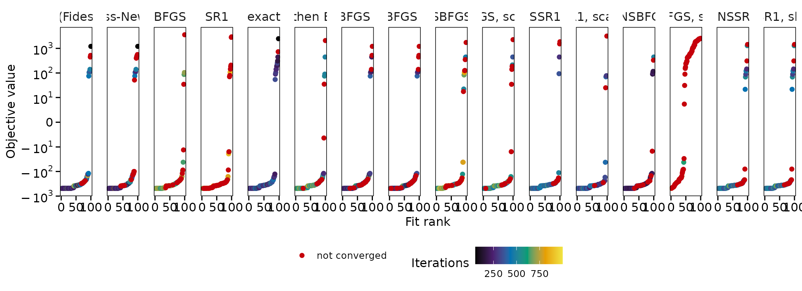

# Trust-region optimization

[`trust()`](https://dmodverse.github.io/dMod2/reference/trust.md)
minimizes the objective function \\\mathcal{J}(\theta)\\, \\-2 \log L\\
or \\-2 \log\\ of the posterior, by a trust-region method on the exact
gradient [\[1\]](#ref-kaschek2019dmod). Arguments and usage:
[Optimization](https://dmodverse.github.io/dMod2/articles/guide-optimization.md).

## Trust-region method

At the iterate \\\theta_k\\ with the gradient \\b = \nabla
\mathcal{J}(\theta_k)\\ and a symmetric approximation \\H\\ of the
Hessian,
[`trust()`](https://dmodverse.github.io/dMod2/reference/trust.md)
minimizes the quadratic model of the objective inside a ball,

\\\min\_{s} \\ m(s) = b^\top s + \tfrac{1}{2}\\ s^\top H s \quad
\text{subject to} \quad \lVert s \rVert \le r . \tag{1}\\

The ratio of actual to predicted decrease decides on the step and the
radius \\r\\. Subproblem, radius, bounds and termination are the same
for every source of \\H\\ and on the [sparse path](#sparse-hessians).

### Trust-region subproblem

[`trust()`](https://dmodverse.github.io/dMod2/reference/trust.md) solves
the subproblem (1) exactly, through the full eigendecomposition of \\H\\
[\[2\]](#ref-more1983computing). The solution satisfies \\(H + \nu I)\\
s = -b\\ with a multiplier \\\nu \ge 0\\ that makes \\H + \nu I\\
positive semidefinite and vanishes unless the step reaches the boundary,
\\\lVert s \rVert = r\\. With \\H = Q \Lambda Q^\top\\, eigenvalues
\\\lambda_i\\ and \\\gamma = Q^\top b\\, the step

\\s(\nu) = -Q (\Lambda + \nu I)^{-1} \gamma \tag{2}\\

solves the subproblem when \\\nu \ge \max(0, -\lambda\_{\min})\\ and
either \\\nu = 0\\ with \\\lVert s \rVert \le r\\, or \\\nu \> 0\\ with
\\\lVert s \rVert = r\\. The second case is a root of the secular
equation

\\\phi(\nu) = \frac{1}{r} - \frac{1}{\lVert s(\nu) \rVert} =
\frac{1}{r} - \Big( \sum_i \frac{\gamma_i^2}{(\lambda_i + \nu)^2}
\Big)^{-1/2}, \tag{3}\\

nearly linear for \\\nu \> -\lambda\_{\min}\\, solved by bisection on a
bracket of \\\nu\\, every evaluation \\O(n\_\theta)\\ in the eigenbasis.
If \\\gamma_i = 0\\ for every eigenvector of \\\lambda\_{\min} \< 0\\
and \\\lVert s(-\lambda\_{\min}) \rVert \le r\\ (hard case), the
solution is \\s(-\lambda\_{\min}) + \tau q\_{\min}\\ with \\\lVert s
\rVert = r\\; otherwise it is the root of (3). Negative curvature is
followed to the boundary. The eigendecomposition costs
\\O(n\_\theta^3)\\; sparse Hessians use the [sparse
path](#sparse-hessians).

### Radius update

With the ratio of actual to predicted decrease

\\\rho_k = \frac{\mathcal{J}(\theta_k) - \mathcal{J}(\theta_k +
s_k)}{-m_k(s_k)}, \tag{4}\\

the radius is updated with \\r\_{\max}\\ = `rmax`:

\\r\_{k+1} = \begin{cases} \min(r_k/4,\\ \lVert s_k \rVert / 4), &
\rho_k \< 1/4, \\ \min(2 r_k,\\ r\_{\max}), & \rho_k \> 3/4 \text{ and }
\lVert s_k \rVert \ge 0.9\\ r_k, \\ r_k, & \text{otherwise.} \end{cases}
\tag{5}\\

A step with \\\rho_k \< 1/4\\ is rejected. The radius grows only when
the step reached the boundary. Under `boundary = "clip"` the radius
shrinks to \\r_k/4\\, grows at \\\rho_k \> 3/4\\ after every step that
is not the Newton step, and a step that lowers \\\mathcal{J}\\ is
accepted where the value or model test ends the run. The first radius is
`rinit`. A trial point where the objective fails or is not finite counts
as rejected; three in a row end the run (`"objfun"`).

### Nonmonotone acceptance

With `stepControl$nonmonotone` \\= \eta \in (0, 1)\\, the actual
decrease is measured from a weighted average of past values
[\[3\]](#ref-zhang2004nonmonotone),

\\Q\_{k+1} = \eta Q_k + 1, \qquad C\_{k+1} = \frac{\eta Q_k C_k +
\mathcal{J}(\theta\_{k+1})}{Q\_{k+1}}, \tag{6}\\

updated at accepted steps, and \\\rho_k = \bigl(C_k -
\mathcal{J}(\theta_k + s_k)\bigr) / \bigl(-m_k(s_k)\bigr)\\; \\\eta =
0\\ recovers (4). The result is the best iterate visited; the
termination tests read \\\mathcal{J}\\ itself.

### Bound constraints

`boundary = "reflective"` is the interior method of Coleman and Li
[\[4\]](#ref-coleman1994convergence). With \\v_i\\ the signed distance
to the bound in the descent direction \\-b_i\\ (1 if infinite), \\D =
\operatorname{diag}(\lvert v \rvert^{1/2})\\ and \\J^v\\ the diagonal of
\\\partial \lvert v \rvert / \partial \theta\\, the subproblem is solved
in the scaled variables

\\\hat b = D b, \qquad \hat B = D H D + \operatorname{diag}(b)\\ J^v .
\tag{7}\\

The optimality measure of `gtol`, \\\max_i \lvert v_i b_i \rvert\\,
vanishes at interior stationary points and at active bounds. A step
leaving the box is cut to the fraction \\\max(\texttt{thetaMax}, 1 -
\text{optimality measure})\\ of the distance (`thetaMax` = 0.99995),
reflected, or replaced by scaled steepest descent, whichever the model
rates best. The ratio (4) and the step length in (5) are those of the
scaled model of (7). `boundary = "clip"` removes active parameters from
the subproblem and clips the step.

### Termination criteria

The tests are listed in
[Optimization](https://dmodverse.github.io/dMod2/articles/guide-optimization.html#termination-criteria).
Only `"gradient"` tests optimality; `"fvalue"`, `"preddiff"` and
`"step"` read the quadratic model and can stop at a non-stationary point
if \\H\\ is poor. A `"gradient"`, `"fvalue"` or `"preddiff"` stop that
ends the run also needs the full Newton step of the scaled model (7) at
the current iterate to predict a decrease of at most `mtol`,

\\\tfrac{1}{2}\\ \hat b^\top \hat B^{+} \hat b = \frac{1}{2}
\sum\_{\hat\lambda_i \> 0} \frac{(\hat q_i^\top \hat
b)^2}{\hat\lambda_i} \le \texttt{mtol} , \tag{8}\\

with the eigenpairs \\(\hat\lambda_i, \hat q_i)\\ of \\\hat B\\,
eigenvalues inside the noise floor of the eigendecomposition counted as
zero. Along a direction of curvature \\\lambda\\ the gradient at a
distance \\d\\ from the minimum is \\\lambda d\\ and the value lies
\\\lambda d^2 / 2\\ above it, so a small gradient along a flat direction
does not mean a value close to the minimum; (8) bounds that excess. On
the [sparse path](#sparse-hessians) the Cholesky factors give (8) where
\\\hat B\\ is positive definite, the dense eigendecomposition of \\\hat
B\\ elsewhere;
[`trustL1()`](https://dmodverse.github.io/dMod2/reference/trust.md)
evaluates (8) on the model of the coordinates not held at a kink ([L1
penalties](#l1-penalties)). A run that fails (8) goes on, within
`iterlim`; `mtol = 0` drops the condition. Stagnation, five rejected
steps in a row that leave the value within `ftol`, ends the run, with
`converged = TRUE` only where (8) holds: where the noise of the value
exceeds the decrease a step predicts, a non-stationary point stagnates
as well. While further phases follow, the value, model and step tests
hand over to the next one, unless the phase ends the run on them
([Hessian phases](#hessian-phases)); the last quasi-Newton phase
therefore ends only on the gradient, stagnation, the radius, `iterlim`
or a failing objective [\[5\]](#ref-nocedal2006numerical). For an ODE
integrated at relative tolerance \\\epsilon\\ a weighted residual
\\r_j\\ of a prediction \\g_j\\ has an error of about \\\epsilon g_j /
\sigma_j\\, so the value has one of about \\2 \epsilon \sum_j \lvert r_j
g_j \rvert / \sigma_j\\, growing with the amount of data, the gradient
more; `ftol` and `gtol` belong at or above these noise floors.

## Sources of the model Hessian

### Gauss-Newton approximation

The Hessian of \\\sum_j r_j^2\\ in the weighted residuals \\r_j\\ is the
Gauss-Newton Hessian \\2 J^\top J\\ plus a term with the second
derivatives of the residuals ([Sensitivities and
Hessians](https://dmodverse.github.io/dMod2/articles/methods-sensitivities.html#gradient-and-hessian-of-the-objective)).
Gauss-Newton keeps the first, positive semidefinite term, which comes
free with the gradient; the second is small where residuals scatter
around zero. A Gaussian prior adds twice the prior precision on the
diagonal ([Likelihood and
prior](https://dmodverse.github.io/dMod2/articles/methods-objective.html#prior)).
With a parameter-dependent error model the matrix is \\J^\top L J\\, not
necessarily semidefinite ([Sensitivities and
Hessians](https://dmodverse.github.io/dMod2/articles/methods-sensitivities.html#gauss-newton-with-an-error-model)).
With large residuals the Gauss-Newton model can stop short of the
minimum.

### Exact Hessian

`hessianMethod = "exact"` runs Newton’s method in the trust region with
second-order sensitivities ([Sensitivities and
Hessians](https://dmodverse.github.io/dMod2/articles/methods-sensitivities.md)),
exact also for large residuals and at a much higher cost per iteration.

### BFGS update

Both quasi-Newton updates use the secant pair

\\s_k = \theta\_{k+1} - \theta_k, \qquad y_k = \nabla
\mathcal{J}(\theta\_{k+1}) - \nabla \mathcal{J}(\theta_k), \tag{9}\\

with the secant equation \\B\_{k+1} s_k = y_k\\. BFGS keeps \\B\\
positive definite, which needs \\s^\top y \> 0\\; the pair is damped
[\[6\]](#ref-powell1978fast):

\\\vartheta = \begin{cases} 1, & s^\top y \ge 0.2\\ s^\top B s, \\
\dfrac{0.8\\ s^\top B s}{s^\top B s - s^\top y}, & \text{otherwise,}
\end{cases} \qquad \tilde y = \vartheta y + (1 - \vartheta) B s ,
\tag{10}\\

the update is

\\B\_{k+1} = B_k - \frac{B_k s\\ s^\top B_k}{s^\top B_k s} +
\frac{\tilde y\\ \tilde y^\top}{s^\top \tilde y}. \tag{11}\\

Then \\s^\top \tilde y \ge 0.2\\ s^\top B s \> 0\\. `qnCautious` skips
pairs with \\s^\top y \le c \lVert s \rVert \lVert y \rVert\\ (counted
in `qnSkipped`). BFGS updates from accepted steps only.

### SR1 update

SR1 satisfies the secant equation without definiteness. With \\w = y -
B_k s\\,

\\B\_{k+1} = B_k + \frac{w\\ w^\top}{w^\top s}, \tag{12}\\

skipped when \\\lvert w^\top s \rvert \le 10^{-8} \lVert s \rVert \lVert
w \rVert\\. SR1 approaches the true Hessian, indefinite regions
included. Rejected trial points also give valid pairs
[\[5\]](#ref-nocedal2006numerical); `qnRejected` (default for `"sr1"`)
uses them.

### Structured secant updates

The data term of
[`normL2()`](https://dmodverse.github.io/dMod2/reference/normL2.md) is a
sum of row losses \\\ell_i(m_i)\\ in the prediction and sigma \\m_i\\ of
a data point, \\\ell_i = r_i^2\\ in the simplest case. With the Jacobian
\\J\\ of all \\m_i\\ and the derivatives \\u_i = \partial \ell_i /
\partial m_i\\, the gradient is \\J^\top u\\ and the Hessian is the
Gauss-Newton Hessian \\G = J^\top L J\\, \\L\\ the Hessian of the losses
in \\m\\, which the objective returns, plus \\C = \sum_i u_i^\top
\nabla^2 m_i\\. The structured methods keep \\G\\ at every iterate and
learn only \\A \approx C\\ from the steps. The secant of Dennis,
Martínez and Tapia [\[7\]](#ref-dennis1989convergence) is \\(J\_{k+1} -
J_k)^\top u\_{k+1}\\ for the data term, of Gauss-Newton Hessian \\G^{\rm
LS}\\; the other terms of a sum, such as a prior, take the secant of
their gradient and Hessian:

\\B_k = G_k + A_k, \qquad y^\\\_k = y_k - J_k^\top (u\_{k+1} - u_k) -
\left(G\_{k+1} - G^{\rm LS}\_{k+1}\right) s_k , \tag{13}\\

\\s_k\\ and \\y_k\\ from (9). For \\\ell_i = r_i^2\\, \\u = 2 r\\ and
the data part is \\2 (J\_{k+1} - J_k)^\top r\_{k+1}\\, as in Fides
[\[8\]](#ref-froehlich2022fides). It equals \\C(\theta\_{k+1}) s_k\\ up
to \\O(\lVert s_k \rVert^2)\\ and takes nothing from the linearization
error of \\G\\, which grows with the step where the residuals are
nonlinear. A Gaussian prior, whose Hessian is constant and part of
\\G\\, adds nothing. Asked for `hessian = "structured"`, an objective
returns \\J\\, \\u\\ and \\G^{\rm LS}\\ (see
[`objlist()`](https://dmodverse.github.io/dMod2/reference/objlist.md));
an objective without them has \\J = 0\\ and \\G^{\rm LS} = 0\\ in (13).

`"sbfgs"` applies the BFGS update (11) with \\\tilde y = y\\ to
\\G\_{k+1} + A_k\\ with the pair \\(s_k, G\_{k+1} s_k + y^\\\_k)\\ and
keeps the difference to \\G\_{k+1}\\,

\\A\_{k+1} = \operatorname{BFGS}(G\_{k+1} + A_k;\\ s_k, G\_{k+1} s_k +
y^\\\_k) - G\_{k+1}, \tag{14}\\

after accepted steps and with the test of `qnCautious`. The update is
not damped: \\G\_{k+1}\\ changes from iterate to iterate, so
\\G\_{k+1} + A_k\\ need not be positive definite along \\s_k\\, and the
update then still restores the secant equation. `"ssr1"` applies (12) to
the correction,

\\A\_{k+1} = A_k + \frac{w\\ w^\top}{w^\top s_k}, \qquad w = y^\\\_k -
A_k s_k, \tag{15}\\

skipped when \\\lvert w^\top s_k \rvert \le 10^{-8} \lVert s_k \rVert
\lVert w \rVert\\. \\A\\ stays indefinite where \\C\\ is, and rejected
trial points update it under `qnRejected`. Both start at \\A_0 = 0\\, so
the first step is a Gauss-Newton step; a handover or a reseed starts
there again. A pair that leaves \\A\\ unchanged counts in `qnSkipped`.

`qnScaling = "residual"` is the totally structured secant method of
Huschens [\[9\]](#ref-yabe1998quadratic). With the residual norm \\\rho
= \lVert u \rVert\\, which is \\2 \lVert r \rVert\\ for \\\ell_i =
r_i^2\\, and \\\rho = \sqrt{\mathcal{J}}\\ for an objective without data
rows,

\\B_k = G_k + \rho_k A_k, \qquad z_k = \frac{\rho\_{k+1}}{\rho_k}\\
y^\\\_k , \tag{16}\\

14. or (15) act on \\\rho\_{k+1} A_k\\ with \\z_k\\ in place of
    \\y^\\\_k\\, and \\A\_{k+1}\\ is the result divided by
    \\\rho\_{k+1}\\. The correction vanishes with the residuals:
    convergence is quadratic for a zero residual and superlinear
    otherwise. \\\rho = 0\\ leaves \\A\\ unchanged.

`"gnsbfgs"` is the hybrid Gauss-Newton structured BFGS method of Zhou
and Chen [\[10\]](#ref-zhou2010global). After every accepted step, with
\\z_k\\ from (16),

\\B\_{k+1} = \begin{cases} G\_{k+1} + A\_{k+1}, \quad A\_{k+1} =
\operatorname{BFGS}(A_k;\\ s_k, z_k), & z_k^\top s_k \ge \epsilon\\
s_k^\top s_k , \\ G\_{k+1}, \quad A\_{k+1} = A_k, & \text{otherwise,}
\end{cases} \tag{17}\\

with \\\epsilon\\ = `qnHybridTol`, default \\10^{-6}\\ as in the paper,
the undamped update (11) and \\A_0 = 0\\. The ratio \\z^\top s / s^\top
s\\ tends to zero for a zero residual, where the run becomes
Gauss-Newton with quadratic convergence, and stays above a positive
bound where \\C\\ is positive definite at the minimum, where the run is
structured BFGS with superlinear convergence. The Gauss-Newton branch is
\\G\\ alone, since the trust region regularizes; `qnHybridShift = TRUE`
adds the term \\\rho\\ I\\ of the paper, with the residual norm \\\rho\\
of (16), which keeps the matrix of the line search positive definite
there. Where \\C\\ is indefinite at the minimum the ratio of a step can
stay negative and the run then stays Gauss-Newton. `"gnssr1"` uses (15)
with \\z_k\\ and the test \\\lvert z_k^\top s_k \rvert \ge \epsilon\\
s_k^\top s_k\\, so it takes negative curvature into the correction as
well. In the trace `hessianSource` is `"gn"` for the iterations on the
Gauss-Newton branch, `hybridGN` counts the steps that chose it.

### Seed and memory

Far from the optimum \\J^\top J\\ is large and ill-conditioned; BFGS
corrects a seed that is wrong by orders of magnitude only slowly, SR1
overwrites it. With `qnMemory` \\= m \> 0\\ the approximation is rebuilt
from \\\gamma I\\, \\\gamma = y^\top y / s^\top y\\
[\[11\]](#ref-shanno1978matrix), and the last \\m\\ pairs, the curvature
of L-BFGS [\[5\]](#ref-nocedal2006numerical) as an explicit matrix.
There is no diagonal preconditioner: on the log scale the
ill-conditioning of sloppy models lies along rotated directions
[\[12\]](#ref-gutenkunst2007universally).

### Hessian phases

A phase hands over to the next where a value, model, step or stagnation
stop or the `iterlim` of the phase would end the run; `"gradient"` ends
the run, and with `onStop = "end"` the value, model, step and stagnation
stops end it as well. A phase with `radiusStall` \\= n\\ also hands over
after \\n\\ consecutive iterations that leave the radius unchanged, an
accepted step inside the region or one that the region at `rmax` bounds.
A handover resets the radius to `rinit`, or keeps it with
`keepRadius = TRUE`, and seeds a quasi-Newton phase with the
Gauss-Newton Hessian at the iterate of the handover. With
`hessianInit = "tracked"` a BFGS phase starts instead from a matrix kept
over the whole run: the Hessian of the first phase at \\\theta_0\\, with
the absolute values of the eigenvalues where it is indefinite, updated
by (10) and (11) with the pair (9) of every accepted step of the phases
before, under the same tests as the update in the phase.

The default of
[`trust()`](https://dmodverse.github.io/dMod2/reference/trust.md) is the
hybrid method of Fides [\[8\]](#ref-froehlich2022fides): Gauss-Newton
with `radiusStall = 20` and `onStop = "end"`, then BFGS, tracked from
the Gauss-Newton Hessian at \\\theta_0\\, at the radius of the switch,
which happens at most once. Where the residuals at the minimum are
large, the Gauss-Newton model misses the second term of the Hessian, and
the Gauss-Newton steps converge linearly, inside the region: the radius
no longer changes, and the BFGS matrix, which has taken up the curvature
along the path, takes over. A run that converges before 20 iterations at
an unchanged radius stays Gauss-Newton throughout. The BFGS phase
evaluates the gradient forward, so the switch costs no evaluation.
Multiple shooting, `boundary = "clip"` and the [sparse
path](#sparse-hessians) run Gauss-Newton alone, as
`hessianMethod = "gn"` does.

### Sparse Hessians

A sparse Hessian \\H = S + U D U^\top\\, \\S\\ sparse and \\U\\ of few
columns \\m\\ with the diagonal \\D\\, takes the same steps without the
eigendecomposition. The root of (3) is found by Newton’s method on
\\1/\lVert s(\nu) \rVert\\, safeguarded by a bracket of \\\nu\\, to a
relative \\10^{-12}\\: every iterate factorizes \\S + \nu I\\ by sparse
Cholesky, with the ordering of one symbolic analysis per pattern, and
adds \\U D U^\top\\ by the Woodbury identity through \\K = D^{-1} +
U^\top (S + \nu I)^{-1} U\\. \\H + \nu I\\ is positive definite where
\\S + \nu I\\ has \\p\\ negative eigenvalues, \\K\\ has \\q\\ positive
ones and \\p + q\\ equals the number of positive entries of \\D\\; an
indefinite \\S + \nu I\\ is factorized as \\L \Delta L^\top\\ for \\p\\.
In the hard case the eigenvector of \\\lambda\_{\min}\\ comes from
inverse iteration on the factor at \\\nu\\ next to \\-\lambda\_{\min}\\.
`sparse = "auto"` compares the flops of a step, about eight
factorizations with \\m + 2\\ solves each from the symbolic analysis,
with the \\4 n\_\theta^3\\ of the eigendecomposition.

A BFGS phase on the sparse path, `"bfgs"` with `hessianInit = "gn"`, is
limited-memory BFGS on the Hessian \\B_0 = S_0 + U_0 D_0 U_0^\top\\ of
the objective at the start of the phase. It keeps the last \\m\\ pairs
(9), \\m\\ = `qnMemory` or 10 where that is 0, each damped by (10)
against the model it updates and skipped by the same tests as the dense
update. In the compact representation
[\[13\]](#ref-byrd1994representations)

\\B = B_0 - W M^{-1} W^\top, \qquad W = (B_0 S,\\ Y), \qquad M =
\begin{pmatrix} S^\top B_0 S & L \\ L^\top & -E \end{pmatrix},
\tag{18}\\

\\S\\ and \\Y\\ hold the pairs as columns, \\L\\ the strict lower
triangle of \\S^\top Y\\ and \\E\\ the diagonal. With \\M = P \Theta
P^\top\\ the correction joins the low-rank part as the \\2m\\ columns of
\\W P\\ with the diagonal \\-\Theta^{-1}\\, which has entries of both
signs, so the sparse factor is that of \\S_0\\ throughout the phase.
\\B_0\\ stays fixed: the phase evaluates value and gradient only, and a
Hessian at every iterate would cost what the phase saves. A BFGS update
keeps the inertia of the matrix it starts from, so an indefinite
\\B_0\\, the Gauss-Newton Hessian of an error model that depends on the
parameters for one, would keep the directions of negative curvature for
the whole phase. Where the factorization of \\B_0\\ shows it is not
positive definite, \\B_0\\ takes \\\tau I\\ added, \\\tau\\ the smallest
of \\10^{-8}, 10^{-7}, \ldots\\ times a bound of \\\lVert B_0 \rVert\\
that makes it definite, refined by bisection
[\[5\]](#ref-nocedal2006numerical), Algorithm 3.3; the dense phase takes
the absolute values of the eigenvalues instead. On a simulated alignment
of 200 gels with 721 parameters (`bench/sparse/alignment.R`), 20
Gauss-Newton iterations followed by the limited-memory phase reach the
optimum of Gauss-Newton from every start, at 20 to 70 times the median
time of Gauss-Newton: with \\B_0\\ fixed the phase converges linearly,
and every step solves with \\2m\\ more low-rank columns. Gauss-Newton
stays the source of a sparse fit; the BFGS phase is for objectives whose
Gauss-Newton Hessian misses curvature that matters.

## L1 penalties

[`trustL1()`](https://dmodverse.github.io/dMod2/reference/trust.md)
minimizes the objective plus an L1 penalty on some of the parameters
[\[14\]](#ref-tibshirani1996regression),

\\\mathcal{J}(\theta) + \sum\_{i \in P} \lambda_i \lvert \theta_i -
\mu_i \rvert , \tag{19}\\

with penalized parameters \\P\\, references \\\mu_i\\ and strengths
\\\lambda_i\\.
[`trustL1()`](https://dmodverse.github.io/dMod2/reference/trust.md) runs
the trust region with the Gauss-Newton Hessian and two changes: a
parameter on the kink is removed from (1) while \\\lvert \partial
\mathcal{J} / \partial \theta_i \rvert \le \lambda_i\\, and a step
across the kink is cut back onto \\\mu_i\\, so zero differences are
exact. Further penalties are a one-sided one,

\\\lambda_i \max(0,\\ \mu_i - \theta_i) , \tag{20}\\

which keeps a parameter on the kink while \\0 \le \partial \mathcal{J} /
\partial \theta_i \le \lambda_i\\; a gate \\\lambda_i (\theta_i -
\mu_i)\\ with \\\theta_i \ge \mu_i\\, which keeps it there while
\\\partial \mathcal{J} / \partial \theta_i \ge -\lambda_i\\; and a fused
block \\B\\, the clustered lasso [\[15\]](#ref-hauber2023uncovering) in
the L1 form (Hauber et al. favor the exponent 0.8),

\\\lambda \sum\_{p \< q \in B} w\_{pq}\\ \lvert \theta_p - \theta_q
\rvert , \tag{21}\\

optionally with an anchor; equal parameters move as one until the data
split them.

## Forward and reverse derivatives on the Oppelt fit

Each source needs other derivatives ([Sensitivities and
Hessians](https://dmodverse.github.io/dMod2/articles/methods-sensitivities.md)):

| source | derivatives per evaluation | sweep |
|----|----|----|
| Gauss-Newton | value, gradient and \\J^\top L J\\ from the forward sensitivities, one tangent per parameter | forward |
| BFGS, SR1 | value and gradient; the gradient from one backward sweep of the adjoint system | reverse |
| exact | value, gradient and exact Hessian by forward over reverse | reverse, `deriv2 = TRUE` |

Seconds per evaluation of the data term at the best fit, minimum of ten,
from `sensitivities.R`:

``` r

timing <- readRDS(file.path(oppelt, "results", "sensitivities.rds"))$timing
timing
#>           value         forward         reverse forward-reverse 
#>           0.007           0.185           0.024           1.014
```

`optimizers.R` fits from the same 100 prior draws with the default of
[`trust()`](https://dmodverse.github.io/dMod2/reference/trust.md),
Gauss-Newton, BFGS and SR1 on the reverse gradient from the identity,
the exact Hessian, 20 Gauss-Newton iterations followed by BFGS, and the
structured methods of [Structured secant
updates](#structured-secant-updates), with and without residual scaling
and the shift of the hybrids; a draw without a stable resting state is
replaced by one with, and a task runs at most 30 minutes:

``` r

# 100 starts drawn from the prior, as in fit.R; a start without a stable resting state is replaced
# by the next one of a second draw, as mstrust() draws anew. BFGS and SR1 take the reverse gradient
# and start from the identity; the BFGS phase after Gauss-Newton, after 20 iterations or once the
# radius stays unchanged, starts from the Gauss-Newton Hessian; the structured methods add a learned correction to the Gauss-Newton Hessian at every
# iterate, scaled with the residual norm or, on the Gauss-Newton branch of a hybrid, shifted by it
free <- setdiff(names(mu), names(gauge))
draw <- function(seed) msParframe(mu[free], n = 100, seed = seed, sd = sigma[free], keepfirst = FALSE)
feasible <- function(p) !inherits(try(objR(p, fixed = gauge, deriv = FALSE), silent = TRUE),
                                  "try-error")
starts <- draw(2)
spare <- draw(3)
spare <- spare[vapply(seq_len(nrow(spare)), function(i)
  feasible(setNames(as.numeric(spare[i, free]), free)), TRUE), ]
bad <- which(!vapply(seq_len(nrow(starts)), function(i)
  feasible(setNames(as.numeric(starts[i, free]), free)), TRUE))
starts[bad, ] <- spare[seq_along(bad), ]
methods <- list(
  `default (Fides hybrid)` = list(),
  `Gauss-Newton` = list(hessianMethod = "gn"),
  BFGS = list(hessianMethod = "bfgs", sweep = "reverse", qnControl = list(hessianInit = "identity")),
  SR1 = list(hessianMethod = "sr1", sweep = "reverse", qnControl = list(hessianInit = "identity")),
  exact = list(hessianMethod = "exact", sweep = "reverse"),
  `GN, then BFGS` = list(phases = list(list(hessianMethod = "gn", iterlim = 20),
                                       list(hessianMethod = "bfgs"))),
  `GN, then BFGS at stall 25` = list(phases = list(list(hessianMethod = "gn", radiusStall = 25),
                                                   list(hessianMethod = "bfgs"))),
  `GN, then BFGS at stall 50` = list(phases = list(list(hessianMethod = "gn", radiusStall = 50),
                                                   list(hessianMethod = "bfgs"))),
  SBFGS = list(hessianMethod = "sbfgs"),
  `SBFGS, scaled` = list(hessianMethod = "sbfgs", qnControl = list(qnScaling = "residual")),
  SSR1 = list(hessianMethod = "ssr1"),
  `SSR1, scaled` = list(hessianMethod = "ssr1", qnControl = list(qnScaling = "residual")),
  GNSBFGS = list(hessianMethod = "gnsbfgs"),
  `GNSBFGS, shifted` = list(hessianMethod = "gnsbfgs", qnControl = list(qnHybridShift = TRUE)),
  GNSSR1 = list(hessianMethod = "gnssr1"),
  `GNSSR1, shifted` = list(hessianMethod = "gnssr1", qnControl = list(qnHybridShift = TRUE)))
# one fit of start `i` by method `m`, with the wall time
fitOne <- function(m, i) {
  t0 <- proc.time()[["elapsed"]]
  fit <- tryCatch(do.call(trust, c(list(objR, setNames(as.numeric(starts[i, free]), free),
                                        fixed = gauge, iterlim = 1000, tolControl = tolerances),
                                   methods[[m]])), error = function(e) NULL)
  data.frame(method = m, start = i, value = if (is.null(fit)) NA_real_ else fit$value,
             converged = !is.null(fit) && isTRUE(fit$converged),
             iterations = if (is.null(fit)) NA_integer_ else as.integer(fit$iterations),
             stopReason = if (is.null(fit)) NA_character_ else fit$stopReason,
             elapsed = proc.time()[["elapsed"]] - t0)
}
tasks <- expand.grid(method = names(methods), start = seq_len(nrow(starts)), stringsAsFactors = FALSE)
optimizers <- do.call(rbind, parallel::mclapply(seq_len(nrow(tasks)), function(k)
  fitOne(tasks$method[k], tasks$start[k]), mc.cores = getOption("dMod2.cores"),
  mc.preschedule = FALSE))
```

``` r

opt <- readRDS(file.path(oppelt, "results", "optimizers.rds"))
opt$method <- factor(opt$method, unique(opt$method))
top <- min(opt$value, na.rm = TRUE)
summary <- do.call(rbind, lapply(split(opt, opt$method), function(d) data.frame(
  starts = nrow(d), failed = sum(is.na(d$value)), converged = sum(d$converged),
  hits = sum(d$value < top + 5, na.rm = TRUE), iterations = median(d$iterations, na.rm = TRUE),
  iterlim = sum(d$iterations >= 1000, na.rm = TRUE), seconds = round(median(d$elapsed, na.rm = TRUE), 1),
  secondsPerHit = round(sum(d$elapsed, na.rm = TRUE) / max(1, sum(d$value < top + 5, na.rm = TRUE))))))
summary
#>                           starts failed converged hits iterations iterlim
#> default (Fides hybrid)       100      0        92   21      281.5       2
#> Gauss-Newton                 100      0        84   21      279.5      15
#> BFGS                         100      0        85   17      684.5       8
#> SR1                          100      0        48   15      912.5      40
#> exact                        100      2        97   15      295.0       1
#> GN, then BFGS                100      0        91   21      614.0       1
#> GN, then BFGS at stall 25    100      0        87   21      272.0       3
#> GN, then BFGS at stall 50    100      0        85   21      274.5       2
#> SBFGS                        100      0        83   18      689.5       9
#> SBFGS, scaled                100      0        86   17      584.5       5
#> SSR1                         100      0        92   19      414.0       2
#> SSR1, scaled                 100      1        95   25      355.0       0
#> GNSBFGS                      100      0        88   20      205.0       0
#> GNSBFGS, shifted             100      0        10    1     1000.0      89
#> GNSSR1                       100      0        88   21      431.0       1
#> GNSSR1, shifted              100      0        88   21      431.0       1
#>                           seconds secondsPerHit
#> default (Fides hybrid)       25.0           238
#> Gauss-Newton                 24.5           222
#> BFGS                         13.0            91
#> SR1                          16.7           111
#> exact                       164.9          1247
#> GN, then BFGS                12.7            64
#> GN, then BFGS at stall 25    18.6           106
#> GN, then BFGS at stall 50    19.7           114
#> SBFGS                        61.2           706
#> SBFGS, scaled                47.6           431
#> SSR1                         34.5           361
#> SSR1, scaled                 30.0           161
#> GNSBFGS                      17.6           154
#> GNSBFGS, shifted             55.8          6547
#> GNSSR1                       38.8           212
#> GNSSR1, shifted              38.3           209
```

Medians over starts; a hit ends within 5 of the best value; `iterlim`
counts the runs stopped by the iteration limit; `failed` counts runs
without result, which the time limit of a task ended. The stops by
method, with a stagnation that ends away from a stationary point of the
model counted apart:

``` r

stop <- ifelse(is.na(opt$stopReason), "failed", opt$stopReason)
stop[stop == "stagnation" & !opt$converged] <- "stagnation, not converged"
stops <- c("gradient", "fvalue", "preddiff", "stagnation", "stagnation, not converged", "radius",
           "iterlim", "failed")
table(opt$method, factor(stop, stops))
#>                            
#>                             gradient fvalue preddiff stagnation
#>   default (Fides hybrid)          23     51        3         15
#>   Gauss-Newton                     0     66        4         14
#>   BFGS                            30      0        0         55
#>   SR1                             22      0        0         26
#>   exact                            7     71       10          9
#>   GN, then BFGS                   34      0        0         57
#>   GN, then BFGS at stall 25       54      0        0         33
#>   GN, then BFGS at stall 50       52      0        0         33
#>   SBFGS                           66      0        0         17
#>   SBFGS, scaled                   72      0        0         14
#>   SSR1                            84      0        0          8
#>   SSR1, scaled                    92      0        0          3
#>   GNSBFGS                         78      0        0         10
#>   GNSBFGS, shifted                 9      0        0          1
#>   GNSSR1                          82      0        0          6
#>   GNSSR1, shifted                 82      0        0          6
#>                            
#>                             stagnation, not converged radius iterlim failed
#>   default (Fides hybrid)                            6      0       2      0
#>   Gauss-Newton                                      1      0      15      0
#>   BFGS                                              7      0       8      0
#>   SR1                                              12      0      40      0
#>   exact                                             0      0       1      2
#>   GN, then BFGS                                     7      1       1      0
#>   GN, then BFGS at stall 25                        10      0       3      0
#>   GN, then BFGS at stall 50                        12      1       2      0
#>   SBFGS                                             7      1       9      0
#>   SBFGS, scaled                                     9      0       5      0
#>   SSR1                                              5      1       2      0
#>   SSR1, scaled                                      4      0       0      1
#>   GNSBFGS                                          12      0       0      0
#>   GNSBFGS, shifted                                  1      0      89      0
#>   GNSSR1                                           10      0       1      0
#>   GNSSR1, shifted                                  10      0       1      0
```

``` r

plotValues(split(opt, opt$method), pseudoLog = TRUE) + ggplot2::theme(legend.position = "bottom")
```



A reverse gradient costs about 1/8 of the forward sensitivities, an
exact Hessian by forward over reverse about 5 times. SSR1, scaled
reaches the lowest plateaus most often, exact converges most often, and
GN, then BFGS needs the least time per hit.

The switch to BFGS once the radius stays unchanged for 25 or 50
iterations ([Hessian phases](#hessian-phases)) reaches as many low
plateaus as the switch after 20 Gauss-Newton iterations, at almost twice
the time per hit: on this objective the radius seldom stays unchanged
that long, and the Gauss-Newton phase, with forward sensitivities on
every step, does most of the descent.

The default, the hybrid of Fides with the switch at 20 iterations of
unchanged radius, converges from more starts than Gauss-Newton and
reaches as many low plateaus, at about the same time per hit. Half of
the default runs end in the Gauss-Newton phase on the value stop, which
`onStop = "end"` makes final, and the BFGS phase takes the forward
gradient of the Gauss-Newton phase.

The structured methods spend a forward Gauss-Newton Hessian on every
step. `"gnsbfgs"` needs the fewest iterations of all methods, and SR1 on
the residual-scaled correction converges from more starts than any
method but the exact Hessian. The shift of the hybrids by \\\rho\\ I\\
helps nowhere here: far from the minimum \\\rho\\ is large, the shifted
Gauss-Newton branch of `"gnsbfgs"` takes short steps, and most runs end
at the iteration limit; `"gnssr1"` ends where it ends without the shift.

The runs that do not converge have three causes:

- The Gauss-Newton runs at the iteration limit end on plateaus 100 to
  1000 above the best value, with a slow oscillating mode at the onset
  of the stability ramp. There the Gauss-Newton model of the data term,
  which lacks the curvature of the residuals, predicts about 1.5 times
  the decrease that follows: steps are accepted, the radius stays
  between `1e-4` and `5e-3`, and the value falls by about `2e-4` per
  step. The exact Hessian and the BFGS phase after 20 Gauss-Newton
  iterations converge from 13 of these 15 starts.
- SR1 from the identity builds the curvature of a Hessian whose
  eigenvalues span six orders of magnitude over hundreds of rejected and
  accepted steps; a converged SR1 run takes a median of 797 iterations,
  so `iterlim = 1000` ends the slower runs before convergence.
- On poor plateaus the value of the Oppelt objective scatters by about
  `2e-4` with the step-size control of the ODE solver, above `ftol`. A
  run there ends on stagnation, five rejected steps in a row, and counts
  as converged only where the full Newton step of the model predicts at
  most `mtol` ([Termination criteria](#termination-criteria)).

The stability term rises on a ramp a tenth of the inverse time span of
the data wide, about `2.8e-4` per minute (`model.R`). On a ramp of
\\10^{-6}\\ times the largest eigenvalue modulus, about `2e-5` here, the
model of a step sees the boundary only after the step crosses it, and
the runs creep along the boundary between rejected steps ([Methods \>
Steady
states](https://dmodverse.github.io/dMod2/articles/methods-steady-states.html#stability)).
The Hessian of the stability term is the Gauss-Newton one for every
source, also for the exact Hessian.

## Stored results

- `examples/oppeltNPJSystBiolAppl2018/results/optimizers.rds` and
  `sensitivities.rds`: from the scripts `optimizers.R` and
  `sensitivities.R` of the project.

Reference:
[`trust()`](https://dmodverse.github.io/dMod2/reference/trust.md),
[`trustL1()`](https://dmodverse.github.io/dMod2/reference/trust.md),
[`mstrust()`](https://dmodverse.github.io/dMod2/reference/mstrust.md),
[`msParframe()`](https://dmodverse.github.io/dMod2/reference/msParframe.md),
[`plotValues()`](https://dmodverse.github.io/dMod2/reference/plotValues.md)

## References

\[1\]

D. Kaschek, W. Mader, M. Fehling-Kaschek, M. Rosenblatt, and J. Timmer,
“Dynamic modeling, parameter estimation, and uncertainty analysis in R,”
*Journal of Statistical Software*, vol. 88, no. 10, pp. 1–32, 2019, doi:
[10.18637/jss.v088.i10](https://doi.org/10.18637/jss.v088.i10).

\[2\]

J. J. Moré and D. C. Sorensen, “Computing a trust region step,” *SIAM
Journal on Scientific and Statistical Computing*, vol. 4, no. 3, pp.
553–572, 1983, doi: [10.1137/0904038](https://doi.org/10.1137/0904038).

\[3\]

H. Zhang and W. W. Hager, “A nonmonotone line search technique and its
application to unconstrained optimization,” *SIAM Journal on
Optimization*, vol. 14, no. 4, pp. 1043–1056, 2004, doi:
[10.1137/S1052623403428208](https://doi.org/10.1137/S1052623403428208).

\[4\]

T. F. Coleman and Y. Li, “On the convergence of interior-reflective
Newton methods for nonlinear minimization subject to bounds,”
*Mathematical Programming*, vol. 67, no. 1–3, pp. 189–224, 1994, doi:
[10.1007/BF01582221](https://doi.org/10.1007/BF01582221).

\[5\]

J. Nocedal and S. J. Wright, *Numerical optimization*, 2nd ed. in
Springer series in operations research and financial engineering. New
York: Springer, 2006. doi:
[10.1007/978-0-387-40065-5](https://doi.org/10.1007/978-0-387-40065-5).

\[6\]

M. J. D. Powell, “A fast algorithm for nonlinearly constrained
optimization calculations,” in *Numerical analysis*, vol. 630, G. A.
Watson, Ed., in Lecture notes in mathematics, vol. 630., Berlin,
Heidelberg: Springer, 1978, pp. 144–157. doi:
[10.1007/BFb0067703](https://doi.org/10.1007/BFb0067703).

\[7\]

J. E. Dennis, H. J. Martínez, and R. A. Tapia, “Convergence theory for
the structured BFGS secant method with an application to nonlinear least
squares,” *Journal of Optimization Theory and Applications*, vol. 61,
no. 2, pp. 161–178, 1989, doi:
[10.1007/BF00962795](https://doi.org/10.1007/BF00962795).

\[8\]

F. Fröhlich and P. K. Sorger, “Fides: Reliable trust-region optimization
for parameter estimation of ODE models,” *PLOS Computational Biology*,
vol. 18, no. 7, p. e1010322, 2022, doi:
[10.1371/journal.pcbi.1010322](https://doi.org/10.1371/journal.pcbi.1010322).

\[9\]

H. Yabe and H. Ogasawara, “Quadratic and superlinear convergence of the
Huschens method for nonlinear least squares problems,” *Computational
Optimization and Applications*, vol. 10, no. 1, pp. 79–103, 1998, doi:
[10.1023/A:1018391917880](https://doi.org/10.1023/A:1018391917880).

\[10\]

W. Zhou and X. Chen, “Global convergence of a new hybrid Gauss-Newton
structured BFGS method for nonlinear least squares problems,” *SIAM
Journal on Optimization*, vol. 20, no. 5, pp. 2422–2441, 2010, doi:
[10.1137/090748470](https://doi.org/10.1137/090748470).

\[11\]

D. F. Shanno and K.-H. Phua, “Matrix conditioning and nonlinear
optimization,” *Mathematical Programming*, vol. 14, no. 1, pp. 149–160,
1978, doi: [10.1007/BF01588962](https://doi.org/10.1007/BF01588962).

\[12\]

R. N. Gutenkunst, J. J. Waterfall, F. P. Casey, K. S. Brown, C. R.
Myers, and J. P. Sethna, “Universally sloppy parameter sensitivities in
systems biology models,” *PLOS Computational Biology*, vol. 3, no. 10,
p. e189, 2007, doi:
[10.1371/journal.pcbi.0030189](https://doi.org/10.1371/journal.pcbi.0030189).

\[13\]

R. H. Byrd, J. Nocedal, and R. B. Schnabel, “Representations of
quasi-Newton matrices and their use in limited memory methods,”
*Mathematical Programming*, vol. 63, no. 1–3, pp. 129–156, 1994, doi:
[10.1007/BF01582063](https://doi.org/10.1007/BF01582063).

\[14\]

R. Tibshirani, “Regression shrinkage and selection via the lasso,”
*Journal of the Royal Statistical Society: Series B*, vol. 58, no. 1,
pp. 267–288, 1996, doi:
[10.1111/j.2517-6161.1996.tb02080.x](https://doi.org/10.1111/j.2517-6161.1996.tb02080.x).

\[15\]

A. L. Hauber, M. Rosenblatt, and J. Timmer, “Uncovering specific
mechanisms across cell types in dynamical models,” *PLOS Computational
Biology*, vol. 19, no. 9, p. e1010867, 2023, doi:
[10.1371/journal.pcbi.1010867](https://doi.org/10.1371/journal.pcbi.1010867).
