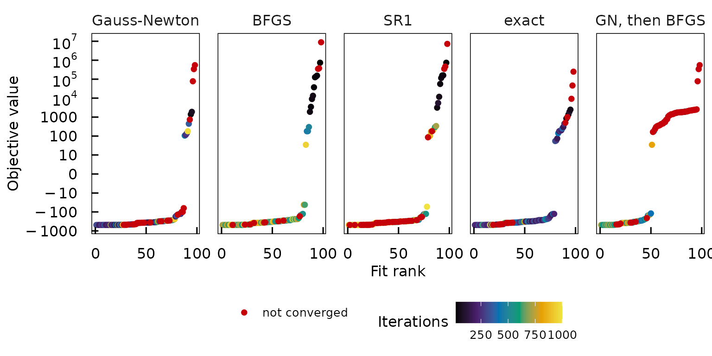

# Trust-region optimization

[`trust()`](https://dmodverse.github.io/dMod2/reference/trust.md)
minimizes the objective function \\\mathcal{J}(\theta)\\, \\-2 \log L\\
or \\-2 \log\\ of the posterior, by a trust-region method on the exact
gradient [\[1\]](#ref-kaschek2019dmod). Arguments and usage:
[Optimization](https://dmodverse.github.io/dMod2/articles/guide-optimization.md).

## Trust-region method

At the iterate \\\theta_k\\ with the gradient \\b = \nabla
\mathcal{J}(\theta_k)\\ and a symmetric approximation \\H\\ of the
Hessian,
[`trust()`](https://dmodverse.github.io/dMod2/reference/trust.md)
minimizes the quadratic model of the objective inside a ball,

\\\min\_{s} \\ m(s) = b^\top s + \tfrac{1}{2}\\ s^\top H s \quad
\text{subject to} \quad \lVert s \rVert \le r . \tag{1}\\

The ratio of actual to predicted decrease decides on the step and the
radius \\r\\. Subproblem, radius, bounds and termination are the same
for every source of \\H\\ and on the [sparse path](#sparse-hessians).

### Trust-region subproblem

[`trust()`](https://dmodverse.github.io/dMod2/reference/trust.md) solves
the subproblem (1) exactly, through the full eigendecomposition of \\H\\
[\[2\]](#ref-more1983computing). The solution satisfies \\(H + \nu I)\\
s = -b\\ with a multiplier \\\nu \ge 0\\ that makes \\H + \nu I\\
positive semidefinite and vanishes unless the step reaches the boundary,
\\\lVert s \rVert = r\\. With \\H = Q \Lambda Q^\top\\, eigenvalues
\\\lambda_i\\ and \\\gamma = Q^\top b\\, the step

\\s(\nu) = -Q (\Lambda + \nu I)^{-1} \gamma \tag{2}\\

solves the subproblem when \\\nu \ge \max(0, -\lambda\_{\min})\\ and
either \\\nu = 0\\ with \\\lVert s \rVert \le r\\, or \\\nu \> 0\\ with
\\\lVert s \rVert = r\\. The second case is a root of the secular
equation

\\\phi(\nu) = \frac{1}{r} - \frac{1}{\lVert s(\nu) \rVert} =
\frac{1}{r} - \Big( \sum_i \frac{\gamma_i^2}{(\lambda_i + \nu)^2}
\Big)^{-1/2}, \tag{3}\\

nearly linear for \\\nu \> -\lambda\_{\min}\\, solved by bisection on a
bracket of \\\nu\\, every evaluation \\O(n\_\theta)\\ in the eigenbasis.
If \\\gamma_i = 0\\ for every eigenvector of \\\lambda\_{\min} \< 0\\
and \\\lVert s(-\lambda\_{\min}) \rVert \le r\\ (hard case), the
solution is \\s(-\lambda\_{\min}) + \tau q\_{\min}\\ with \\\lVert s
\rVert = r\\; otherwise it is the root of (3). Negative curvature is
followed to the boundary. The eigendecomposition costs
\\O(n\_\theta^3)\\; sparse Hessians use the [sparse
path](#sparse-hessians).

### Radius update

With the ratio of actual to predicted decrease

\\\rho_k = \frac{\mathcal{J}(\theta_k) - \mathcal{J}(\theta_k +
s_k)}{-m_k(s_k)}, \tag{4}\\

the radius is updated with \\r\_{\max}\\ = `rmax`:

\\r\_{k+1} = \begin{cases} \min(r_k/4,\\ \lVert s_k \rVert / 4), &
\rho_k \< 1/4, \\ \min(2 r_k,\\ r\_{\max}), & \rho_k \> 3/4 \text{ and }
\lVert s_k \rVert \ge 0.9\\ r_k, \\ r_k, & \text{otherwise.} \end{cases}
\tag{5}\\

A step with \\\rho_k \< 1/4\\ is rejected. The radius grows only when
the step reached the boundary. Under `boundary = "clip"` the radius
shrinks to \\r_k/4\\, grows at \\\rho_k \> 3/4\\ after every step that
is not the Newton step, and a step that lowers \\\mathcal{J}\\ is
accepted where the value or model test ends the run. The first radius is
`rinit`. A trial point where the objective fails or is not finite counts
as rejected; three in a row end the run (`"objfun"`).

### Nonmonotone acceptance

With `stepControl$nonmonotone` \\= \eta \in (0, 1)\\, the actual
decrease is measured from a weighted average of past values
[\[3\]](#ref-zhang2004nonmonotone),

\\Q\_{k+1} = \eta Q_k + 1, \qquad C\_{k+1} = \frac{\eta Q_k C_k +
\mathcal{J}(\theta\_{k+1})}{Q\_{k+1}}, \tag{6}\\

updated at accepted steps, and \\\rho_k = \bigl(C_k -
\mathcal{J}(\theta_k + s_k)\bigr) / \bigl(-m_k(s_k)\bigr)\\; \\\eta =
0\\ recovers (4). The result is the best iterate visited; the
termination tests read \\\mathcal{J}\\ itself.

### Bound constraints

`boundary = "reflective"` is the interior method of Coleman and Li
[\[4\]](#ref-coleman1996interior). With \\v_i\\ the signed distance to
the bound in the descent direction \\-b_i\\ (1 if infinite), \\D =
\operatorname{diag}(\lvert v \rvert^{1/2})\\ and \\J^v\\ the diagonal of
\\\partial \lvert v \rvert / \partial \theta\\, the subproblem is solved
in the scaled variables

\\\hat b = D b, \qquad \hat B = D H D + \operatorname{diag}(b)\\ J^v .
\tag{7}\\

The optimality measure of `gtol`, \\\max_i \lvert v_i b_i \rvert\\,
vanishes at interior stationary points and at active bounds. A step
leaving the box is cut to the fraction \\\max(\texttt{thetaMax}, 1 -
\text{optimality measure})\\ of the distance (`thetaMax` = 0.99995),
reflected, or replaced by scaled steepest descent, whichever the model
rates best. The ratio (4) and the step length in (5) are those of the
scaled model of (7). `boundary = "clip"` removes active parameters from
the subproblem and clips the step.

### Termination criteria

The tests are listed in
[Optimization](https://dmodverse.github.io/dMod2/articles/guide-optimization.html#termination-criteria).
Only `"gradient"` tests optimality; `"fvalue"`, `"preddiff"` and
`"step"` read the quadratic model and can stop at a non-stationary point
if \\H\\ is poor. A `"gradient"`, `"fvalue"` or `"preddiff"` stop that
ends the run also needs the full Newton step of the scaled model (7) at
the current iterate to predict a decrease of at most `mtol`,

\\\tfrac{1}{2}\\ \hat b^\top \hat B^{+} \hat b = \frac{1}{2}
\sum\_{\hat\lambda_i \> 0} \frac{(\hat q_i^\top \hat
b)^2}{\hat\lambda_i} \le \texttt{mtol} , \tag{8}\\

with the eigenpairs \\(\hat\lambda_i, \hat q_i)\\ of \\\hat B\\,
eigenvalues inside the noise floor of the eigendecomposition counted as
zero. Along a direction of curvature \\\lambda\\ the gradient at a
distance \\d\\ from the minimum is \\\lambda d\\ and the value lies
\\\lambda d^2 / 2\\ above it, so a small gradient along a flat direction
does not mean a value close to the minimum; (8) bounds that excess. On
the [sparse path](#sparse-hessians) the Cholesky factors give (8) where
\\\hat B\\ is positive definite, the dense eigendecomposition of \\\hat
B\\ elsewhere;
[`trustL1()`](https://dmodverse.github.io/dMod2/reference/trust.md)
evaluates (8) on the model of the coordinates not held at a kink ([L1
penalties](#l1-penalties)). A run that fails (8) goes on, within
`iterlim`; `mtol = 0` drops the condition. While further phases follow,
the value, model and step tests hand over to the next one ([Hessian
phases](#hessian-phases)); the last quasi-Newton phase therefore ends
only on the gradient, stagnation, the radius, `iterlim` or a failing
objective [\[5\]](#ref-nocedal2006numerical). For an ODE integrated at
relative tolerance \\\epsilon\\ a weighted residual \\r_j\\ of a
prediction \\g_j\\ has an error of about \\\epsilon g_j / \sigma_j\\, so
the value has one of about \\2 \epsilon \sum_j \lvert r_j g_j \rvert /
\sigma_j\\, growing with the amount of data, the gradient more; `ftol`
and `gtol` belong at or above these noise floors.

## Sources of the model Hessian

### Gauss-Newton approximation

The Hessian of \\\sum_j r_j^2\\ in the weighted residuals \\r_j\\ is the
Gauss-Newton Hessian \\2 J^\top J\\ plus a term with the second
derivatives of the residuals ([Sensitivities and
Hessians](https://dmodverse.github.io/dMod2/articles/methods-sensitivities.html#gradient-and-hessian-of-the-objective)).
Gauss-Newton keeps the first, positive semidefinite term, which comes
free with the gradient; the second is small where residuals scatter
around zero. A Gaussian prior adds twice the prior precision on the
diagonal ([Likelihood and
prior](https://dmodverse.github.io/dMod2/articles/methods-objective.html#prior)).
With a parameter-dependent error model the matrix is \\J^\top L J\\, not
necessarily semidefinite ([Sensitivities and
Hessians](https://dmodverse.github.io/dMod2/articles/methods-sensitivities.html#gauss-newton-with-an-error-model)).
With large residuals the Gauss-Newton model can stop short of the
minimum.

### Exact Hessian

`hessianMethod = "exact"` runs Newton’s method in the trust region with
second-order sensitivities ([Sensitivities and
Hessians](https://dmodverse.github.io/dMod2/articles/methods-sensitivities.md)),
exact also for large residuals and at a much higher cost per iteration.

### BFGS update

Both quasi-Newton updates use the secant pair

\\s_k = \theta\_{k+1} - \theta_k, \qquad y_k = \nabla
\mathcal{J}(\theta\_{k+1}) - \nabla \mathcal{J}(\theta_k), \tag{9}\\

with the secant equation \\B\_{k+1} s_k = y_k\\. BFGS keeps \\B\\
positive definite, which needs \\s^\top y \> 0\\; the pair is damped
[\[6\]](#ref-powell1978fast):

\\\vartheta = \begin{cases} 1, & s^\top y \ge 0.2\\ s^\top B s, \\
\dfrac{0.8\\ s^\top B s}{s^\top B s - s^\top y}, & \text{otherwise,}
\end{cases} \qquad \tilde y = \vartheta y + (1 - \vartheta) B s ,
\tag{10}\\

the update is

\\B\_{k+1} = B_k - \frac{B_k s\\ s^\top B_k}{s^\top B_k s} +
\frac{\tilde y\\ \tilde y^\top}{s^\top \tilde y}. \tag{11}\\

Then \\s^\top \tilde y \ge 0.2\\ s^\top B s \> 0\\. `qnCautious` skips
pairs with \\s^\top y \le c \lVert s \rVert \lVert y \rVert\\ (counted
in `qnSkipped`), a cautious update in the sense of
[\[7\]](#ref-li2001global), whose test scales with the gradient instead.
BFGS updates from accepted steps only.

### SR1 update

SR1 satisfies the secant equation without definiteness. With \\w = y -
B_k s\\,

\\B\_{k+1} = B_k + \frac{w\\ w^\top}{w^\top s}, \tag{12}\\

skipped when \\\lvert w^\top s \rvert \le 10^{-8} \lVert s \rVert \lVert
w \rVert\\. SR1 approaches the true Hessian, indefinite regions
included. Rejected trial points also give valid pairs
[\[5\]](#ref-nocedal2006numerical); `qnRejected` (default for `"sr1"`)
uses them.

### Seed and memory

Far from the optimum \\J^\top J\\ is large and ill-conditioned; BFGS
corrects a seed that is wrong by orders of magnitude only slowly, SR1
overwrites it. With `qnMemory` \\= m \> 0\\ the approximation is rebuilt
from \\\gamma I\\, \\\gamma = y^\top y / s^\top y\\
[\[8\]](#ref-shanno1978matrix), and the last \\m\\ pairs, the curvature
of L-BFGS [\[5\]](#ref-nocedal2006numerical) as an explicit matrix.
There is no diagonal preconditioner: on the log scale the
ill-conditioning of sloppy models lies along rotated directions
[\[9\]](#ref-gutenkunst2007universally).

### Hessian phases

A phase hands over to the next where a value, model, step or stagnation
stop or the `iterlim` of the phase would end the run; `"gradient"` ends
the run. A handover resets the radius to `rinit` and seeds a
quasi-Newton phase with the Gauss-Newton Hessian, as in Fides
[\[10\]](#ref-froehlich2022fides).

### Sparse Hessians

A sparse Hessian \\H = S + U D U^\top\\, \\S\\ sparse and \\U\\ of few
columns \\m\\ with the diagonal \\D\\, takes the same steps without the
eigendecomposition. The root of (3) is found by Newton’s method on
\\1/\lVert s(\nu) \rVert\\, safeguarded by a bracket of \\\nu\\, to a
relative \\10^{-12}\\: every iterate factorizes \\S + \nu I\\ by sparse
Cholesky, with the ordering of one symbolic analysis per pattern, and
adds \\U D U^\top\\ by the Woodbury identity through \\K = D^{-1} +
U^\top (S + \nu I)^{-1} U\\. \\H + \nu I\\ is positive definite where
\\S + \nu I\\ has \\p\\ negative eigenvalues, \\K\\ has \\q\\ positive
ones and \\p + q\\ equals the number of positive entries of \\D\\; an
indefinite \\S + \nu I\\ is factorized as \\L \Delta L^\top\\ for \\p\\.
In the hard case the eigenvector of \\\lambda\_{\min}\\ comes from
inverse iteration on the factor at \\\nu\\ next to \\-\lambda\_{\min}\\.
`sparse = "auto"` compares the flops of a step, about eight
factorizations with \\m + 2\\ solves each from the symbolic analysis,
with the \\4 n\_\theta^3\\ of the eigendecomposition.

## L1 penalties

[`trustL1()`](https://dmodverse.github.io/dMod2/reference/trust.md)
minimizes the objective plus an L1 penalty on some of the parameters
[\[11\]](#ref-tibshirani1996regression),

\\\mathcal{J}(\theta) + \sum\_{i \in P} \lambda_i \lvert \theta_i -
\mu_i \rvert , \tag{13}\\

with penalized parameters \\P\\, references \\\mu_i\\ and strengths
\\\lambda_i\\.
[`trustL1()`](https://dmodverse.github.io/dMod2/reference/trust.md) runs
the trust region with the Gauss-Newton Hessian and two changes: a
parameter on the kink is removed from (1) while \\\lvert \partial
\mathcal{J} / \partial \theta_i \rvert \le \lambda_i\\, and a step
across the kink is cut back onto \\\mu_i\\, so zero differences are
exact. Further penalties are a one-sided one,

\\\lambda_i \max(0,\\ \mu_i - \theta_i) , \tag{14}\\

which keeps a parameter on the kink while \\0 \le \partial \mathcal{J} /
\partial \theta_i \le \lambda_i\\; a gate \\\lambda_i (\theta_i -
\mu_i)\\ with \\\theta_i \ge \mu_i\\, which keeps it there while
\\\partial \mathcal{J} / \partial \theta_i \ge -\lambda_i\\; and a fused
block \\B\\, the clustered lasso [\[12\]](#ref-hauber2023uncovering) in
the L1 form (Hauber et al. favor the exponent 0.8),

\\\lambda \sum\_{p \< q \in B} w\_{pq}\\ \lvert \theta_p - \theta_q
\rvert , \tag{15}\\

optionally with an anchor; equal parameters move as one until the data
split them.

## Forward and reverse derivatives on the Oppelt fit

Each source needs other derivatives ([Sensitivities and
Hessians](https://dmodverse.github.io/dMod2/articles/methods-sensitivities.md)):

| source | derivatives per evaluation | sweep |
|----|----|----|
| Gauss-Newton | value, gradient and \\J^\top L J\\ from the forward sensitivities, one tangent per parameter | forward |
| BFGS, SR1 | value and gradient; the gradient from one backward sweep of the adjoint system | reverse |
| exact | value, gradient and exact Hessian by forward over reverse | reverse, `deriv2 = TRUE` |

Seconds per evaluation of the data term at the best fit, minimum of ten,
from `sensitivities.R`:

``` r

timing <- readRDS(file.path(oppelt, "results", "sensitivities.rds"))$timing
timing
#>           value         forward         reverse forward-reverse 
#>           0.007           0.126           0.019           0.873
```

`optimizers.R` fits from the same 100 prior draws with Gauss-Newton,
BFGS and SR1 on the reverse gradient from the identity, the exact
Hessian, and 20 Gauss-Newton iterations followed by BFGS:

``` r

# 100 starts drawn from the prior, as in fit.R. BFGS and SR1 take the reverse gradient and start
# from the identity; the BFGS phase after Gauss-Newton starts from the Gauss-Newton Hessian
free <- setdiff(names(mu), names(gauge))
starts <- msParframe(mu[free], n = 100, seed = 2, sd = sigma[free], keepfirst = FALSE)
methods <- list(
  `Gauss-Newton` = list(hessianMethod = "gn"),
  BFGS = list(hessianMethod = "bfgs", sweep = "reverse", qnControl = list(hessianInit = "identity")),
  SR1 = list(hessianMethod = "sr1", sweep = "reverse", qnControl = list(hessianInit = "identity")),
  exact = list(hessianMethod = "exact", sweep = "reverse"),
  `GN, then BFGS` = list(phases = list(list(hessianMethod = "gn", iterlim = 20),
                                       list(hessianMethod = "bfgs"))))
# one fit of start `i` by method `m`, with the wall time
fitOne <- function(m, i) {
  t0 <- proc.time()[["elapsed"]]
  fit <- tryCatch(do.call(trust, c(list(objR, setNames(as.numeric(starts[i, free]), free),
                                        fixed = gauge, iterlim = 1000, tolControl = tolerances),
                                   methods[[m]])), error = function(e) NULL)
  data.frame(method = m, start = i, value = if (is.null(fit)) NA_real_ else fit$value,
             converged = !is.null(fit) && isTRUE(fit$converged),
             iterations = if (is.null(fit)) NA_integer_ else as.integer(fit$iterations),
             elapsed = proc.time()[["elapsed"]] - t0)
}
tasks <- expand.grid(method = names(methods), start = seq_len(nrow(starts)), stringsAsFactors = FALSE)
optimizers <- do.call(rbind, parallel::mclapply(seq_len(nrow(tasks)), function(k)
  fitOne(tasks$method[k], tasks$start[k]), mc.cores = getOption("dMod2.cores"),
  mc.preschedule = FALSE))
```

``` r

opt <- readRDS(file.path(oppelt, "results", "optimizers.rds"))
opt$method <- factor(opt$method, unique(opt$method))
top <- min(opt$value, na.rm = TRUE)
summary <- do.call(rbind, lapply(split(opt, opt$method), function(d) data.frame(
  starts = nrow(d), failed = sum(is.na(d$value)), converged = sum(d$converged),
  hits = sum(d$value < top + 5, na.rm = TRUE), iterations = median(d$iterations, na.rm = TRUE),
  iterlim = sum(d$iterations >= 1000, na.rm = TRUE), seconds = round(median(d$elapsed, na.rm = TRUE), 1),
  secondsPerHit = round(sum(d$elapsed, na.rm = TRUE) / max(1, sum(d$value < top + 5, na.rm = TRUE))))))
summary
#>               starts failed converged hits iterations iterlim seconds
#> Gauss-Newton     100      2        70   20      358.0      25    28.8
#> BFGS             100      2        86   14      662.0       9    11.5
#> SR1              100      2        59   13      903.5      36    14.7
#> exact            100      2        82   11      281.0      14   138.2
#> GN, then BFGS    100      2        49   11      807.0      45    13.8
#>               secondsPerHit
#> Gauss-Newton            239
#> BFGS                     80
#> SR1                     109
#> exact                  3021
#> GN, then BFGS           126
```

Medians over starts; a hit ends within 5 of the best value; `iterlim`
counts the runs stopped by the iteration limit; `failed` counts starts
without result:

``` r

plotValues(split(opt, opt$method), pseudoLog = TRUE) + ggplot2::theme(legend.position = "bottom")
```



A reverse gradient costs about 1/7 of the forward sensitivities, an
exact Hessian by forward over reverse about 7 times. Gauss-Newton
reaches the lowest plateaus most often, BFGS converges most often, and
BFGS needs the least time per hit. Gauss-Newton followed by BFGS stops
at the iteration limit in 45 runs: the BFGS phase starts from the
Gauss-Newton Hessian far from the optimum ([Seed and
memory](#seed-and-memory)).

## Stored results

- `examples/oppeltNPJSystBiolAppl2018/results/optimizers.rds` and
  `sensitivities.rds`: from the scripts `optimizers.R` and
  `sensitivities.R` of the project.

Reference:
[`trust()`](https://dmodverse.github.io/dMod2/reference/trust.md),
[`trustL1()`](https://dmodverse.github.io/dMod2/reference/trust.md),
[`mstrust()`](https://dmodverse.github.io/dMod2/reference/mstrust.md),
[`msParframe()`](https://dmodverse.github.io/dMod2/reference/msParframe.md),
[`plotValues()`](https://dmodverse.github.io/dMod2/reference/plotValues.md)

## References

\[1\]

D. Kaschek, W. Mader, M. Fehling-Kaschek, M. Rosenblatt, and J. Timmer,
“dMod: Efficient parameter estimation and uncertainty analysis for
dynamic models,” *Journal of Statistical Software*, vol. 88, no. 10, pp.
1–32, 2019, doi:
[10.18637/jss.v088.i10](https://doi.org/10.18637/jss.v088.i10).

\[2\]

J. J. Moré and D. C. Sorensen, “Computing a trust region step,” *SIAM
Journal on Scientific and Statistical Computing*, vol. 4, no. 3, pp.
553–572, 1983, doi: [10.1137/0904038](https://doi.org/10.1137/0904038).

\[3\]

H. Zhang and W. W. Hager, “A nonmonotone line search technique and its
application to unconstrained optimization,” *SIAM Journal on
Optimization*, vol. 14, no. 4, pp. 1043–1056, 2004, doi:
[10.1137/S1052623403428208](https://doi.org/10.1137/S1052623403428208).

\[4\]

T. F. Coleman and Y. Li, “An interior trust region approach for
nonlinear minimization subject to bounds,” *SIAM Journal on
Optimization*, vol. 6, no. 2, pp. 418–445, 1996, doi:
[10.1137/0806023](https://doi.org/10.1137/0806023).

\[5\]

J. Nocedal and S. J. Wright, *Numerical optimization*, 2nd ed. Springer,
2006. doi:
[10.1007/978-0-387-40065-5](https://doi.org/10.1007/978-0-387-40065-5).

\[6\]

M. J. D. Powell, “A fast algorithm for nonlinearly constrained
optimization calculations,” *Lecture Notes in Mathematics*, vol. 630,
pp. 144–157, 1978, doi:
[10.1007/BFb0067703](https://doi.org/10.1007/BFb0067703).

\[7\]

D.-H. Li and M. Fukushima, “On the global convergence of the BFGS method
for nonconvex unconstrained optimization problems,” *SIAM Journal on
Optimization*, vol. 11, no. 4, pp. 1054–1064, 2001, doi:
[10.1137/S1052623499354242](https://doi.org/10.1137/S1052623499354242).

\[8\]

D. F. Shanno and K.-H. Phua, “Matrix conditioning and nonlinear
optimization,” *Mathematical Programming*, vol. 14, no. 1, pp. 149–160,
1978, doi: [10.1007/BF01588962](https://doi.org/10.1007/BF01588962).

\[9\]

R. N. Gutenkunst, J. J. Waterfall, F. P. Casey, K. S. Brown, C. R.
Myers, and J. P. Sethna, “Universally sloppy parameter sensitivities in
systems biology models,” *PLOS Computational Biology*, vol. 3, no. 10,
p. e189, 2007, doi:
[10.1371/journal.pcbi.0030189](https://doi.org/10.1371/journal.pcbi.0030189).

\[10\]

F. Fröhlich and P. K. Sorger, “Fides: Reliable trust-region optimization
for parameter estimation of ODE models,” *PLOS Computational Biology*,
vol. 18, no. 7, p. e1010322, 2022, doi:
[10.1371/journal.pcbi.1010322](https://doi.org/10.1371/journal.pcbi.1010322).

\[11\]

R. Tibshirani, “Regression shrinkage and selection via the lasso,”
*Journal of the Royal Statistical Society: Series B*, vol. 58, no. 1,
pp. 267–288, 1996, doi:
[10.1111/j.2517-6161.1996.tb02080.x](https://doi.org/10.1111/j.2517-6161.1996.tb02080.x).

\[12\]

A. L. Hauber, M. Rosenblatt, and J. Timmer, “Uncovering specific
mechanisms across cell types in dynamical models,” *PLOS Computational
Biology*, vol. 19, no. 9, p. e1010867, 2023, doi:
[10.1371/journal.pcbi.1010867](https://doi.org/10.1371/journal.pcbi.1010867).
