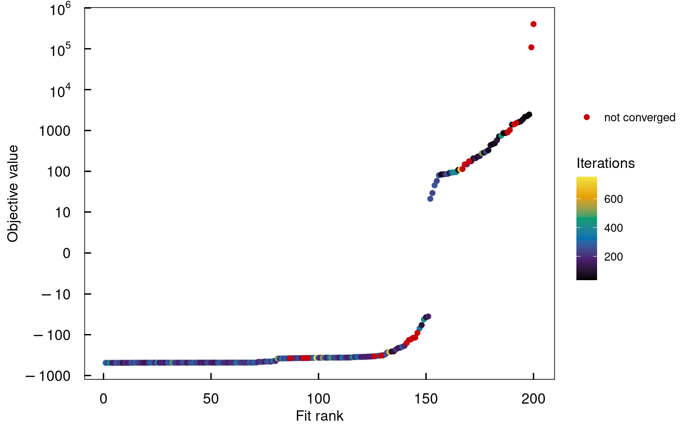
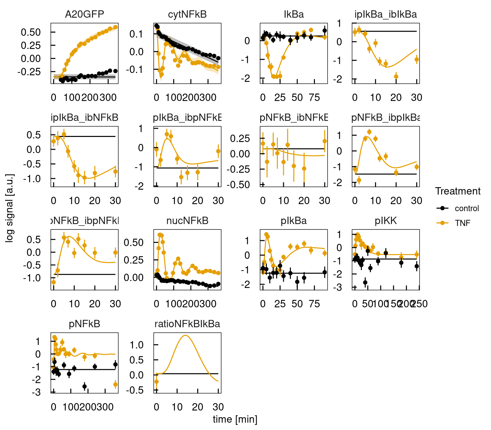
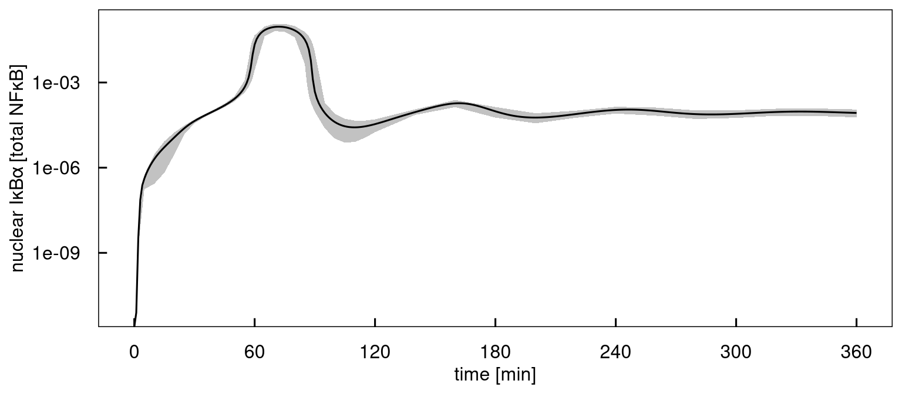
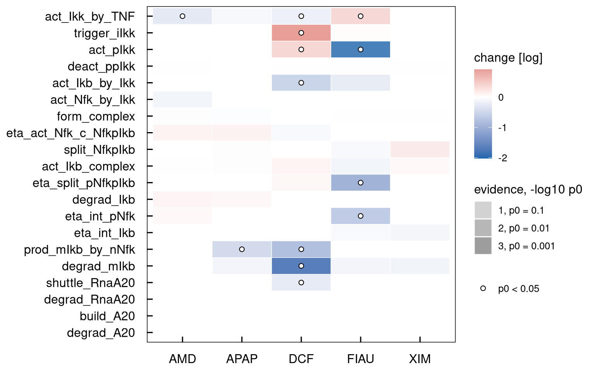

# NFκB signaling (Oppelt 2018)

\[1\] TRUE TRUE TRUE TRUE

Shows:
[`Pimpl()`](https://dmodverse.github.io/dMod2/reference/Pimpl.md),
[`symmetryDetection()`](https://dmodverse.github.io/dMod2/reference/symmetryDetection.md),
[`symmetryReduction()`](https://dmodverse.github.io/dMod2/reference/symmetryReduction.md),
[`mstrust()`](https://dmodverse.github.io/dMod2/reference/mstrust.md),
[`trust()`](https://dmodverse.github.io/dMod2/reference/trust.md),
[`profile()`](https://rdrr.io/r/stats/profile.html),
[`constraintStability()`](https://dmodverse.github.io/dMod2/reference/constraintStability.md),
[`randomEffects()`](https://dmodverse.github.io/dMod2/reference/randomEffects.md),
[`msem()`](https://dmodverse.github.io/dMod2/reference/msem.md),
[`exportPEtab()`](https://dmodverse.github.io/dMod2/reference/exportPEtab.md),
[`importPEtab()`](https://dmodverse.github.io/dMod2/reference/importPEtab.md).

NFκB signaling in HepG2 cells after TNFα and the effects of five
hepatotoxic compounds, after Oppelt et al. (2018), npj Syst Biol Appl
4:23. The full model has 38 reactions in cytoplasm and nucleus and
starts from a steady state solved by
[`Pimpl()`](https://dmodverse.github.io/dMod2/reference/Pimpl.md); the
symmetries are removed by a gauge, and the profiles reduce it to the
core model of the publication. 312 measurements of untreated and
stimulated cells determine the model, 444 further ones the effects of
the compounds. Data of the publication; model after Daniel Kaschek’s
dMod implementation (dkaschek/dMod_Examples, TNFa). The
[guide](https://dmodverse.github.io/dMod2/articles/guide-model.html)
explains the code.

## Files

| file | content |
|----|----|
| `data/oppelt2018.csv` | the measurements of the publication |
| `model.R` | data, the full model, the resting state, conditions, compiling, objective, the gauge |
| `symmetries.R` | the Lie symmetries of the full model and their reduction, saves `results/symmetries.rds` and `results/reduction.rds` |
| `fit.R` | multistart of 200 fits, saves `results/fits.rds` |
| `onefit.R` | one fit from a start near the best fit, saves `results/onefit.rds` for the guide |
| `sensitivities.R` | forward and reverse gradient and the exact Hessian at the best fit, saves `results/sensitivities.rds` for the guide |
| `optimizers.R` | the Hessian sources of [`trust()`](https://dmodverse.github.io/dMod2/reference/trust.md) from the same 100 starts, saves `results/optimizers.rds` for the guide |
| `profiles.R` | profiles of all parameters, saves `results/profiles.rds` |
| `variants.R` | core model of the publication and variants that release one setting, likelihood ratios, saves `results/variants.rds` |
| `reduced.R` | the model reduced by the limits the profiles point to |
| `refit.R` | fit and profiles of the reduced model, likelihood ratio, saves `results/reduced.rds` |
| `prediction.R` | prediction band of nuclear IκBα, saves `results/prediction.rds` |
| `compounds.R` | the changes the compounds cause, by spike-and-slab random effects, saves `results/compounds.rds` |
| `helix.R` | the expensive runs (multistarts, profiles, optimizers, compounds) as array jobs of one or two cores per task on the Helix cluster |
| `petab.R` | the model as a PEtab problem with the resting state as a pre-equilibration, written to `results/petab/` and read back |
| `plots.R` | figures from the saved results |
| `results/` | saved results, each with the md5 of the files it is computed from in the attribute `"stamp"` |

## Run

With this folder as working directory, in this order:

``` r

source("model.R")        # compiles into build/
source("symmetries.R")   # needs the Python package symident
source("fit.R")
source("onefit.R")
source("sensitivities.R")
source("optimizers.R")
source("profiles.R")
source("variants.R")
source("refit.R")
source("prediction.R")
source("compounds.R")
source("petab.R")
source("plots.R")
```

`model.R` uses the free cores of the machine. `plots.R` only reads
`results/`.

## Fit

200 fits, 180 converged. The best value is -488.675, reached by 9 fits
within 0.1.





## Reduction

The reduced model is the core model of the publication (Table S5) with
two delay steps of the A20 transcript, a separate factor
`eta_split_pNfkpIkb` for the release of pNFκB, and the NFκB blot after
NFκB precipitation reading the offset alone.

The profiles of the full model lead to a model with 16 fewer parameters,
whose data term is 19.05 higher, below the 95% threshold of 26.30; 46 of
the 47 parameters of the reduced model have a finite 95% interval.
[Profile
likelihood](https://dmodverse.github.io/dMod2/articles/guide-profiles.html)
shows the limits.

## Prediction

The 95% prediction band of nuclear IκBα, not measured, in the reduced
model:



## Compounds

Changes of the rate constants by the five compounds from spike-and-slab
random effects; color: mode on the log scale, opacity: evidence against
no change:


