# Theophylline, warfarin and mavoglurant

\[1\] TRUE TRUE TRUE TRUE TRUE TRUE TRUE TRUE TRUE TRUE TRUE TRUE TRUE
TRUE TRUE \[16\] TRUE TRUE TRUE TRUE TRUE TRUE

Shows:
[`randomEffects()`](https://dmodverse.github.io/dMod2/reference/randomEffects.md),
[`em()`](https://dmodverse.github.io/dMod2/reference/em.md),
[`msem()`](https://dmodverse.github.io/dMod2/reference/msem.md),
[`vcov()`](https://rdrr.io/r/stats/vcov.html),
[`plotVPC()`](https://dmodverse.github.io/dMod2/reference/plotVPC.md),
[`plotResiduals()`](https://dmodverse.github.io/dMod2/reference/plotResiduals.md),
[`plotRandomEffects()`](https://dmodverse.github.io/dMod2/reference/plotRandomEffects.md).

Theophylline, warfarin PK/PD and mavoglurant with occasions: FOCEI and
SAEM multistarts and the diagnostics of the fits.

## Files

| file | content |
|----|----|
| `analysis.R` | the analysis, shown below |
| `results/cache.rds` | saved fits; delete it to fit again |
| `theophyllineMultistart.R` | multistarts of the theophylline model by FOCEI, quadrature and SAEM, saves `results/multistart.rds` for the guide |

## Run

With this folder as working directory: `source("analysis.R")`.

``` r

library(dMod2)
dir.create("build", showWarnings = FALSE)
# generated sources and shared objects in build/, reused when nothing changed
options(dMod2.outdir = "build")
cores <- max(1L, min(20L, parallel::detectCores() - 2L))
nstart <- 100L
# second derivatives forward over reverse for FOCEI, forward over forward for the reported Hessian
dm <- c("forward", "reverse", "forward-reverse")

# fits are saved in results/cache.rds under a key and read from there when present; delete the
# file to fit everything again
cached <- function(key, expr) {
  file <- "results/cache.rds"
  dir.create("results", showWarnings = FALSE)
  store <- if (file.exists(file)) readRDS(file) else list()
  if (is.null(store[[key]])) {
    store[[key]] <- expr
    saveRDS(store, file)
  }
  store[[key]]
}
# a fit of em() cached without the model, which an evaluation at the fit estimates restores
cachedEm <- function(key, obj, random, start, control = list(), ...) {
  model <- c("design", "prdfn", "errfn", "data")
  f <- cached(key, { f <- em(obj, random, start, control = control, ...); f[model] <- NULL; f })
  f[model] <- em(obj, random, f, control = modifyList(control, list(trustControl = list(iterlim = 0),
                                                                    boundary = FALSE)),
                 verbose = FALSE)[model]
  f
}
```

## Multistarts

The starts: the initial values on the log scale and `nstart - 1` draws
around them, N(0, 0.5) per parameter. Every fit runs on one core,
`nstart` fits on `cores` cores at once.

``` r

drawStarts <- function(init, n = nstart) {
  set.seed(1)
  rbind(init, t(vapply(seq_len(n - 1L), function(i) init + rnorm(length(init), 0, 0.5), init)))
}

# dMod2 from every start; the fits as a table of -2 log L, convergence, seconds and estimates
runDMod2 <- function(obj, random, starts, method) {
  out <- parallel::mclapply(seq_len(nrow(starts)), function(i) {
    options(dMod2.cores = 1L)
    set.seed(i)
    t <- system.time(f <- tryCatch(em(obj, random, starts[i, ], method = method, verbose = FALSE),
                                   error = function(e) NULL))[["elapsed"]]
    if (is.null(f)) return(list(value = NA_real_, converged = FALSE, seconds = t, argument = NULL))
    list(value = f$value, converged = isTRUE(f$converged), seconds = t, argument = f$argument)
  }, mc.cores = cores, mc.preschedule = FALSE)
  data.frame(package = "dMod2", start = seq_along(out), value = vapply(out, `[[`, 0, "value"),
             converged = vapply(out, `[[`, TRUE, "converged"), seconds = vapply(out, `[[`, 0, "seconds"))
}

# per method the best value, the starts within 0.1 of it, the failed and unconverged fits, the
# median and total seconds per fit; `runs` a named list of the tables of runDMod2()
summarizeStarts <- function(runs) {
  do.call(rbind, lapply(names(runs), function(m) {
    r <- runs[[m]]
    best <- min(r$value, na.rm = TRUE)
    data.frame(method = m, best = best, hits = sum(r$value - best < 0.1, na.rm = TRUE),
               failed = sum(is.na(r$value)), unconverged = sum(!r$converged & !is.na(r$value)),
               medianSeconds = stats::median(r$seconds), totalSeconds = sum(r$seconds))
  }))
}

# the waterfall of every method, a panel each, and the seconds per fit
plotStarts <- function(runs, title) {
  w <- plotValues(runs, pseudoLog = TRUE) + ggplot2::labs(title = title)
  seconds <- do.call(rbind, lapply(names(runs), function(m) data.frame(method = m, seconds = runs[[m]]$seconds)))
  s <- ggplot2::ggplot(seconds, ggplot2::aes(method, seconds)) + ggplot2::geom_boxplot() +
    ggplot2::scale_y_log10(labels = scales::label_log()) +
    ggplot2::labs(x = NULL, y = "seconds per fit, one core") + theme_dMod()
  cowplot::plot_grid(w, s, nrow = 1, rel_widths = c(2, 1))
}

# -2 log L of FOCEI at given estimates, the definition under which the SAEM fits are compared
focei <- function(obj, random, pars)
  em(obj, random, pars, control = list(trustControl = list(iterlim = 0)), verbose = FALSE)$value

# the multistarts of FOCEI and SAEM of one model, and the best SAEM fit with -2 log L of FOCEI at
# the SAEM estimates; `saem` the model SAEM fits
compareMethods <- function(runs, label, saem) {
  runs <- list(FOCEI = runs$focei, SAEM = runs$saem)
  print(summarizeStarts(runs))
  print(plotStarts(runs, label))
  sfit <- cachedEm(paste(label, "dMod2 saem best"), saem$obj, saem$random, saem$starts[which.min(runs$SAEM$value), ],
                   method = "saem", verbose = FALSE)
  print(round(sfit$argument, 4))
  print(c(SAEM = focei(saem$obj, saem$random, sfit$argument)))
  invisible(NULL)
}
```

## Theophylline

Twelve subjects, one oral dose each, a one-compartment model with
first-order absorption from a depot of volume 1 into the central
compartment of volume V; absorption rate, volume and clearance vary
between subjects.

``` r

data(Theoph, package = "datasets")
Theoph$Subject <- as.character(Theoph$Subject)
theoData <- as.datalist(data.frame(name = "cp", time = Theoph$Time, value = Theoph$conc, sigma = NA_real_,
                                   condition = Theoph$Subject))
theoNet <- eqnlist() |>
  assignCompartment(Ag = "depot") |>
  assignCompartment(Cc = "central", volume = "V") |>
  setCompartmentVolume(unit = "1") |>
  addReaction("Ag", "Cc", "Ka * Ag", "absorption") |>
  addReaction("Cc", "", "Cl * Cc", "elimination", rateCompartment = "unit")
theoNet
```

    #> 
    #> Compartments:
    #>   depot (V=1)
    #>   central (V=V)
    #>   unit (V=1)
    #> States by compartment:
    #>   central: Cc
    #>   depot: Ag
    #> 
    #>   Check Educt -> Product    Rate Description
    #> 1          Ag ->      Cc Ka * Ag  absorption
    #> 2          Cc ->         Cl * Cc elimination

``` r

theoX <- Xs(odemodel(theoNet, modelname = "pm_theoph", compile = FALSE, deriv2 = TRUE, derivMode = dm))
theoG <- Y(c(cp = "Cc"), theoX, modelname = "pm_theoph_g", compile = FALSE, deriv2 = TRUE, derivMode = dm)
theoE <- Y(c(cp = "sigma"), theoG, attachInput = FALSE, modelname = "pm_theoph_e", compile = FALSE, deriv2 = TRUE,
           derivMode = dm)
subjects <- sort(unique(Theoph$Subject))
theoTable <- data.frame(ID = subjects, dose = tapply(Theoph$Dose * Theoph$Wt, Theoph$Subject, `[`, 1)[subjects],
                        weight = tapply(Theoph$Wt, Theoph$Subject, `[`, 1)[subjects], row.names = subjects)
theoTrafo <- branch(define(NULL, "x <- x", x = c("Ka", "V", "Cl", "Ag", "Cc", "sigma")), table = theoTable)
theoTrafo <- insert(theoTrafo, "Ag <- dose", dose = dose)
theoTrafo <- insert(theoTrafo, "Cc <- 0")
theoTrafo <- insert(theoTrafo, "x <- exp(x)", x = c("Ka", "V", "Cl", "sigma"))
theoTrafo <- insert(theoTrafo, Ka + V + Cl ~ 1 + (1 | ID))
theoP <- P(theoTrafo, method = "explicit", modelname = "pm_theoph_p", compile = FALSE, deriv2 = TRUE, derivMode = dm)
compileSeconds <- c(theophylline = system.time(compile(theoX, theoG, theoE, theoP,
                                                       output = "pm_theoph_all"))[["elapsed"]])
theoObj <- normL2(theoData, theoG * theoX * theoP, errmodel = theoE)
theoRandom <- randomEffects(theoP)
theoStarts <- drawStarts(c(Ka = 0, V = 3, Cl = 0.7, sigma = log(0.5), omega_Ka_Ka = log(0.3),
                           omega_V_V = log(0.3), omega_Cl_Cl = log(0.3)))

theoRuns <- cached("Theophylline dMod2", list(focei = runDMod2(theoObj, theoRandom, theoStarts, "focei"),
                                               saem = runDMod2(theoObj, theoRandom, theoStarts, "saem")))
theoFit <- cachedEm("Theophylline dMod2 focei best", theoObj, theoRandom,
                    theoStarts[which.min(theoRuns$focei$value), ], verbose = FALSE)
summary(theoFit)
```

    #> EM summary (focei): -2 log L 352.934381, converged TRUE, 36 iterations
    #>   without the 2 pi constant of the data (NONMEM OBJ): 110.334608
    #> 
    #> Parameters:
    #>             estimate        se   rsePct
    #> Ka           -2.4670   0.05115    2.073
    #> V             0.5201   0.19060   36.650
    #> Cl            1.0020   0.06062    6.050
    #> sigma        -0.3443   0.06825   19.830
    #> omega_Ka_Ka  -7.9920 206.40000 2583.000
    #> omega_V_V    -0.5029   0.23080   45.890
    #> omega_Cl_Cl  -1.7620   0.21980   12.470
    #> 
    #> Random effects:
    #>  type eta1 eta2  estimate      se
    #>    sd   Ka   Ka 0.0003383 0.06984
    #>    sd    V    V 0.6047000 0.13960
    #>    sd   Cl   Cl 0.1717000 0.03774
    #> 
    #> Shrinkage: eta_Ka = 0.998, eta_V = 0.005, eta_Cl = -0.005

## Diagnostics

``` r

plot(theoFit)
```

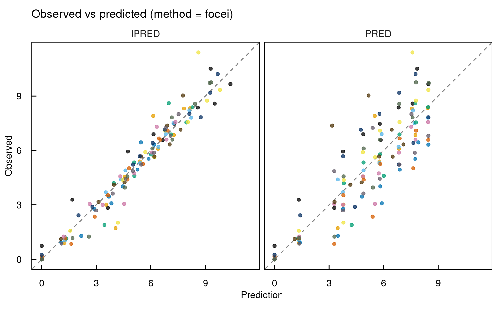

``` r

plotResiduals(theoFit, nsim = 500, seed = 1)
```

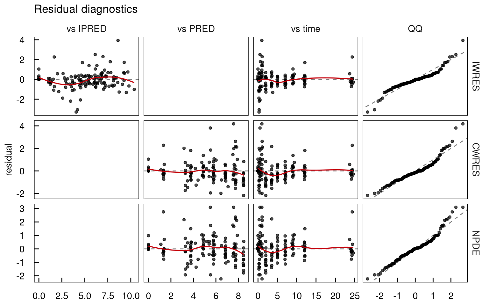

``` r

plotCombined(theoFit)
```

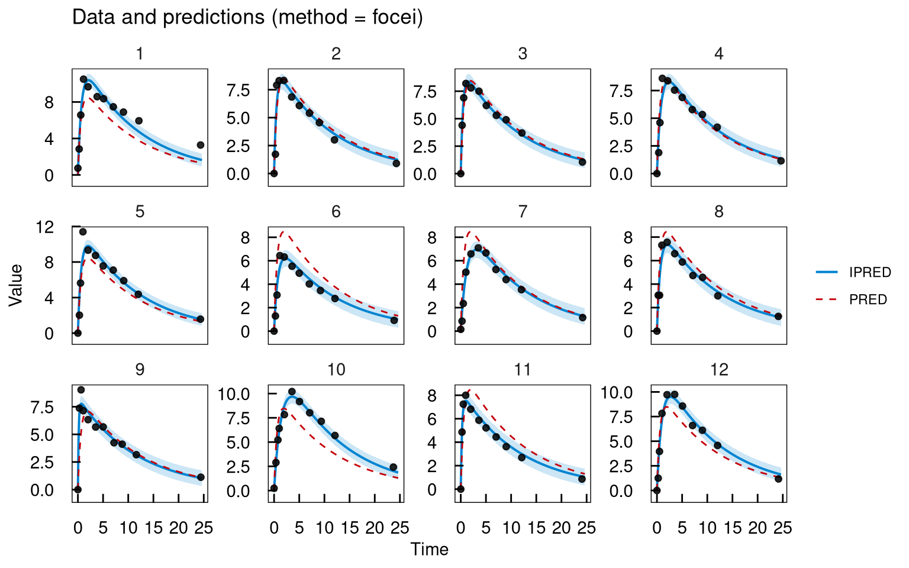

``` r

plotRandomEffects(theoFit)
```

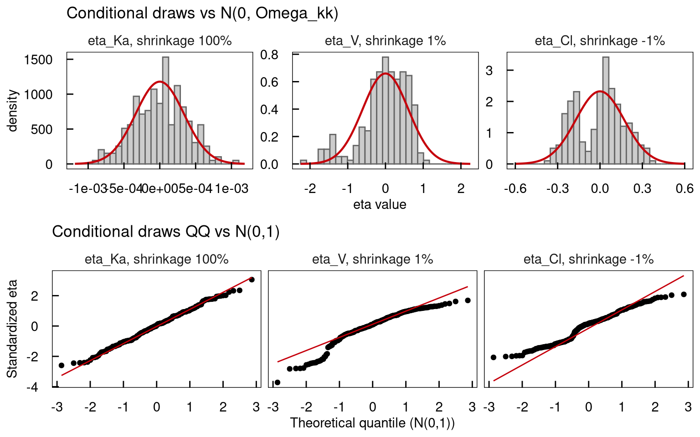

``` r

plotRandomEffects(theoFit, covariates = theoTable["weight"])
```

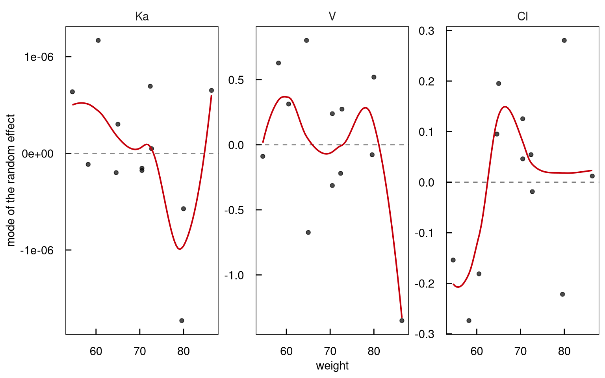

``` r

plotVPC(theoFit, nsim = 500, bins = 8, seed = 1)
```

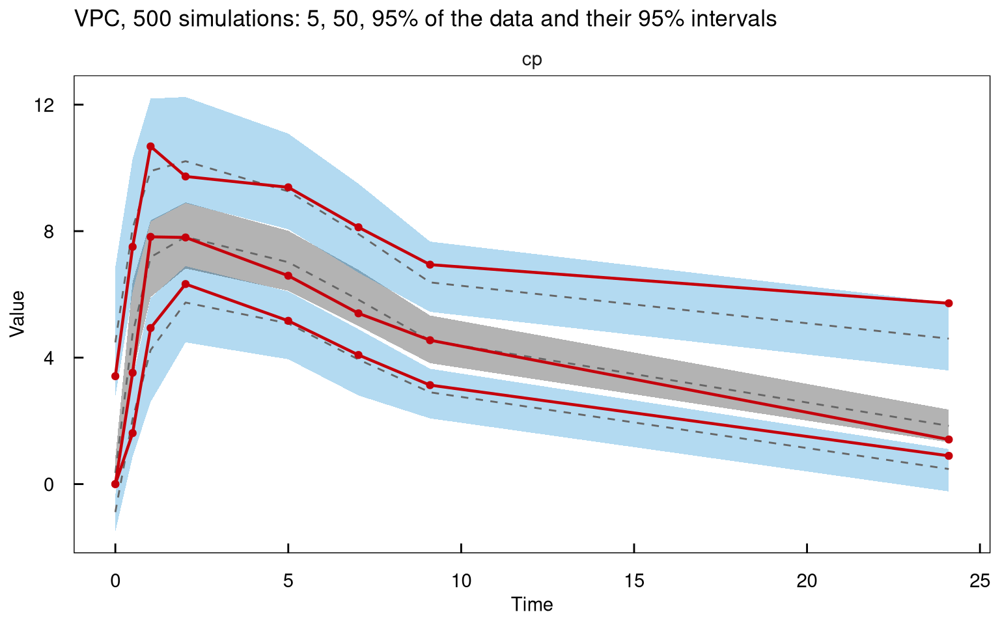

## FOCEI and SAEM

``` r

compareMethods(theoRuns, "Theophylline", list(obj = theoObj, random = theoRandom, starts = theoStarts))
```

    #>   method     best hits failed unconverged medianSeconds totalSeconds
    #> 1  FOCEI 352.9344    1      0           1        1.2330      130.224
    #> 2   SAEM 354.9611    1      0           2        6.5515      671.326

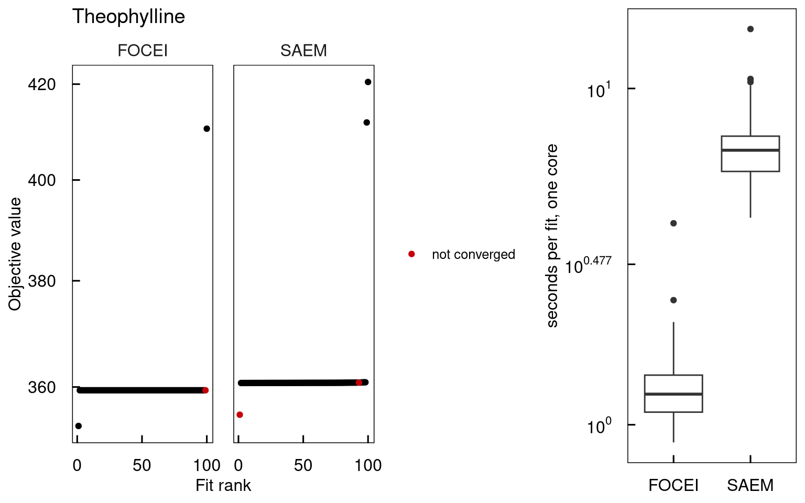

    #>          Ka           V          Cl       sigma omega_Ka_Ka   omega_V_V 
    #>     -2.4710      0.5102      0.9982     -0.3452     -3.1265     -0.4928 
    #> omega_Cl_Cl 
    #>     -1.7575 
    #>     SAEM 
    #> 352.9441

## Warfarin

32 subjects, one oral dose; the plasma concentration `cp` and the
prothrombin complex activity `pca`, whose synthesis the concentration
inhibits (a turnover model with maximal inhibition 1). Volume,
clearance, baseline and turnover rate of the activity vary between
subjects.

``` r

data(warfarin)
warfData <- as.datalist(warfarin, splitBy = "condition", keepCovariates = c("dose", "wt", "age", "sex"))
warfNet <- eqnlist() |>
  assignCompartment(Ag = "depot") |>
  assignCompartment(Cc = "central", volume = "V") |>
  assignCompartment(PCA = "effect") |>
  setCompartmentVolume(unit = "1") |>
  addReaction("Ag", "Cc", "Ka * Ag", "absorption") |>
  addReaction("Cc", "", "Cl * Cc", "elimination", rateCompartment = "unit") |>
  addReaction("", "PCA", "kout * pca0 * IC50 / (IC50 + Cc)", "synthesis") |>
  addReaction("PCA", "", "kout * PCA", "degradation")
warfNet
```

    #> 
    #> Compartments:
    #>   depot (V=1)
    #>   central (V=V)
    #>   effect (V=1)
    #>   unit (V=1)
    #> States by compartment:
    #>   central: Cc
    #>   depot: Ag
    #>   effect: PCA
    #> 
    #>   Check Educt -> Product                             Rate Description
    #> 1          Ag ->      Cc                          Ka * Ag  absorption
    #> 2          Cc ->                                  Cl * Cc elimination
    #> 3             ->     PCA kout * pca0 * IC50 / (IC50 + Cc)   synthesis
    #> 4         PCA ->                               kout * PCA degradation

``` r

warfX <- Xs(odemodel(warfNet, modelname = "pm_warf", compile = FALSE, deriv2 = TRUE, derivMode = dm))
warfG <- Y(c(cp = "Cc", pca = "PCA"), warfX, modelname = "pm_warf_g", compile = FALSE, deriv2 = TRUE,
           derivMode = dm)
# the error of cp combined from an absolute and a relative part, positive also where the solver
# leaves cp at or below 0
warfE <- Y(c(cp = "sqrt(sigma_cp_abs^2 + (sigma_cp_rel * cp)^2)", pca = "sigma_pca"), warfG,
           attachInput = FALSE, modelname = "pm_warf_e", compile = FALSE, deriv2 = TRUE, derivMode = dm)
warfTable <- attr(warfData, "condition.grid")
warfTable$ID <- rownames(warfTable)
warfTrafo <- branch(define(NULL, "x <- x", x = c("Ka", "V", "Cl", "IC50", "kout", "pca0", "Ag", "Cc", "PCA",
                                                  "sigma_cp_abs", "sigma_cp_rel", "sigma_pca")), table = warfTable)
warfTrafo <- insert(warfTrafo, "Ag <- d", d = dose)
warfTrafo <- insert(warfTrafo, "Cc <- 0")
warfTrafo <- insert(warfTrafo, "PCA <- pca0")
warfTrafo <- insert(warfTrafo, "x <- exp(x)", x = c("Ka", "V", "Cl", "IC50", "kout", "pca0", "sigma_cp_abs",
                                                    "sigma_cp_rel", "sigma_pca"))
warfTrafo <- insert(warfTrafo, V + Cl + pca0 + kout ~ 1 + (1 | ID))
warfP <- P(warfTrafo, method = "explicit", modelname = "pm_warf_p", compile = FALSE, deriv2 = TRUE, derivMode = dm)
compileSeconds["warfarin"] <- system.time(compile(warfX, warfG, warfE, warfP, output = "pm_warf_all"))[["elapsed"]]
warfObj <- normL2(warfData, warfG * warfX * warfP, errmodel = warfE)
warfRandom <- randomEffects(warfP)
warfStarts <- drawStarts(c(Ka = 0, V = 2, Cl = -2, IC50 = 0, kout = -3, pca0 = 4.6, sigma_cp_abs = log(0.1),
                           sigma_cp_rel = log(0.1),
                           sigma_pca = log(5), omega_V_V = log(0.3), omega_Cl_Cl = log(0.3),
                           omega_pca0_pca0 = log(0.3), omega_kout_kout = log(0.3)))
warfRuns <- cached("Warfarin dMod2", list(focei = runDMod2(warfObj, warfRandom, warfStarts, "focei"),
                                           saem = runDMod2(warfObj, warfRandom, warfStarts, "saem")))
warfFit <- cachedEm("Warfarin dMod2 focei best", warfObj, warfRandom,
                    warfStarts[which.min(warfRuns$focei$value), ], verbose = FALSE)
summary(warfFit)
```

    #> EM summary (focei): -2 log L 2395.005082, converged TRUE, 35 iterations
    #>   without the 2 pi constant of the data (NONMEM OBJ): 1514.661967
    #> 
    #> Parameters:
    #>                 estimate      se   rsePct
    #> Ka               -0.6692 0.09290  13.8800
    #> V                 2.0220 0.05176   2.5600
    #> Cl               -1.9890 0.05572   2.8010
    #> IC50              0.1205 0.05134  42.5900
    #> kout             -2.9880 0.02700   0.9038
    #> pca0              4.5710 0.01228   0.2686
    #> sigma_cp_abs      0.0654 0.13730 209.9000
    #> sigma_cp_rel     -1.8420 0.13860   7.5220
    #> sigma_pca         1.3730 0.08206   5.9750
    #> omega_V_V        -1.4310 0.16520  11.5500
    #> omega_Cl_Cl      -1.2590 0.13790  10.9500
    #> omega_pca0_pca0  -2.8960 0.18790   6.4870
    #> omega_kout_kout  -2.5120 0.33200  13.2200
    #> 
    #> Random effects:
    #>  type eta1 eta2 estimate      se
    #>    sd    V    V  0.23910 0.03951
    #>    sd   Cl   Cl  0.28410 0.03916
    #>    sd pca0 pca0  0.05524 0.01038
    #>    sd kout kout  0.08113 0.02694
    #> 
    #> Shrinkage: eta_V = 0.136, eta_Cl = 0.034, eta_pca0 = 0.165, eta_kout = 0.360

## Diagnostics

``` r

plot(warfFit)
```

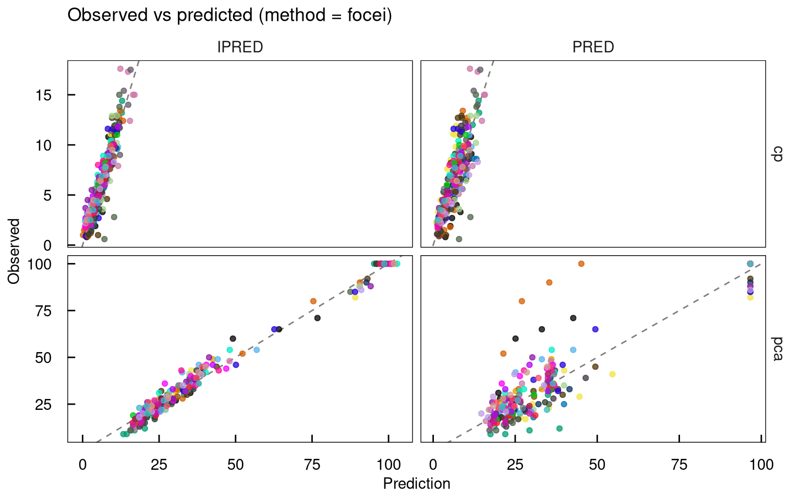

``` r

plotResiduals(warfFit, nsim = 500, seed = 1)
```

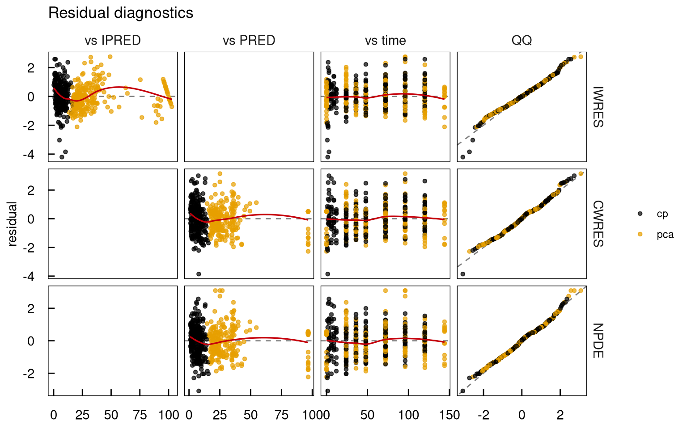

``` r

plotCombined(warfFit, conditionsPerPage = 8)[[1]]
```

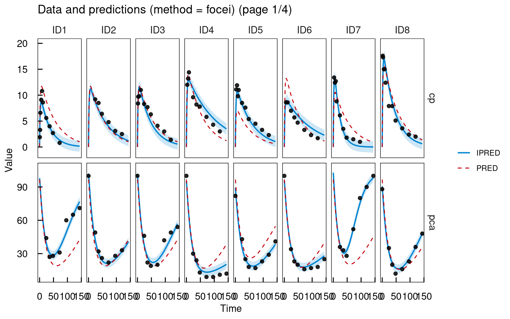

``` r

plotRandomEffects(warfFit)
```

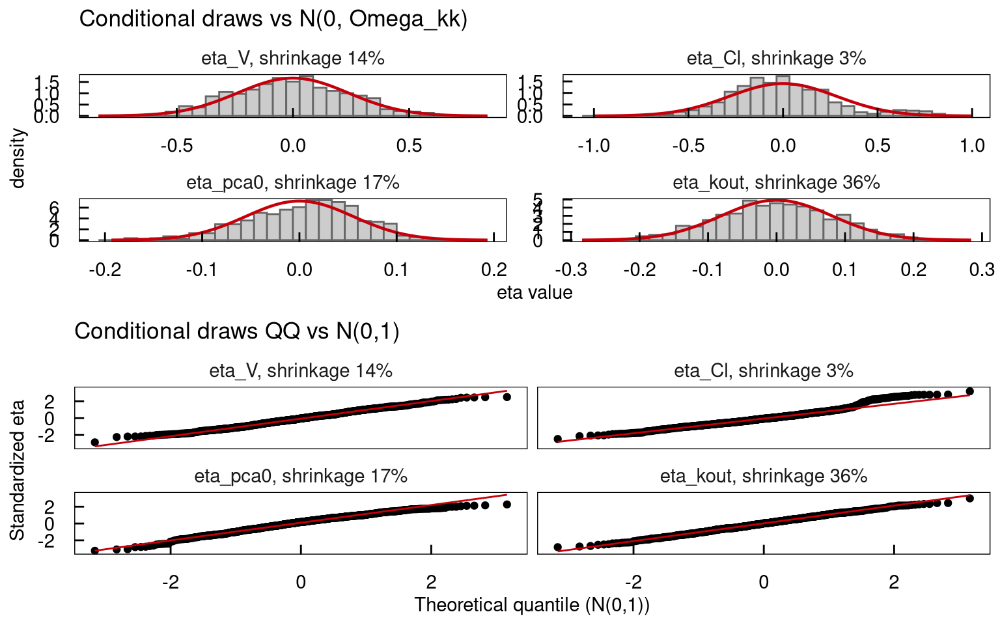

``` r

plotRandomEffects(warfFit, covariates = c("wt", "age", "sex"))
```

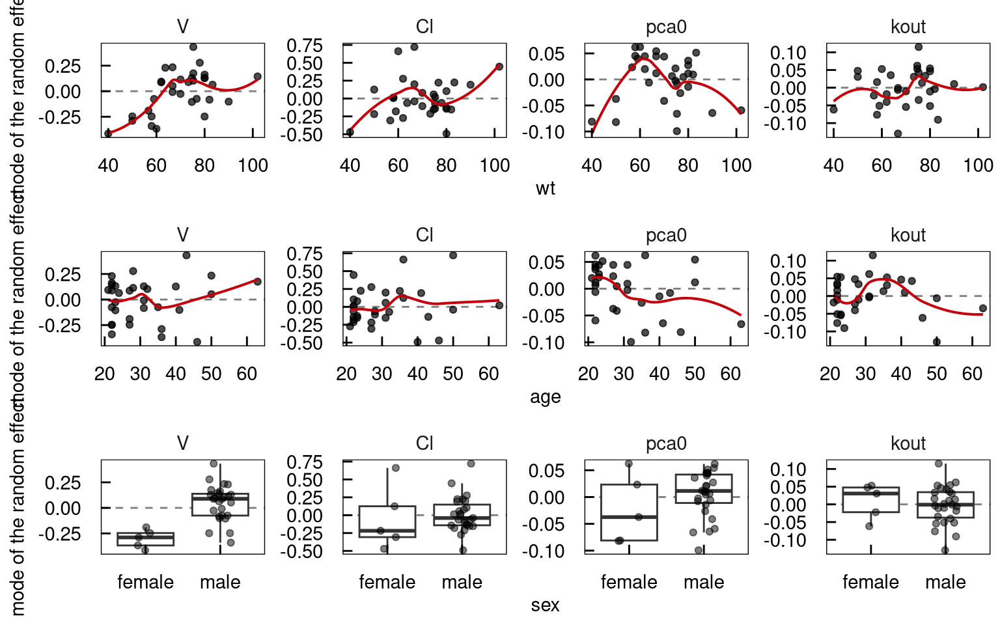

``` r

plotVPC(warfFit, nsim = 500, bins = 8, seed = 1)
```

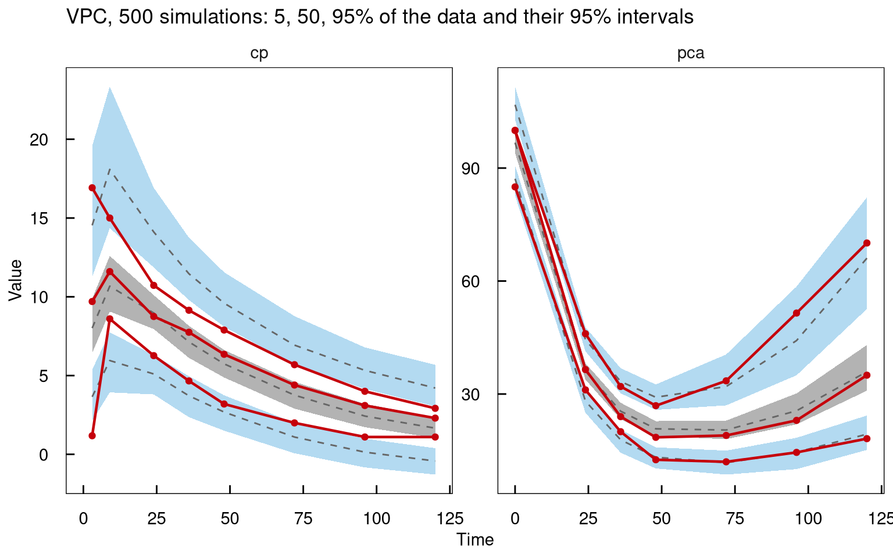

## FOCEI and SAEM

The SAEM fits run all 500 iterations and end unconverged: the expected
increase of -2 log L from the Monte Carlo error of the averaged estimate
stays above `mcTol` (0.05).

``` r

compareMethods(warfRuns, "Warfarin", list(obj = warfObj, random = warfRandom, starts = warfStarts))
```

    #>   method     best hits failed unconverged medianSeconds totalSeconds
    #> 1  FOCEI 2395.005   99      0           0       11.8435     1243.297
    #> 2   SAEM 2395.739   53      0         100       55.7525     5570.971

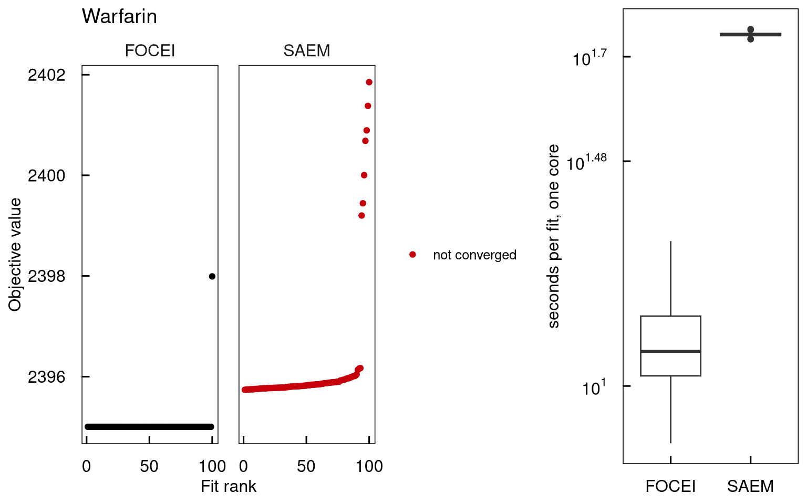

    #>              Ka               V              Cl            IC50            kout 
    #>         -0.6439          2.0381         -2.0060          0.1536         -2.9708 
    #>            pca0    sigma_cp_abs    sigma_cp_rel       sigma_pca       omega_V_V 
    #>          4.5715         -0.0657         -1.7808          1.4514         -1.4698 
    #>     omega_Cl_Cl omega_pca0_pca0 omega_kout_kout 
    #>         -1.2701         -2.8746         -2.7625 
    #>     SAEM 
    #> 2396.107

## Mavoglurant

120 subjects, an infusion of 10 min (20 min in one occasion) as a time
switch, 78 subjects on two occasions. Two compartments; clearances scale
with weight to the power 0.75, volumes with weight. Clearance, the
central and peripheral volume and the intercompartmental clearance vary
between subjects, the clearance also between the occasions of a subject,
`(1 | ID:OCC)`. SAEM fits the model without the variability between
occasions.

``` r

data(mavoglurant)
mavoData <- as.datalist(mavoglurant, splitBy = "condition",
                        keepCovariates = c("ID", "OCC", "dose", "duration", "AGE", "SEX", "WT", "HT"))
mavoNet <- eqnlist() |>
  assignCompartment(C1 = "central", volume = "V1") |>
  assignCompartment(C2 = "peripheral", volume = "V2") |>
  setCompartmentVolume(unit = "1") |>
  addReaction("", "C1", "piecewise(dose / duration, time < duration, 0)", "infusion", rateCompartment = "unit") |>
  addReaction("C1", "", "CL * C1", "elimination", rateCompartment = "unit") |>
  addReaction("C1", "C2", "Q * C1", "distribution", rateCompartment = "unit") |>
  addReaction("C2", "C1", "Q * C2", "redistribution", rateCompartment = "unit")
mavoNet
```

    #> 
    #> Compartments:
    #>   central (V=V1)
    #>   peripheral (V=V2)
    #>   unit (V=1)
    #> States by compartment:
    #>   central: C1
    #>   peripheral: C2
    #> 
    #>   Check Educt -> Product                                           Rate
    #> 1             ->      C1 piecewise(dose / duration, time < duration, 0)
    #> 2          C1 ->                                                CL * C1
    #> 3          C1 ->      C2                                         Q * C1
    #> 4          C2 ->      C1                                         Q * C2
    #>      Description
    #> 1       infusion
    #> 2    elimination
    #> 3   distribution
    #> 4 redistribution

``` r

# solver tolerances 1e-10: at the defaults the solver error, absolute in mg/L, moves -2 log L by
# about 1e-3, more than the fit resolves
mavoX <- Xs(odemodel(mavoNet, modelname = "pm_mavo", compile = FALSE, deriv2 = TRUE, derivMode = dm),
            options = list(atol = 1e-10, rtol = 1e-10))
# the dose in mg, the concentration in ng/mL
mavoG <- Y(c(cp = "1000 * C1"), mavoX, modelname = "pm_mavo_g", compile = FALSE, deriv2 = TRUE, derivMode = dm)
mavoE <- Y(c(cp = "sqrt(sigma_abs^2 + (sigma_rel * cp)^2)"), mavoG, attachInput = FALSE, modelname = "pm_mavo_e",
           compile = FALSE, deriv2 = TRUE, derivMode = dm)
mavoTable <- attr(mavoData, "condition.grid")
mavoTable$ID <- as.character(mavoTable$ID)
mavoTrafo <- function(between) {
  tr <- branch(define(NULL, "x <- x", x = c("CL", "V1", "Q", "V2", "C1", "C2", "dose", "duration", "sigma_abs",
                                                "sigma_rel")),
               table = mavoTable)
  tr <- insert(tr, "dose <- d", d = dose)
  tr <- insert(tr, "duration <- u", u = duration)
  tr <- insert(tr, "x <- 0", x = c("C1", "C2"))
  tr <- insert(tr, "x <- x * (w / 70)^0.75", x = c("CL", "Q"), w = WT)
  tr <- insert(tr, "x <- x * w / 70", x = c("V1", "V2"), w = WT)
  tr <- insert(tr, "x <- exp(x)", x = c("CL", "V1", "Q", "V2", "sigma_abs", "sigma_rel"))
  if (between) tr <- insert(tr, CL ~ 1 + (1 | ID) + (1 | ID:OCC)) else tr <- insert(tr, CL ~ 1 + (1 | ID))
  insert(tr, V1 + Q + V2 ~ 1 + (1 | ID))
}
mavoP <- P(mavoTrafo(TRUE), method = "explicit", modelname = "pm_mavo_p", compile = FALSE, deriv2 = TRUE,
           derivMode = dm)
mavoP1 <- P(mavoTrafo(FALSE), method = "explicit", modelname = "pm_mavo_p1", compile = FALSE, deriv2 = TRUE,
            derivMode = dm)
compileSeconds["mavoglurant"] <- system.time(compile(mavoX, mavoG, mavoE, mavoP, mavoP1,
                                                     output = "pm_mavo_all"))[["elapsed"]]
mavoObj <- normL2(mavoData, mavoG * mavoX * mavoP, errmodel = mavoE)
mavoObj1 <- normL2(mavoData, mavoG * mavoX * mavoP1, errmodel = mavoE)
mavoRandom <- randomEffects(mavoP)
mavoRandom1 <- randomEffects(mavoP1)
mavoRandom
```

    #> Random effects: 5 terms over ID, ID:OCC
    #>   block 1 (normal, ID): eta_CL
    #>   block 2 (normal, ID:OCC): eta_CL_ID_OCC
    #>   block 3 (normal, ID): eta_V1
    #>   block 4 (normal, ID): eta_Q
    #>   block 5 (normal, ID): eta_V2
    #>   fixed effects: CL, V1, Q, V2

``` r

mavoInit <- c(CL = log(30), V1 = log(40), Q = log(30), V2 = log(150), sigma_abs = log(1), sigma_rel = log(0.2),
              omega_CL_CL = log(0.3),
              omega_V1_V1 = log(0.3), omega_Q_Q = log(0.3), omega_V2_V2 = log(0.3))
mavoStarts <- drawStarts(c(mavoInit, omega_CL_ID_OCC_CL_ID_OCC = log(0.15)))
mavoStarts1 <- mavoStarts[, names(mavoInit)]
mavoRuns <- cached("Mavoglurant dMod2", list(focei = runDMod2(mavoObj, mavoRandom, mavoStarts, "focei"),
                                              saem = runDMod2(mavoObj1, mavoRandom1, mavoStarts1, "saem")))
mavoFit <- cachedEm("Mavoglurant dMod2 focei best", mavoObj, mavoRandom,
                    mavoStarts[which.min(mavoRuns$focei$value), ], verbose = FALSE)
summary(mavoFit)
```

    #> EM summary (focei): -2 log L 21597.788355, converged TRUE, 19 iterations
    #>   without the 2 pi constant of the data (NONMEM OBJ): 17137.260715
    #> 
    #> Parameters:
    #>                           estimate      se  rsePct
    #> CL                          3.2250 0.02605  0.8079
    #> V1                          3.9180 0.02413  0.6160
    #> Q                           3.2400 0.03597  1.1100
    #> V2                          4.8200 0.03528  0.7319
    #> sigma_abs                  -0.4331 0.22240 51.3500
    #> sigma_rel                  -1.8050 0.01801  0.9981
    #> omega_CL_CL                -1.2880 0.06939  5.3870
    #> omega_V1_V1                -1.3920 0.07309  5.2500
    #> omega_Q_Q                  -1.0140 0.07654  7.5510
    #> omega_V2_V2                -1.0130 0.07194  7.1000
    #> omega_CL_ID_OCC_CL_ID_OCC  -2.7500 0.12670  4.6060
    #> 
    #> Random effects:
    #>  grouping type      eta1      eta2 estimate      se
    #>        ID   sd        CL        CL  0.27580 0.01914
    #>        ID   sd        V1        V1  0.24850 0.01816
    #>        ID   sd         Q         Q  0.36290 0.02778
    #>        ID   sd        V2        V2  0.36300 0.02612
    #>    ID:OCC   sd CL_ID_OCC CL_ID_OCC  0.06395 0.00810
    #> 
    #> Shrinkage: ID: eta_CL = 0.029, ID: eta_V1 = 0.051, ID: eta_Q = 0.066, ID: eta_V2 = 0.045, ID:OCC: eta_CL_ID_OCC = 0.470

``` r

compileSeconds
```

    #> theophylline     warfarin  mavoglurant 
    #>       26.972       38.035      152.680

## Diagnostics

``` r

plot(mavoFit)
```

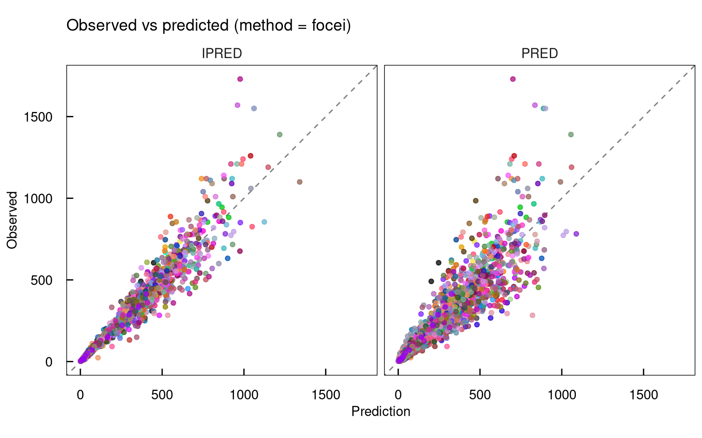

``` r

plotResiduals(mavoFit, nsim = 200, seed = 1)
```

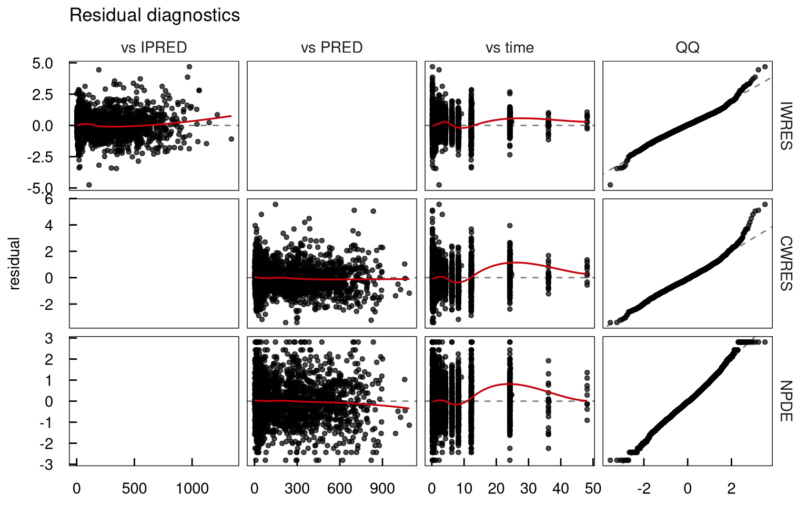

``` r

plotCombined(mavoFit, conditionsPerPage = 12)[[1]]
```

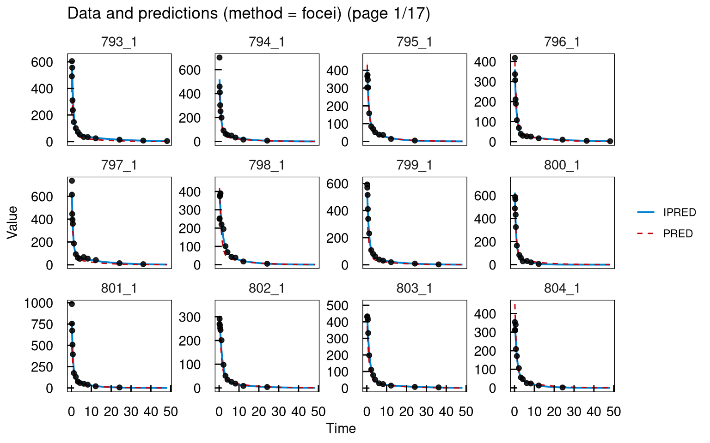

``` r

plotRandomEffects(mavoFit)
```

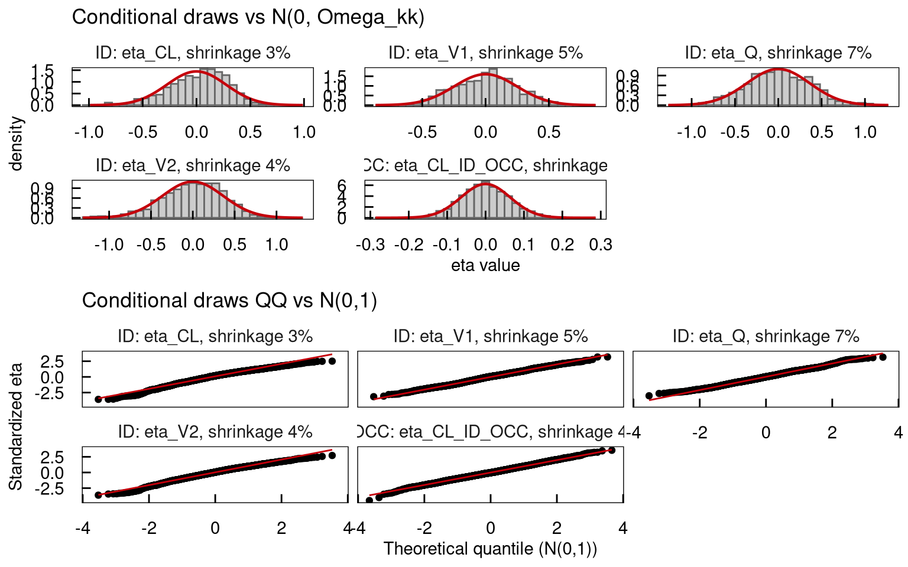

``` r

plotRandomEffects(mavoFit, covariates = c("WT", "AGE", "SEX", "HT"))
```

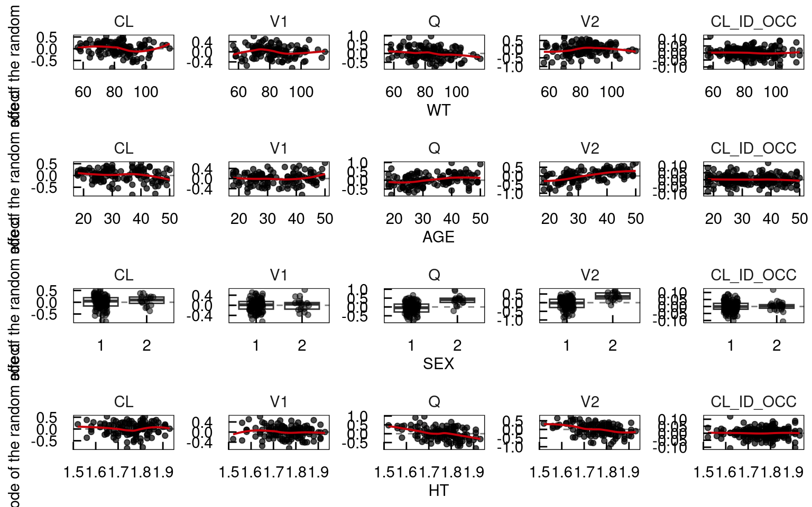

``` r

plotVPC(mavoFit, nsim = 200, bins = 8, pc = TRUE, strata = "dose", seed = 1)
```

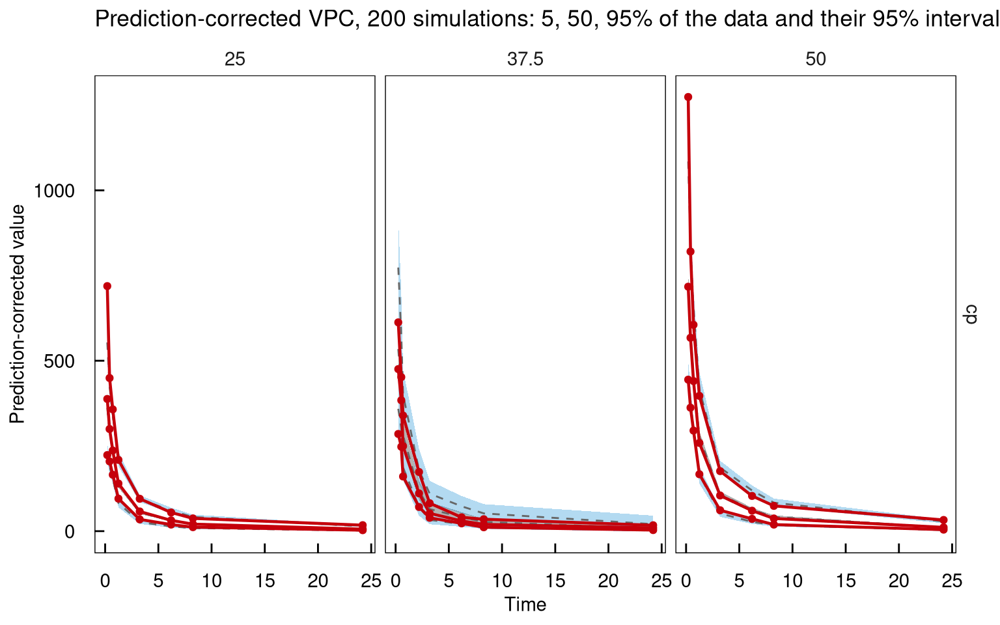

## FOCEI and SAEM

``` r

compareMethods(mavoRuns, "Mavoglurant", list(obj = mavoObj1, random = mavoRandom1, starts = mavoStarts1))
```

    #>   method     best hits failed unconverged medianSeconds totalSeconds
    #> 1  FOCEI 21597.79   69      0           1      131.9365     14084.02
    #> 2   SAEM 21627.67   20      0          29      374.3300     41735.39

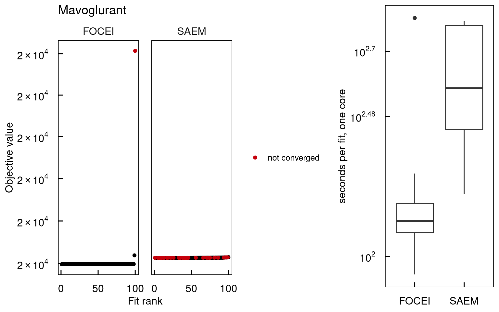

    #>          CL          V1           Q          V2   sigma_abs   sigma_rel 
    #>      3.2239      3.9139      3.2508      4.8280     -0.0998     -1.7800 
    #> omega_CL_CL omega_V1_V1   omega_Q_Q omega_V2_V2 
    #>     -1.2635     -1.3839     -1.0113     -1.0113 
    #>     SAEM 
    #> 21650.39
