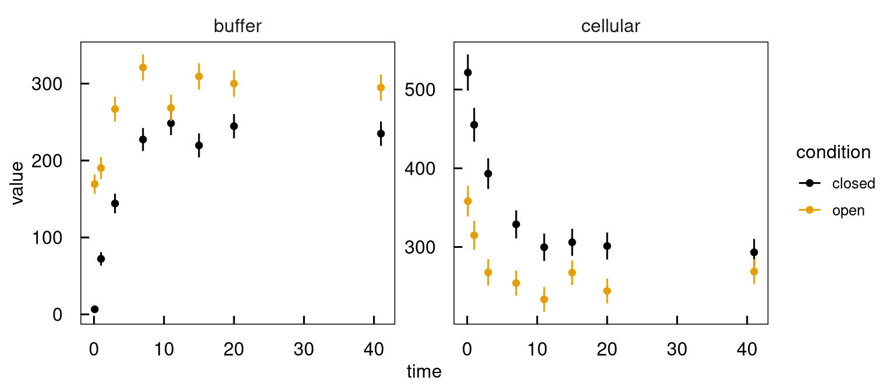
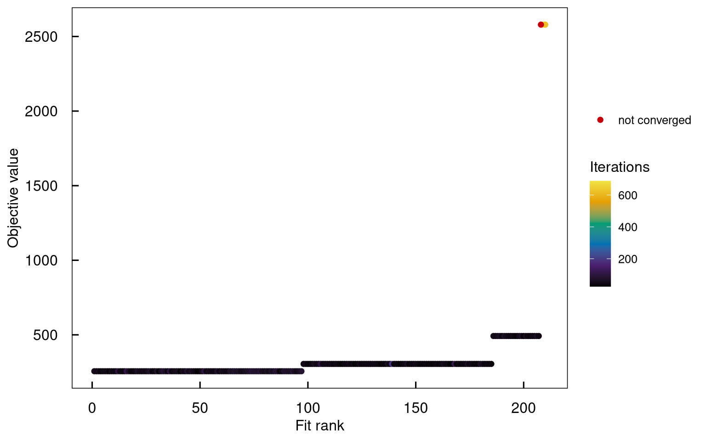
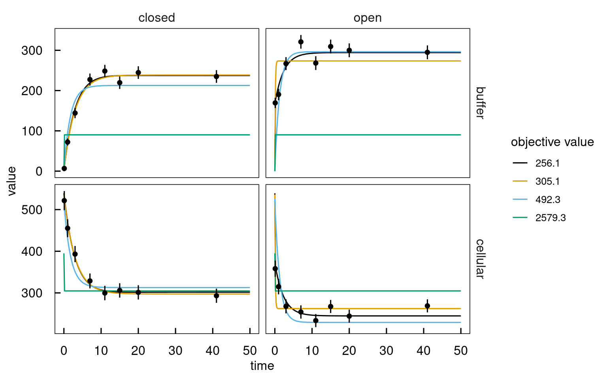
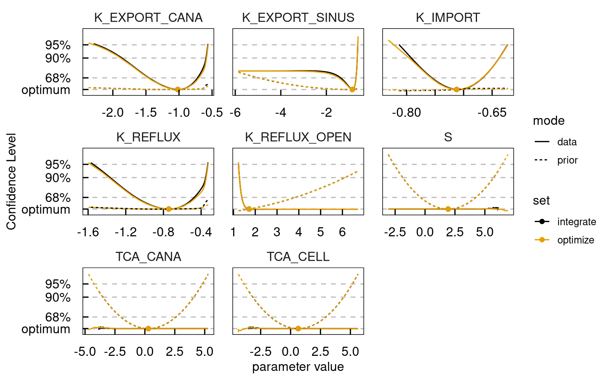
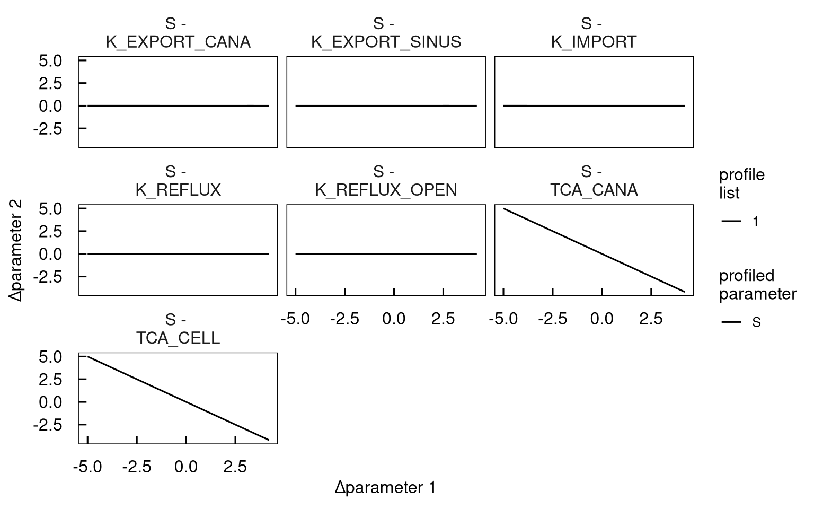
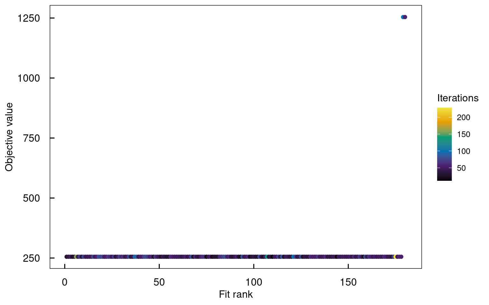
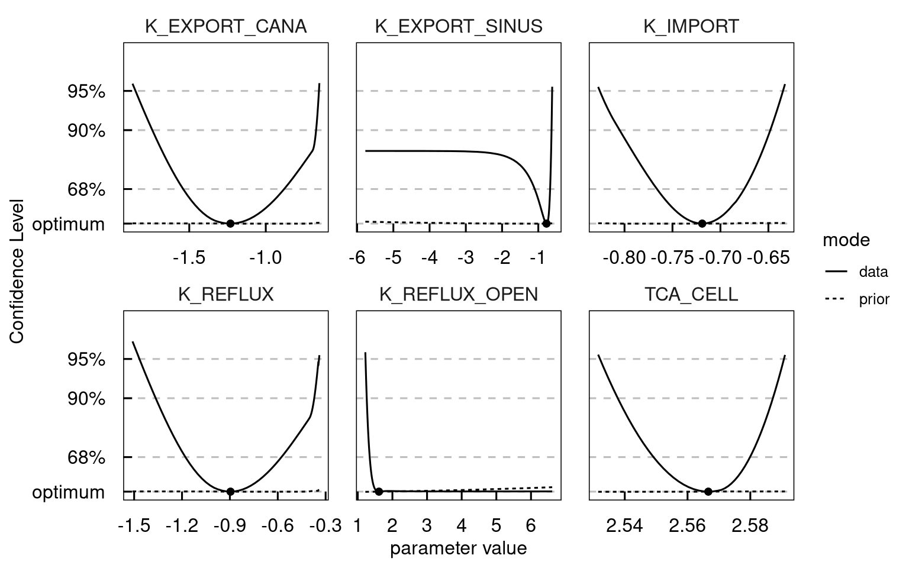
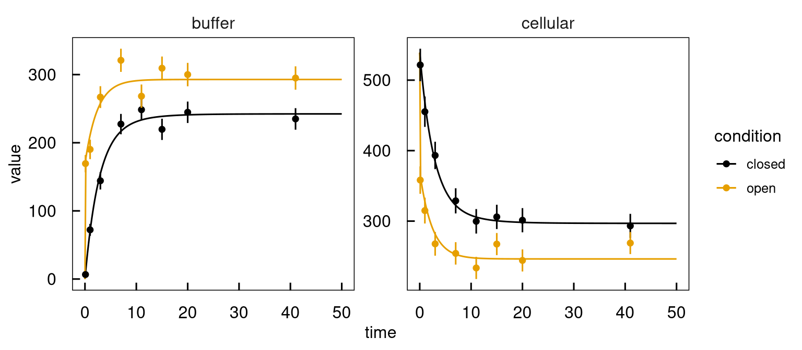
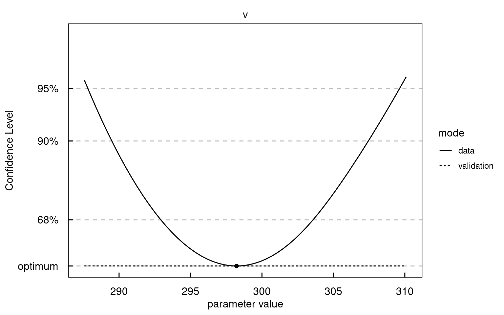
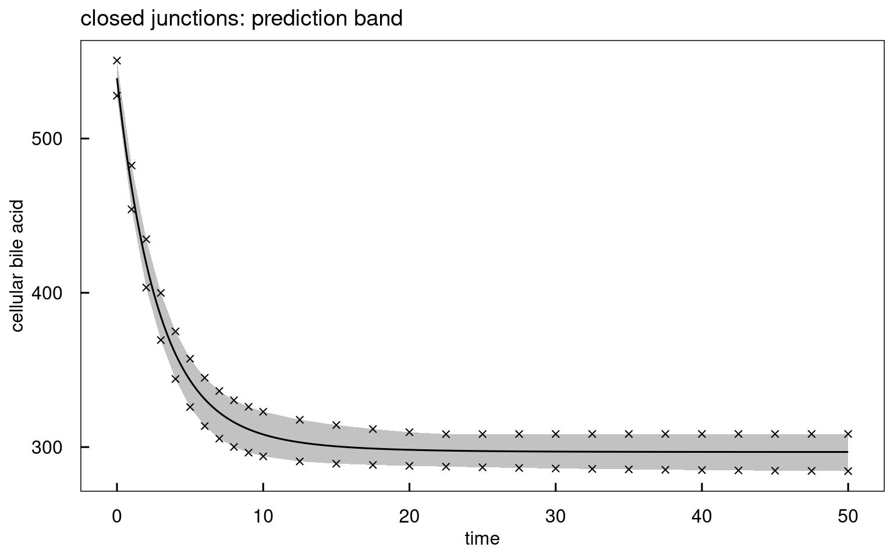

# `demo("BA_transport")`

Rendered by `dev/render-demos.R`; run it with `demo("BA_transport", package = "dMod2")`.

Bile acid transport in hepatocytes: uptake from the buffer, sinusoidal and
canalicular export, and reflux from the canaliculi. With tight junctions
opened, the reflux is faster. The demo fits both conditions, finds a structural
non-identifiability in the profiles, removes it with a steady-state start and a
fixed scale and ends with a prediction band from prediction profiles. Its
multistarts run as tasks through distributedComputing().


``` r
library(dMod2)
library(ggplot2)

.modelname <- "bamodel"
.outdir    <- file.path(tempdir(), .modelname)
if (!dir.exists(.outdir)) dir.create(.outdir, recursive = TRUE)
# generated sources and shared objects go to .outdir, see ?dMod2 for the options;
# compiling, fitting and profiling use the free cores of the local machine
options(dMod2.outdir = .outdir)
.cores <- detectFreeCores()
set.seed(5555)
```

## Data and model
Bile acid amounts in the buffer and in the cells, closed and open junctions.
A model has three parts: the prediction `x` solves the ODEs, the observation
`g` maps states to what was measured, the parametrisation `p` maps the
estimated parameters to those of the model. `g*x*p` composes them.


``` r
data(badata)
data <- as.datalist(badata)
```

``` r
plot(data)
```




``` r
reactions <- eqnlist() |>
  addReaction("TCA_buffer", "TCA_cell", "k_import*TCA_buffer", "uptake") |>
  addReaction("TCA_cell", "TCA_buffer", "k_export_sinus*TCA_cell", "sinusoidal export") |>
  addReaction("TCA_cell", "TCA_cana", "k_export_cana*TCA_cell", "canalicular export") |>
  addReaction("TCA_cana", "TCA_buffer", "k_reflux*TCA_cana", "reflux into the buffer")

model <- odemodel(reactions, modelname = "ba_ode", compile = FALSE)
x <- Xs(model)

# the cells hold the canaliculi, both seen through one scale
observables <- eqnvec(buffer = "s*TCA_buffer", cellular = "s*(TCA_cana + TCA_cell)")
g <- Y(observables, x, modelname = "ba_obs", compile = FALSE)
innerpars <- getParameters(x, g)
```

## Parameter transformation
The buffer starts empty, every other parameter is estimated on log10. Open
junctions get a reflux rate of their own.


``` r
trafo <- eqnvec() |>
  define("x~x", x = innerpars) |>
  define("TCA_buffer~0") |>
  insert("x~10^y", x = .currentSymbols, y = toupper(.currentSymbols)) |>
  branch(conditions = c("closed", "open")) |>
  insert("K_REFLUX~K_REFLUX_OPEN", conditionMatch = "open")
p <- P(trafo, modelname = "ba_trafo", compile = FALSE)

compile(g, x, p, output = .modelname, cores = .cores)

outerpars <- getParameters(p)
pouter    <- structure(rep(-1, length(outerpars)), names = outerpars)
times     <- seq(0, 50, length.out = 300)

# a weak prior keeps the non-identifiable directions finite
obj  <- normL2(data, g*x*p, attrName = "data") +
  constraintL2(pouter, sigma = 4, attrName = "prior")
```

## Multi-start fit
distributedComputing() saves the objects named in `input`, copies them with the
code and the shared objects of the model to a job folder in the working
directory and runs the code there in the background, as one task on the local
machine. In the task, `cores` holds the cores of `on`, and mstrust() runs ten
fits per core. It needs a Unix-like system; on Windows, call mstrust() itself
with `cores = .cores`. ?distributedComputing shows how to send the same code to
other machines with sshNodes() or to a SLURM cluster with slurmCluster().


``` r
job <- distributedComputing(
  mstrust(obj, pouter, sd = 4, fits = 10 * cores, cores = cores),
  on = localNode(.cores), jobname = "ba_fits", input = c("obj", "pouter")
)
job
```

```
#> Job ba_fits: 1 task on localhost (21 cores)
#> check(), wait(), get(combine = TRUE, all = FALSE), log(i), purge(local = FALSE), terminate()
```

``` r
# wait() reports the tasks done, running or failed until none runs. get() joins
# the parlists of the tasks; purge() deletes the job folders.
job$wait(interval = 5)
fits <- as.parframe(job$get())
job$purge(local = TRUE)
plotValues(fits)
```




The fits end in a few local optima, one prediction each.


``` r
.optima <- predict(g*x*p, times = times, pars = unique(subset(fits, converged)),
                   data = data)
ggplot(.optima, aes(time, value, colour = factor(round(.value, 1)),
                    group = interaction(condition, .value))) +
  geom_line() +
  geom_errorbar(data = attr(.optima, "data"),
                aes(x = time, ymin = value - sigma, ymax = value + sigma),
                inherit.aes = FALSE, width = 0) +
  geom_point(data = attr(.optima, "data"), colour = "black") +
  facet_grid(name ~ condition, scales = "free_y") +
  theme_dMod() +
  scale_color_dMod() +
  labs(colour = "objective value")
```




``` r
bestfit <- as.parvec(fits)
```

## Parameter profile likelihood
profile() follows each profile in one of two ways: `method = "integrate"`
integrates the path along which the other parameters stay optimal, and
`method = "optimize"` reoptimises them at every step. Both run here, and
plotProfile() takes the two as a list and draws them together.


``` r
profiles_integrate <- profile(obj, bestfit, whichPar = names(bestfit),
                              method = "integrate", cores = .cores,
                              limits = c(lower = -5, upper = 5),
                              stepControl = list(stop = "data"))
profiles_optimize <- profile(obj, bestfit, whichPar = names(bestfit),
                             method = "optimize", cores = .cores,
                             limits = c(lower = -5, upper = 5),
                             stepControl = list(stop = "data"))
plotProfile(list(integrate = profiles_integrate, optimize = profiles_optimize),
            mode %in% c("data", "prior"))
```




The profiles of S, TCA_CELL and TCA_CANA stay flat in the data: the three
compensate each other, as the paths show.


``` r
plotPaths(profiles_integrate, whichPar = "S")
```




## Starting from steady state
The canaliculi start in balance with the cells, at the reflux of closed
junctions, since they open only at time 0. The scale is fixed to 1, which
removes the direction.


``` r
trafo <- eqnvec() |>
  define("x~x", x = innerpars) |>
  define("TCA_buffer~0") |>
  define("TCA_cana~TCA_cell*k_export_cana/k_reflux") |>
  insert("x~10^y", x = .currentSymbols, y = toupper(.currentSymbols)) |>
  branch(conditions = c("closed", "open")) |>
  define("k_reflux~10^K_REFLUX_OPEN", conditionMatch = "open") |>
  insert("S~0")
p <- P(trafo, modelname = "ba_trafo_ss", compile = TRUE)

outerpars <- getParameters(p)
pouter    <- structure(rep(-1, length(outerpars)), names = outerpars)
obj  <- normL2(data, g*x*p, attrName = "data") +
  constraintL2(pouter, sigma = 20, attrName = "prior")
```

`wait = TRUE` waits for the tasks, returns their results and deletes the job.


``` r
fits <- distributedComputing(
  mstrust(obj, pouter, sd = 4, fits = 10 * cores, cores = cores),
  on = localNode(.cores), jobname = "ba_fits_ss", input = c("obj", "pouter"),
  wait = TRUE
) |> as.parframe()
plotValues(fits)
```




``` r
bestfit <- as.parvec(fits)

profiles <- profile(obj, bestfit, whichPar = names(bestfit), method = "integrate",
                    cores = .cores, limits = c(lower = -5, upper = 5),
                    stepControl = list(stop = "data"),
                    algoControl = list(reoptimize = TRUE))
plotProfile(profiles, mode %in% c("data", "prior"))
```




## Fixed reflux in the open condition
K_REFLUX_OPEN stays practically non-identifiable: its profile is open towards
instantaneous reflux. The reflux is fixed to a fast rate instead. K_EXPORT_SINUS
stays open towards slow export below the 68% level.


``` r
trafo <- eqnvec() |>
  define("x~x", x = innerpars) |>
  define("TCA_buffer~0") |>
  define("TCA_cana~TCA_cell*k_export_cana/k_reflux") |>
  insert("x~10^y", x = .currentSymbols, y = toupper(.currentSymbols)) |>
  branch(conditions = c("closed", "open")) |>
  define("k_reflux~10^6", conditionMatch = "open") |>
  insert("S~0")
p <- P(trafo, modelname = "ba_trafo_final", compile = TRUE)

obj     <- normL2(data, g*x*p, attrName = "data")
bestfit <- trust(obj, bestfit[getParameters(p)], rinit = 1)$argument
```

``` r
plot((g*x*p)(times, bestfit, deriv = FALSE), data)
```




``` r
# the parameters with their 95% confidence intervals, on log10
profiles <- profile(obj, bestfit, whichPar = names(bestfit), method = "integrate",
                    cores = .cores, limits = c(lower = -5, upper = 5),
                    algoControl = list(reoptimize = TRUE))
confint(profiles, level = 0.95)
```

```
#>                          name      value      lower      upper
#> K_EXPORT_CANA   K_EXPORT_CANA -1.2565416 -1.8467086 -0.6678071
#> K_EXPORT_SINUS K_EXPORT_SINUS -0.7632620       -Inf -0.6180828
#> K_IMPORT             K_IMPORT -0.7173893 -0.8133183 -0.6346371
#> K_REFLUX             K_REFLUX -0.9155095 -1.4632941 -0.3409976
#> TCA_CELL             TCA_CELL  2.5685418  2.5459922  2.5905578
```

## Prediction profile
The cellular bile acid at time t becomes a parameter v, tied to the model by a
data point with a small sigma. Profiling v gives the confidence interval of the
prediction; with a small validation term, the total is the prediction profile.


``` r
.predict <- function(t) {
  objv <- normL2(data, g*x*p, times = t, attrName = "data") +
    datapointL2(name = "cellular", time = t, parameter = "v", sigma = 0.1,
                attrName = "validation", condition = "closed")
  pred <- (g*x*p)(t, bestfit, deriv = FALSE)[["closed"]]
  v0   <- unname(pred[pred[, "time"] == t, "cellular"])
  fit  <- trust(objv, c(v = v0, bestfit), rinit = 1)
  profile(objv, fit$argument, "v", method = "integrate",
          stepControl = list(stop = "data"),
          algoControl = list(reoptimize = TRUE))
}

prof20 <- .predict(20)
plotProfile(prof20, mode %in% c("validation", "data"))
```




``` r
confint(prof20, val.column = "data")
```

```
#>   name   value    lower    upper
#> v    v 298.223 287.8172 309.6298
```

``` r
# the interval at several times, drawn as a band around the prediction
.band <- do.call(rbind, lapply(c(0:10, seq(12.5, 50, by = 2.5)), function(t)
  data.frame(time = t, confint(.predict(t), val.column = "data")[c("lower", "upper")])))

.pred <- subset(as.data.frame((g*x*p)(times, bestfit, deriv = FALSE)),
                condition == "closed" & name == "cellular")
ggplot(.pred, aes(time, value)) +
  geom_ribbon(data = .band, aes(x = time, ymin = lower, ymax = upper),
              inherit.aes = FALSE, alpha = 0.3) +
  geom_line() +
  geom_point(data = .band, aes(y = lower), shape = 4) +
  geom_point(data = .band, aes(y = upper), shape = 4) +
  theme_dMod() +
  labs(x = "time", y = "cellular bile acid", title = "closed junctions: prediction band")
```




