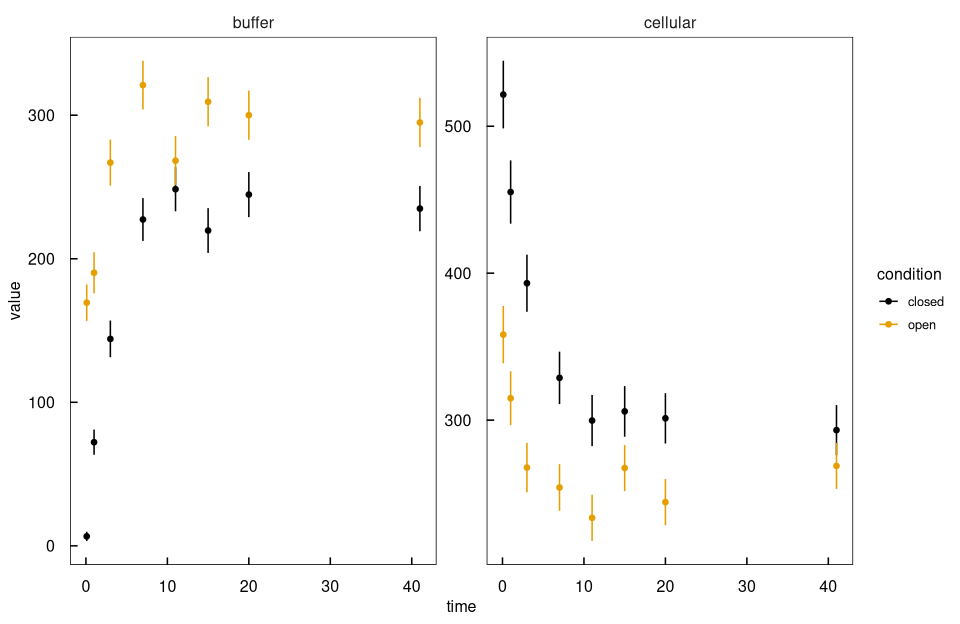
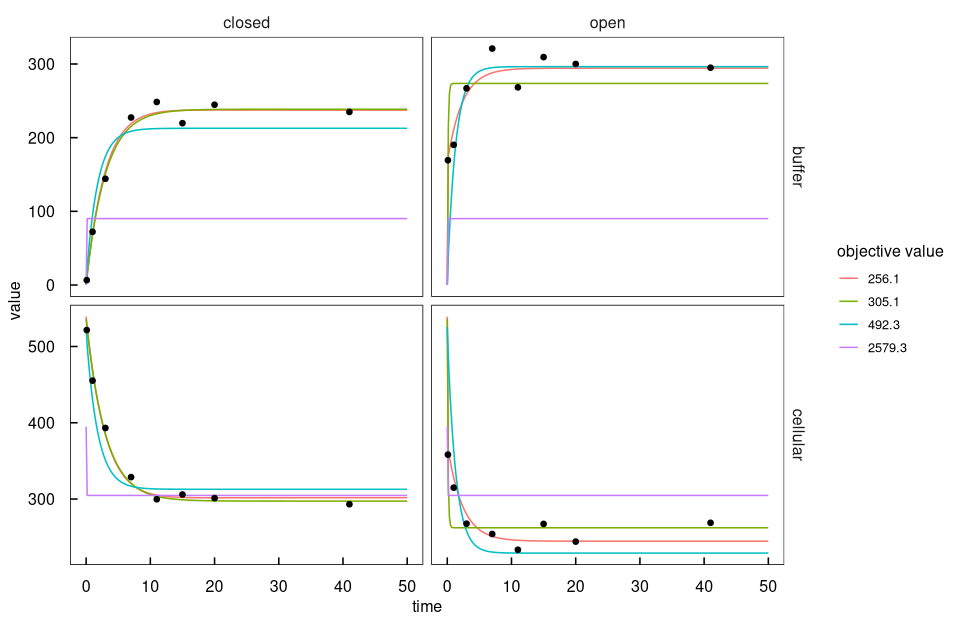
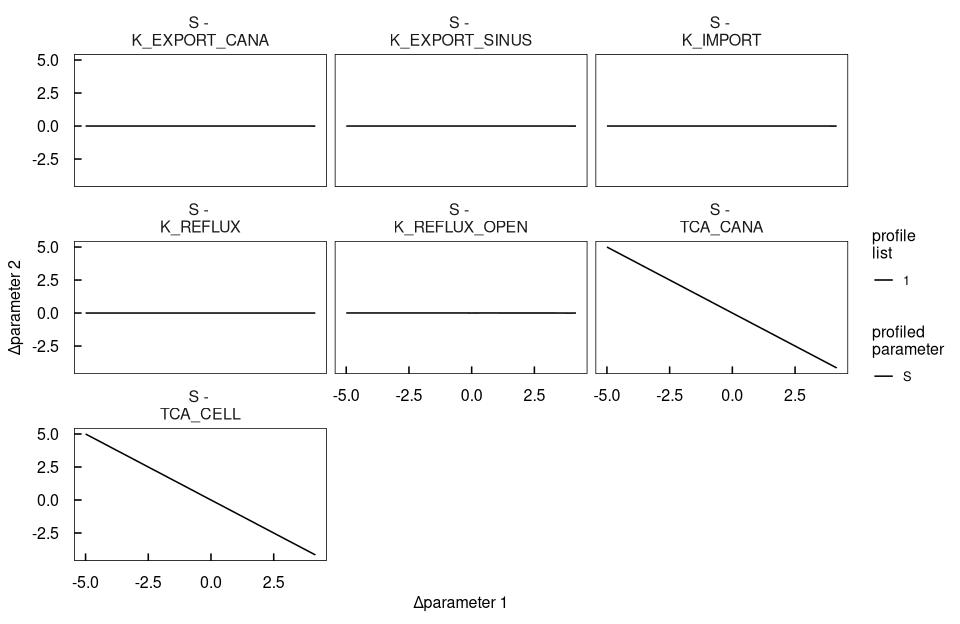
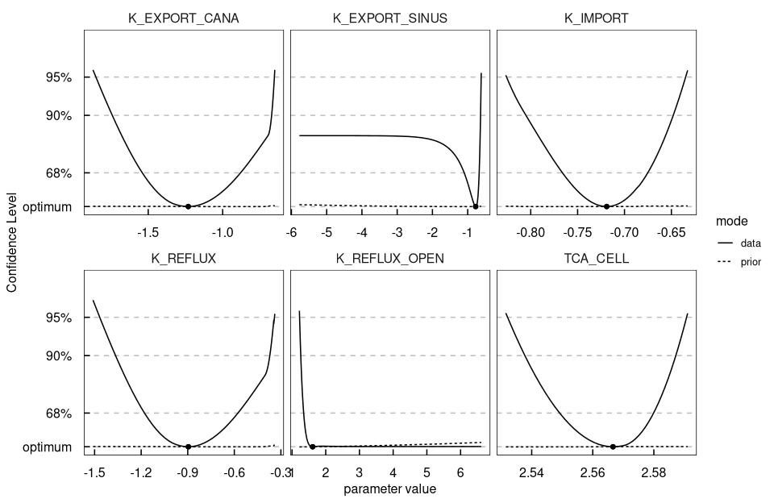
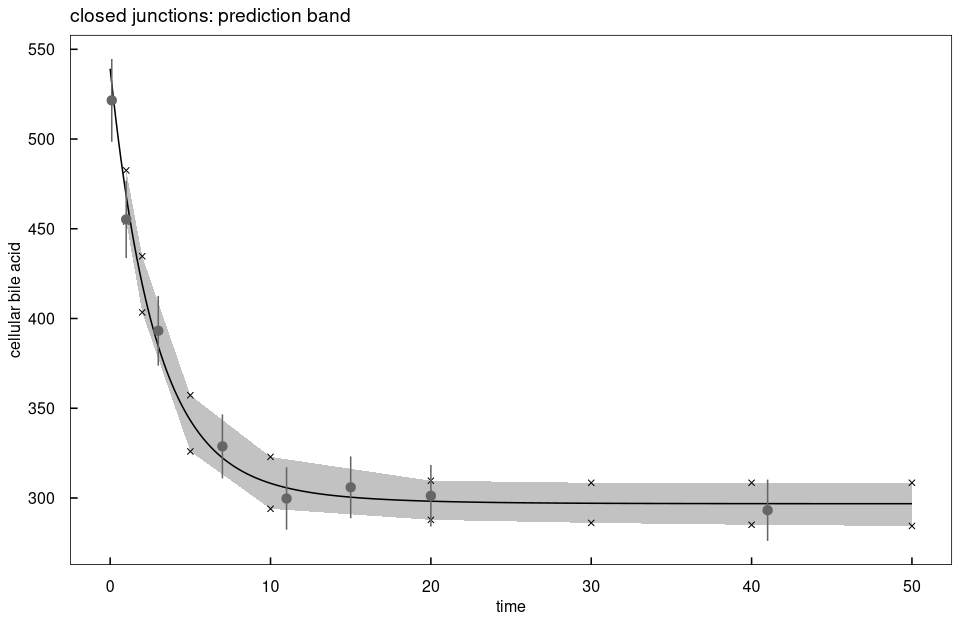

# `demo("BA_transport")`

Rendered by `dev/render-demos.R`; run it with `demo("BA_transport", package = "dMod2")`.

Bile acid transport in hepatocytes: uptake from the buffer, sinusoidal and
canalicular export, and reflux from the canaliculi. With tight junctions
opened, the reflux is faster. The demo fits both conditions, finds a structural
non-identifiability in the profiles, removes it with a steady-state start and
ends with a prediction band from prediction profiles.


``` r
library(dMod2)
library(ggplot2)

.outdir <- file.path(tempdir(), "bamodel")
if (!dir.exists(.outdir)) dir.create(.outdir, recursive = TRUE)
.cores <- 4
set.seed(5555)
```

## Data and model
Bile acid amounts in the buffer and in the cells, closed and open junctions.
A model has three parts: the prediction `x` solves the ODEs, the observation
`g` maps states to what was measured, the parametrisation `p` maps the
estimated parameters to those of the model. `g*x*p` composes them.


``` r
data(badata)
data <- as.datalist(badata)
plot(data)
```



``` r
reactions <- eqnlist() |>
  addReaction("TCA_buffer", "TCA_cell", "k_import*TCA_buffer", "uptake") |>
  addReaction("TCA_cell", "TCA_buffer", "k_export_sinus*TCA_cell", "sinusoidal export") |>
  addReaction("TCA_cell", "TCA_cana", "k_export_cana*TCA_cell", "canalicular export") |>
  addReaction("TCA_cana", "TCA_buffer", "k_reflux*TCA_cana", "reflux into the buffer")

model <- odemodel(reactions, modelname = "ba_ode", compile = FALSE, outdir = .outdir)
x <- Xs(model)

# the cells hold the canaliculi, both seen through one scale
observables <- eqnvec(buffer = "s*TCA_buffer", cellular = "s*(TCA_cana + TCA_cell)")
g <- Y(observables, x, modelname = "ba_obs", compile = FALSE, outdir = .outdir)
innerpars <- getParameters(x, g)
```

## Two conditions
The buffer starts empty, every other parameter is estimated on log10. Open
junctions get a reflux rate of their own.


``` r
trafo <- eqnvec() |>
  define("x~x", x = innerpars) |>
  define("TCA_buffer~0") |>
  insert("x~10^y", x = .currentSymbols, y = toupper(.currentSymbols)) |>
  branch(conditions = c("closed", "open")) |>
  insert("K_REFLUX~K_REFLUX_OPEN", conditionMatch = "open")
p <- P(trafo, modelname = "ba_trafo", compile = FALSE, outdir = .outdir)

compile(g, x, p, output = "bamodel", cores = .cores)

outerpars <- getParameters(p)
pouter    <- structure(rep(-1, length(outerpars)), names = outerpars)
times     <- seq(0, 50, length.out = 300)

# a weak prior keeps the non-identifiable directions finite
obj  <- normL2(data, g*x*p, attrName = "data") +
  constraintL2(pouter, sigma = 4, attrName = "prior")
fits <- mstrust(obj, pouter, sd = 4, fits = 50, cores = .cores, iterlim = 1000,
                resultPath = .outdir)
fits <- as.parframe(fits)
plotValues(fits)
```


The fits end in a few local optima, one prediction each.


``` r
.optima <- predict(g*x*p, times = times, pars = unique(fits), data = data)
ggplot(.optima, aes(time, value, colour = factor(round(.value, 1)),
                    group = interaction(condition, .value))) +
  geom_line() +
  geom_point(data = attr(.optima, "data"), colour = "black") +
  facet_grid(name ~ condition, scales = "free_y") +
  theme_dMod() +
  labs(colour = "objective value")
```



``` r
bestfit <- as.parvec(fits)
```

## Profiles: a structural non-identifiability
The profiles of S, TCA_CELL and TCA_CANA stay flat in the data: the three
compensate each other, as the paths show.


``` r
profiles <- profile(obj, bestfit, whichPar = names(bestfit), method = "integrate",
                    cores = .cores, limits = c(lower = -5, upper = 5),
                    stepControl = list(stop = "data"))
plotProfile(profiles, mode %in% c("data", "prior"))
```


``` r
plotPaths(profiles, whichPar = "S")
```



## A steady-state start
The canaliculi start in balance with the cells, at the reflux of closed
junctions, since they open only at time 0. The scale is fixed to 1, which
removes the direction.


``` r
trafo <- eqnvec() |>
  define("x~x", x = innerpars) |>
  define("TCA_buffer~0") |>
  define("TCA_cana~TCA_cell*k_export_cana/k_reflux") |>
  insert("x~10^y", x = .currentSymbols, y = toupper(.currentSymbols)) |>
  branch(conditions = c("closed", "open")) |>
  define("k_reflux~10^K_REFLUX_OPEN", conditionMatch = "open") |>
  insert("S~0")
p <- P(trafo, modelname = "ba_trafo_ss", compile = TRUE, outdir = .outdir)

outerpars <- getParameters(p)
pouter    <- structure(rep(-1, length(outerpars)), names = outerpars)
obj  <- normL2(data, g*x*p, attrName = "data") +
  constraintL2(pouter, sigma = 20, attrName = "prior")
fits <- as.parframe(mstrust(obj, pouter, sd = 4, fits = 50, cores = .cores,
                            iterlim = 1000, resultPath = .outdir))
plotValues(fits)
```


``` r
bestfit <- as.parvec(fits)

profiles <- profile(obj, bestfit, whichPar = names(bestfit), method = "integrate",
                    cores = .cores, limits = c(lower = -5, upper = 5),
                    stepControl = list(stop = "data"),
                    algoControl = list(reoptimize = TRUE))
plotProfile(profiles, mode %in% c("data", "prior"))
```



## Fast reflux in the open condition
K_REFLUX_OPEN stays practically non-identifiable: its profile is open towards
instantaneous reflux. The reflux is fixed to a fast rate instead. K_EXPORT_SINUS
stays open towards slow export below the 68% level.


``` r
trafo <- eqnvec() |>
  define("x~x", x = innerpars) |>
  define("TCA_buffer~0") |>
  define("TCA_cana~TCA_cell*k_export_cana/k_reflux") |>
  insert("x~10^y", x = .currentSymbols, y = toupper(.currentSymbols)) |>
  branch(conditions = c("closed", "open")) |>
  define("k_reflux~10^6", conditionMatch = "open") |>
  insert("S~0")
p <- P(trafo, modelname = "ba_trafo_final", compile = TRUE, outdir = .outdir)

obj     <- normL2(data, g*x*p, attrName = "data")
bestfit <- trust(obj, bestfit[getParameters(p)], rinit = 1, rmax = 10,
                 iterlim = 1000)$argument
plot((g*x*p)(times, bestfit), data)
```


``` r
# the parameters with their 95% confidence intervals, on log10
profiles <- profile(obj, bestfit, names(bestfit), method = "integrate",
                    cores = .cores, limits = c(lower = -5, upper = 5),
                    algoControl = list(reoptimize = TRUE))
confint(profiles, level = 0.95)
```

```
#>                          name      value      lower      upper
#> K_EXPORT_CANA   K_EXPORT_CANA -1.2565428 -1.8467084 -0.6678021
#> K_EXPORT_SINUS K_EXPORT_SINUS -0.7632615       -Inf -0.6180824
#> K_IMPORT             K_IMPORT -0.7173892 -0.8133181 -0.6346370
#> K_REFLUX             K_REFLUX -0.9155106 -1.4632952 -0.3409975
#> TCA_CELL             TCA_CELL  2.5685418  2.5459922  2.5905578
```

## Prediction profile
The cellular bile acid at time t becomes a parameter v, tied to the model by a
data point with a small sigma. Profiling v gives the confidence interval of the
prediction; with a small validation term, the total is the prediction profile.


``` r
.predict <- function(t) {
  objv <- normL2(data, g*x*p, times = t, attrName = "data") +
    datapointL2(name = "cellular", time = t, parameter = "v", sigma = 0.1,
                attrName = "validation", condition = "closed")
  v0  <- unname((g*x*p)(t, bestfit, deriv = FALSE)[["closed"]][1, "cellular"])
  fit <- trust(objv, c(v = v0, bestfit), rinit = 1, rmax = 10, iterlim = 1000)
  profile(objv, fit$argument, "v", method = "integrate",
          stepControl = list(stop = "data"),
          algoControl = list(reoptimize = TRUE))
}

prof20 <- .predict(20)
plotProfile(prof20, mode %in% c("validation", "data"))
```


``` r
confint(prof20, val.column = "data")
```

```
#>   name    value    lower    upper
#> v    v 298.2246 287.8172 309.6322
```

``` r
# the interval at several times, drawn as a band around the prediction
.band <- do.call(rbind, lapply(c(1, 2, 5, 10, 20, 30, 40, 50), function(t)
  data.frame(time = t, confint(.predict(t), val.column = "data")[c("lower", "upper")])))

.pred <- subset(as.data.frame((g*x*p)(times, bestfit, deriv = FALSE)),
                condition == "closed" & name == "cellular")
ggplot(.pred, aes(time, value)) +
  geom_ribbon(data = .band, aes(x = time, ymin = lower, ymax = upper),
              inherit.aes = FALSE, alpha = 0.3) +
  geom_line() +
  geom_point(data = .band, aes(y = lower), shape = 4) +
  geom_point(data = .band, aes(y = upper), shape = 4) +
  geom_pointrange(data = subset(badata, condition == "closed" & name == "cellular"),
                  aes(ymin = value - sigma, ymax = value + sigma), colour = "grey40") +
  theme_dMod() +
  labs(x = "time", y = "cellular bile acid", title = "closed junctions: prediction band")
```



