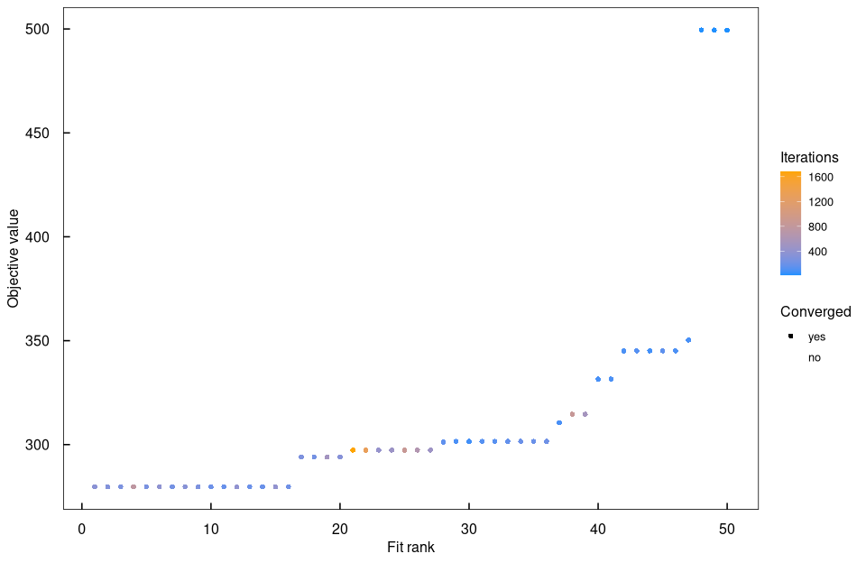
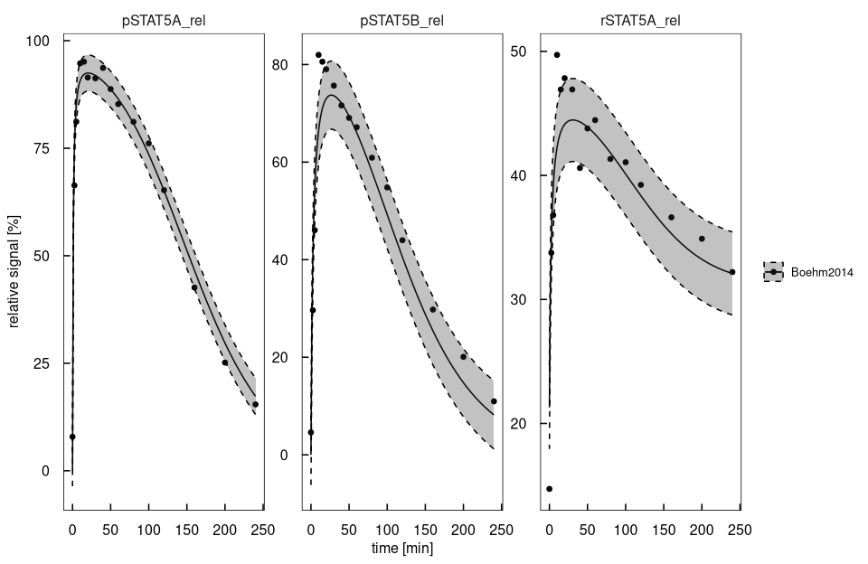
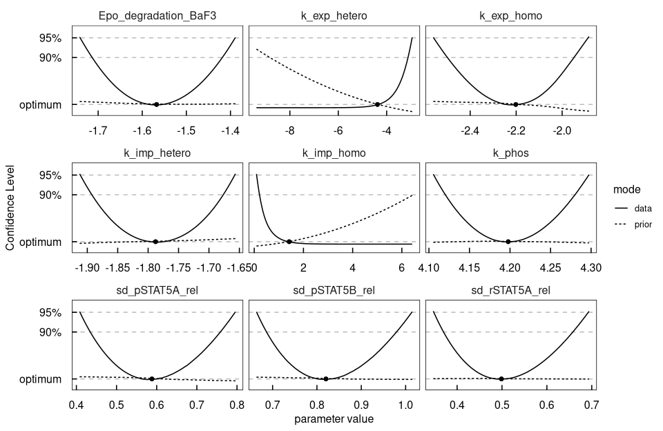

# `demo("Boehm_JProteomeRes2014")`

Rendered by `dev/render-demos.R`; run it with `demo("Boehm_JProteomeRes2014", package = "dMod2")`.

STAT5 dimerisation after Epo stimulation, from reactions to profile likelihoods:
multi-start fit, an error model by restricted maximum likelihood, confidence
intervals and a cross-check against the shipped PEtab form.
Boehm et al. (2014) J Proteome Res, doi:10.1021/pr5006923.


``` r
library(dMod2)
library(ggplot2)
set.seed(5555)

.modelname <- "boehm"
# generated sources, objects and libraries go here, not the working directory
.outdir    <- file.path(tempdir(), .modelname)
if (!dir.exists(.outdir)) dir.create(.outdir, recursive = TRUE)
.petabDir <- system.file("extdata", "petab_boehm", package = "dMod2")
.cores    <- 8
```

## Reactions
BaF3-EpoR cells respond to erythropoietin: STAT5A and STAT5B are phosphorylated,
form the dimers ApA, ApB and BpB, move into the nucleus and return. The Epo
stimulus decays and enters the rates in closed form, so `time` appears in a rate.
Nuclear species get their compartment before the reactions that produce them.


``` r
epo <- "1.25e-7*exp(-Epo_degradation_BaF3*time)"

reactions <- eqnlist() |>
  assignCompartment(nucpApA = "nuc", nucpApB = "nuc", nucpBpB = "nuc", volume = "0.45") |>
  addReaction("2*STAT5A", "pApA", paste0("k_phos*", epo, "*STAT5A^2"),
              "STAT5A-STAT5A phosphorylation", compartment = "cyt") |>
  addReaction("STAT5A + STAT5B", "pApB", paste0("k_phos*", epo, "*STAT5A*STAT5B"),
              "STAT5A-STAT5B phosphorylation", compartment = "cyt") |>
  addReaction("2*STAT5B", "pBpB", paste0("k_phos*", epo, "*STAT5B^2"),
              "STAT5B-STAT5B phosphorylation", compartment = "cyt") |>
  addReaction("pApA", "nucpApA", "k_imp_homo*pApA", "pApA import", compartment = "cyt") |>
  addReaction("pApB", "nucpApB", "k_imp_hetero*pApB", "pApB import", compartment = "cyt") |>
  addReaction("pBpB", "nucpBpB", "k_imp_homo*pBpB", "pBpB import", compartment = "cyt") |>
  addReaction("nucpApA", "2*STAT5A", "k_exp_homo*nucpApA", "pApA export", compartment = "nuc") |>
  addReaction("nucpApB", "STAT5A + STAT5B", "k_exp_hetero*nucpApB", "pApB export", compartment = "nuc") |>
  addReaction("nucpBpB", "2*STAT5B", "k_exp_homo*nucpBpB", "pBpB export", compartment = "nuc") |>
  setCompartmentVolume(cyt = "1.4")
```

The volumes enter the right-hand side as the ratios that convert a flux from the
compartment it is written in into that of the species it changes.


``` r
as.eqnvec(reactions)
```

```
#> Idx   Inner <- Outer
#>   1 nucpApA <- 1*(k_imp_homo*pApA)*(1.4/0.45)-1*(k_exp_homo*nucpApA)
#>   2 nucpApB <- 1*(k_imp_hetero*pApB)*(1.4/0.45)-1*(k_exp_hetero*nucpApB)
#>   3 nucpBpB <- 1*(k_imp_homo*pBpB)*(1.4/0.45)-1*(k_exp_homo*nucpBpB)
#>   4    pApA <- 1*(k_phos*1.25e-7*exp(-Epo_degradation_BaF3*time)*STAT5A^2)-1*(k_imp_homo*pApA)
#>   5    pApB <- 1*(k_phos*1.25e-7*exp(-Epo_degradation_BaF3*time)*STAT5A*STAT5B)-1*(k_imp_hetero*pApB)
#>   6    pBpB <- 1*(k_phos*1.25e-7*exp(-Epo_degradation_BaF3*time)*STAT5B^2)-1*(k_imp_homo*pBpB)
#>   7  STAT5A <- -2*(k_phos*1.25e-7*exp(-Epo_degradation_BaF3*time)*STAT5A^2)-1*(k_phos*1.25e-7*exp(-Epo_degradation_BaF3*time)*STAT5A*STAT5B)+2*(k_exp_homo*nucpApA)*(0.45/1.4)+1*(k_exp_hetero*nucpApB)*(0.45/1.4)
#>   8  STAT5B <- -1*(k_phos*1.25e-7*exp(-Epo_degradation_BaF3*time)*STAT5A*STAT5B)-2*(k_phos*1.25e-7*exp(-Epo_degradation_BaF3*time)*STAT5B^2)+1*(k_exp_hetero*nucpApB)*(0.45/1.4)+2*(k_exp_homo*nucpBpB)*(0.45/1.4)
```

## Prediction, observation and error model
Only relative quantities were measured, mixed by the isotope ratio specC17. The
error model has one standard deviation per observable, estimated with the rest.


``` r
myOptions <- list(atol = 1e-8, rtol = 1e-6, maxattempts = 100L, maxsteps = 1e6)

model <- odemodel(reactions, modelname = "boehm_ode", compile = FALSE, outdir = .outdir)
x <- Xs(model, options = myOptions)

observables <- eqnvec(
  pSTAT5A_rel = "(100*pApB + 200*pApA*specC17)/(pApB + STAT5A*specC17 + 2*pApA*specC17)",
  pSTAT5B_rel = "-(100*pApB - 200*pBpB*(specC17 - 1))/((STAT5B*(specC17 - 1) - pApB) + 2*pBpB*(specC17 - 1))",
  rSTAT5A_rel = "(100*pApB + 100*STAT5A*specC17 + 200*pApA*specC17)/(2*pApB + STAT5A*specC17 + 2*pApA*specC17 - STAT5B*(specC17 - 1) - 2*pBpB*(specC17 - 1))"
)
errors <- eqnvec(
  pSTAT5A_rel = "sd_pSTAT5A_rel",
  pSTAT5B_rel = "sd_pSTAT5B_rel",
  rSTAT5A_rel = "sd_rSTAT5A_rel"
)

g <- Y(observables, x, modelname = "boehm_obs", attachInput = FALSE,
       compile = FALSE, outdir = .outdir)
e <- Y(errors, g, modelname = "boehm_err", attachInput = FALSE,
       compile = FALSE, outdir = .outdir)
```

## Parameter transformation
Initial dimers are zero, the STAT5 pool is split by the measured ratio, and the
nine estimated parameters are on log10.


``` r
innerpars <- getParameters(model, g, e)
estimated <- c("Epo_degradation_BaF3", "k_exp_hetero", "k_exp_homo", "k_imp_hetero",
               "k_imp_homo", "k_phos", "sd_pSTAT5A_rel", "sd_pSTAT5B_rel", "sd_rSTAT5A_rel")

p <- eqnvec() |>
  define("x~x", x = innerpars) |>
  define("x~0", x = c("pApA", "pApB", "pBpB", "nucpApA", "nucpApB", "nucpBpB")) |>
  insert("STAT5A ~ 207.6*ratio") |>
  insert("STAT5B ~ 207.6 - 207.6*ratio") |>
  insert("ratio ~ 0.693") |>
  insert("specC17 ~ 0.107") |>
  insert("x~exp10(x)", x = estimated) |>
  P(modelname = "boehm_trafo", condition = "Boehm2014", compile = FALSE, outdir = .outdir)
```

One call compiles ODE, sensitivities, observation, error model and trafo
together into one shared object.


``` r
compile(g, x, p, e, output = .modelname, cores = 4)
prd       <- g*x*p
outerpars <- getParameters(prd)
```

## Objective and multi-start fit
Two directions are practically non-identifiable, so a weak prior keeps the
dynamic parameters finite. It stays off the standard deviations, whose REML
estimate below solves the stationarity condition of the data term alone.


``` r
data(boehm)
data <- as.datalist(boehm)

pouter <- structure(rep(-1, length(outerpars)), names = outerpars)
dyn    <- setdiff(outerpars, grep("^sd_", outerpars, value = TRUE))
obj    <- normL2(data, prd, e) + constraintL2(pouter[dyn], sigma = 4)
```

Fifty trust-region fits from random starts, sorted by value: the lowest
plateau holds the runs that reached the best optimum.


``` r
fits <- mstrust(obj, center = pouter, sd = 3, fits = 50, cores = .cores,
                rinit = 0.1, rmax = 10, iterlim = 5000)
fits <- as.parframe(fits)
plotValues(fits, tol = 0.1, value < 1e4)
```



``` r
best <- as.parvec(fits)
```

## Error model by restricted maximum likelihood
Maximum likelihood underestimates the standard deviations, because the fitted
mean shrinks the residuals. `reml()` weights each residual by one minus its
leverage, the stationarity condition of the restricted likelihood (Patterson
and Thompson 1971), which leaves the standard deviations unbiased.


``` r
remlfit <- reml(obj, best)
rbind(ML = best[remlfit$errpars], REML = remlfit$argument[remlfit$errpars])
```

```
#>      sd_pSTAT5A_rel sd_pSTAT5B_rel sd_rSTAT5A_rel
#> ML        0.5881682      0.8202413      0.4987665
#> REML      0.6254118      0.8442062      0.5248506
```

``` r
remlfit$dof     # data points minus the summed leverage, per observable
```

```
#> pSTAT5A_rel pSTAT5B_rel rSTAT5A_rel 
#>     13.6778     14.2216     14.1006
```

``` r
remlfit$rank    # effective number of mean parameters
```

```
#> [1] 6
```

The summed leverage per observable adds up to the rank, which stays below the
nominal number of mean parameters.


``` r
lev <- remlLeverage(obj, best)
tapply(lev$leverage, lev$name, sum)
```

```
#> pSTAT5A_rel pSTAT5B_rel rSTAT5A_rel 
#>    2.367583    1.743831    1.888586
```

## Fit and uncertainty band
One standard deviation of the REML error model around the prediction.


``` r
pars   <- remlfit$argument
times  <- seq(0, 240, length.out = 200)
prdout <- as.data.frame(prd(times, pars, deriv = FALSE), errfn = e)

plot(prd(times, pars, deriv = FALSE), data) +
  geom_ribbon(data = prdout, aes(x = time, ymin = value - sigma, ymax = value + sigma),
              linetype = "dashed", alpha = 0.3) +
  labs(x = "time [min]", y = "relative signal [%]", colour = NULL, fill = NULL)
```



## Profile likelihood
A profile re-optimises every other parameter while one is held away from the
optimum, so the interval comes from the likelihood itself (Raue et al. 2009).
`profileThreshold()` gives the threshold once for `profile()`, `plotProfile()`
and `confint()`; `method = "F"` calibrates it for the finite sample, with the
effective rank of the REML fit as the number of mean parameters.


``` r
nd     <- sum(vapply(data, nrow, 0L))
thr_95 <- profileThreshold(0.95, method = "F", n = nd, p = remlfit$rank)
thr_90 <- profileThreshold(0.90, method = "F", n = nd, p = remlfit$rank)
```

The intervals are taken on the data term; the prior only keeps the fit finite.


``` r
profiles <- profile(
  obj, best, names(best), limits = c(-5, 5), cores = length(best), delta = thr_95,
  stepControl = list(stepsize = 1e-4, min = 1e-4, max = Inf,
                     atol = 1e-3, rtol = 1e-3, limit = 200, stop = "data"),
  algoControl = list(reoptimize = TRUE),
  optControl  = list(rinit = 0.1, rmax = 10, iterlim = 20))

plotProfile(profiles, mode %in% c("data", "prior"),
            threshold = c("90%" = thr_90, "95%" = thr_95))
```



``` r
confint(profiles, level = 0.95, val.column = "data",
        method = "F", n = nd, p = remlfit$rank)
```

```
#>                                      name      value       lower      upper
#> Epo_degradation_BaF3 Epo_degradation_BaF3 -1.5674986 -1.74084952 -1.3892968
#> k_exp_hetero                 k_exp_hetero -4.3809569        -Inf -2.9487896
#> k_exp_homo                     k_exp_homo -2.2016253 -2.55913046 -1.8872483
#> k_imp_hetero                 k_imp_hetero -1.7877407 -1.91147214 -1.6576290
#> k_imp_homo                     k_imp_homo  1.4205654  0.09620245        Inf
#> k_phos                             k_phos  4.1977926  4.10595688  4.2971059
#> sd_pSTAT5A_rel             sd_pSTAT5A_rel  0.5881682  0.40896806  0.7952649
#> sd_pSTAT5B_rel             sd_pSTAT5B_rel  0.8202413  0.66406353  1.0139488
#> sd_rSTAT5A_rel             sd_rSTAT5A_rel  0.4987665  0.34804945  0.6923076
```

For k_imp_homo and k_exp_hetero the data term stays level and only the prior
rises: homodimer import is faster than phosphorylation, and the heterodimer
barely returns within 240 minutes. Those intervals stay open on one side.
## Cross-check against the PEtab form of the same problem
The import rebuilds the model from SBML and the tables. At the published
optimum both forms give the same sum of squares. The explicit modelname keeps
the import's files apart from the hand-built ones.


``` r
.pars     <- read.delim(file.path(.petabDir, "parameters_Boehm_JProteomeRes2014.tsv"))
.pars     <- .pars[.pars$estimate == 1, ]
published <- setNames(log10(.pars$nominalValue), .pars$parameterId)[outerpars]

petab <- importPEtab(file.path(.petabDir, "Boehm.yaml"), backend = "cppDE", cores = 4,
                     modelname = "boehm_petab", outdir = .outdir, options = myOptions)
stopifnot(setequal(names(petab$bestfit), outerpars))
c(hand  = attr(obj(published, deriv = FALSE), "chi2"),
  PEtab = attr(petab$obj(published, deriv = FALSE), "chi2"))
```

```
#>  hand.data PEtab.data 
#>   47.97632   47.97632
```

