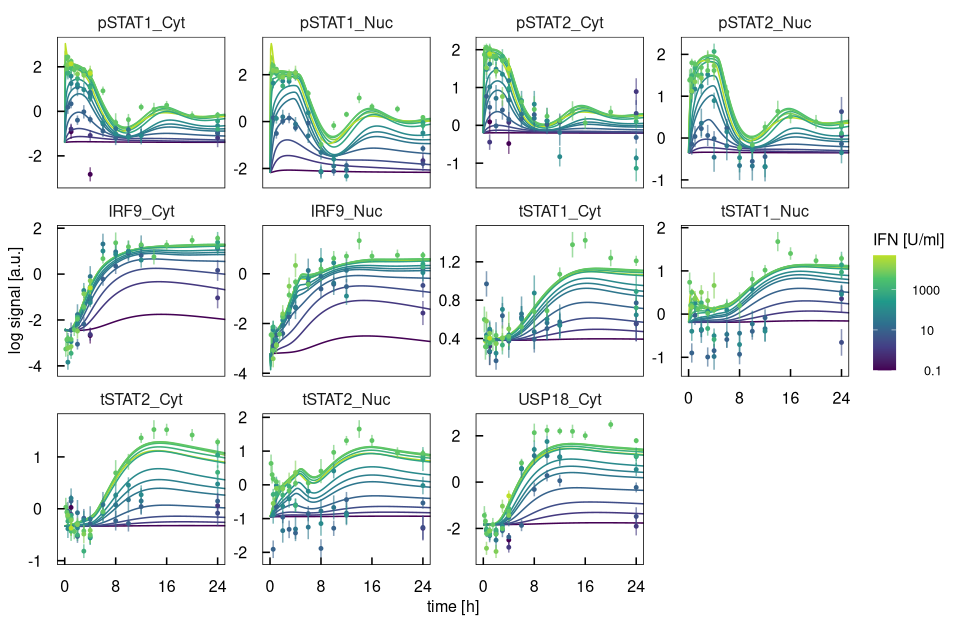
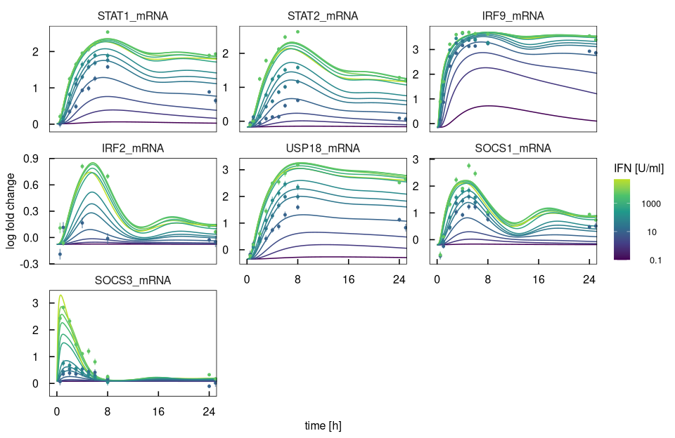
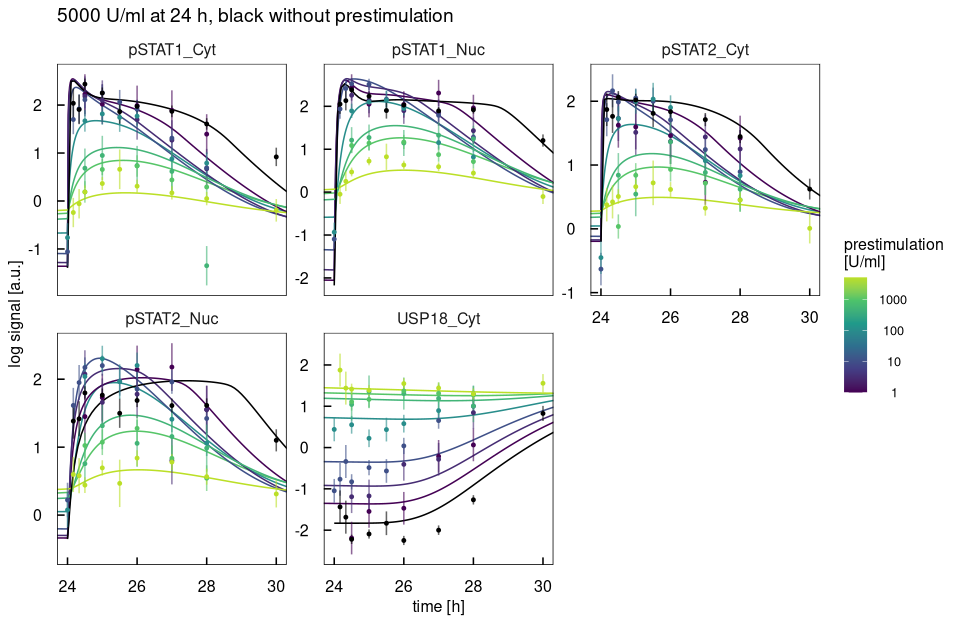
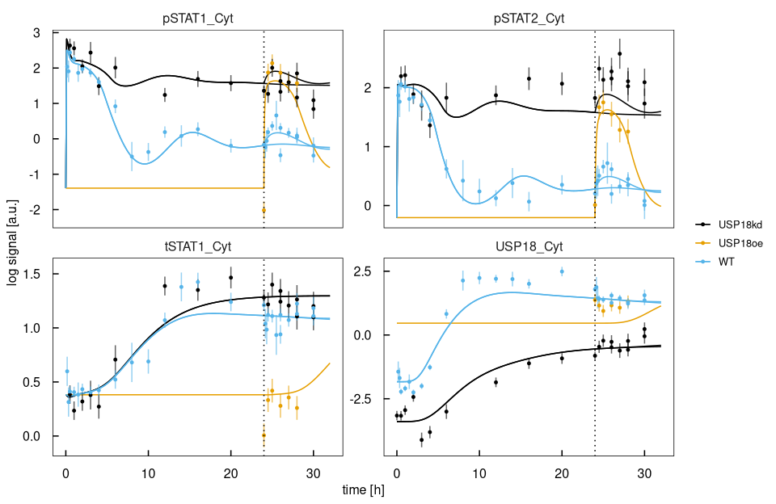
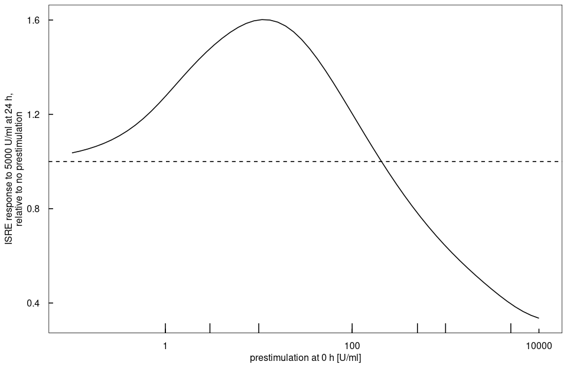

# `demo("KokMSB2020")`

Rendered by `dev/render-demos.R`; run it with `demo("KokMSB2020", package = "dMod2")`.

IFNalpha signalling in Huh7.5 hepatoma cells: receptor activation, STAT1/STAT2/
IRF9 complexes, target gene transcription and the USP18, SOCS1 and SOCS3
feedbacks that make a first dose sensitise or desensitise the cell.
Kok et al. (2020) Mol Syst Biol; Huh7.5 core model at the published optimum.


``` r
library(dMod2)
library(ggplot2)

.modelname <- "kok"
# generated sources, objects and libraries go here, not the working directory
.outdir    <- file.path(tempdir(), .modelname)

if (!dir.exists(.outdir)) dir.create(.outdir, recursive = TRUE)
.extDir <- system.file("extdata", "kok", package = "dMod2")
```

## Load data
Immunoblots and qPCR are fitted on the natural log, molecules per cell
(`mc_*`) on the linear scale. A condition is named `<experiment>_<ifn1>_<ifn2>`,
by the IFN doses in U/ml at 0 h and at 24 h.


``` r
data(kok)
mydataL   <- as.datalist(kok, splitBy = "condition",
                         keepCovariates = c("experiment", "ifn1", "ifn2"))
cond.grid <- covariates(mydataL)

cat(sprintf("%d points, %d conditions, %d observables\n", nrow(kok),
            length(mydataL), length(unique(kok$name))))
```

```
#> 1918 points, 25 conditions, 22 observables
```

## Define model
Newly made STAT1, STAT2, IRF9, USP18 and SOCS1 pass a linear chain before they
act, which delays the feedback without a delay differential equation.


``` r
.chain <- function(eq, protein, n, synthesis, to) {
  st <- paste0(protein, "_LC_", seq_len(n))
  eq <- addReaction(eq, "", st[1], synthesis, paste(protein, "translation"))
  for (i in seq_len(n - 1))
    eq <- addReaction(eq, st[i], st[i + 1], sprintf("delay%s*%s", protein, st[i]))
  addReaction(eq, st[n], to, sprintf("delay%s*%s", protein, st[n]),
              paste(protein, "maturation"))
}

# a transcript with basal synthesis, induction by an occupied binding site, decay
.mRNA <- function(eq, gene, induction, decay = sprintf("hl%smRNA*%smRNA", gene, gene)) {
  m <- paste0(gene, "mRNA")
  eq |>
    addReaction("", m, sprintf("synth%sbasal", m), paste(gene, "basal transcription")) |>
    addReaction("", m, induction, paste(gene, "induced transcription")) |>
    addReaction(m, "", decay, paste(gene, "mRNA decay"))
}

.receptor <- "(1 + kinhBySOCS*SOCS1)*(1 + kinhByUSP18*USP18)*SOCS3"

reactions <- eqnlist() |>
  # receptor turnover and IFN binding, inhibited by SOCS1, USP18 and SOCS3
  addReaction("", "Rec", "prodRec", "receptor synthesis") |>
  addReaction("Rec", "", "degRec*Rec", "receptor degradation") |>
  addReaction("Rec", "", "degRecBySOCS*Rec*SOCS1", "receptor degradation by SOCS1") |>
  addReaction("IFN + Rec", "aRecIFN", paste0("BindIFN*IFN*Rec/(", .receptor, ")"),
              "IFN binding") |>
  addReaction("aRecIFN", "", "degaRecIFN*aRecIFN", "active receptor degradation") |>
  addReaction("aRecIFN", "", "degaRecIFNBySOCS*aRecIFN*SOCS1", "by SOCS1") |>
  addReaction("aRecIFN", "", "degByUSP18*aRecIFN*USP18", "by USP18") |>
  addReaction("aRecIFN", "", "degBySOCSandUSP18*aRecIFN*SOCS1*USP18",
              "by SOCS1 and USP18") |>

  # the active receptor phosphorylates STAT1/STAT2 heterodimers and STAT1 homodimers
  addReaction("STAT1c + STAT2c", "pSTAT1pSTAT2c",
              "ComplFormSTAT1STAT2c*aRecIFN*STAT1c*STAT2c", "heterodimer formation") |>
  addReaction("pSTAT1pSTAT2c", "pSTAT1pSTAT2n", "TrLocSTAT1STAT2c*pSTAT1pSTAT2c",
              "heterodimer import") |>
  addReaction("pSTAT1pSTAT2n", "STAT1n + STAT2n", "decaySTAT1STAT2n*pSTAT1pSTAT2n",
              "heterodimer dephosphorylation") |>
  addReaction("pSTAT1pSTAT2c + IRF9c", "ISGF3c", "BindIRF9c*pSTAT1pSTAT2c*IRF9c",
              "ISGF3 formation") |>
  addReaction("ISGF3c", "ISGF3n", "TrLocISGF3c*ISGF3c", "ISGF3 import") |>
  addReaction("ISGF3n", "STAT1n + STAT2n + IRF9n", "decayISGF3n*ISGF3n",
              "ISGF3 dissociation") |>
  addReaction("2*STAT1c", "pSTAT1dimc", "ComplFormSTAT1dimc*aRecIFN*STAT1c^2",
              "homodimer formation") |>
  addReaction("pSTAT1dimc", "pSTAT1dimn", "TrLocSTAT1dimc*pSTAT1dimc", "homodimer import") |>
  addReaction("pSTAT1dimn", "2*STAT1n", "decaySTAT1dimn*pSTAT1dimn",
              "homodimer dephosphorylation") |>

  # occupancy of ISRE and GAS promoter sites
  addReaction("", "OccISREbs", "genOccISREbsByISGF3n*ISGF3n", "ISRE occupied by ISGF3") |>
  addReaction("", "OccISREbs", "genOccISREbsBySTAT1STAT2n*pSTAT1pSTAT2n",
              "ISRE occupied by the heterodimer") |>
  addReaction("OccISREbs", "", "hlOccISREbs*OccISREbs", "ISRE release") |>
  addReaction("", "OccGASbs", "genOccGASbsBySTAT1dimn*pSTAT1dimn", "GAS occupied") |>
  addReaction("OccGASbs", "", "hlOccGASbs*OccGASbs", "GAS release") |>

  # unphosphorylated STATs and IRF9 shuttle between cytoplasm and nucleus
  addReaction("STAT1c", "STAT1n", "TrLocSTAT1c*STAT1c", "STAT1 import") |>
  addReaction("STAT1n", "STAT1c", "TrLocSTAT1n*STAT1n", "STAT1 export") |>
  addReaction("STAT2c", "STAT2n", "TrLocSTAT2c*STAT2c", "STAT2 import") |>
  addReaction("STAT2n", "STAT2c", "TrLocSTAT2n*STAT2n", "STAT2 export") |>
  addReaction("IRF9c", "IRF9n", "TrLocIRF9c*IRF9c", "IRF9 import") |>
  addReaction("IRF9n", "IRF9c", "TrLocIRF9n*IRF9n", "IRF9 export") |>

  # target genes
  .mRNA("STAT1", "synthSTAT1mRNA*OccISREbs/(kmSTAT1 + OccISREbs)") |>
  .mRNA("STAT2", "synthSTAT2mRNA*OccISREbs") |>
  .mRNA("IRF9",  "synthIRF9mRNA*OccISREbs/(kmIRF9 + OccISREbs)") |>
  .mRNA("USP18", "synthUSP18mRNA*OccISREbs") |>
  .mRNA("SOCS1", "synthSOCS1mRNA*OccISREbs",
        decay = "hlSOCS1mRNA*SOCS1mRNA*(1 + IRF2)") |>
  .mRNA("SOCS3", "synthSOCS3mRNA*OccGASbs") |>
  # IRF2 transcript is turned into protein rather than degraded
  addReaction("", "IRF2mRNA", "synthIRF2mRNAbasal", "IRF2 basal transcription") |>
  addReaction("", "IRF2mRNA", "synthIRF2mRNA*OccISREbs", "IRF2 induced transcription") |>
  addReaction("IRF2mRNA", "IRF2", "delayIRF2*IRF2mRNA", "IRF2 translation") |>
  addReaction("IRF2", "", "degIRF2*IRF2", "IRF2 degradation") |>

  # feedback and pool proteins
  .chain("STAT1", 3, "synthSTAT1*STAT1mRNA/(kmsynthSTAT1 + STAT1mRNA)", "STAT1c") |>
  addReaction("STAT1c", "", "degSTAT1*STAT1c", "STAT1 degradation") |>
  .chain("STAT2", 5, "synthSTAT2*STAT2mRNA", "STAT2c") |>
  addReaction("STAT2c", "", "degSTAT2*STAT2c", "STAT2 degradation") |>
  .chain("IRF9", 2, "synthIRF9*IRF9mRNA", "IRF9c") |>
  addReaction("IRF9c", "", "degIRF9*IRF9c", "IRF9 degradation") |>
  .chain("USP18", 2, "synthUSP18*USP18mRNA", "USP18") |>
  addReaction("USP18", "", "degUSP18*USP18", "USP18 degradation") |>
  .chain("SOCS1", 1, "synthSOCS1*SOCS1mRNA", "SOCS1") |>
  addReaction("SOCS1", "", "degSOCS1*SOCS1", "SOCS1 degradation") |>
  addReaction("", "SOCS3", "synthSOCS3*SOCS3mRNA", "SOCS3 translation") |>
  addReaction("SOCS3", "", "degSOCS3*SOCS3", "SOCS3 degradation")
```

IFN is added on top of what is left, at 0 h and at 24 h


``` r
doses <- eventlist(var = "IFN", time = c(0, 24), value = c("first", "second"),
                   method = "add")

.pSTAT1 <- c(Cyt = "ISGF3c + 2*pSTAT1dimc + pSTAT1pSTAT2c",
             Nuc = "ISGF3n + 2*pSTAT1dimn + pSTAT1pSTAT2n")
.pSTAT2 <- c(Cyt = "ISGF3c + pSTAT1pSTAT2c", Nuc = "ISGF3n + pSTAT1pSTAT2n")
.IRF9   <- c(Cyt = "ISGF3c + IRF9c", Nuc = "ISGF3n + IRF9n")
.tSTAT1 <- paste(.pSTAT1, "+", c(Cyt = "STAT1c", Nuc = "STAT1n"))
.tSTAT2 <- paste(.pSTAT2, "+", c(Cyt = "STAT2c", Nuc = "STAT2n"))
names(.tSTAT1) <- names(.tSTAT2) <- c("Cyt", "Nuc")

.blot <- function(target, sum, loc)
  sprintf("log(scale_%s_%s*(%s) + off_%s_%s)", target, loc, sum, target, loc)

observables <- do.call(eqnvec, c(
  setNames(as.list(c(.blot("pSTAT1", .pSTAT1, names(.pSTAT1)),
                     .blot("pSTAT2", .pSTAT2, names(.pSTAT2)),
                     .blot("IRF9",   .IRF9,   names(.IRF9)),
                     .blot("tSTAT1", .tSTAT1, names(.tSTAT1)),
                     .blot("tSTAT2", .tSTAT2, names(.tSTAT2)))),
           paste0(rep(c("pSTAT1", "pSTAT2", "IRF9", "tSTAT1", "tSTAT2"), each = 2),
                  "_", c("Cyt", "Nuc"))),
  list(USP18_Cyt = "log(scale_USP18*USP18 + off_USP18)"),
  # qPCR is normalised to the untreated level, so a transcript needs no scale
  setNames(as.list(sprintf("log(%smRNA)",
                           c("STAT1", "STAT2", "IRF9", "IRF2", "USP18", "SOCS1", "SOCS3"))),
           paste0(c("STAT1", "STAT2", "IRF9", "IRF2", "USP18", "SOCS1", "SOCS3"), "_mRNA")),
  list(mc_STAT1 = paste(.tSTAT1, collapse = " + "),
       mc_STAT2 = paste(.tSTAT2, collapse = " + "),
       mc_IRF9  = paste(.IRF9, collapse = " + "),
       mc_USP18 = "USP18")))

stopifnot(setequal(names(observables), unique(kok$name)))
```

## Build


``` r
myOptions <- list(atol = 1e-8, rtol = 1e-6, maxsteps = 1e6L, maxattempts = 100L)

# model, observation and trafo also get the reverse sweep, see the gradient below
.modes <- c("forward", "reverse")
model <- odemodel(reactions, events = doses, modelname = "kok_ode",
                  derivMode = .modes, compile = FALSE, outdir = .outdir)
x <- Xs(model, options = myOptions)
g <- Y(observables, x, modelname = "kok_obs", attachInput = FALSE,
       derivMode = .modes, compile = FALSE, outdir = .outdir)
```

## Parameter transformation
Every condition starts at the unstimulated steady state, solved in closed form.
A rule is inserted before the rules that rewrite its symbols, so the right-hand
sides end up in the estimated parameters only.


``` r
.complexes <- c("IFN", "aRecIFN", "pSTAT1pSTAT2c", "pSTAT1pSTAT2n", "ISGF3c",
                "ISGF3n", "pSTAT1dimc", "pSTAT1dimn", "OccISREbs", "OccGASbs")
.chainOf <- function(protein, n) paste0(protein, "_LC_", seq_len(n))

trafo <- eqnvec() |>
  define("x~x", x = getParameters(model, g)) |>
  define("x~0", x = .complexes) |>

  # protein pools: synthesis balances degradation, the same flux passes each chain
  insert("x ~ STAT1c*degSTAT1/delaySTAT1", x = .chainOf("STAT1", 3)) |>
  insert("x ~ STAT2c*degSTAT2/delaySTAT2", x = .chainOf("STAT2", 5)) |>
  insert("x ~ IRF9c*degIRF9/delayIRF9", x = .chainOf("IRF9", 2)) |>
  insert("x ~ synthUSP18*USP18mRNA/delayUSP18", x = .chainOf("USP18", 2)) |>
  insert("SOCS1_LC_1 ~ synthSOCS1*SOCS1mRNA/delaySOCS1") |>
  insert("synthSTAT1 ~ STAT1c*degSTAT1/STAT1mRNA*(kmsynthSTAT1 + STAT1mRNA)") |>
  insert("synthSTAT2 ~ STAT2c*degSTAT2/STAT2mRNA") |>
  insert("synthIRF9 ~ IRF9c*degIRF9/IRF9mRNA") |>
  insert("USP18 ~ synthUSP18*USP18mRNA/degUSP18") |>
  insert("prodRec ~ Rec*(degRec + degRecBySOCS*SOCS1)") |>
  insert("SOCS1 ~ synthSOCS1*SOCS1mRNA/degSOCS1") |>
  insert("SOCS3 ~ synthSOCS3*SOCS3mRNA/degSOCS3") |>
  insert("degIRF2 ~ IRF2mRNA*delayIRF2/IRF2") |>

  # transcripts at rest
  insert("STAT1mRNA ~ synthSTAT1mRNAbasal/hlSTAT1mRNA") |>
  insert("STAT2mRNA ~ synthSTAT2mRNAbasal/hlSTAT2mRNA") |>
  insert("IRF9mRNA ~ synthIRF9mRNAbasal/hlIRF9mRNA") |>
  insert("USP18mRNA ~ synthUSP18mRNAbasal/hlUSP18mRNA") |>
  insert("SOCS3mRNA ~ synthSOCS3mRNAbasal/hlSOCS3mRNA") |>
  insert("SOCS1mRNA ~ synthSOCS1mRNAbasal/(hlSOCS1mRNA*(1 + IRF2))") |>
  insert("IRF2mRNA ~ synthIRF2mRNAbasal/delayIRF2") |>

  # nucleus to cytoplasm ratio at rest, the same for all shuttling proteins
  insert("STAT1c ~ totSTAT1/(1 + rCytNuc)") |>
  insert("STAT1n ~ totSTAT1*rCytNuc/(1 + rCytNuc)") |>
  insert("STAT2c ~ totSTAT2/(1 + rCytNuc)") |>
  insert("STAT2n ~ totSTAT2*rCytNuc/(1 + rCytNuc)") |>
  insert("IRF9c ~ totIRF9/(1 + rCytNuc)") |>
  insert("IRF9n ~ totIRF9*rCytNuc/(1 + rCytNuc)") |>
  insert("TrLocSTAT1c ~ TrLocSTAT1n*rCytNuc") |>
  insert("TrLocSTAT2c ~ TrLocSTAT2n*rCytNuc") |>
  insert("TrLocIRF9c ~ TrLocIRF9n*rCytNuc") |>

  # observation scales and complex formation relative to the protein totals
  insert("x ~ x/totSTAT1", x = paste0("scale_tSTAT1_", c("Cyt", "Nuc"))) |>
  insert("x ~ x/totSTAT2", x = c(paste0("scale_tSTAT2_", c("Cyt", "Nuc")),
                               "ComplFormSTAT1dimc")) |>
  insert("x ~ x/totIRF9", x = paste0("scale_", c("pSTAT1", "pSTAT2", "IRF9"),
                                   rep(c("_Cyt", "_Nuc"), each = 3))) |>
  insert("totSTAT1 ~ 4e5*totSTAT1") |>
  insert("totSTAT2 ~ 2.5e4*(1 + totSTAT2)") |>
  insert("totIRF9 ~ 500*(1 + totIRF9)") |>
  insert("Rec ~ 100*Rec") |>
  insert("synthUSP18 ~ 1000*synthUSP18")
```

Per condition: the USP18 knock-down lowers every USP18 synthesis, doxycycline
raises the basal one, and the two doses come from the covariates, 10 model
units per U/ml.


``` r
trafo <- trafo |>
  branch(table = cond.grid) |>
  insert("x ~ x/x_inh", experiment == "USP18kd",
         x = c("synthUSP18mRNA", "synthUSP18", "synthUSP18mRNAbasal")) |>
  insert("x ~ x*x_OE", experiment == "USP18oe", x = "synthUSP18mRNAbasal") |>
  insert("first ~ dose", dose = 10*ifn1) |>
  insert("second ~ dose", dose = 10*ifn2)
```

## Structural identifiability
A symmetry is a direction in parameter space along which the observables do not
change. Over all 25 conditions the model has four, all scaling symmetries.


``` r
structural <- symmetryDetection(reactions, observables, trafo = trafo,
                                events = doses, cores = 4)
summary(structural)
```

```
#> ------------------------------------------------------------
#> detect  |  observability   engine: modular (GF(p) + CRT)
#> ------------------------------------------------------------
#> Computation:
#>   Lie order 19 (gap order 1), set by condition 1
#>   rank: proven (4 directions, exact scalings)
#>   25 conditions, 50 segments
#>   settings: reduce_cq=False, equilibrate=False, reconstruct=False
#>   elapsed: 9.0s
#> 
#> Result:  rank 92 / 96  |  4 non-identifiable directions
#> 
#> Generators  X = Σᵢ ξ(i) ∂ᵢ
#> 
#> Scalings:
#>   X₁  (exact)
#>       ξ(genOccISREbsByISGF3n)      :  + genOccISREbsByISGF3n
#>       ξ(genOccISREbsBySTAT1STAT2n) :  + genOccISREbsBySTAT1STAT2n
#>       ξ(kmIRF9)                    :  + kmIRF9
#>       ξ(kmSTAT1)                   :  + kmSTAT1
#>       ξ(synthIRF2mRNA)             :  - synthIRF2mRNA
#>       ξ(synthSOCS1mRNA)            :  - synthSOCS1mRNA
#>       ξ(synthSTAT2mRNA)            :  - synthSTAT2mRNA
#>       ξ(synthUSP18mRNA)            :  - synthUSP18mRNA
#> 
#>   X₂  (exact)
#>       ξ(genOccGASbsBySTAT1dimn) :  + genOccGASbsBySTAT1dimn
#>       ξ(synthSOCS3mRNA)         :  - synthSOCS3mRNA
#> 
#>   X₃  (exact)
#>       ξ(degBySOCSandUSP18) :  + degBySOCSandUSP18
#>       ξ(degRecBySOCS)      :  + degRecBySOCS
#>       ξ(degaRecIFNBySOCS)  :  + degaRecIFNBySOCS
#>       ξ(kinhBySOCS)        :  + kinhBySOCS
#>       ξ(synthSOCS1)        :  - synthSOCS1
#> 
#>   X₄  (exact)
#>       ξ(BindIFN)    :  + BindIFN
#>       ξ(synthSOCS3) :  + synthSOCS3
#> 
#> exact = proven over Q.
#> 
#> Reduction:
#>   X₁, X₂, X₃, X₄ are scalings: gauge them by holding one coordinate of each
#>   fixed, at any value.
```

Each generator $X = \sum_i \xi_i(\theta)\,\partial_{\theta_i}$ has the components
$\xi_i(\theta) = \pm\theta_i$. Its flow solves
$\mathrm{d}\theta_i/\mathrm{d}s = \xi_i(\theta)$, so
$\theta_i(s) = \theta_i\,e^{\pm s}$: with $\lambda = e^{s}$ the parameters marked
$+$ are multiplied by $\lambda$ and those marked $-$ divided by it. The
observables stay the same for every $\lambda > 0$, so the data fix only the
products and ratios this rescaling leaves alone. The rescaled parameters belong
to the ISRE and GAS occupancy, SOCS1 and SOCS3, which are seen only through the
rates they enter. As the summary says, holding one parameter of each generator
fixed removes it. The publication does so by tying one rate to another, and
fixes three more values on top.


``` r
trafo <- trafo |>
  insert("synthSOCS1 ~ degSOCS1") |>
  insert("synthSOCS3 ~ degSOCS3") |>
  insert("genOccISREbsByISGF3n ~ hlOccISREbs/(500*(1 + totIRF9))") |>
  insert("genOccGASbsBySTAT1dimn ~ hlOccGASbs") |>
  insert("rCytNuc ~ 0.1") |>
  insert("TrLocIRF9n ~ exp(8)") |>
  insert("x~0", x = c("off_IRF9_Nuc", "off_IRF9_Cyt", "off_USP18",
                      "off_tSTAT2_Nuc", "off_tSTAT1_Nuc"))

# every estimated parameter on the natural log
p <- trafo |>
  insert("x~exp(x)", x = .currentSymbols) |>
  P(modelname = "kok_trafo", derivMode = .modes, compile = FALSE, outdir = .outdir)

compile(g, x, p, output = .modelname, cores = 12)

prd       <- g*x*p
outerpars <- getParameters(prd)
cat(length(outerpars), "estimated parameters\n")
```

```
#> 85 estimated parameters
```

## Objective
A wide prior around 1 keeps directions the data leave open finite.


``` r
pouter <- structure(rep(0, length(outerpars)), names = outerpars)
obj    <- normL2(mydataL, prd) + constraintL2(pouter, sigma = 12)

# the published optimum, on the natural log scale
.pars   <- read.delim(file.path(.extDir, "parameters_Kok_MSB2020.tsv"))
bestfit <- setNames(.pars$estimate, .pars$parameterId)
stopifnot(setequal(names(bestfit), outerpars))

obj(bestfit) |> system.time()
```

```
#>    user  system elapsed 
#>   2.842   0.018   2.870
```

## Forward and reverse gradient
Forward sensitivities integrate one system per parameter, the reverse sweep the
states once and back, which at 85 parameters is much faster.


``` r
system.time(obj(bestfit, deriv = TRUE))
```

```
#>    user  system elapsed 
#>   2.818   0.004   2.834
```

``` r
system.time(obj(bestfit, deriv = TRUE, sweep = "reverse"))
```

```
#>    user  system elapsed 
#>   0.113   0.000   0.113
```

At the optimum the gradient is small, so the integration error at the
tolerances of the fit dominates it. With tighter tolerances and the sweep
checked against them, the two agree.


``` r
.xt   <- Xs(model, options = modifyList(myOptions, list(atol = 1e-10, rtol = 1e-8)),
            optionsReverse = list(refine = TRUE))
.objt <- normL2(mydataL, g*.xt*p) + constraintL2(pouter, sigma = 12)
.fwd  <- .objt(bestfit, deriv = TRUE)
.rev  <- .objt(bestfit, deriv = TRUE, sweep = "reverse")
head(cbind(forward = .fwd$gradient, reverse = .rev$gradient[names(.fwd$gradient)]), 10)
```

```
#>                          forward      reverse
#> Rec                 -0.004116486 -0.004108472
#> totSTAT1            -0.018540556 -0.018519895
#> totSTAT2             0.002254702  0.002275425
#> totIRF9              0.006630645  0.006608674
#> synthUSP18           0.012815522  0.012754923
#> synthUSP18mRNAbasal -0.002131938 -0.002149877
#> hlUSP18mRNA         -0.009637053 -0.009590448
#> degUSP18            -0.013912892 -0.013855883
#> synthSTAT1mRNAbasal  0.008162411  0.008120175
#> hlSTAT1mRNA         -0.004909787 -0.004890890
```

## Fit at the published optimum
Lines are the model, points the data with one standard deviation. The plots
follow Figures 3, 5 and 7 of the publication.


``` r
times <- sort(unique(c(seq(0, 32, by = 0.1), 24 + seq(0, 1, by = 0.02))))
fit   <- as.data.frame(prd(times, bestfit, deriv = FALSE), data = mydataL)

.blots <- c(paste0(c("pSTAT1", "pSTAT2", "IRF9", "tSTAT1", "tSTAT2"), "_",
                   rep(c("Cyt", "Nuc"), each = 5)), "USP18_Cyt")
.mRNAs <- grep("_mRNA$", unique(kok$name), value = TRUE)

# model and data of the conditions `keep` selects, for the observables `names`
.panel <- function(keep, names) {
  pick <- function(df) df[keep(df) & df$name %in% names, ]
  list(model = pick(fit), data = pick(kok))
}
.draw <- function(pn, colour, xlim = NULL)
  ggplot(pn$model, aes(time, value, colour = .data[[colour]], group = condition)) +
  geom_line() +
  geom_errorbar(data = pn$data, aes(ymin = value - sigma, ymax = value + sigma),
                width = 0, alpha = 0.6) +
  geom_point(data = pn$data, size = 1) +
  facet_wrap(~name, scales = "free_y") +
  coord_cartesian(xlim = xlim) +
  theme_dMod()
.doses <- function(...)
  scale_colour_viridis_c(trans = "log10", end = 0.9, ...,
                         labels = function(d) format(d, scientific = FALSE,
                                                     drop0trailing = TRUE))
```

### a single dose: response and feedback over the first day


``` r
.single <- function(df) df$experiment == "WT" & df$ifn2 == 0 & df$ifn1 > 0
.draw(.panel(.single, .blots), "ifn1", c(0, 24)) +
  .doses() +
  scale_x_continuous(breaks = seq(0, 24, 8)) +
  labs(x = "time [h]", y = "log signal [a.u.]", colour = "IFN [U/ml]")
```



``` r
.draw(.panel(.single, .mRNAs), "ifn1", c(0, 24)) +
  .doses() +
  scale_x_continuous(breaks = seq(0, 24, 8)) +
  labs(x = "time [h]", y = "log fold change", colour = "IFN [U/ml]")
```



### the second dose after a prestimulation
Without prestimulation the response to 5000 U/ml is that of `WT_5000_0`,
shifted to 24 h, since every condition starts at the same steady state.


``` r
.naive <- function(df) {
  df <- df[df$condition == "WT_5000_0" & df$time <= 8, ]
  transform(df, time = time + 24, condition = "naive", ifn1 = NA)
}
.second <- function(df) df$experiment == "WT" & df$ifn2 == 5000
.late   <- c("pSTAT1_Nuc", "pSTAT2_Nuc", "pSTAT1_Cyt", "pSTAT2_Cyt", "USP18_Cyt")
.pn     <- .panel(.second, .late)
.pn$model <- rbind(.pn$model, subset(.naive(fit), name %in% .late))
.pn$data  <- rbind(.pn$data, subset(.naive(kok), name %in% .late))
.draw(.pn, "ifn1", c(24, 30)) +
  .doses(na.value = "black") +
  labs(x = "time [h]", y = "log signal [a.u.]", colour = "prestimulation\n[U/ml]",
       title = "5000 U/ml at 24 h, black without prestimulation")
```



### USP18: knock-down and overexpression against the wild type


``` r
.usp18 <- function(df) df$condition %in% c("WT_5000_0", "WT_5000_5000",
                                            "USP18kd_5000_0", "USP18kd_5000_5000",
                                            "USP18oe_0_5000")
.draw(.panel(.usp18, c("USP18_Cyt", "tSTAT1_Cyt", "pSTAT1_Cyt", "pSTAT2_Cyt")),
      "experiment") +
  geom_vline(xintercept = 24, linetype = "dotted") +
  scale_color_dMod() +
  labs(x = "time [h]", y = "log signal [a.u.]", colour = NULL)
```



### sensitization: the response to 5000 U/ml against the prestimulation dose
The response is the area under the occupied ISRE sites in the 4 h after a dose.
Above 1 a prestimulation sensitizes the cell, below 1 it desensitizes it.


``` r
.auc <- function(pars, from) {
  tt  <- seq(from, from + 4, by = 0.02)
  occ <- x(sort(unique(c(0, tt))), pars, deriv = FALSE)[[1]]
  occ <- occ[occ[, "time"] >= from, "OccISREbs"]
  sum(diff(tt) * (head(occ, -1) + tail(occ, -1)) / 2)
}
.pin  <- unlist(p(bestfit)[["WT_10_5000"]])
.ref  <- .auc(replace(.pin, c("first", "second"), c(10*5000, 0)), 0)
.dose <- 10^seq(-1, 4, length.out = 60)
sensitization <- data.frame(
  dose  = .dose,
  ratio = sapply(.dose, function(d) .auc(replace(.pin, "first", 10*d), 24)) / .ref)

ggplot(sensitization, aes(dose, ratio)) +
  geom_hline(yintercept = 1, linetype = "dashed") +
  geom_line() +
  # the prestimulation doses measured
  geom_rug(data = data.frame(dose = unique(kok$ifn1[.second(kok)])),
           aes(x = dose), inherit.aes = FALSE, sides = "b") +
  scale_x_log10() +
  theme_dMod() +
  labs(x = "prestimulation at 0 h [U/ml]",
       y = "ISRE response to 5000 U/ml at 24 h,\nrelative to no prestimulation")
```



