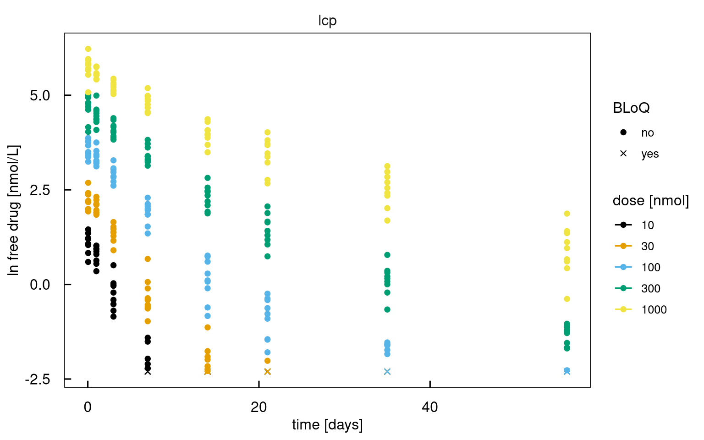
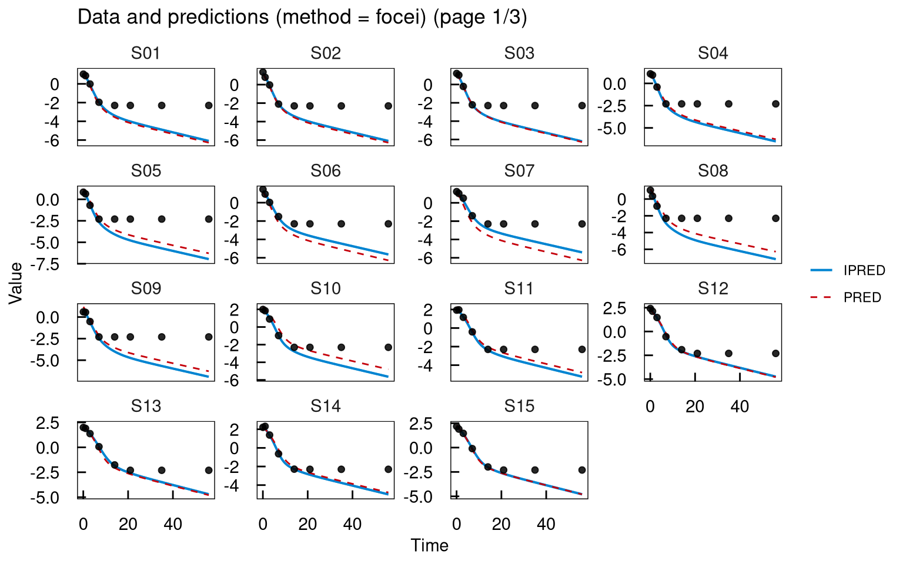
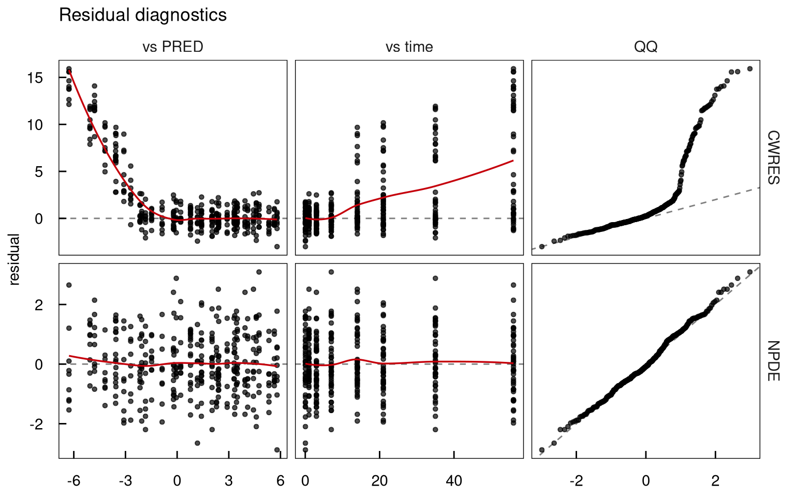
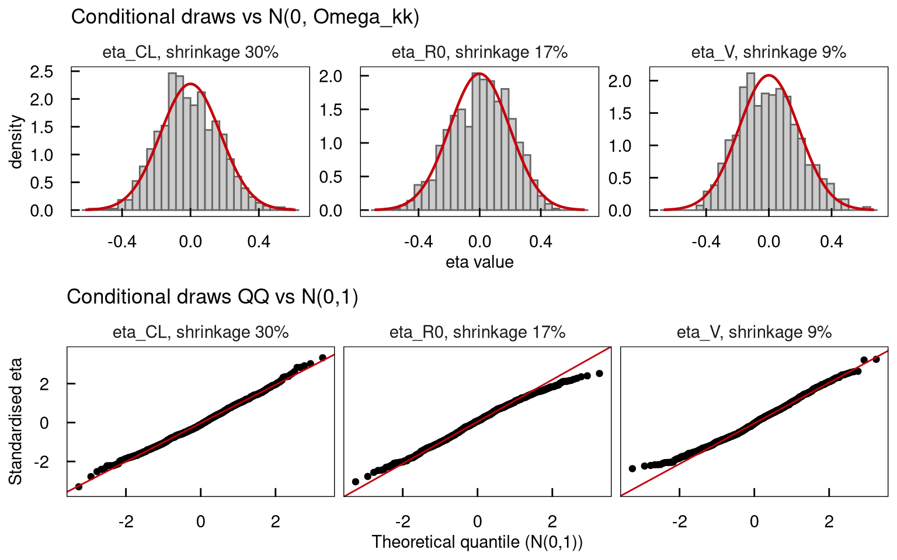
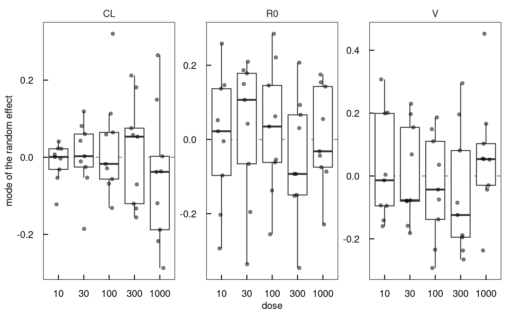
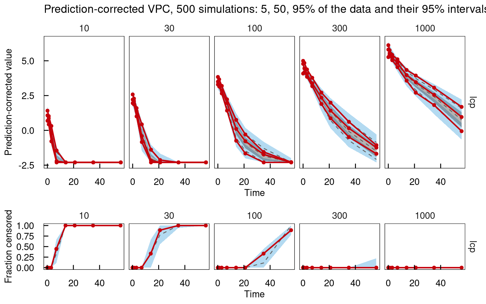

# TMDD

Simulated target-mediated drug disposition: steady state, identifiability, censored readings, FOCEI and quadrature against nlmixr2.

## Files

| file | content |
|---|---|
| `analysis.R` | the analysis, shown below |
| `results/cache.rds` | saved fits; delete it to fit again |

## Run

With this folder as working directory: `source("analysis.R")`.


``` r
library(dMod2)
dir.create("build", showWarnings = FALSE)
# generated sources and shared objects in build/, reused when nothing changed
options(dMod2.outdir = "build")
cores <- max(1L, min(20L, parallel::detectCores() - 2L))
nstart <- 100L
withNlmixr2 <- requireNamespace("nlmixr2", quietly = TRUE)

# fits are saved in results/cache.rds under a key and read from there when present; delete the
# file to fit everything again
cached <- function(key, expr) {
  file <- "results/cache.rds"
  dir.create("results", showWarnings = FALSE)
  store <- if (file.exists(file)) readRDS(file) else list()
  if (is.null(store[[key]])) {
    store[[key]] <- expr
    saveRDS(store, file)
  }
  store[[key]]
}
# a fit of em() cached without its model, which an evaluation at its estimates restores
cachedEm <- function(key, obj, random, start, control = list(), ...) {
  model <- c("design", "prdfn", "errfn", "data")
  f <- cached(key, { f <- em(obj, random, start, control = control, ...); f[model] <- NULL; f })
  f[model] <- em(obj, random, f$argument, control = modifyList(control, list(trustControl = list(iterlim = 0))),
                 verbose = FALSE)[model]
  f
}

dm <- c("forward", "reverse", "forward-reverse")
```

## Model

Concentrations in nmol/L, time in days; the rates of distribution and linear elimination are
fluxes in nmol per day in a frame of volume 1, binding and turnover concentration rates in the
central compartment.

``` r
net <- eqnlist() |>
  assignCompartment(C = "central", volume = "V") |>
  assignCompartment(Cp = "peripheral", volume = "Vp") |>
  assignCompartment(R = "central") |>
  assignCompartment(RC = "central") |>
  setCompartmentVolume(unit = "1") |>
  addReaction("C", "", "CL * C", "elimination", rateCompartment = "unit") |>
  addReaction("C", "Cp", "Q * C", "distribution", rateCompartment = "unit") |>
  addReaction("Cp", "C", "Q * Cp", "redistribution", rateCompartment = "unit") |>
  addReaction("C + R", "RC", "kon * C * R", "binding") |>
  addReaction("RC", "C + R", "koff * RC", "dissociation") |>
  addReaction("RC", "", "kint * RC", "internalisation") |>
  addReaction("", "R", "ksyn", "synthesis", compartment = "central") |>
  addReaction("R", "", "kdeg * R", "degradation")
net
```

```
#> 
#> Compartments:
#>   central (V=V)
#>   peripheral (V=Vp)
#>   unit (V=1)
#> States by compartment:
#>   central: C, R, RC
#>   peripheral: Cp
#> 
#>   Check Educt -> Product        Rate     Description
#> 1           C ->              CL * C     elimination
#> 2           C ->      Cp       Q * C    distribution
#> 3          Cp ->       C      Q * Cp  redistribution
#> 4       C + R ->      RC kon * C * R         binding
#> 5          RC ->   C + R   koff * RC    dissociation
#> 6          RC ->           kint * RC internalisation
#> 7             ->       R        ksyn       synthesis
#> 8           R ->            kdeg * R     degradation
```

The target before the dose is at the steady state of the drug-free system, R = ksyn / kdeg;
with R0 as parameter the synthesis is kdeg R0.

``` r
steady <- steadyStates(eqnlist() |> addReaction("", "R", "ksyn", "synthesis") |>
                         addReaction("R", "", "kdeg * R", "degradation"))
```

```
#> Steady state: 1 expressions, 0 states at 0, test passed (mod p), 0 s
```

``` r
steady
```

```
#>           R 
#> "ksyn/kdeg"
```

## Identifiability

With the dose known and the target at its steady state, R(0) = R0 and ksyn = kdeg R0, the free
drug alone determines all nine parameters; total target is not measured.

``` r
start <- eqnvec(C = "dose / V", Cp = "0", R = "R0", RC = "0", ksyn = "kdeg * R0")
parameters <- c("CL", "V", "Q", "Vp", "kon", "koff", "kint", "kdeg", "R0")
identifiability <- symmetryDetection(as.eqnvec(net), eqnvec(lcp = "log(C)"), fixed = "dose",
                                     trafo = c(start, eqnvec(setNames(parameters, parameters)), eqnvec(dose = "dose")))
identifiability
```

```
#> Result:  structurally locally identifiable (rank 9 / 9)
```

## Design and simulation

Five dose groups of 9 subjects, samples from one hour to eight weeks; clearance, central volume
and target level vary between subjects with 20% CV, the readings with 15% on the log scale. The
seed gives a typical draw: its share of censored readings is the median of seeds 1 to 50.

``` r
truth <- log(c(CL = 0.3, V = 3, Q = 0.2, Vp = 3, kon = 5, koff = 0.25, kint = 15, kdeg = 15, R0 = 0.1))
omega <- sqrt(log(1 + 0.2^2))
sigma <- sqrt(log(1 + 0.15^2))
doses <- c(10, 30, 100, 300, 1000)
times <- c(1 / 24, 1, 3, 7, 14, 21, 35, 56)
lloq <- 0.1
subjects <- sprintf("S%02d", 1:45)
table <- data.frame(ID = subjects, dose = rep(doses, each = 9), row.names = subjects)
```

The free drug in log10 coordinates, C = 10^C_l10: it stays positive where binding takes it far
below the absolute tolerance of the solver, and log(C) is linear in the state.

``` r
ode <- log10Transform(as.eqnvec(net), states = "C")
ode
```

```
#> Idx Inner <- Outer
#>   1 C_l10 <- (-CL/V-Q/V-R*kon+Cp*Q/((10^(C_l10))*V)+RC*koff/(10^(C_l10)))/log(10)
#>   2    Cp <- 1*(Q*(10^(C_l10)))*(1/Vp)-1*(Q*Cp)*(1/Vp)
#>   3     R <- -1*(kon*(10^(C_l10))*R)+1*(koff*RC)+1*(ksyn)-1*(kdeg*R)
#>   4    RC <- 1*(kon*(10^(C_l10))*R)-1*(koff*RC)-1*(kint*RC)
```

``` r
# solver tolerances 1e-10: at the defaults its error moves -2 log L by about 1e-4, more than FOCEI
# resolves, and the fit stalls short of its optimum
x <- Xs(odemodel(ode, modelname = "tmdd", compile = FALSE, deriv2 = TRUE, derivMode = dm),
        options = list(atol = 1e-10, rtol = 1e-10))
g <- Y(c(lcp = "log(10) * C_l10"), x, modelname = "tmdd_g", compile = FALSE, deriv2 = TRUE, derivMode = dm)
e <- Y(c(lcp = "sigma"), g, attachInput = FALSE, modelname = "tmdd_e", compile = FALSE, deriv2 = TRUE, derivMode = dm)
trafo <- branch(define(NULL, "x <- x", x = c("CL", "V", "Q", "Vp", "kon", "koff", "kint", "ksyn", "kdeg",
                                             "C_l10", "Cp", "R", "RC", "sigma")), table = table)
trafo <- insert(trafo, "x <- y", x = c("C_l10", "Cp", "RC"), y = c("log10(dose / V)", "0", "0"))
trafo <- insert(trafo, paste("R <-", steady[["R"]]))
trafo <- insert(trafo, "ksyn <- kdeg * R0")
trafo <- insert(trafo, "dose <- d", d = dose)
trafo <- insert(trafo, "x <- exp(x)", x = c(parameters, "sigma"))
trafo <- insert(trafo, CL + V + R0 ~ 1 + (1 | ID))
p <- P(trafo, method = "explicit", modelname = "tmdd_p", compile = FALSE, deriv2 = TRUE, derivMode = dm)
compile(x, g, e, p, output = "tmdd_all")
random <- randomEffects(p)

simulateData <- function(seed) {
  set.seed(seed)
  eta <- matrix(rnorm(45 * 3, 0, omega), 45, dimnames = list(subjects, c("CL", "V", "R0")))
  pars <- c(truth, sigma = log(sigma),
            setNames(as.vector(eta), paste0("eta_", rep(colnames(eta), each = 45), "_", subjects)))
  pred <- (g * x * p)(times = times, pars = pars, deriv = FALSE)
  do.call(rbind, lapply(subjects, function(s) {
    v <- pred[[s]][match(times, pred[[s]][, "time"]), "lcp"] + rnorm(length(times), 0, sigma)
    data.frame(name = "lcp", time = times, value = pmax(v, log(lloq)), sigma = NA_real_, lloq = log(lloq),
               condition = s, ID = s, dose = table[s, "dose"])
  }))
}
censored <- vapply(1:50, function(s) mean(simulateData(s)$value <= log(lloq)), 0)
seed <- which.min(abs(censored - stats::median(censored)))
c(seed = seed, censored = censored[seed], median = stats::median(censored))
```

```
#>       seed   censored     median 
#> 10.0000000  0.2222222  0.2222222
```

``` r
sim <- simulateData(seed)
data <- as.datalist(sim, splitBy = "condition", keepCovariates = c("ID", "dose"))
plotData(data) + ggplot2::aes(colour = factor(dose)) +
  ggplot2::labs(x = "time [days]", y = "ln free drug [nmol/L]", colour = "dose [nmol]")
```




## Fits

The starts: the truth on the log scale and 99 draws around it, N(0, 0.5) per parameter. Every
fit runs on one core. Up to level 5 the nodes resolve -2 log L only to the level error the
summary of quadrature prints, and a rebuild of the nodes moves it by about 1e-3. A quadrature
fit converges where a step no longer lowers -2 log L on the rebuilt nodes; one still moving
after ten rebuilds ends unconverged.

``` r
obj <- normL2(data, g * x * p, errmodel = e)
# second derivatives forward over forward; quadrature up to level 5, which the certificate passes
ctrl <- list(derivMode = "forward-forward", quadrature = list(maxLevel = 5))
# -2 log L of FOCEI at given estimates, the definition under which all fits are compared
focei <- function(obj, random, pars)
  em(obj, random, pars, control = c(ctrl, list(trustControl = list(iterlim = 0))), verbose = FALSE)$value
init <- c(truth, sigma = log(sigma), omega_CL_CL = log(omega), omega_V_V = log(omega), omega_R0_R0 = log(omega))
set.seed(1)
starts <- rbind(init, t(vapply(seq_len(nstart - 1L), function(i) init + rnorm(length(init), 0, 0.5), init)))
runs <- cached("dMod2", do.call(rbind, unlist(lapply(c(focei = "focei", quadrature = "quadrature"), function(method)
  parallel::mclapply(seq_len(nrow(starts)), function(i) {
    options(dMod2.cores = 1L)
    t <- system.time(f <- tryCatch(em(obj, random, starts[i, ], method = method, control = ctrl, verbose = FALSE),
                                   error = function(e) NULL))[["elapsed"]]
    data.frame(method = method, start = i, value = if (is.null(f)) NA_real_ else f$value,
               focei = if (is.null(f)) NA_real_ else if (method == "focei") f$value else focei(obj, random, f$argument),
               converged = !is.null(f) && isTRUE(f$converged), seconds = t)
  }, mc.cores = cores, mc.preschedule = FALSE)), recursive = FALSE)))
best <- tapply(runs$value, runs$method, min, na.rm = TRUE)
data.frame(best = best, hits = tapply(runs$value - best[runs$method] < 0.1, runs$method, sum, na.rm = TRUE),
           converged = tapply(runs$converged, runs$method, sum), failed = tapply(is.na(runs$value), runs$method, sum),
           medianSeconds = tapply(runs$seconds, runs$method, stats::median))
```

```
#>                 best hits converged failed medianSeconds
#> focei      -40.71680   96       100      0      220.2585
#> quadrature -40.51056   96       100      0      259.6215
```

``` r
fit <- cachedEm("dMod2 focei best", obj, random, starts[which.min(runs$value[runs$method == "focei"]), ],
                control = ctrl, verbose = FALSE)
quad <- cachedEm("dMod2 quadrature best", obj, random, starts[which.min(runs$value[runs$method == "quadrature"]), ],
                 method = "quadrature", verbose = FALSE,
                 control = modifyList(ctrl, list(quadrature = list(certificate = list(points = 256)))))
summary(fit)
```

```
#> EM summary (focei): -2 log L -40.716801, converged TRUE, 45 iterations
#>   without the 2 pi constant of the data (NONMEM OBJ): -555.322380
#> 
#> Parameters:
#>             estimate      se  rsePct
#> CL            -1.198 0.05782   4.827
#> V              1.099 0.03312   3.013
#> Q             -1.716 0.05845   3.406
#> Vp             1.034 0.05842   5.648
#> kon            2.283 2.30200 100.800
#> koff          -2.982 0.71610  24.010
#> kint          -1.208 0.43300  35.830
#> kdeg           2.922 2.30700  78.940
#> R0            -2.732 2.30700  84.440
#> sigma         -1.914 0.05364   2.803
#> omega_CL_CL   -1.739 0.19630  11.290
#> omega_V_V     -1.653 0.13130   7.945
#> omega_R0_R0   -1.627 0.15800   9.713
#> 
#> Random effects:
#>  type eta1 eta2 estimate      se
#>    sd   CL   CL   0.1756 0.03448
#>    sd    V    V   0.1915 0.02515
#>    sd   R0   R0   0.1965 0.03105
#> 
#> Shrinkage: eta_CL = 0.303, eta_V = 0.090, eta_R0 = 0.166
```

``` r
quad
```

```
#> EM (quadrature): -2 log L -40.510556, converged TRUE, 1 iterations, 45 groups
#>          CL           V           Q          Vp         kon        koff 
#>   -1.197983    1.099391   -1.715839    1.034337    2.282309   -2.981369 
#>        kint        kdeg          R0       sigma omega_CL_CL   omega_V_V 
#>   -1.208029    2.921773   -2.731743   -1.913640   -1.739300   -1.652919 
#> omega_R0_R0 
#>   -1.627165 
#> Random effects:
#>  type eta1 eta2  estimate         se
#>    sd   CL   CL 0.1756434 0.03376000
#>    sd    V    V 0.1914901 0.02509827
#>    sd   R0   R0 0.1964858 0.03077443
#> Quadrature: levels 4 to 5, estimated level error 0.56 in -2 log L; importance sampling flags 0 of 45 groups
```

``` r
round(cbind(truth = init, focei = fit$argument[names(init)], quadrature = quad$argument[names(init)],
            se = sqrt(pmax(diag(vcov(fit)), 0))[names(init)]), 3)
```

```
#>              truth  focei quadrature    se
#> CL          -1.204 -1.198     -1.198 0.058
#> V            1.099  1.099      1.099 0.033
#> Q           -1.609 -1.716     -1.716 0.058
#> Vp           1.099  1.034      1.034 0.058
#> kon          1.609  2.283      2.282 2.302
#> koff        -1.386 -2.982     -2.981 0.716
#> kint         2.708 -1.208     -1.208 0.433
#> kdeg         2.708  2.922      2.922 2.307
#> R0          -2.303 -2.732     -2.732 2.307
#> sigma       -1.903 -1.914     -1.914 0.054
#> omega_CL_CL -1.619 -1.739     -1.739 0.196
#> omega_V_V   -1.619 -1.653     -1.653 0.131
#> omega_R0_R0 -1.619 -1.627     -1.627 0.158
```

## Diagnostics

CWRES linearise around the modes, NPDE come from simulations of the fitted model and take the
censored readings by their simulated fraction.

``` r
plotCombined(fit, conditionsPerPage = 15)[[1]]
```




``` r
plotResiduals(fit, type = c("CWRES", "NPDE"), nsim = 500, seed = 1)
```




``` r
attr(residuals(fit, type = "NPDE", nsim = 500, seed = 1), "tests")
```

```
#>        test statistic         p
#> 1      mean 0.5035383 0.6148947
#> 2  variance 1.0623704 0.3988859
#> 3 normality 0.9942048 0.1885959
#> 4    global        NA 0.5657876
```

``` r
plotRandomEffects(fit)
```




``` r
plotRandomEffects(fit, covariates = "dose")
```




``` r
plotVPC(fit, nsim = 500, bins = c(0, (head(times, -1) + tail(times, -1)) / 2, 60), pc = TRUE, logScale = TRUE,
        strata = "dose", seed = 1)
```




## nlmixr2 FOCEI and SAEM

The same model with the censored readings by M3 (CENS = 1, DV the limit) and the same starts.
Every fit, quadrature included, counts by the -2 log L of FOCEI at its estimates.

``` r
if (withNlmixr2) {
  ui <- nlmixr2est::nlmixr2(function() {
    ini({
      lcl <- -1.2; lv <- 1.1; lq <- -1.6; lvp <- 1.1; lkon <- 1.6; lkoff <- -1.4; lkint <- 2.7; lkdeg <- 2.7
      lr0 <- -2.3
      eta.cl ~ 0.04; eta.v ~ 0.04; eta.r0 ~ 0.04
      add.sd <- 0.15
    })
    model({
      cl <- exp(lcl + eta.cl); v <- exp(lv + eta.v); q <- exp(lq); vp <- exp(lvp)
      kon <- exp(lkon); koff <- exp(lkoff); kint <- exp(lkint); kdeg <- exp(lkdeg); r0 <- exp(lr0 + eta.r0)
      cf <- central / v
      d/dt(central) <- -cl * cf - q * cf + q * peripheral / vp - (kon * cf * r - koff * rc) * v
      d/dt(peripheral) <- q * cf - q * peripheral / vp
      r(0) <- r0
      d/dt(r) <- kdeg * r0 - kdeg * r - kon * cf * r + koff * rc
      d/dt(rc) <- kon * cf * r - koff * rc - kint * rc
      lcp <- log(cf)
      lcp ~ add(add.sd)
    })
  })
  ndata <- rbind(data.frame(ID = match(table$ID, subjects), TIME = 0, AMT = table$dose, EVID = 1L, DV = NA_real_,
                            CENS = 0L, CMT = "central"),
                 data.frame(ID = match(sim$ID, subjects), TIME = sim$time, AMT = 0, EVID = 0L, DV = sim$value,
                            CENS = as.integer(sim$value <= log(lloq)), CMT = "central"))
  ndata <- ndata[order(ndata$ID, ndata$TIME, -ndata$EVID), ]
  toIni <- function(s)
    c(list(lcl = s[["CL"]], lv = s[["V"]], lq = s[["Q"]], lvp = s[["Vp"]], lkon = s[["kon"]], lkoff = s[["koff"]],
           lkint = s[["kint"]], lkdeg = s[["kdeg"]], lr0 = s[["R0"]], add.sd = exp(s[["sigma"]])),
      unname(Map(function(eta, o) stats::as.formula(sprintf("%s ~ %.10g", eta, exp(2 * s[[o]]))),
                 c("eta.cl", "eta.v", "eta.r0"), c("omega_CL_CL", "omega_V_V", "omega_R0_R0"))))
  fromNlmixr2 <- function(f) {
    th <- f$theta; om <- diag(f$omega)
    c(CL = th[["lcl"]], V = th[["lv"]], Q = th[["lq"]], Vp = th[["lvp"]], kon = th[["lkon"]], koff = th[["lkoff"]],
      kint = th[["lkint"]], kdeg = th[["lkdeg"]], R0 = th[["lr0"]], sigma = log(th[["add.sd"]]),
      omega_CL_CL = log(sqrt(om[["eta.cl"]])), omega_V_V = log(sqrt(om[["eta.v"]])),
      omega_R0_R0 = log(sqrt(om[["eta.r0"]])))
  }
  # rxode2::ini() evaluates the random effects in `envir`, where it needs lotri()
  nfit <- function(s, est) {
    out <- NULL
    control <- if (est == "focei") nlmixr2est::foceiControl(print = 0) else nlmixr2est::saemControl(print = 0)
    utils::capture.output(out <- tryCatch(suppressMessages(suppressWarnings(
      nlmixr2est::nlmixr2(do.call(rxode2::ini, c(list(ui), toIni(s), envir = asNamespace("rxode2"))), ndata, est = est,
                          control = control))),
      error = function(e) NULL))
    out
  }
  rxode2::setRxThreads(1L)
  nruns <- cached("nlmixr2", {
    invisible(nfit(starts[1, ], "focei"))
    do.call(rbind, unlist(lapply(c("focei", "saem"), function(est)
      parallel::mclapply(seq_len(nrow(starts)), function(i) {
        rxode2::setRxThreads(1L)
        t <- system.time(f <- nfit(starts[i, ], est))[["elapsed"]]
        data.frame(method = paste("nlmixr2", est), start = i, seconds = t,
                   value = if (is.null(f)) NA_real_ else focei(obj, random, fromNlmixr2(f)))
      }, mc.cores = cores, mc.preschedule = FALSE)), recursive = FALSE))
  })
  all <- rbind(data.frame(method = runs$method, start = runs$start, value = runs$focei, seconds = runs$seconds), nruns)
  all$method <- factor(all$method, c("focei", "quadrature", "nlmixr2 focei", "nlmixr2 saem"),
                       c("dMod2 FOCEI", "dMod2 quadrature", "nlmixr2 FOCEI", "nlmixr2 SAEM"))
  all$delta <- all$value - min(all$value, na.rm = TRUE)
  all$rank <- stats::ave(rank(all$value, ties.method = "first", na.last = TRUE), all$method,
                         FUN = function(r) rank(r, na.last = TRUE))
  print(ggplot2::ggplot(all[is.finite(all$value), ], ggplot2::aes(rank, delta + 1e-3, color = method,
                                                                  shape = method)) +
          ggplot2::geom_point() + ggplot2::scale_y_log10(labels = scales::label_log()) +
          ggplot2::scale_shape_manual(values = c(19, 17, 1, 2)) + scale_color_dMod() + theme_dMod() +
          ggplot2::labs(x = "fit, ordered", y = "-2 log L (FOCEI) above the best + 0.001", color = NULL,
                        shape = NULL))
  print(do.call(rbind, lapply(split(all, all$method), function(r)
    data.frame(method = r$method[1], best = min(r$value, na.rm = TRUE),
               hits = sum(r$value - min(all$value, na.rm = TRUE) < 0.1, na.rm = TRUE),
               failed = sum(is.na(r$value)), medianSeconds = stats::median(r$seconds), totalSeconds = sum(r$seconds)))))
  nbest <- cached("nlmixr2 best", lapply(c(focei = "nlmixr2 focei", saem = "nlmixr2 saem"), function(m)
    fromNlmixr2(nfit(starts[nruns$start[nruns$method == m][which.min(nruns$value[nruns$method == m])], ],
                     sub("nlmixr2 ", "", m)))))
  print(round(cbind(truth = init, dMod2 = fit$argument[names(init)], nlmixr2 = nbest$focei[names(init)],
                    nlmixr2Saem = nbest$saem[names(init)]), 3))
}
```
