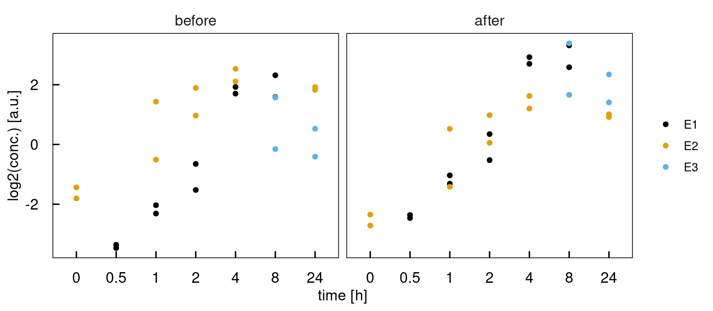
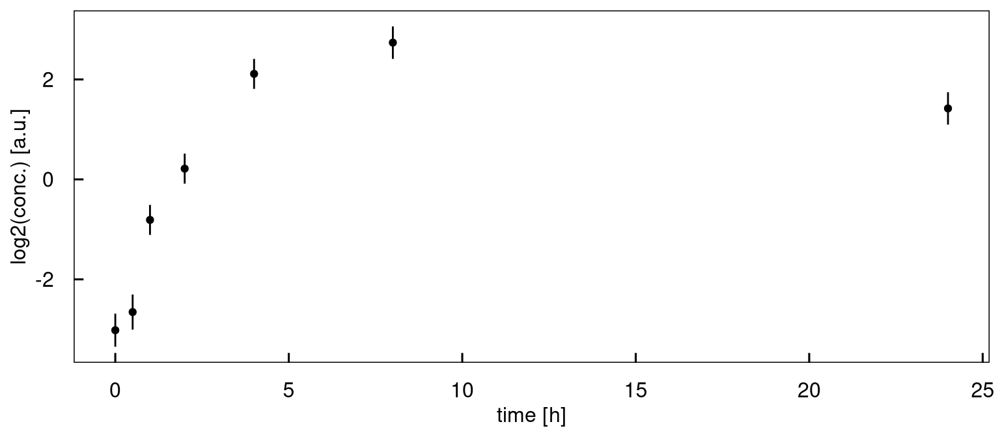
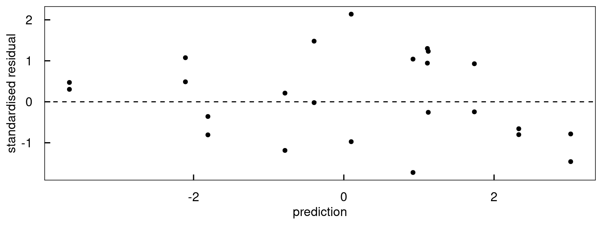
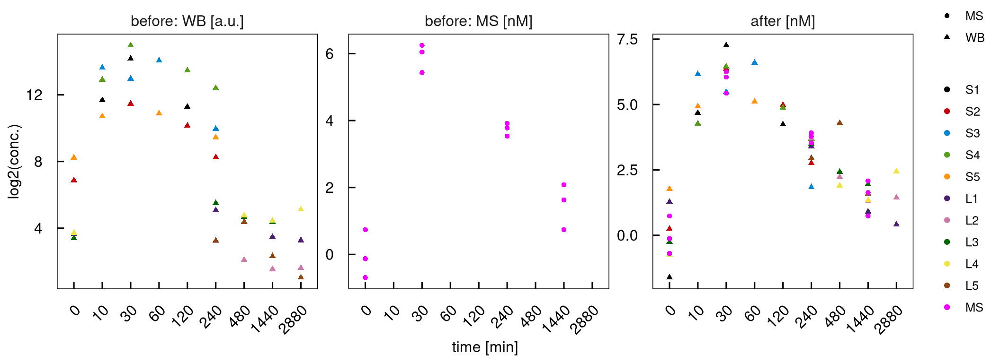
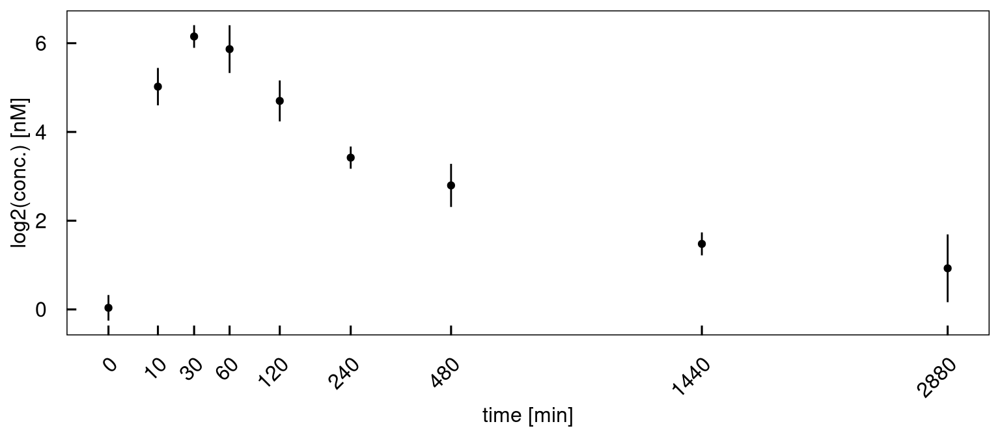
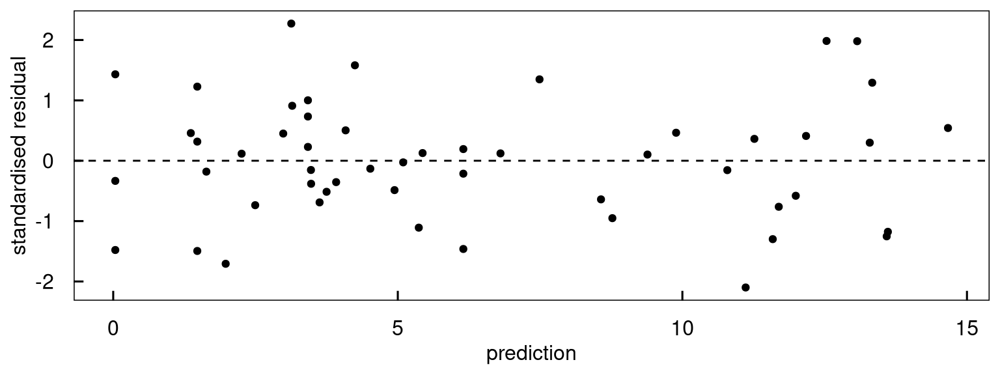
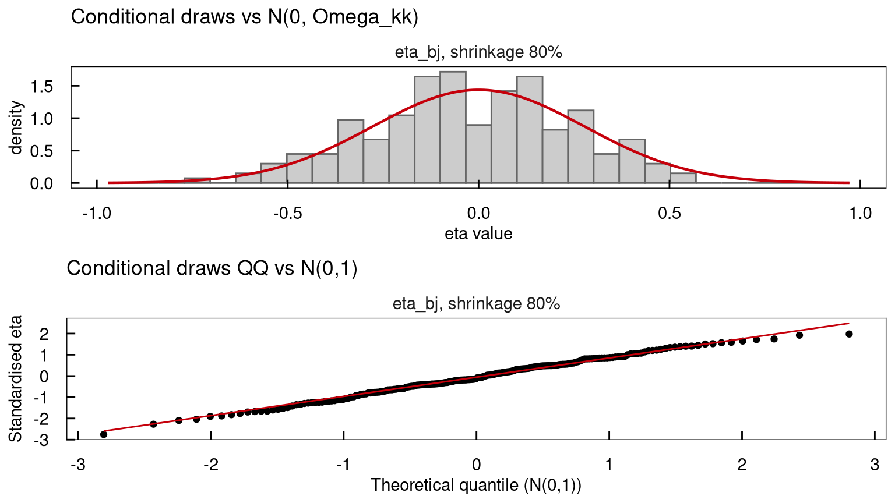
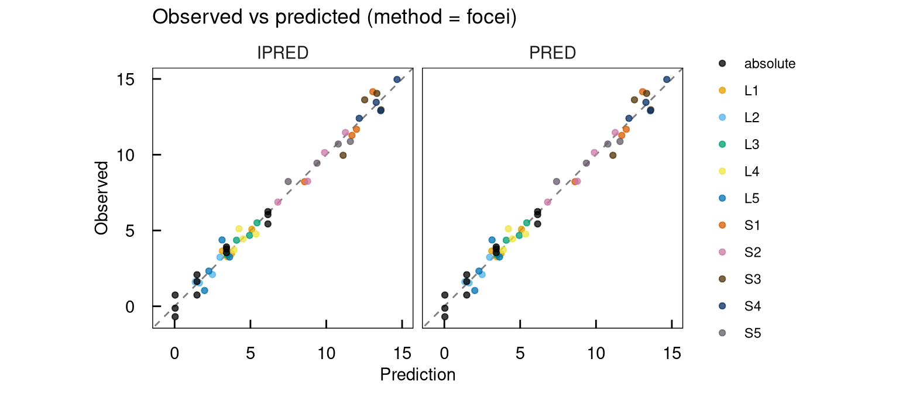

# `demo("alignment")`

Rendered by `dev/render-demos.R`; run it with `demo("alignment", package = "dMod2")`.

## Aligning qPCR experiments and Western blots

Replicates of relative measurements, each experiment on its own scale, aligned as in
blotIt (Kemmer, Bang, Rosenblatt, Timmer, Kaschek 2022, PLOS ONE 17: e0264295,
doi:10.1371/journal.pone.0264295): a free expression for the measured value in symbols
whose predictors are formulas over the columns of the data. First an mRNA by qPCR with
readings below the detection limit, aligned up to a common factor. Then a phosphoprotein
on Western blots with a background per gel, random between gels, together with targeted
mass spectrometry in nM, whose units the aligned values take. The blotIt of Kemmer et
al. has fixed effects only; the background that varies between gels as a random effect
goes beyond it.


``` r
library(dMod2)
library(ggplot2)
options(dMod2.outdir = file.path(tempdir(), "alignment"))
dir.create(getOption("dMod2.outdir"), showWarnings = FALSE)
```

## qPCR

The mRNA of a target gene after stimulation at seven time points, measured in three
experiments in technical duplicates. Each experiment has its own cDNA and plate and a
subset of the time points; no time point is in every experiment. A well reports the
cycle Ct at which its fluorescence crosses a threshold, a level set above the background
while the signal still grows exponentially. The amount doubles with every cycle, so
36 - Ct is the log2 concentration in arbitrary units, shifted by an offset of the
experiment. Untreated cells barely express the target: a well that has not crossed the
threshold after 40 cycles reports no Ct, and its reading lies below 36 - 40 = -4.
### Data

The column `lloq` holds the limit of every reading; a reading `NA` is censored there.


``` r
set.seed(5)
times <- c(0, 0.5, 1, 2, 4, 8, 24)
log2fold <- c(0, 0.3, 1.6, 3.6, 5.2, 5.6, 4.4)
runs <- list(E1 = times[1:6], E2 = times[c(1, 3:5, 7)], E3 = times[c(2, 6, 7)])
qpcr <- do.call(rbind, lapply(names(runs), function(e)
  data.frame(experiment = e, time = rep(runs[[e]], each = 2))))
offset <- setNames(rnorm(length(runs)), names(runs))
ct <- 39.3 - log2fold[match(qpcr$time, times)] - offset[qpcr$experiment] + rnorm(nrow(qpcr), 0, 0.8)
qpcr$value <- ifelse(ct < 40, 36 - ct, NA)
qpcr$lloq <- -4
head(qpcr)
```

```
#>   experiment time     value lloq
#> 1         E1  0.0        NA   -4
#> 2         E1  0.0        NA   -4
#> 3         E1  0.5 -3.358529   -4
#> 4         E1  0.5 -3.463122   -4
#> 5         E1  1.0 -2.032558   -4
#> 6         E1  1.0 -2.312237   -4
```

``` r
sum(is.na(qpcr$value))
```

```
#> [1] 4
```

### Model

The reading is `yi + sj`: `yi` the log2 concentration per time point, `sj` the offset of
the experiment. The error is absolute.


``` r
m <- alignmentModel(qpcr, model = "yi + sj", errmodel = "sigma",
                    biological = yi ~ time,
                    scaling    = sj ~ experiment,
                    error      = sigma ~ 1,
                    trafo = "sigma <- exp(sigma)")
m
```

```
#> alignmentModel: 28 readings, model yi + sj, error sigma
#>   yi         biological    7 parameters
#>   sj         scaling       3 parameters
#>   sigma      error         1 parameter, sigma = exp(sigma)
#>   4 readings censored at their lloq
#>   mean of yi normalized in 1 block of experiments
```

### Fit

The mean of the values is held at 0, so they are log2 concentrations relative to their
mean. Their differences to the untreated value are the log2 fold changes.


``` r
fit <- align(m, fits = 1)
fit
```

```
#> alignment: 28 readings, 7 biological values, -2 log L 49.76, 10 parameters, AIC 69.76
```

``` r
a <- fit$aligned
a$log2fc <- a$estimate - a$estimate[a$time == 0]
cbind(a[c("time", "estimate", "se", "log2fc")], simulated = log2fold[match(a$time, times)])
```

```
#>   time   estimate        se    log2fc simulated
#> 1  0.0 -3.0174167 0.3308717 0.0000000       0.0
#> 2  0.5 -2.6541558 0.3514302 0.3632609       0.3
#> 3  1.0 -0.8106575 0.2999378 2.2067592       1.6
#> 4  2.0  0.2151046 0.2999378 3.2325213       3.6
#> 5  4.0  2.1109517 0.2999378 5.1283685       5.2
#> 6  8.0  2.7362999 0.3247688 5.7537167       5.6
#> 7 24.0  1.4198738 0.3238500 4.4372905       4.4
```

The readings of every experiment before and after the alignment. A well without Ct has
no reading; it enters the fit as censored and is not drawn.


``` r
s <- fit$scaled[!fit$scaled$bloq, ]
both <- rbind(data.frame(s[c("experiment", "time")], stage = "before", value = s$value),
              data.frame(s[c("experiment", "time")], stage = "after", value = s$scaled))
both$stage <- factor(both$stage, c("before", "after"))
```

``` r
ggplot(both, aes(factor(time), value, colour = experiment)) +
  geom_point() + facet_wrap(~ stage) +
  labs(x = "time [h]", y = "log2(conc.) [a.u.]", colour = NULL) +
  scale_color_dMod() + theme_dMod()
```




``` r
plotAligned(fit) + labs(x = "time [h]", y = "log2(conc.) [a.u.]")
```




``` r
plotResiduals(fit)
```




### The aligned values as data for a model fit


``` r
as.datalist(fit)
```

```
#> C1:
#>   name time      value     sigma lloq
#> 1   yi  0.0 -3.0174167 0.3308717 -Inf
#> 2   yi  0.5 -2.6541558 0.3514302 -Inf
#> 3   yi  1.0 -0.8106575 0.2999378 -Inf
#> 4   yi  2.0  0.2151046 0.2999378 -Inf
#> 5   yi  4.0  2.1109517 0.2999378 -Inf
#> 6   yi  8.0  2.7362999 0.3247688 -Inf
#> 7   yi 24.0  1.4198738 0.3238500 -Inf
```

## Western blot and targeted mass spectrometry

A phosphoprotein after stimulation with a ligand, quantified on ten gels and by targeted
mass spectrometry. Five gels hold a short time course up to 4 h, five a long one up to
48 h; the two courses share only the untreated lane and 4 h. Every gel holds four of the
time points of its course and is imaged on a scale of its own, the long gels far lower
on the whole. A gel adds its own background to the bands, the signal of the membrane
around them, and its image scales both. The background shows on gels with weak lanes,
the untreated one and the late ones, and hides under the bands of the others. With a
background of its own on every gel, the untreated level and the typical background are
told apart only by how the background varies between gels: a normal random effect per
gel. The mass spectrometry measures the concentration in nM at four time points of both
courses in triplicate. Its readings are absolute: marked in the column `absolute`, they
are predicted by the expression `absolute`, by default the first biological symbol, and
depend on no scaling parameter. Their gel is `NA`. The block of experiments they belong
to is not normalized but comes out in nM.
### Data

One row per reading, log2 of the band in arbitrary units or of the concentration in nM.
The gels of the short course are S1 to S5, those of the long one L1 to L5.


``` r
set.seed(6)
short <- c(0, 10, 30, 60, 120, 240)
long <- c(0, 240, 480, 1440, 2880)
times <- sort(union(short, long))
conc <- c(1, 40, 85, 60, 25, 10, 6, 3, 2)
gels <- c(sprintf("S%d", 1:5), sprintf("L%d", 1:5))
course <- setNames(rep(c("short", "long"), each = 5), gels)
shift <- setNames(ifelse(course == "short", 6, 1) + rnorm(10, 0, 1.5), gels)
background <- setNames(1.5 + rnorm(10, 0, 0.3), gels)
wb <- do.call(rbind, lapply(gels, function(g)
  data.frame(method = "WB", gel = g, time = sort(sample(if (course[[g]] == "short") short else long, 4)))))
wb$value <- log2(conc[match(wb$time, times)] + 2^background[wb$gel]) + shift[wb$gel] +
  rnorm(nrow(wb), 0, 0.7)
ms <- data.frame(method = "MS", gel = NA, time = rep(c(0, 30, 240, 1440), each = 3))
ms$value <- log2(conc[match(ms$time, times)]) + rnorm(nrow(ms), 0, 0.5)
wbms <- rbind(cbind(wb, absolute = FALSE), cbind(ms, absolute = TRUE))
head(wbms)
```

```
#>   method gel time     value absolute
#> 1     WB  S1    0  8.219017    FALSE
#> 2     WB  S1   10 11.673758    FALSE
#> 3     WB  S1   30 14.158178    FALSE
#> 4     WB  S1  120 11.274899    FALSE
#> 5     WB  S2    0  6.870860    FALSE
#> 6     WB  S2   30 11.463610    FALSE
```

### Model

A band reads `log2(2^yi + 2^(b + bj)) + sj`: the log2 concentration `yi` in nM per time
point plus the background, shifted by `sj` per gel, all on the log2 scale. The log2
background is the fixed `b`, common to all gels, plus `bj`, a normal random effect around
0 per gel. A mass spectrometry reading is `yi` itself. The error is absolute, one per
method. The data say little about the background: its spread between gels is small, and
the bands hide most of it. A prior keeps the standard deviation of `bj` near 0.3, its log
`omega_bj_bj` normal around log(0.3) with standard deviation 0.3, and a weak one puts `b`
around 1 nM, normal around 0 with standard deviation 2.


``` r
m <- alignmentModel(wbms, model = "log2(2^yi + 2^(b + bj)) + sj", errmodel = "sigma",
                    biological = yi ~ time,
                    scaling    = list(sj ~ gel, b ~ 1, bj ~ 0 + (1 | gel)),
                    error      = sigma ~ method,
                    trafo = "sigma <- exp(sigma)",
                    prior = constraintL2(mu = c(omega_bj_bj = log(0.3), b = 0),
                                         sigma = c(omega_bj_bj = 0.3, b = 2)))
m
```

```
#> alignmentModel: 52 readings, model log2(2^yi + 2^(b + bj)) + sj, error sigma
#>   yi         biological    9 parameters
#>   sj         scaling      10 parameters
#>   b          scaling       1 parameter
#>   bj         scaling       0 parameters, random over gel
#>   sigma      error         2 parameters, sigma = exp(sigma)
#>   prior on omega_bj_bj, b 
#>   12 absolute readings, model yi: 1 of 1 block on their scale
```

### Fit

The values come out as log2 concentrations in nM, also at the time points the mass
spectrometry did not measure:


``` r
fit <- align(m, fits = 1)
fit
```

```
#> alignment: 52 readings, 9 biological values, -2 log L 83.41, 23 parameters, AIC 129.41
```

``` r
a <- fit$aligned[order(fit$aligned$time), ]
cbind(a[c("time", "estimate", "se")], nM = round(2^a$estimate, 1), simulated = conc[match(a$time, times)])
```

```
#>   time   estimate        se   nM simulated
#> 1    0 0.03655316 0.2883765  1.0         1
#> 2   10 5.02136776 0.4216913 32.5        40
#> 3   30 6.15132966 0.2557986 71.1        85
#> 6   60 5.86656464 0.5383944 58.3        60
#> 4  120 4.69975124 0.4618403 26.0        25
#> 5  240 3.42096099 0.2502693 10.7        10
#> 9  480 2.79491521 0.4861345  6.9         6
#> 7 1440 1.47703792 0.2584950  2.8         3
#> 8 2880 0.92697603 0.7638352  1.9         2
```

The background in nM and the standard deviations of the two methods on the log2 scale:


``` r
p <- fit$parameters
round(2^p[["b"]], 2)
```

```
#> [1] 2.31
```

``` r
c(MS = exp(p[["sigma"]]), WB = exp(p[["sigma"]] + p[["sigma_methodWB"]]))
```

```
#>        MS        WB 
#> 0.4912902 0.5487917
```

The readings of every gel and of the mass spectrometry before and after the alignment,
one colour per gel. Before it, the bands are in arbitrary units on the scales of their
gels and the mass spectrometry in nM; after it, all are in nM. The absolute readings stay
as they are:


``` r
s <- fit$scaled
s$gel <- factor(ifelse(s$absolute, "MS", s$gel), c(gels, "MS"))
panel <- c("before: WB [a.u.]", "before: MS [nM]", "after [nM]")
both <- rbind(data.frame(s[c("gel", "method", "time")], reading = s$value,
                         panel = ifelse(s$absolute, panel[2], panel[1])),
              data.frame(s[c("gel", "method", "time")], reading = s$scaled, panel = panel[3]))
both$panel <- factor(both$panel, panel)
```

``` r
ggplot(both[is.finite(both$reading), ], aes(factor(time), reading, colour = gel, shape = method)) +
  geom_point() + facet_wrap(~ panel, scales = "free_y") +
  guides(x = guide_axis(angle = 45)) +
  labs(x = "time [min]", y = "log2(conc.)", colour = NULL, shape = NULL) +
  scale_color_dMod(palette = "dMod") + theme_dMod()
```




``` r
plotAligned(fit) + scale_x_sqrt(breaks = times) + guides(x = guide_axis(angle = 45)) +
  labs(x = "time [min]", y = "log2(conc.) [nM]")
```




``` r
plotResiduals(fit)
```




### Random background

The standard deviation of the log2 background between gels, and per gel the mode of its
random effect with its conditional standard error. The standard deviation lies near the
mean of its prior: its value comes mostly from the prior, not from the data.


``` r
fit$omega
```

```
#>     type eta1 eta2  estimate         se
#> row   sd   bj   bj 0.2775261 0.07877185
```

``` r
fit$random
```

```
#>    group eta parameter         mode        se
#> 1     S1  bj eta_bj_S1 -0.066548854 0.2619842
#> 2     S2  bj eta_bj_S2 -0.004927476 0.2607822
#> 3     S3  bj eta_bj_S3 -0.031607264 0.2762200
#> 4     S4  bj eta_bj_S4  0.004391036 0.2759803
#> 5     S5  bj eta_bj_S5  0.128260216 0.2598588
#> 6     L1  bj eta_bj_L1  0.025619495 0.2467956
#> 7     L2  bj eta_bj_L2  0.009167521 0.2582406
#> 8     L3  bj eta_bj_L3  0.003285968 0.2533464
#> 9     L4  bj eta_bj_L4  0.040362300 0.2457822
#> 10    L5  bj eta_bj_L5 -0.061122193 0.2591295
```

The shrinkage, 1 - SD(modes) / omega, says how much the data know about the random
effect of a single gel. Where the bands hide the background, the mode of a gel stays
near 0, the population value. The aligned values, `b` and omega integrate over the
random effects and do not depend on it. But the mode of a gel is no measurement of its
background, and plots of the modes look too narrow.


``` r
fit$fit$shrinkage
```

```
#>   eta_bj 
#> 0.799672
```

Draws from the conditional distributions of the random effects against the estimated
normal distribution, which they follow whatever the shrinkage. At a high shrinkage the
draws mostly repeat that normal distribution, so the plot could hardly reveal a
background distributed otherwise.


``` r
plotRandomEffects(fit$fit)
```




The readings against the individual prediction (IPRED), with the random effects at
their modes, and the population prediction (PRED), with every gel at the population
background:


``` r
plot(fit$fit) + theme(legend.position = "right") + labs(colour = NULL)
```




