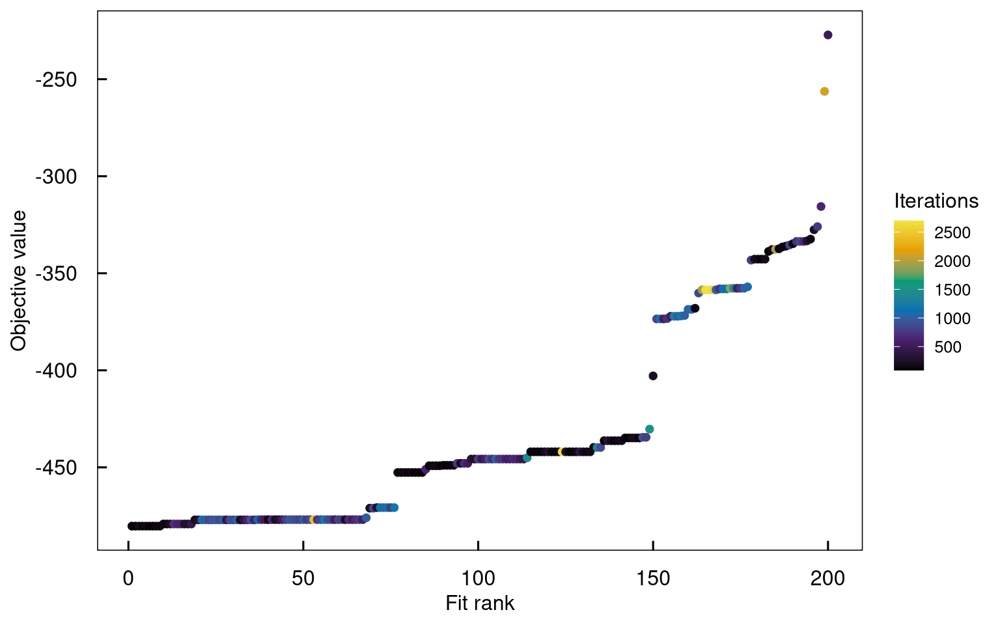
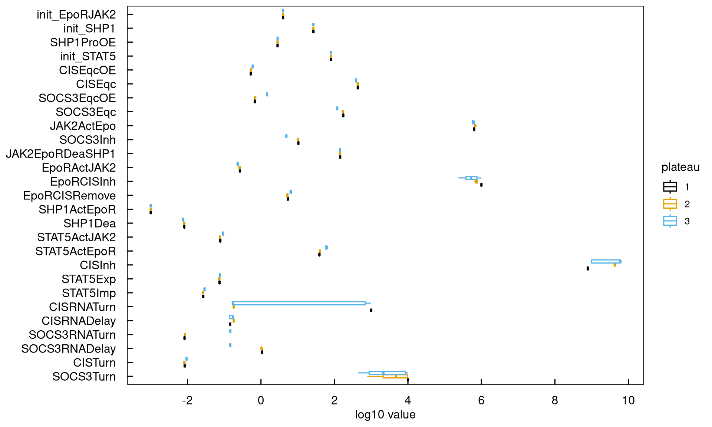
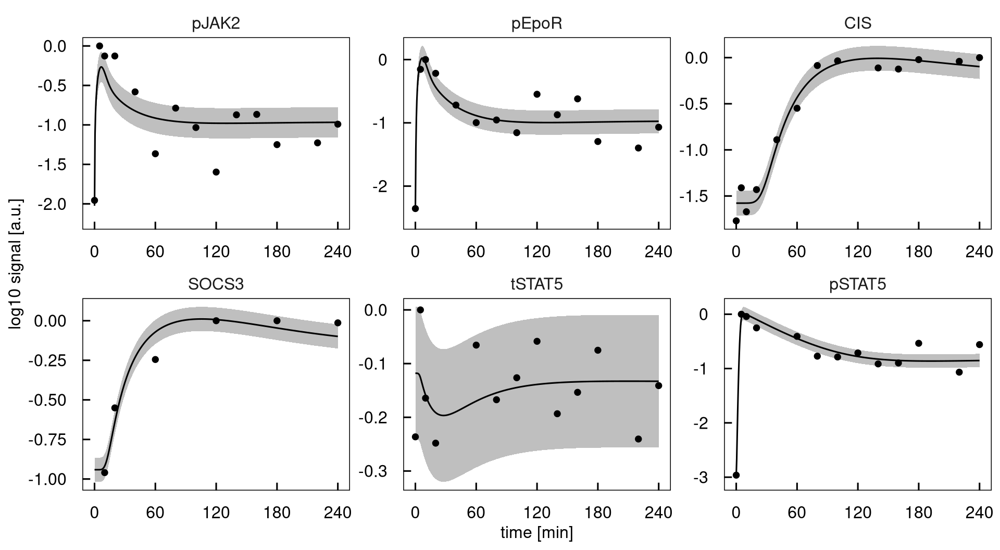
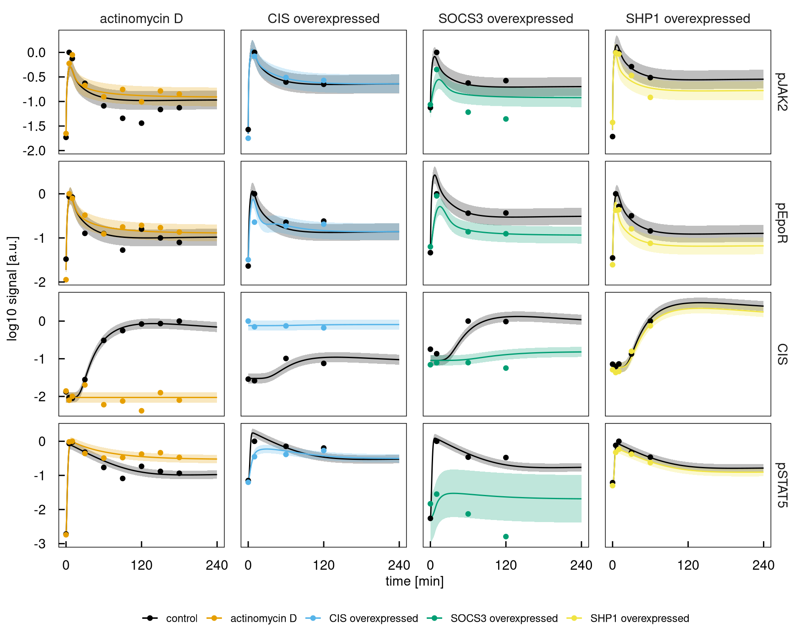
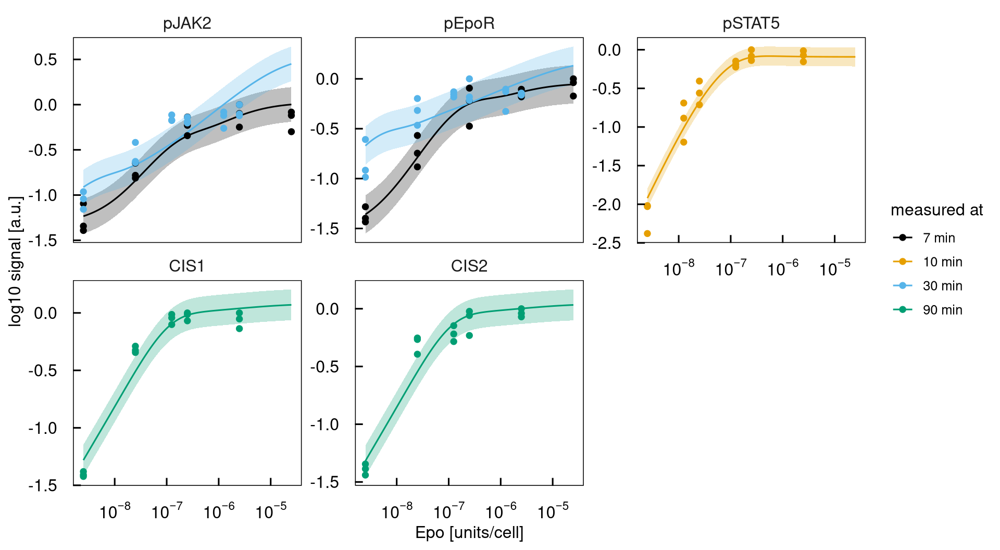

# Bachmann 2011


JAK2-STAT5 signalling in CFU-E cells with the feedbacks of CIS, SOCS3 and SHP1, after Bachmann et
al. (2011), Mol Syst Biol 7:516. 541 measurements from 13 experiments in 36 conditions, 20
observables, 113 parameters, fitted within the bounds of the publication. The guide chapter
[PEtab](https://dmodverse.github.io/dMod2/articles/guide-petab.html) imports the problem from the
PEtab benchmark collection.

## Files

| file | content |
|---|---|
| `model.R` | data, reactions, observables, error model, conditions, compiling, objective |
| `fit.R` | multistart of 200 fits, saves `results/fits.rds` |
| `plots.R` | figures from the saved results |
| `petab.R` | the problem from its PEtab files, compared with `model.R`, and `model.R` written as PEtab |
| `results/` | saved fits |

## Run

With this folder as working directory:

```r
source("model.R")     # about a minute, mostly compiling into build/
source("fit.R")       # about 100 core hours
source("plots.R")
```

`model.R` uses the free cores of the machine. The guide chapter
[Remote computing](https://dmodverse.github.io/dMod2/articles/guide-remote-computing.html) shows how
to run a multistart on other machines. `plots.R` only reads `results/`.


## Fit

200 of 200 fits returned, 200 converged. The best value of -2 log L is -480.298, reached by 9 fits within 1. The published optimum has -480.298.







## Prediction


Reference time course, 5 units/ml Epo:




Perturbations, control against perturbed:




Dose responses:



