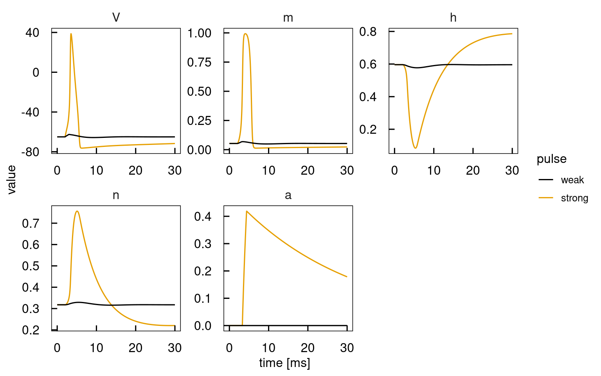
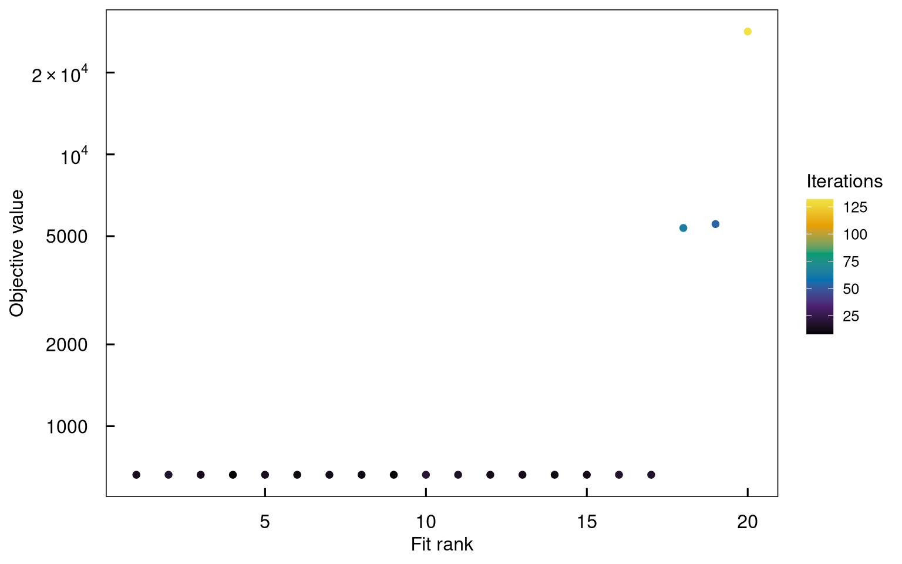
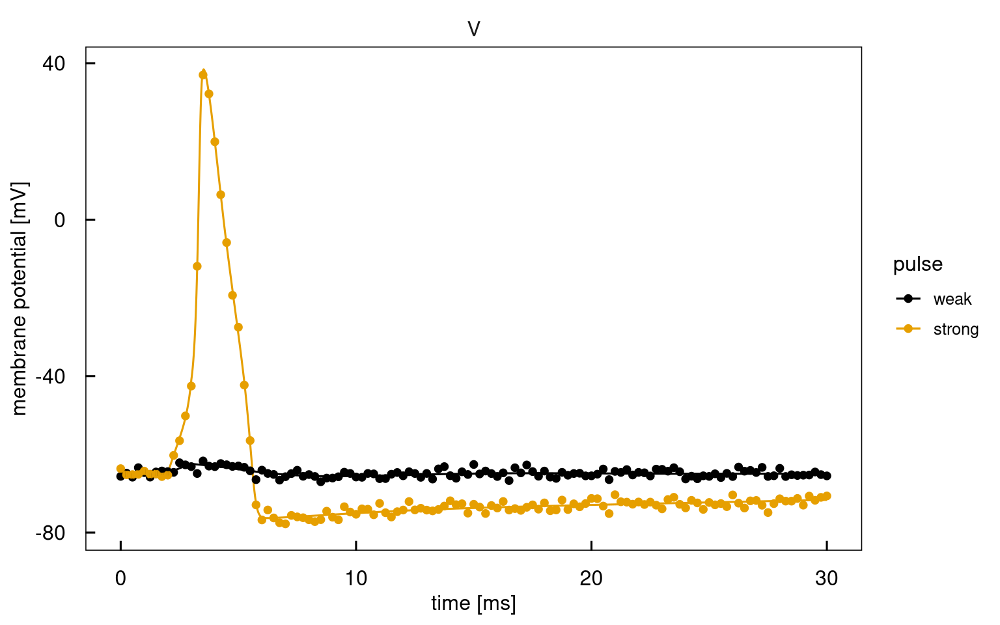
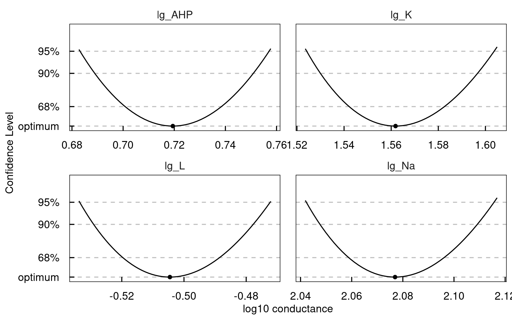

# Hodgkin-Huxley

The Hodgkin-Huxley model of the squid axon with a current pulse written with `piecewise()`: simulated data, fit and profiles.

## Files

| file | content |
|---|---|
| `analysis.R` | the analysis, shown below |

## Run

With this folder as working directory: `source("analysis.R")`.


``` r
library(dMod2)
library(ggplot2)

.modelname <- "hodgkinHuxley"
dir.create("build", showWarnings = FALSE)
# generated sources and shared objects in build/, reused when nothing changed
options(dMod2.outdir = "build")
.cores <- detectFreeCores()
set.seed(1)
```

## Model
Gate rates with a removable 0/0 at one voltage, written with piecewise(), and a
current pulse switched on and off in time.

``` r
alpha_m <- "piecewise(1, V == -40, 0.1*(V + 40)/(1 - exp(-(V + 40)/10)))"
beta_m  <- "4*exp(-(V + 65)/18)"
alpha_h <- "0.07*exp(-(V + 65)/20)"
beta_h  <- "1/(1 + exp(-(V + 35)/10))"
alpha_n <- "piecewise(0.1, V == -55, 0.01*(V + 55)/(1 - exp(-(V + 55)/10)))"
beta_n  <- "0.125*exp(-(V + 65)/80)"

I_Na   <- "g_Na*m^3*h*(V - E_Na)"
I_K    <- "g_K*n^4*(V - E_K)"
I_L    <- "g_L*(V - E_L)"
I_AHP  <- "g_AHP*a*(V - E_K)"
I_stim <- "piecewise(I0, time >= t_on && time < t_on + dur, 0)"

f <- eqnvec(
  V = paste0("(", I_stim, " - ", I_Na, " - ", I_K, " - ", I_L, " - ", I_AHP, ")/C_m"),
  m = paste0(alpha_m, "*(1 - m) - ", beta_m, "*m"),
  h = paste0(alpha_h, "*(1 - h) - ", beta_h, "*h"),
  n = paste0(alpha_n, "*(1 - n) - ", beta_n, "*n"),
  # the right-hand side jumps where V crosses V_th; the solver locates the switch
  a = "piecewise((1 - a)/tau_on, V > V_th, -a/tau_off)"
)

model <- odemodel(f, modelname = "hh_ode", compile = FALSE)
x <- Xs(model)
```

## Parameters
The gates start at their steady state at -65 mV, the AHP gate closed.

``` r
gateAtRest <- function(alpha, beta, V = -65) {
  env <- list(V = V, piecewise = function(value, condition, otherwise)
    if (condition) value else otherwise)
  a <- eval(parse(text = alpha), env); b <- eval(parse(text = beta), env)
  a/(a + b)
}

trafo <- eqnvec(
  V = "-65",
  m = gateAtRest(alpha_m, beta_m),
  h = gateAtRest(alpha_h, beta_h),
  n = gateAtRest(alpha_n, beta_n),
  a = "0",
  g_Na = "10^lg_Na", g_K = "10^lg_K", g_L = "10^lg_L", g_AHP = "10^lg_AHP",
  E_Na = "50", E_K = "-77", E_L = "-54.387", C_m = "1",
  V_th = "0", tau_on = "2", tau_off = "30",
  t_on = "2", dur = "1", I0 = "I0"
)
```

A weak pulse stays below threshold, a strong one fires a spike and opens the AHP
gate.

``` r
pulses <- data.frame(I0 = c(3, 20), row.names = c("weak", "strong"))
p <- trafo |>
  branch(table = pulses, apply = "insert") |>
  P(modelname = "hh_trafo", compile = FALSE)

compile(x, p, output = .modelname, cores = .cores)

pars_true <- c(lg_Na = log10(120), lg_K = log10(36), lg_L = log10(0.3), lg_AHP = log10(5))
```

## Simulated data
The membrane potential from the true conductances, every 0.25 ms with 1 mV noise.

``` r
times <- seq(0, 30, by = 0.02)
# the weak pulse first, as in the legend of every plot
pulseOrder <- scale_color_dMod(limits = c("weak", "strong"))
plot((x*p)(times, pars_true, deriv = FALSE)) + pulseOrder + labs(x = "time [ms]", colour = "pulse")
```




``` r
data <- as.data.frame((x*p)(seq(0, 30, by = 0.25), pars_true, deriv = FALSE))
data <- subset(data, name == "V")
data$sigma <- 1
data$value <- data$value + rnorm(nrow(data), sd = data$sigma)
data <- as.datalist(data)
```

## Fit
Twenty starts around the true conductances.

``` r
obj <- normL2(data, x*p)

fits <- mstrust(obj, pars_true, fits = 20, sd = 0.5, cores = .cores)
plotValues(fits, pseudoLog = TRUE)
```




``` r
bestfit <- as.parvec(fits)
rbind(true = pars_true, fit = bestfit)
```

```
#>         lg_Na     lg_K       lg_L    lg_AHP
#> true 2.079181 1.556303 -0.5228787 0.6989700
#> fit  2.076958 1.561851 -0.5045314 0.7194383
```

``` r
plotCombined((x*p)(times, bestfit, deriv = FALSE), data, name == "V") + pulseOrder +
  labs(x = "time [ms]", y = "membrane potential [mV]", colour = "pulse")
```




## Profiles
How well the voltage trace of the two pulses determines each conductance.

``` r
profiles <- profile(obj, bestfit, names(bestfit), cores = .cores)
plotProfile(profiles, mode == "data") + labs(x = "log10 conductance")
```




``` r
confint(profiles)
```

```
#>          name      value      lower      upper
#> lg_AHP lg_AHP  0.7194383  0.6831549  0.7570720
#> lg_K     lg_K  1.5618514  1.5241544  1.6036853
#> lg_L     lg_L -0.5045314 -0.5335305 -0.4722975
#> lg_Na   lg_Na  2.0769580  2.0422626  2.1156488
```
