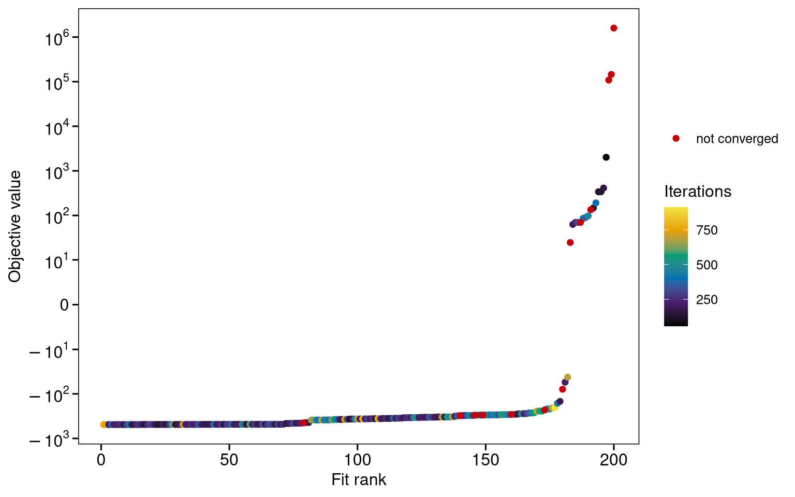
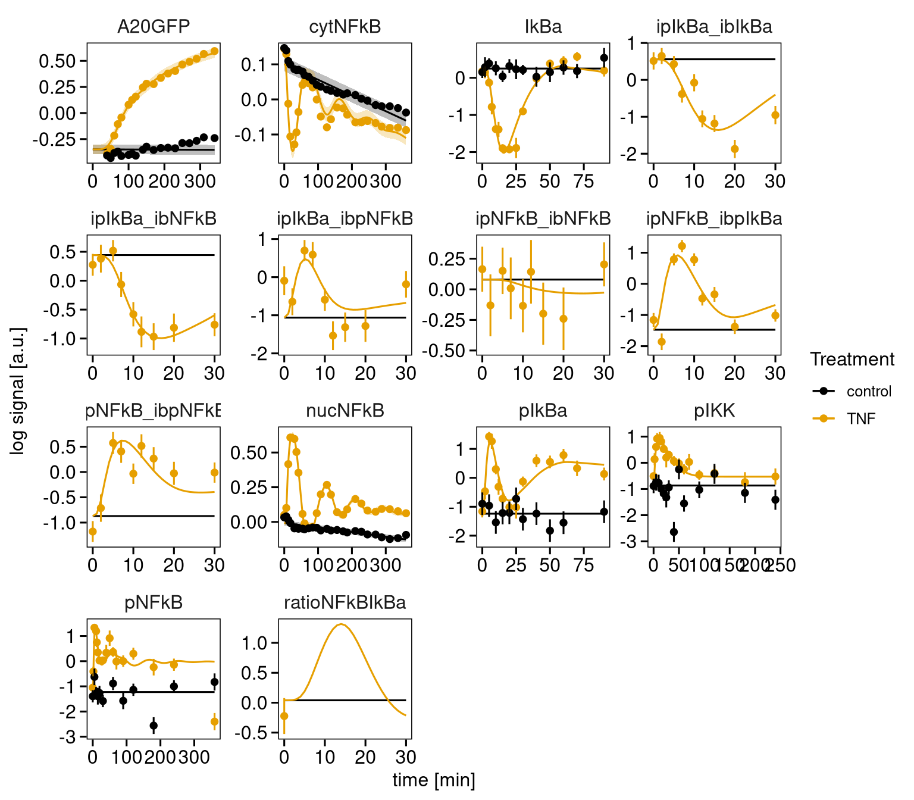
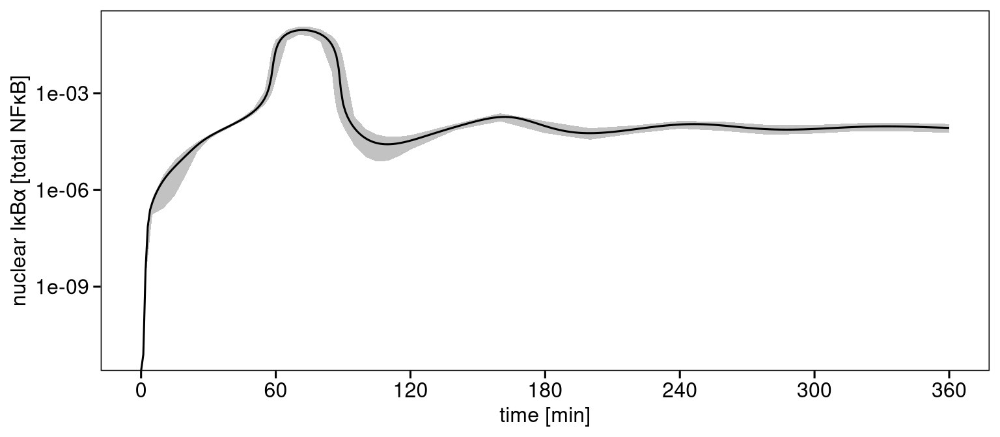
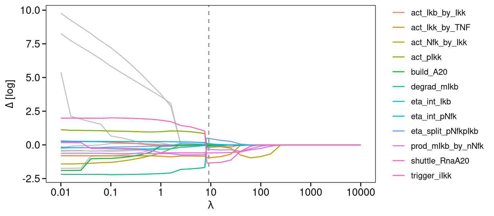

# NFκB signaling (Oppelt 2018)

Shows: `Pimpl()`, `symmetryDetection()`, `symmetryReduction()`, `mstrust()`, `trust()`, `trustL1()`, `profile()`, `constraintStability()`, `randomEffects()`, `msem()`, `exportPEtab()`, `importPEtab()`.


NFκB signaling in HepG2 cells after TNFα and the effects of diclofenac (DCF), after
Oppelt et al. (2018), npj Syst Biol Appl 4:23. The full model has 38 reactions in cytoplasm and
nucleus and starts from a steady state solved by `Pimpl()`; the symmetries are removed by a gauge,
and the profiles reduce it to the core model of the publication. 312 measurements of untreated and
stimulated cells determine the model, 182 further ones under DCF the effects of DCF. Data of the
publication; model after Daniel Kaschek's dMod implementation (dkaschek/dMod_Examples, TNFa). The
[guide](https://dmodverse.github.io/dMod2/articles/guide-model.html) explains the code.

## Files

| file | content |
|---|---|
| `data/oppelt2018.csv` | the measurements of the publication |
| `model.R` | data, the full model, the resting state, conditions, compiling, objective, the gauge |
| `symmetries.R` | the Lie symmetries of the full model and their reduction, saves `results/symmetries.rds` and `results/reduction.rds` |
| `fit.R` | multistart of 200 fits, saves `results/fits.rds` |
| `onefit.R` | one fit from a start near the best fit, saves `results/onefit.rds` for the guide |
| `sensitivities.R` | forward and reverse gradient and the exact Hessian at the best fit, saves `results/sensitivities.rds` for the guide |
| `optimizers.R` | the Hessian sources of `trust()` from the same 100 starts, saves `results/optimizers.rds` for the guide |
| `profiles.R` | profiles of all parameters, saves `results/profiles.rds` |
| `variants.R` | core model of the publication and variants that release one setting, likelihood ratios, saves `results/variants.rds` |
| `reduced.R` | the model reduced by the limits the profiles point to |
| `discrete.R` | the discrete symmetry of the reduced model and the chart of a fundamental domain, saves `results/discrete.rds` |
| `fundamental.R` | fit and profiles of the reduced model in the chart of the fundamental domain, saves `results/fundamental.rds` |
| `refit.R` | fit and profiles of the reduced model, likelihood ratio, saves `results/reduced.rds` |
| `prediction.R` | prediction band of nuclear IκBα, saves `results/prediction.rds` |
| `dcf.R` | the changes by DCF as in the publication, by the L1 scan and by spike-and-slab random effects, saves `results/dcf.rds` and `results/dcfL1.rds` |
| `helix.R` | the expensive runs (multistarts, profiles, optimizers, the L1 scan and spike and slab of DCF, the profiles of the reduced model and the prediction profiles) as array jobs of one or two cores per task on the Helix cluster |
| `petab.R` | the model as a PEtab problem with the resting state as a pre-equilibration, written to `results/petab/` and read back |
| `plots.R` | figures from the saved results |
| `results/` | saved results, each with the md5 of the files it is computed from in the attribute `"stamp"` |

## Run

With this folder as working directory, in this order:

```r
source("model.R")        # compiles into build/
source("symmetries.R")   # needs the Python package symident
source("fit.R")
source("onefit.R")
source("sensitivities.R")
source("optimizers.R")
source("profiles.R")
source("variants.R")
source("refit.R")
source("prediction.R")
source("dcf.R")
source("petab.R")
source("plots.R")
```

`model.R` evaluates on the free cores of the machine and compiles on six. `plots.R` fits nothing:
it reads `results/` and simulates the compiled models.


## Fit

200 fits, 187 converged. The best value is -488.677, reached by 10 fits within 0.1.







## Reduction

The reduced model is the core model of the publication (Table S5) with two delay steps of the
A20 transcript, a separate factor `eta_split_pNfkpIkb` for the release of pNFκB, and the NFκB blot
after NFκB precipitation reading the offset alone.

The profiles of the full model lead to a model with 16 fewer parameters, whose data term is 19.05 higher, below the 95% threshold of 26.30; 46 of the 47 parameters of the reduced model have a finite 95% interval. [Profile likelihood](https://dmodverse.github.io/dMod2/articles/guide-profiles.html) shows the limits.

## Prediction


The 95% prediction band of nuclear IκBα, not measured, in the reduced model:




## DCF


The differences by DCF over the strength of the L1 penalty, as in Fig. 2a of the publication; in
color those kept at the selected strength (dashed):



