# Pharmacometrics

Theophylline, warfarin PK/PD and mavoglurant with occasions: FOCEI and SAEM multistarts, diagnostics, and nlmixr2 on the same starts.

## Files

| file | content |
|---|---|
| `analysis.R` | the analysis, shown below |
| `results/cache.rds` | saved fits; delete it to fit again |
| `theophyllineMultistart.R` | multistarts of the theophylline model by FOCEI, quadrature and SAEM, saves `results/multistart.rds` for the guide |

## Run

With this folder as working directory: `source("analysis.R")`.


``` r
library(dMod2)
dir.create("build", showWarnings = FALSE)
# generated sources and shared objects in build/, reused when nothing changed
options(dMod2.outdir = "build")
cores <- max(1L, min(20L, parallel::detectCores() - 2L))
nstart <- 100L
withNlmixr2 <- requireNamespace("nlmixr2", quietly = TRUE)
# second derivatives forward over reverse for FOCEI, forward over forward for its reported Hessian
dm <- c("forward", "reverse", "forward-reverse")

# fits are saved in results/cache.rds under a key and read from there when present; delete the
# file to fit everything again
cached <- function(key, expr) {
  file <- "results/cache.rds"
  dir.create("results", showWarnings = FALSE)
  store <- if (file.exists(file)) readRDS(file) else list()
  if (is.null(store[[key]])) {
    store[[key]] <- expr
    saveRDS(store, file)
  }
  store[[key]]
}
# a fit of em() cached without its model, which an evaluation at its estimates restores
cachedEm <- function(key, obj, random, start, control = list(), ...) {
  model <- c("design", "prdfn", "errfn", "data")
  f <- cached(key, { f <- em(obj, random, start, control = control, ...); f[model] <- NULL; f })
  f[model] <- em(obj, random, f, control = modifyList(control, list(trustControl = list(iterlim = 0),
                                                                    boundary = FALSE)),
                 verbose = FALSE)[model]
  f
}
```

## Multistarts

The starts: the initial values on the log scale and `nstart - 1` draws around them, N(0, 0.5)
per parameter. Every fit runs on one core, `nstart` fits on `cores` cores at once.

``` r
drawStarts <- function(init, n = nstart) {
  set.seed(1)
  rbind(init, t(vapply(seq_len(n - 1L), function(i) init + rnorm(length(init), 0, 0.5), init)))
}

# dMod2 from every start; the fits as a table of -2 log L, convergence, seconds and estimates
runDMod2 <- function(obj, random, starts, method) {
  out <- parallel::mclapply(seq_len(nrow(starts)), function(i) {
    options(dMod2.cores = 1L)
    set.seed(i)
    t <- system.time(f <- tryCatch(em(obj, random, starts[i, ], method = method, verbose = FALSE),
                                   error = function(e) NULL))[["elapsed"]]
    if (is.null(f)) return(list(value = NA_real_, converged = FALSE, seconds = t, argument = NULL))
    list(value = f$value, converged = isTRUE(f$converged), seconds = t, argument = f$argument)
  }, mc.cores = cores, mc.preschedule = FALSE)
  data.frame(package = "dMod2", start = seq_along(out), value = vapply(out, `[[`, 0, "value"),
             converged = vapply(out, `[[`, TRUE, "converged"), seconds = vapply(out, `[[`, 0, "seconds"))
}

# the model `ui` of nlmixr2 at a start `s`: `toIni` turns it into the arguments of rxode2::ini(),
# which evaluates the random effects in `envir`, where it needs lotri()
iniAt <- function(ui, toIni, s) do.call(rxode2::ini, c(list(ui), toIni(s), envir = asNamespace("rxode2")))

# a fit of nlmixr2 by `est` of the model `m` on `data`, NULL where it fails
fitNlmixr2 <- function(m, data, est) {
  control <- if (est == "focei") nlmixr2est::foceiControl(print = 0) else nlmixr2est::saemControl(print = 0)
  out <- NULL
  utils::capture.output(out <- tryCatch(suppressMessages(suppressWarnings(
    nlmixr2est::nlmixr2(m, data, est = est, control = control))), error = function(e) NULL))
  out
}

# nlmixr2 from every start, the model compiled by a first fit before the workers start
runNlmixr2 <- function(ui, data, starts, est, toIni) {
  rxode2::setRxThreads(1L)
  fitNlmixr2(ui, data, est)
  out <- parallel::mclapply(seq_len(nrow(starts)), function(i) {
    rxode2::setRxThreads(1L)
    set.seed(i)
    t <- system.time(f <- fitNlmixr2(iniAt(ui, toIni, starts[i, ]), data, est))[["elapsed"]]
    if (is.null(f)) return(list(value = NA_real_, converged = FALSE, seconds = t))
    list(value = -2 * as.numeric(suppressMessages(stats::logLik(f))), seconds = t,
         converged = est == "saem" || !grepl("false|maximum|limit|not", f$message, ignore.case = TRUE))
  }, mc.cores = cores, mc.preschedule = FALSE)
  data.frame(package = "nlmixr2", start = seq_along(out), value = vapply(out, `[[`, 0, "value"),
             converged = vapply(out, `[[`, TRUE, "converged"), seconds = vapply(out, `[[`, 0, "seconds"))
}

# what the comparison reads of a fit of nlmixr2, which a cache holds
nlmixr2Summary <- function(f) {
  table <- as.data.frame(f)
  list(theta = f$theta, omega = f$omega, parFixedDf = f$parFixedDf, covMethod = f$covMethod,
       logLik = as.numeric(stats::logLik(f)), shrink = f$shrink, eta = as.data.frame(f$eta),
       table = table[intersect(c("ID", "TIME", "CMT", "IPRED"), names(table))])
}

# the initial values of random effects for rxode2::ini(), variances from the log standard
# deviations `map` (eta = omega) of a start
etaIni <- function(map, s)
  unname(Map(function(e, o) stats::as.formula(sprintf("%s ~ %.10g", e, exp(2 * s[[o]]))), names(map), map))

# per package the best value, the starts within 0.1 of it, the failed and unconverged fits, the
# median and total seconds per fit
summariseStarts <- function(runs) {
  do.call(rbind, lapply(split(runs, runs$package), function(r) {
    best <- min(r$value, na.rm = TRUE)
    data.frame(package = r$package[1], best = best, hits = sum(r$value - best < 0.1, na.rm = TRUE),
               failed = sum(is.na(r$value)), unconverged = sum(!r$converged & !is.na(r$value)),
               medianSeconds = stats::median(r$seconds), totalSeconds = sum(r$seconds))
  }))
}

# the waterfall of both packages, a panel each, and the seconds per fit
plotStarts <- function(runs, title) {
  w <- plotValues(split(runs, factor(runs$package, unique(runs$package))), pseudoLog = TRUE) +
    ggplot2::labs(title = title)
  s <- ggplot2::ggplot(runs, ggplot2::aes(package, seconds)) + ggplot2::geom_boxplot() +
    ggplot2::scale_y_log10(labels = scales::label_log()) +
    ggplot2::labs(x = NULL, y = "seconds per fit, one core") + theme_dMod()
  cowplot::plot_grid(w, s, nrow = 1, rel_widths = c(2, 1))
}

# the estimates of both packages on the log scale with standard errors, and their difference in
# standard errors of dMod2
compareFits <- function(fit, nfit, fromNlmixr2) {
  est <- fit$argument
  se <- sqrt(pmax(diag(vcov(fit)), 0))[names(est)]
  n <- fromNlmixr2(nfit)
  out <- data.frame(dMod2 = est[names(n$estimate)], seDMod2 = se[names(n$estimate)], nlmixr2 = n$estimate,
                    seNlmixr2 = n$se[names(n$estimate)])
  out$differenceInSE <- (out$dMod2 - out$nlmixr2) / out$seDMod2
  out
}

# the EBEs and IPRED of both packages against each other: `etas` maps the random effects of dMod2
# to those of nlmixr2, `id` the groups of dMod2 to the IDs of nlmixr2, `rows` the rows of both to keys
plotAgainst <- function(fit, nfit, etas, id, rows) {
  e <- fit$random[fit$random$eta %in% names(etas), ]
  ne <- as.data.frame(nfit$eta)
  e$nlmixr2 <- mapply(function(g, k) ne[match(id(g), as.character(ne$ID)), etas[[k]]], e$group, e$eta)
  pr <- predict(fit)
  pr <- pr[pr$source == "obs", ]
  nd <- nfit$table
  pr$nlmixr2 <- nd$IPRED[match(rows$dMod2(pr), rows$nlmixr2(nd))]
  a <- ggplot2::ggplot(e, ggplot2::aes(nlmixr2, mode)) + ggplot2::geom_abline(linetype = 2, color = "grey50") +
    ggplot2::geom_point() + ggplot2::facet_wrap(~ eta, scales = "free") +
    ggplot2::labs(x = "EBE nlmixr2", y = "EBE dMod2") + theme_dMod()
  b <- ggplot2::ggplot(pr, ggplot2::aes(nlmixr2, IPRED)) + ggplot2::geom_abline(linetype = 2, color = "grey50") +
    ggplot2::geom_point(alpha = 0.5) + ggplot2::facet_wrap(~ name, scales = "free") +
    ggplot2::labs(x = "IPRED nlmixr2", y = "IPRED dMod2") + theme_dMod()
  cowplot::plot_grid(a, b, nrow = 1, rel_widths = c(2, 1))
}

# the comparison of one model: FOCEI against FOCEI (multistarts, best fits, -2 log L, shrinkage, EBEs
# and IPRED), SAEM against SAEM with -2 log L of both by FOCEI
compareAll <- function(obj, random, starts, runs, nruns, fit, ui, ndata, toIni, fromNlmixr2, etas, id, rows, label,
                       saem = list(obj = obj, random = random, starts = starts, ui = ui, toIni = toIni)) {
  refit <- function(r, ui, toIni, starts, est)
    cached(paste(label, "nlmixr2", est, "best"),
           nlmixr2Summary(fitNlmixr2(iniAt(ui, toIni, starts[which.min(r$value), ]), ndata, est)))
  both <- rbind(runs$focei, nruns$focei)
  print(summariseStarts(both))
  print(plotStarts(both, paste(label, "FOCEI")))
  nfit <- refit(nruns$focei, ui, toIni, starts, "focei")
  print(compareFits(fit, nfit, fromNlmixr2))
  cat("standard errors: dMod2 from the Hessian of -2 log L, nlmixr2 by", nfit$covMethod, "\n")
  print(c(dMod2 = fit$value, nlmixr2 = -2 * nfit$logLik,
          dMod2AtNlmixr2 = focei(obj, random, fromNlmixr2(nfit)$estimate)))
  # both report the shrinkage per grouping where there are several, nlmixr2 the subjects under `id`
  shrink <- if (is.list(fit$shrinkage)) unlist(unname(fit$shrinkage)) else fit$shrinkage
  nshrink <- if (is.data.frame(nfit$shrink)) nfit$shrink else nfit$shrink$id
  print(rbind(dMod2 = shrink[paste0("eta_", names(etas))],
              nlmixr2 = unlist(nshrink["sd shrinkage (%)", etas]) / 100))
  print(plotAgainst(fit, nfit, etas, id, rows))
  both <- rbind(runs$saem, nruns$saem)
  print(summariseStarts(both))
  print(plotStarts(both, paste(label, "SAEM")))
  sfit <- cachedEm(paste(label, "dMod2 saem best"), saem$obj, saem$random, saem$starts[which.min(runs$saem$value), ],
                   method = "saem", verbose = FALSE)
  nsaem <- refit(nruns$saem, saem$ui, saem$toIni, saem$starts, "saem")
  n <- fromNlmixr2(nsaem)$estimate
  print(round(rbind(dMod2 = sfit$argument[names(n)], nlmixr2 = n), 4))
  print(c(dMod2 = focei(saem$obj, saem$random, sfit$argument), nlmixr2 = focei(saem$obj, saem$random, n)))
  invisible(NULL)
}

# -2 log L of FOCEI at given estimates, the definition under which the SAEM fits are compared
focei <- function(obj, random, pars)
  em(obj, random, pars, control = list(trustControl = list(iterlim = 0)), verbose = FALSE)$value
```

## Theophylline

Twelve subjects, one oral dose each, a one-compartment model with first-order absorption from a
depot of volume 1 into the central compartment of volume V; absorption rate, volume and
clearance vary between subjects.

``` r
data(Theoph, package = "datasets")
Theoph$Subject <- as.character(Theoph$Subject)
theoData <- as.datalist(data.frame(name = "cp", time = Theoph$Time, value = Theoph$conc, sigma = NA_real_,
                                   condition = Theoph$Subject))
theoNet <- eqnlist() |>
  assignCompartment(Ag = "depot") |>
  assignCompartment(Cc = "central", volume = "V") |>
  setCompartmentVolume(unit = "1") |>
  addReaction("Ag", "Cc", "Ka * Ag", "absorption") |>
  addReaction("Cc", "", "Cl * Cc", "elimination", rateCompartment = "unit")
theoNet
```

```
#> 
#> Compartments:
#>   depot (V=1)
#>   central (V=V)
#>   unit (V=1)
#> States by compartment:
#>   central: Cc
#>   depot: Ag
#> 
#>   Check Educt -> Product    Rate Description
#> 1          Ag ->      Cc Ka * Ag  absorption
#> 2          Cc ->         Cl * Cc elimination
```

``` r
theoX <- Xs(odemodel(theoNet, modelname = "pm_theoph", compile = FALSE, deriv2 = TRUE, derivMode = dm))
theoG <- Y(c(cp = "Cc"), theoX, modelname = "pm_theoph_g", compile = FALSE, deriv2 = TRUE, derivMode = dm)
theoE <- Y(c(cp = "sigma"), theoG, attachInput = FALSE, modelname = "pm_theoph_e", compile = FALSE, deriv2 = TRUE,
           derivMode = dm)
subjects <- sort(unique(Theoph$Subject))
theoTable <- data.frame(ID = subjects, dose = tapply(Theoph$Dose * Theoph$Wt, Theoph$Subject, `[`, 1)[subjects],
                        weight = tapply(Theoph$Wt, Theoph$Subject, `[`, 1)[subjects], row.names = subjects)
theoTrafo <- branch(define(NULL, "x <- x", x = c("Ka", "V", "Cl", "Ag", "Cc", "sigma")), table = theoTable)
theoTrafo <- insert(theoTrafo, "Ag <- dose", dose = dose)
theoTrafo <- insert(theoTrafo, "Cc <- 0")
theoTrafo <- insert(theoTrafo, "x <- exp(x)", x = c("Ka", "V", "Cl", "sigma"))
theoTrafo <- insert(theoTrafo, Ka + V + Cl ~ 1 + (1 | ID))
theoP <- P(theoTrafo, method = "explicit", modelname = "pm_theoph_p", compile = FALSE, deriv2 = TRUE, derivMode = dm)
compileSeconds <- c(theophylline = system.time(compile(theoX, theoG, theoE, theoP,
                                                       output = "pm_theoph_all"))[["elapsed"]])
theoObj <- normL2(theoData, theoG * theoX * theoP, errmodel = theoE)
theoRandom <- randomEffects(theoP)
theoStarts <- drawStarts(c(Ka = 0, V = 3, Cl = 0.7, sigma = log(0.5), omega_Ka_Ka = log(0.3),
                           omega_V_V = log(0.3), omega_Cl_Cl = log(0.3)))

theoRuns <- cached("Theophylline dMod2", list(focei = runDMod2(theoObj, theoRandom, theoStarts, "focei"),
                                               saem = runDMod2(theoObj, theoRandom, theoStarts, "saem")))
theoFit <- cachedEm("Theophylline dMod2 focei best", theoObj, theoRandom,
                    theoStarts[which.min(theoRuns$focei$value), ], verbose = FALSE)
summary(theoFit)
```

```
#> EM summary (focei): -2 log L 352.934381, converged TRUE, 36 iterations
#>   without the 2 pi constant of the data (NONMEM OBJ): 110.334608
#> 
#> Parameters:
#>             estimate        se   rsePct
#> Ka           -2.4670   0.05115    2.073
#> V             0.5201   0.19060   36.650
#> Cl            1.0020   0.06062    6.050
#> sigma        -0.3443   0.06825   19.830
#> omega_Ka_Ka  -7.9920 206.40000 2583.000
#> omega_V_V    -0.5029   0.23080   45.890
#> omega_Cl_Cl  -1.7620   0.21980   12.470
#> 
#> Random effects:
#>  type eta1 eta2  estimate      se
#>    sd   Ka   Ka 0.0003383 0.06984
#>    sd    V    V 0.6047000 0.13960
#>    sd   Cl   Cl 0.1717000 0.03774
#> 
#> Shrinkage: eta_Ka = 0.998, eta_V = 0.005, eta_Cl = -0.005
```

## Diagnostics

``` r
plot(theoFit)
```


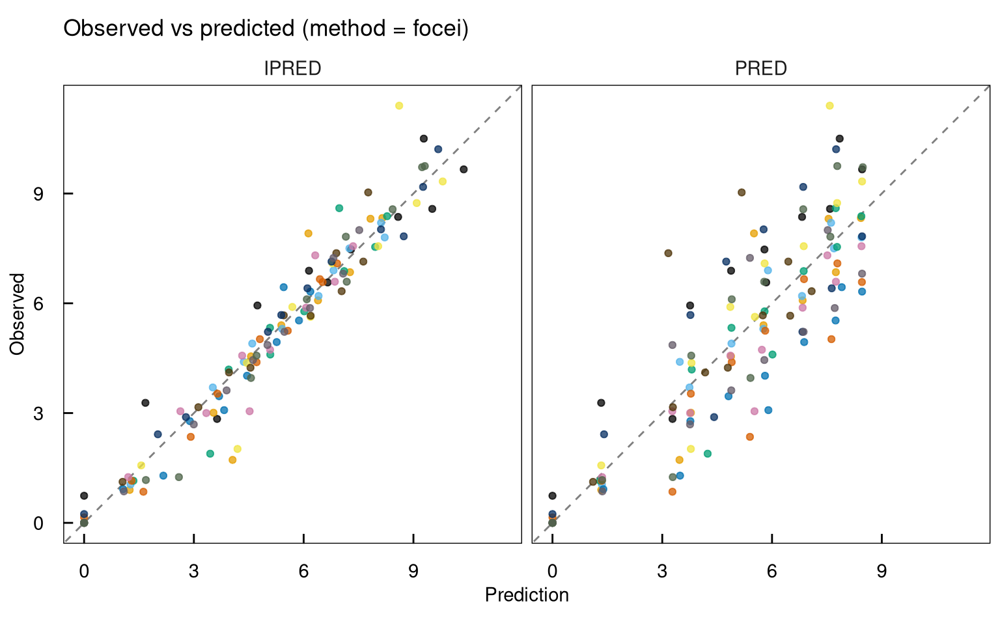

``` r
plotResiduals(theoFit, nsim = 500, seed = 1)
```


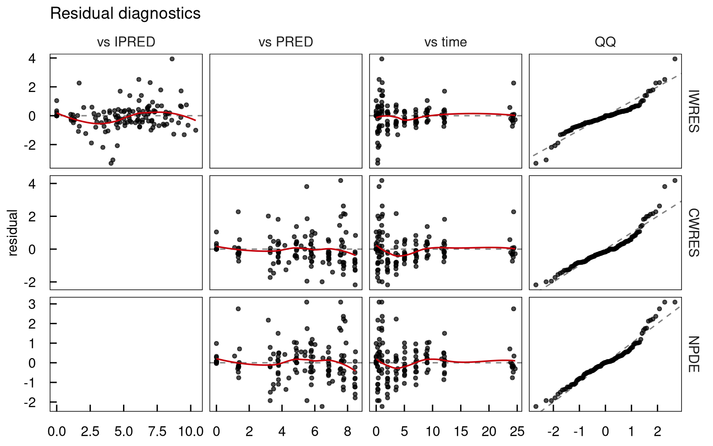

``` r
plotCombined(theoFit)
```


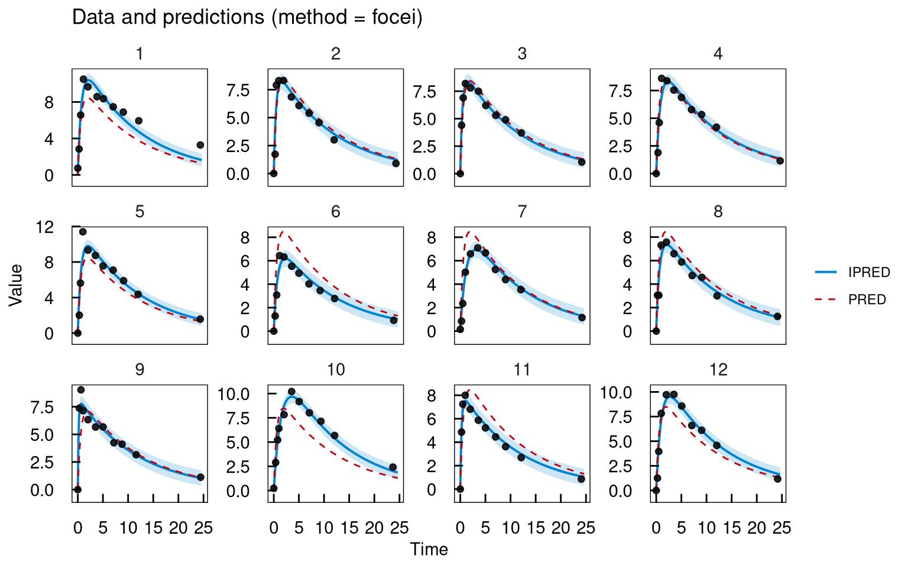

``` r
plotRandomEffects(theoFit)
```


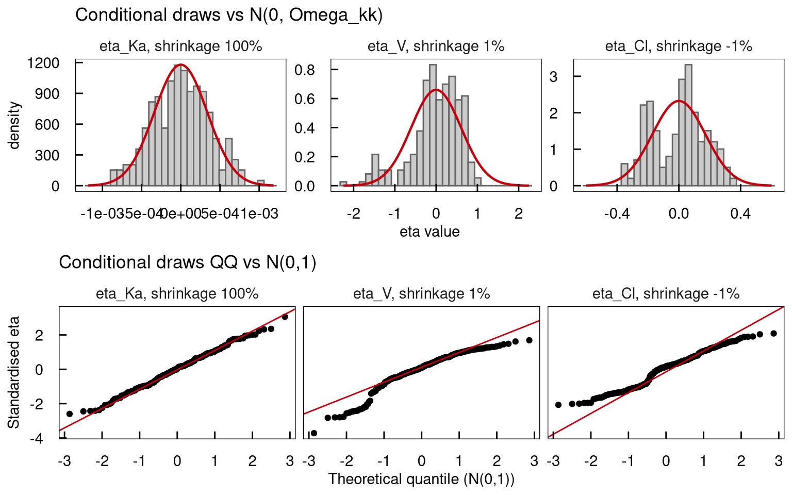

``` r
plotRandomEffects(theoFit, covariates = theoTable["weight"])
```


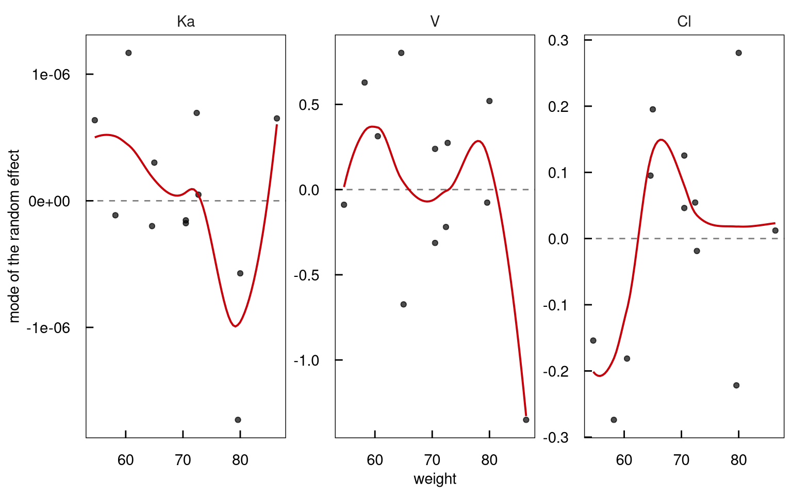

``` r
plotVPC(theoFit, nsim = 500, bins = 8, seed = 1)
```


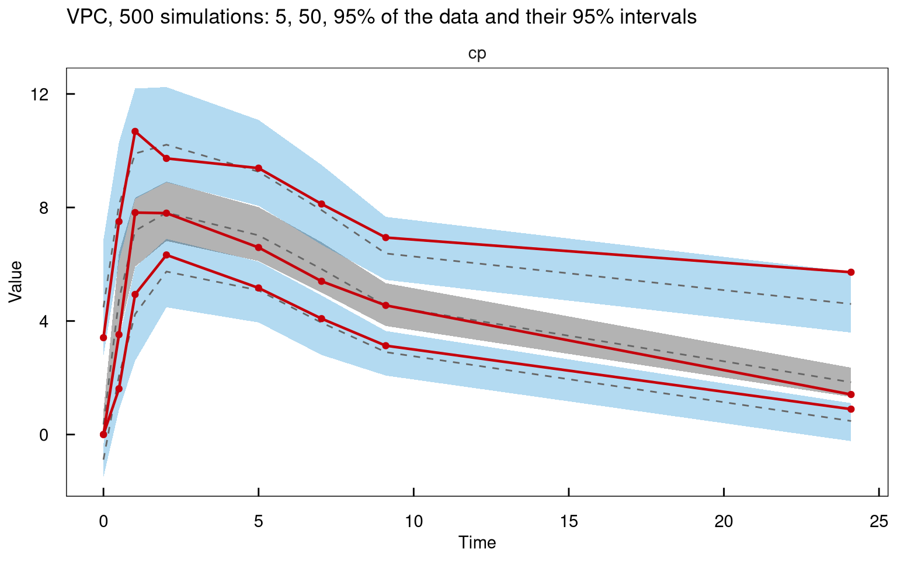

## Theophylline in nlmixr2

The same model on `nlmixr2data::theo_sd`, which doses Dose times Wt into the depot.

``` r
if (withNlmixr2) {
  theoUi <- nlmixr2est::nlmixr2(function() {
    ini({
      tka <- 0; tv <- 3; tcl <- 0.7
      eta.ka ~ 0.09; eta.v ~ 0.09; eta.cl ~ 0.09
      add.sd <- 0.5
    })
    model({
      ka <- exp(tka + eta.ka); v <- exp(tv + eta.v); cl <- exp(tcl + eta.cl)
      d/dt(depot) <- -ka * depot
      d/dt(center) <- ka * depot - cl / v * center
      cp <- center / v
      cp ~ add(add.sd)
    })
  })
  theoIni <- function(s) c(list(tka = s[["Ka"]], tv = s[["V"]], tcl = s[["Cl"]], add.sd = exp(s[["sigma"]])),
                           etaIni(c(eta.ka = "omega_Ka_Ka", eta.v = "omega_V_V", eta.cl = "omega_Cl_Cl"), s))
  theoFrom <- function(f) {
    th <- f$theta; om <- diag(f$omega); se <- setNames(f$parFixedDf$SE, rownames(f$parFixedDf))
    list(estimate = c(Ka = th[["tka"]], V = th[["tv"]], Cl = th[["tcl"]], sigma = log(th[["add.sd"]]),
                      omega_Ka_Ka = log(sqrt(om[["eta.ka"]])), omega_V_V = log(sqrt(om[["eta.v"]])),
                      omega_Cl_Cl = log(sqrt(om[["eta.cl"]]))),
         se = c(Ka = se[["tka"]], V = se[["tv"]], Cl = se[["tcl"]], sigma = se[["add.sd"]] / th[["add.sd"]]))
  }
  theoN <- cached("Theophylline nlmixr2",
                  list(focei = runNlmixr2(theoUi, nlmixr2data::theo_sd, theoStarts, "focei", theoIni),
                       saem = runNlmixr2(theoUi, nlmixr2data::theo_sd, theoStarts, "saem", theoIni)))
  compareAll(theoObj, theoRandom, theoStarts, theoRuns, theoN, theoFit, theoUi, nlmixr2data::theo_sd, theoIni, theoFrom,
             c(Ka = "eta.ka", V = "eta.v", Cl = "eta.cl"), function(g) g,
             list(dMod2 = function(d) paste(d$condition, signif(d$time, 6)),
                  nlmixr2 = function(d) paste(d$ID, signif(d$TIME, 6))), "Theophylline")
}
```

## Warfarin

32 subjects, one oral dose; the plasma concentration `cp` and the prothrombin complex activity
`pca`, whose synthesis the concentration inhibits (a turnover model with maximal inhibition 1).
Volume, clearance, baseline and turnover rate of the activity vary between subjects.

``` r
data(warfarin)
warfData <- as.datalist(warfarin, splitBy = "condition", keepCovariates = c("dose", "wt", "age", "sex"))
warfNet <- eqnlist() |>
  assignCompartment(Ag = "depot") |>
  assignCompartment(Cc = "central", volume = "V") |>
  assignCompartment(PCA = "effect") |>
  setCompartmentVolume(unit = "1") |>
  addReaction("Ag", "Cc", "Ka * Ag", "absorption") |>
  addReaction("Cc", "", "Cl * Cc", "elimination", rateCompartment = "unit") |>
  addReaction("", "PCA", "kout * pca0 * IC50 / (IC50 + Cc)", "synthesis") |>
  addReaction("PCA", "", "kout * PCA", "degradation")
warfNet
```

```
#> 
#> Compartments:
#>   depot (V=1)
#>   central (V=V)
#>   effect (V=1)
#>   unit (V=1)
#> States by compartment:
#>   central: Cc
#>   depot: Ag
#>   effect: PCA
#> 
#>   Check Educt -> Product                             Rate Description
#> 1          Ag ->      Cc                          Ka * Ag  absorption
#> 2          Cc ->                                  Cl * Cc elimination
#> 3             ->     PCA kout * pca0 * IC50 / (IC50 + Cc)   synthesis
#> 4         PCA ->                               kout * PCA degradation
```

``` r
warfX <- Xs(odemodel(warfNet, modelname = "pm_warf", compile = FALSE, deriv2 = TRUE, derivMode = dm))
warfG <- Y(c(cp = "Cc", pca = "PCA"), warfX, modelname = "pm_warf_g", compile = FALSE, deriv2 = TRUE,
           derivMode = dm)
# the error of cp combined from an absolute and a relative part, positive also where the solver
# leaves cp at or below 0
warfE <- Y(c(cp = "sqrt(sigma_cp_abs^2 + (sigma_cp_rel * cp)^2)", pca = "sigma_pca"), warfG,
           attachInput = FALSE, modelname = "pm_warf_e", compile = FALSE, deriv2 = TRUE, derivMode = dm)
warfTable <- attr(warfData, "condition.grid")
warfTable$ID <- rownames(warfTable)
warfTrafo <- branch(define(NULL, "x <- x", x = c("Ka", "V", "Cl", "IC50", "kout", "pca0", "Ag", "Cc", "PCA",
                                                  "sigma_cp_abs", "sigma_cp_rel", "sigma_pca")), table = warfTable)
warfTrafo <- insert(warfTrafo, "Ag <- d", d = dose)
warfTrafo <- insert(warfTrafo, "Cc <- 0")
warfTrafo <- insert(warfTrafo, "PCA <- pca0")
warfTrafo <- insert(warfTrafo, "x <- exp(x)", x = c("Ka", "V", "Cl", "IC50", "kout", "pca0", "sigma_cp_abs",
                                                    "sigma_cp_rel", "sigma_pca"))
warfTrafo <- insert(warfTrafo, V + Cl + pca0 + kout ~ 1 + (1 | ID))
warfP <- P(warfTrafo, method = "explicit", modelname = "pm_warf_p", compile = FALSE, deriv2 = TRUE, derivMode = dm)
compileSeconds["warfarin"] <- system.time(compile(warfX, warfG, warfE, warfP, output = "pm_warf_all"))[["elapsed"]]
warfObj <- normL2(warfData, warfG * warfX * warfP, errmodel = warfE)
warfRandom <- randomEffects(warfP)
warfStarts <- drawStarts(c(Ka = 0, V = 2, Cl = -2, IC50 = 0, kout = -3, pca0 = 4.6, sigma_cp_abs = log(0.1),
                           sigma_cp_rel = log(0.1),
                           sigma_pca = log(5), omega_V_V = log(0.3), omega_Cl_Cl = log(0.3),
                           omega_pca0_pca0 = log(0.3), omega_kout_kout = log(0.3)))
warfRuns <- cached("Warfarin dMod2", list(focei = runDMod2(warfObj, warfRandom, warfStarts, "focei"),
                                           saem = runDMod2(warfObj, warfRandom, warfStarts, "saem")))
warfFit <- cachedEm("Warfarin dMod2 focei best", warfObj, warfRandom,
                    warfStarts[which.min(warfRuns$focei$value), ], verbose = FALSE)
summary(warfFit)
```

```
#> EM summary (focei): -2 log L 2395.005082, converged TRUE, 35 iterations
#>   without the 2 pi constant of the data (NONMEM OBJ): 1514.661967
#> 
#> Parameters:
#>                 estimate      se   rsePct
#> Ka               -0.6692 0.09290  13.8800
#> V                 2.0220 0.05176   2.5600
#> Cl               -1.9890 0.05572   2.8010
#> IC50              0.1205 0.05134  42.5900
#> kout             -2.9880 0.02700   0.9038
#> pca0              4.5710 0.01228   0.2686
#> sigma_cp_abs      0.0654 0.13730 209.9000
#> sigma_cp_rel     -1.8420 0.13860   7.5220
#> sigma_pca         1.3730 0.08206   5.9750
#> omega_V_V        -1.4310 0.16520  11.5500
#> omega_Cl_Cl      -1.2590 0.13790  10.9500
#> omega_pca0_pca0  -2.8960 0.18790   6.4870
#> omega_kout_kout  -2.5120 0.33200  13.2200
#> 
#> Random effects:
#>  type eta1 eta2 estimate      se
#>    sd    V    V  0.23910 0.03951
#>    sd   Cl   Cl  0.28410 0.03916
#>    sd pca0 pca0  0.05524 0.01038
#>    sd kout kout  0.08113 0.02694
#> 
#> Shrinkage: eta_V = 0.136, eta_Cl = 0.034, eta_pca0 = 0.165, eta_kout = 0.360
```

## Diagnostics

``` r
plot(warfFit)
```


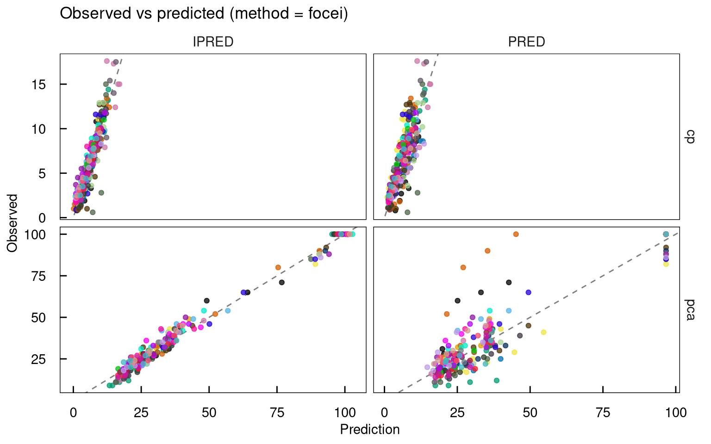

``` r
plotResiduals(warfFit, nsim = 500, seed = 1)
```


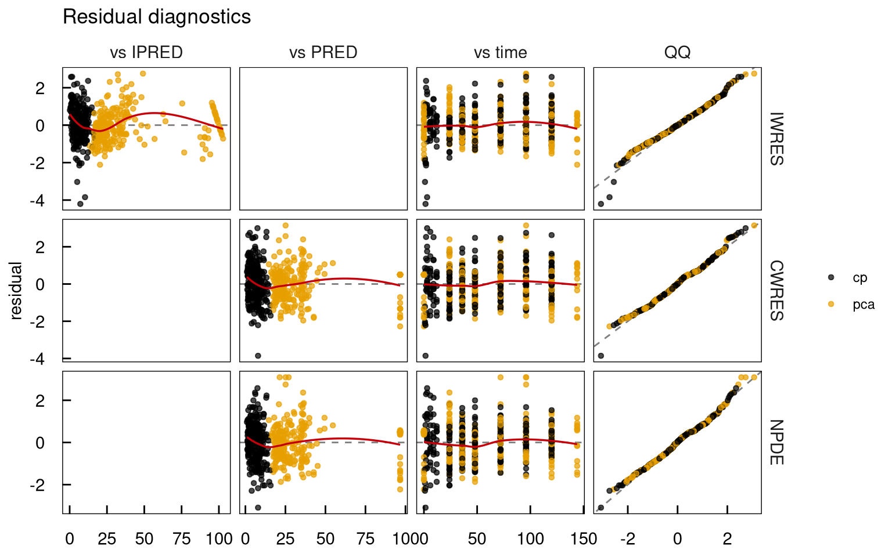

``` r
plotCombined(warfFit, conditionsPerPage = 8)[[1]]
```


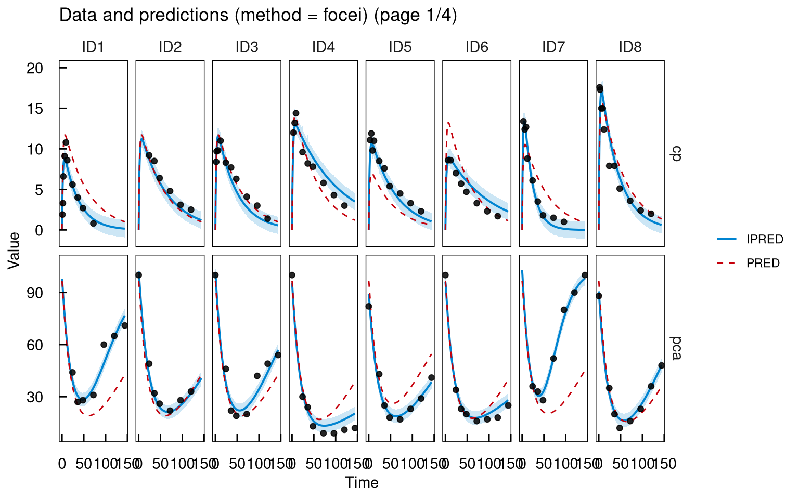

``` r
plotRandomEffects(warfFit)
```


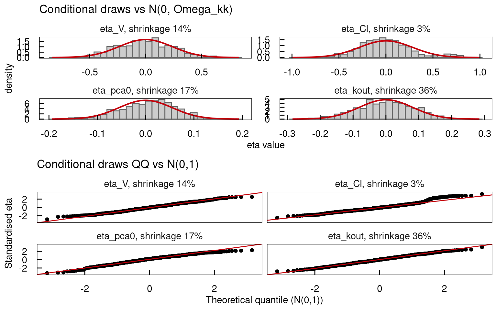

``` r
plotRandomEffects(warfFit, covariates = c("wt", "age", "sex"))
```


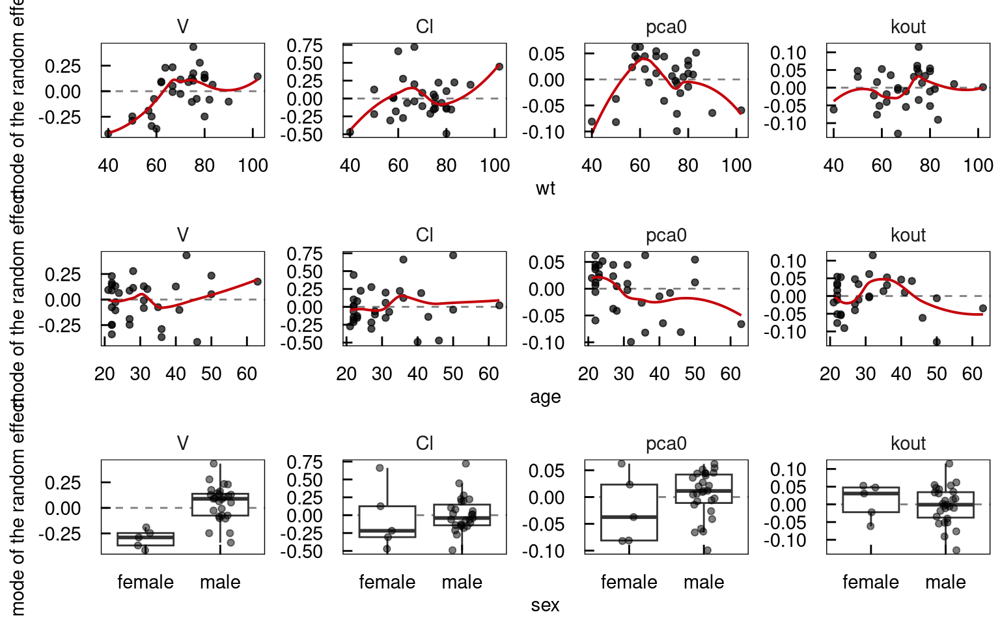

``` r
plotVPC(warfFit, nsim = 500, bins = 8, seed = 1)
```


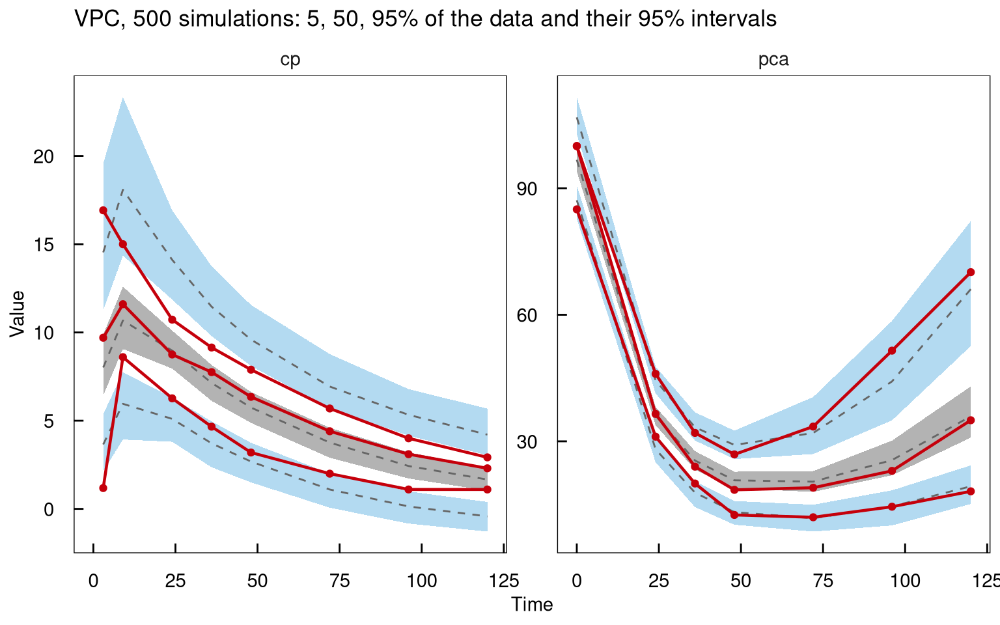

## Warfarin in nlmixr2

The SAEM fits of dMod2 run all 500 iterations and end unconverged: the expected increase of
-2 log L from the Monte Carlo error of the averaged estimate stays above `mcTol` (0.05).

``` r
if (withNlmixr2) {
  warfUi <- nlmixr2est::nlmixr2(function() {
    ini({
      tka <- 0; tv <- 2; tcl <- -2; tic50 <- 0; tkout <- -3; tpca0 <- 4.6
      eta.v ~ 0.09; eta.cl ~ 0.09; eta.pca0 ~ 0.09; eta.kout ~ 0.09
      add.cp <- 0.1; prop.cp <- 0.1; add.pca <- 5
    })
    model({
      ka <- exp(tka); v <- exp(tv + eta.v); cl <- exp(tcl + eta.cl); ic50 <- exp(tic50)
      kout <- exp(tkout + eta.kout); pca0 <- exp(tpca0 + eta.pca0)
      d/dt(depot) <- -ka * depot
      d/dt(center) <- ka * depot - cl / v * center
      eff(0) <- pca0
      d/dt(eff) <- kout * pca0 * ic50 / (ic50 + center / v) - kout * eff
      cp <- center / v
      pca <- eff
      cp ~ add(add.cp) + prop(prop.cp)
      pca ~ add(add.pca)
    })
  })
  warfN2 <- nlmixr2data::warfarin
  warfN2 <- warfN2[!(warfN2$evid == 0 & warfN2$dvid == "cp" & warfN2$dv == 0), ]
  warfIni <- function(s) c(list(tka = s[["Ka"]], tv = s[["V"]], tcl = s[["Cl"]], tic50 = s[["IC50"]],
                                tkout = s[["kout"]], tpca0 = s[["pca0"]], add.cp = exp(s[["sigma_cp_abs"]]),
                                prop.cp = exp(s[["sigma_cp_rel"]]),
                                add.pca = exp(s[["sigma_pca"]])),
                           etaIni(c(eta.v = "omega_V_V", eta.cl = "omega_Cl_Cl", eta.pca0 = "omega_pca0_pca0",
                                    eta.kout = "omega_kout_kout"), s))
  warfFrom <- function(f) {
    th <- f$theta; om <- diag(f$omega); se <- setNames(f$parFixedDf$SE, rownames(f$parFixedDf))
    list(estimate = c(Ka = th[["tka"]], V = th[["tv"]], Cl = th[["tcl"]], IC50 = th[["tic50"]], kout = th[["tkout"]],
                      pca0 = th[["tpca0"]], sigma_cp_abs = log(th[["add.cp"]]),
                      sigma_cp_rel = log(th[["prop.cp"]]), sigma_pca = log(th[["add.pca"]]),
                      omega_V_V = log(sqrt(om[["eta.v"]])), omega_Cl_Cl = log(sqrt(om[["eta.cl"]])),
                      omega_pca0_pca0 = log(sqrt(om[["eta.pca0"]])), omega_kout_kout = log(sqrt(om[["eta.kout"]]))),
         se = c(Ka = se[["tka"]], V = se[["tv"]], Cl = se[["tcl"]], IC50 = se[["tic50"]], kout = se[["tkout"]],
                pca0 = se[["tpca0"]], sigma_cp_abs = se[["add.cp"]] / th[["add.cp"]],
                sigma_cp_rel = se[["prop.cp"]] / th[["prop.cp"]],
                sigma_pca = se[["add.pca"]] / th[["add.pca"]]))
  }
  warfN <- cached("Warfarin nlmixr2", list(focei = runNlmixr2(warfUi, warfN2, warfStarts, "focei", warfIni),
                                           saem = runNlmixr2(warfUi, warfN2, warfStarts, "saem", warfIni)))
  compareAll(warfObj, warfRandom, warfStarts, warfRuns, warfN, warfFit, warfUi, warfN2, warfIni, warfFrom,
             c(V = "eta.v", Cl = "eta.cl", pca0 = "eta.pca0", kout = "eta.kout"), function(g) sub("^ID", "", g),
             list(dMod2 = function(d) paste(sub("^ID", "", d$condition), signif(d$time, 6), d$name),
                  nlmixr2 = function(d) paste(d$ID, signif(d$TIME, 6), d$CMT)), "Warfarin")
}
```

## Mavoglurant

120 subjects, an infusion of 10 min (20 min in one occasion) as a time switch, 78 subjects on two
occasions. Two compartments; clearances scale with weight to the power 0.75, volumes with weight.
Clearance, the central and peripheral volume and the intercompartmental clearance vary between
subjects, the clearance also between the occasions of a subject, `(1 | ID:OCC)`. SAEM fits the
model without the variability between occasions.

``` r
data(mavoglurant)
mavoData <- as.datalist(mavoglurant, splitBy = "condition",
                        keepCovariates = c("ID", "OCC", "dose", "duration", "AGE", "SEX", "WT", "HT"))
mavoNet <- eqnlist() |>
  assignCompartment(C1 = "central", volume = "V1") |>
  assignCompartment(C2 = "peripheral", volume = "V2") |>
  setCompartmentVolume(unit = "1") |>
  addReaction("", "C1", "piecewise(dose / duration, time < duration, 0)", "infusion", rateCompartment = "unit") |>
  addReaction("C1", "", "CL * C1", "elimination", rateCompartment = "unit") |>
  addReaction("C1", "C2", "Q * C1", "distribution", rateCompartment = "unit") |>
  addReaction("C2", "C1", "Q * C2", "redistribution", rateCompartment = "unit")
mavoNet
```

```
#> 
#> Compartments:
#>   central (V=V1)
#>   peripheral (V=V2)
#>   unit (V=1)
#> States by compartment:
#>   central: C1
#>   peripheral: C2
#> 
#>   Check Educt -> Product                                           Rate
#> 1             ->      C1 piecewise(dose / duration, time < duration, 0)
#> 2          C1 ->                                                CL * C1
#> 3          C1 ->      C2                                         Q * C1
#> 4          C2 ->      C1                                         Q * C2
#>      Description
#> 1       infusion
#> 2    elimination
#> 3   distribution
#> 4 redistribution
```

``` r
# solver tolerances 1e-10: at the defaults the solver error, absolute in mg/L, moves -2 log L by
# about 1e-3, more than the fit resolves
mavoX <- Xs(odemodel(mavoNet, modelname = "pm_mavo", compile = FALSE, deriv2 = TRUE, derivMode = dm),
            options = list(atol = 1e-10, rtol = 1e-10))
# the dose in mg, the concentration in ng/mL
mavoG <- Y(c(cp = "1000 * C1"), mavoX, modelname = "pm_mavo_g", compile = FALSE, deriv2 = TRUE, derivMode = dm)
mavoE <- Y(c(cp = "sqrt(sigma_abs^2 + (sigma_rel * cp)^2)"), mavoG, attachInput = FALSE, modelname = "pm_mavo_e",
           compile = FALSE, deriv2 = TRUE, derivMode = dm)
mavoTable <- attr(mavoData, "condition.grid")
mavoTable$ID <- as.character(mavoTable$ID)
mavoTrafo <- function(between) {
  tr <- branch(define(NULL, "x <- x", x = c("CL", "V1", "Q", "V2", "C1", "C2", "dose", "duration", "sigma_abs",
                                                "sigma_rel")),
               table = mavoTable)
  tr <- insert(tr, "dose <- d", d = dose)
  tr <- insert(tr, "duration <- u", u = duration)
  tr <- insert(tr, "x <- 0", x = c("C1", "C2"))
  tr <- insert(tr, "x <- x * (w / 70)^0.75", x = c("CL", "Q"), w = WT)
  tr <- insert(tr, "x <- x * w / 70", x = c("V1", "V2"), w = WT)
  tr <- insert(tr, "x <- exp(x)", x = c("CL", "V1", "Q", "V2", "sigma_abs", "sigma_rel"))
  if (between) tr <- insert(tr, CL ~ 1 + (1 | ID) + (1 | ID:OCC)) else tr <- insert(tr, CL ~ 1 + (1 | ID))
  insert(tr, V1 + Q + V2 ~ 1 + (1 | ID))
}
mavoP <- P(mavoTrafo(TRUE), method = "explicit", modelname = "pm_mavo_p", compile = FALSE, deriv2 = TRUE,
           derivMode = dm)
mavoP1 <- P(mavoTrafo(FALSE), method = "explicit", modelname = "pm_mavo_p1", compile = FALSE, deriv2 = TRUE,
            derivMode = dm)
compileSeconds["mavoglurant"] <- system.time(compile(mavoX, mavoG, mavoE, mavoP, mavoP1,
                                                     output = "pm_mavo_all"))[["elapsed"]]
mavoObj <- normL2(mavoData, mavoG * mavoX * mavoP, errmodel = mavoE)
mavoObj1 <- normL2(mavoData, mavoG * mavoX * mavoP1, errmodel = mavoE)
mavoRandom <- randomEffects(mavoP)
mavoRandom1 <- randomEffects(mavoP1)
mavoRandom
```

```
#> Random effects: 5 terms over ID, ID:OCC
#>   block 1 (normal, ID): eta_CL
#>   block 2 (normal, ID:OCC): eta_CL_ID_OCC
#>   block 3 (normal, ID): eta_V1
#>   block 4 (normal, ID): eta_Q
#>   block 5 (normal, ID): eta_V2
#>   fixed effects: CL, V1, Q, V2
```

``` r
mavoInit <- c(CL = log(30), V1 = log(40), Q = log(30), V2 = log(150), sigma_abs = log(1), sigma_rel = log(0.2),
              omega_CL_CL = log(0.3),
              omega_V1_V1 = log(0.3), omega_Q_Q = log(0.3), omega_V2_V2 = log(0.3))
mavoStarts <- drawStarts(c(mavoInit, omega_CL_ID_OCC_CL_ID_OCC = log(0.15)))
mavoStarts1 <- mavoStarts[, names(mavoInit)]
mavoRuns <- cached("Mavoglurant dMod2", list(focei = runDMod2(mavoObj, mavoRandom, mavoStarts, "focei"),
                                              saem = runDMod2(mavoObj1, mavoRandom1, mavoStarts1, "saem")))
mavoFit <- cachedEm("Mavoglurant dMod2 focei best", mavoObj, mavoRandom,
                    mavoStarts[which.min(mavoRuns$focei$value), ], verbose = FALSE)
summary(mavoFit)
```

```
#> EM summary (focei): -2 log L 21597.788355, converged TRUE, 19 iterations
#>   without the 2 pi constant of the data (NONMEM OBJ): 17137.260715
#> 
#> Parameters:
#>                           estimate      se  rsePct
#> CL                          3.2250 0.02605  0.8079
#> V1                          3.9180 0.02413  0.6160
#> Q                           3.2400 0.03597  1.1100
#> V2                          4.8200 0.03528  0.7319
#> sigma_abs                  -0.4331 0.22240 51.3500
#> sigma_rel                  -1.8050 0.01801  0.9981
#> omega_CL_CL                -1.2880 0.06939  5.3870
#> omega_V1_V1                -1.3920 0.07309  5.2500
#> omega_Q_Q                  -1.0140 0.07654  7.5510
#> omega_V2_V2                -1.0130 0.07194  7.1000
#> omega_CL_ID_OCC_CL_ID_OCC  -2.7500 0.12670  4.6060
#> 
#> Random effects:
#>  grouping type      eta1      eta2 estimate      se
#>        ID   sd        CL        CL  0.27580 0.01914
#>        ID   sd        V1        V1  0.24850 0.01816
#>        ID   sd         Q         Q  0.36290 0.02778
#>        ID   sd        V2        V2  0.36300 0.02612
#>    ID:OCC   sd CL_ID_OCC CL_ID_OCC  0.06395 0.00810
#> 
#> Shrinkage: ID: eta_CL = 0.029, ID: eta_V1 = 0.051, ID: eta_Q = 0.066, ID: eta_V2 = 0.045, ID:OCC: eta_CL_ID_OCC = 0.470
```

``` r
compileSeconds
```

```
#> theophylline     warfarin  mavoglurant 
#>        0.250        0.307        1.105
```

## Diagnostics

``` r
plot(mavoFit)
```


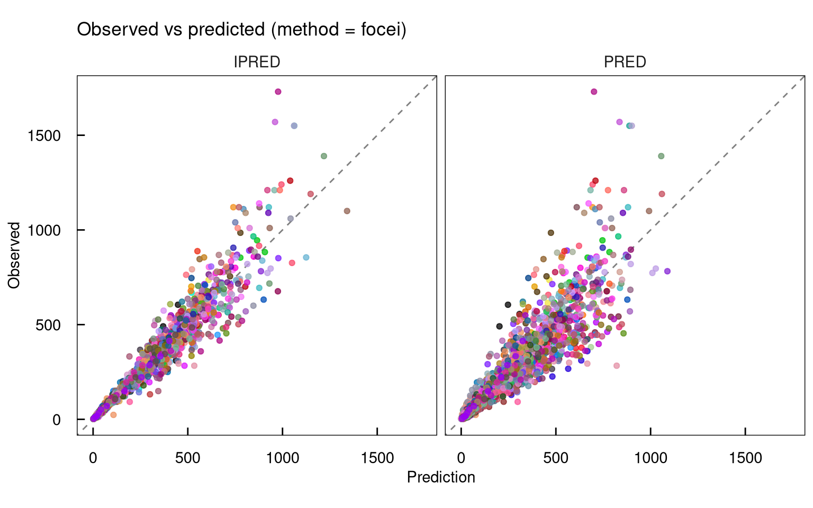

``` r
plotResiduals(mavoFit, nsim = 200, seed = 1)
```


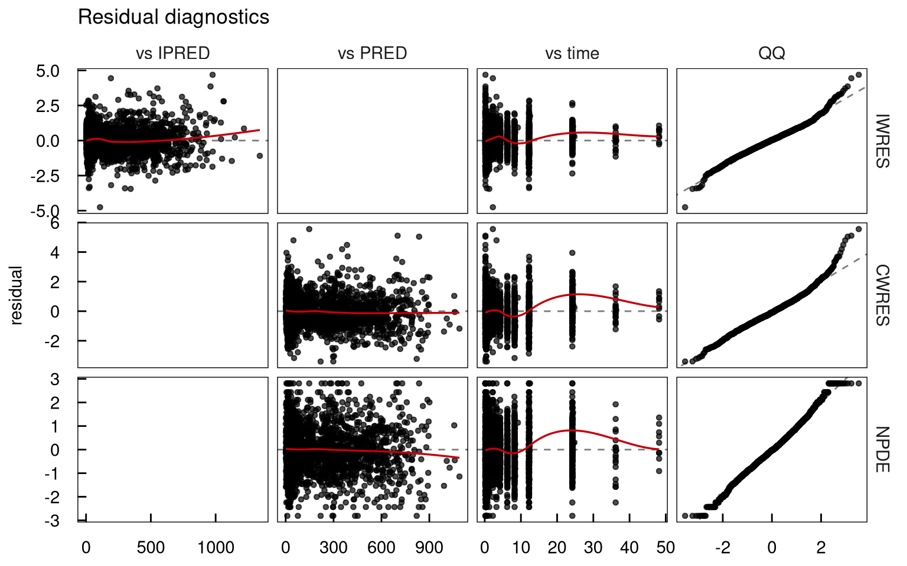

``` r
plotCombined(mavoFit, conditionsPerPage = 12)[[1]]
```


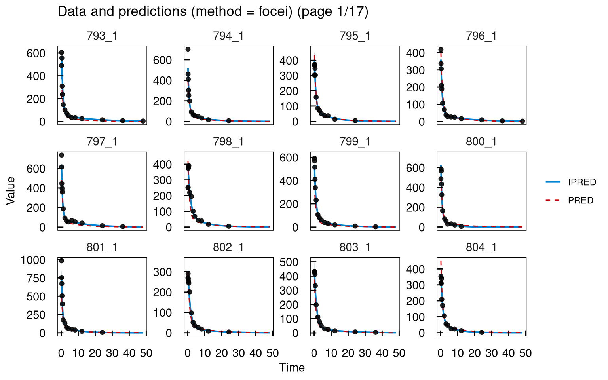

``` r
plotRandomEffects(mavoFit)
```


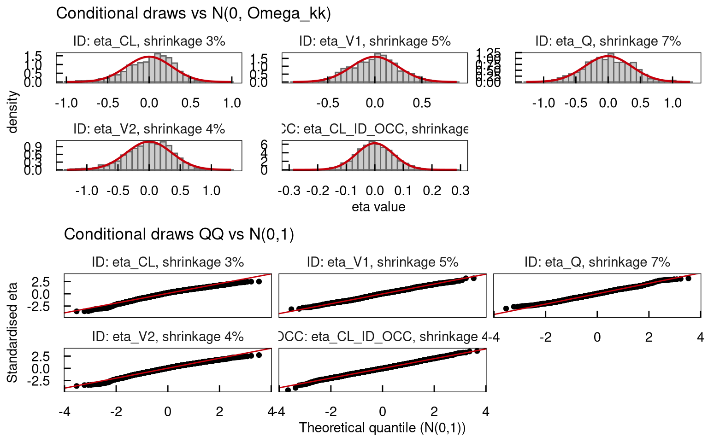

``` r
plotRandomEffects(mavoFit, covariates = c("WT", "AGE", "SEX", "HT"))
```


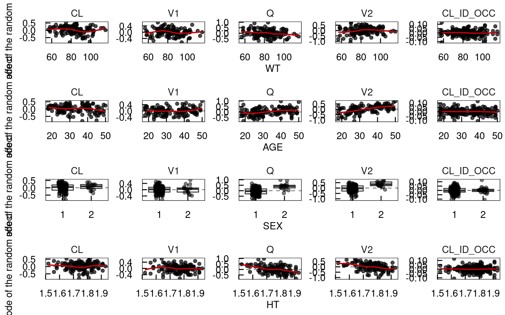

``` r
plotVPC(mavoFit, nsim = 200, bins = 8, pc = TRUE, strata = "dose", seed = 1)
```


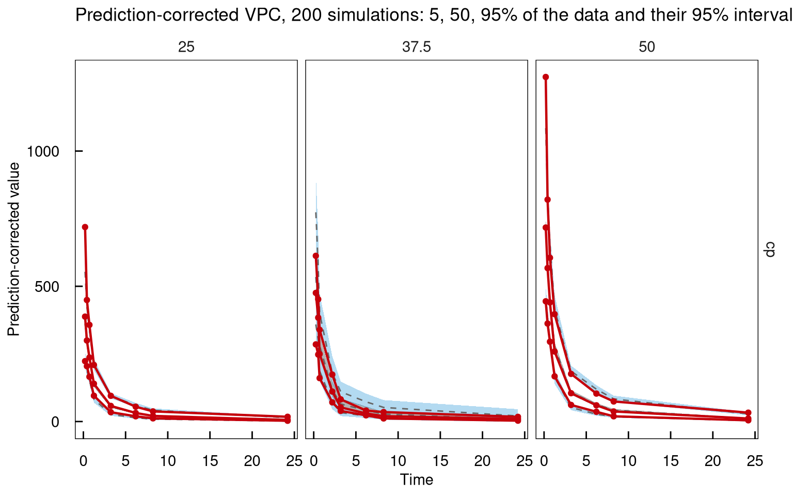

## Mavoglurant in nlmixr2

nlmixr2 takes the occasions of a subject on one time axis, the second occasion 1000 h after the
first and its dose a reset of the compartments (EVID 4), and the variability between occasions
as `iov.cl ~ ... | occ`.

``` r
if (withNlmixr2) {
  mavoUi <- nlmixr2est::nlmixr2(function() {
    ini({
      tcl <- log(30); tv1 <- log(40); tq <- log(30); tv2 <- log(150)
      eta.cl ~ 0.09; eta.v1 ~ 0.09; eta.q ~ 0.09; eta.v2 ~ 0.09
      iov.cl ~ 0.0225 | occ
      add.sd <- 1; prop.sd <- 0.2
    })
    model({
      cl <- exp(tcl + eta.cl + iov.cl) * (WT / 70)^0.75
      v1 <- exp(tv1 + eta.v1) * WT / 70
      q <- exp(tq + eta.q) * (WT / 70)^0.75
      v2 <- exp(tv2 + eta.v2) * WT / 70
      d/dt(central) <- -cl / v1 * central - q / v1 * central + q / v2 * peripheral
      d/dt(peripheral) <- q / v1 * central - q / v2 * peripheral
      cp <- 1000 * central / v1
      cp ~ add(add.sd) + prop(prop.sd)
    })
  })
  # the same without the variability between occasions, for SAEM
  mavoUi1 <- nlmixr2est::nlmixr2(function() {
    ini({
      tcl <- log(30); tv1 <- log(40); tq <- log(30); tv2 <- log(150)
      eta.cl ~ 0.09; eta.v1 ~ 0.09; eta.q ~ 0.09; eta.v2 ~ 0.09
      add.sd <- 1; prop.sd <- 0.2
    })
    model({
      cl <- exp(tcl + eta.cl) * (WT / 70)^0.75
      v1 <- exp(tv1 + eta.v1) * WT / 70
      q <- exp(tq + eta.q) * (WT / 70)^0.75
      v2 <- exp(tv2 + eta.v2) * WT / 70
      d/dt(central) <- -cl / v1 * central - q / v1 * central + q / v2 * peripheral
      d/dt(peripheral) <- q / v1 * central - q / v2 * peripheral
      cp <- 1000 * central / v1
      cp ~ add(add.sd) + prop(prop.sd)
    })
  })
  mavoN2 <- local({
    m <- nlmixr2data::mavoglurant
    m <- m[!(m$EVID == 0 & m$MDV == 1), ]
    data.frame(ID = m$ID, TIME = m$TIME + 1000 * (m$OCC - 1), AMT = m$AMT, RATE = m$RATE,
               EVID = ifelse(m$EVID == 1 & m$OCC == 2, 4L, m$EVID), DV = m$DV, CMT = "central", occ = m$OCC, WT = m$WT)
  })
  mavoIni <- function(between) function(s)
    c(list(tcl = s[["CL"]], tv1 = s[["V1"]], tq = s[["Q"]], tv2 = s[["V2"]], add.sd = exp(s[["sigma_abs"]]),
           prop.sd = exp(s[["sigma_rel"]])),
      etaIni(c(eta.cl = "omega_CL_CL", eta.v1 = "omega_V1_V1", eta.q = "omega_Q_Q", eta.v2 = "omega_V2_V2",
               if (between) c(iov.cl = "omega_CL_ID_OCC_CL_ID_OCC")), s))
  mavoFrom <- function(f) {
    th <- f$theta; se <- setNames(f$parFixedDf$SE, rownames(f$parFixedDf))
    # one matrix per level with occasions
    om <- if (is.list(f$omega)) unlist(lapply(unname(f$omega), diag)) else diag(f$omega)
    est <- c(CL = th[["tcl"]], V1 = th[["tv1"]], Q = th[["tq"]], V2 = th[["tv2"]], sigma_abs = log(th[["add.sd"]]),
             sigma_rel = log(th[["prop.sd"]]),
             omega_CL_CL = log(sqrt(om[["eta.cl"]])), omega_V1_V1 = log(sqrt(om[["eta.v1"]])),
             omega_Q_Q = log(sqrt(om[["eta.q"]])), omega_V2_V2 = log(sqrt(om[["eta.v2"]])))
    if (!is.na(om["iov.cl"])) est["omega_CL_ID_OCC_CL_ID_OCC"] <- log(sqrt(om[["iov.cl"]]))
    list(estimate = est, se = c(CL = se[["tcl"]], V1 = se[["tv1"]], Q = se[["tq"]], V2 = se[["tv2"]],
                                sigma_abs = se[["add.sd"]] / th[["add.sd"]],
                                sigma_rel = se[["prop.sd"]] / th[["prop.sd"]]))
  }
  mavoN <- cached("Mavoglurant nlmixr2",
                  list(focei = runNlmixr2(mavoUi, mavoN2, mavoStarts, "focei", mavoIni(TRUE)),
                       saem = runNlmixr2(mavoUi1, mavoN2, mavoStarts1, "saem", mavoIni(FALSE))))
  compareAll(mavoObj, mavoRandom, mavoStarts, mavoRuns, mavoN, mavoFit, mavoUi, mavoN2, mavoIni(TRUE), mavoFrom,
             c(CL = "eta.cl", V1 = "eta.v1", Q = "eta.q", V2 = "eta.v2"), function(g) g,
             list(dMod2 = function(d) paste(sub("_.*", "", d$condition), sub(".*_", "", d$condition), signif(d$time, 6)),
                  nlmixr2 = function(d) paste(d$ID, 1 + (d$TIME >= 1000), signif(d$TIME %% 1000, 6))), "Mavoglurant",
             saem = list(obj = mavoObj1, random = mavoRandom1, starts = mavoStarts1, ui = mavoUi1, toIni = mavoIni(FALSE)))
}
```
